Hola. Entrego el artefacto de levantamiento del dominio de Integración, VACÍO, conforme al metamodelo vigente (conocimiento 05, secciones 2.2 a 2.5). No registré ningún dato del caso. Tomé las convenciones de formato de Villalobos (BAC-14, ejemplo del plano del apartamento: una hoja por concepto concreto, con los atributos heredados repetidos). Las decisiones que dependen de ti están marcadas en las partes 3 y 4.

# 1. Propósito del artefacto y conceptos que cubre

**Propósito.** Plantilla de levantamiento (punto de vista PV-INT-1, edición, BAC-14) para que las áreas registren, con fuente, qué información de estado del pedido viaja entre quién, por qué mecanismo, con qué oportunidad y dónde se reportan problemas. Incluye la plantilla del mapa de integración en Mermaid con ELK (punto de vista PV-INT-2, consulta, BAC-13). Altura: el intercambio; no baja a campos de mensaje ni a protocolos.

**Conceptos cubiertos.** Se cubren los 11 conceptos del metamodelo:

| Concepto | Cómo queda en el formato |
|---|---|
| RutaExpress (raíz) | No tiene atributos y solo tiene relaciones múltiples. Sin hoja propia. Solo se materializan `marketplaces` y `aliados` (hojas puente), porque llevan información. Ver brecha B5. |
| Extremo (abstracto) | Sin hoja propia. Sus atributos `id` y `nombre` se repiten en Sistema, ParticipanteExterno y Area. Ver brecha B4. |
| Sistema, ParticipanteExterno, Area | Una hoja cada uno. |
| Intercambio, GrupoInformacion, EstadoPedido, ModalidadEntrega, Problema, Fuente | Una hoja cada uno. |

**Reglas de construcción aplicadas (F1).**
- Una hoja por concepto concreto.
- Una columna por atributo y por relación 1 o 0..1, como llave.
- Una hoja puente por cada relación múltiple (*), con excepción de las agrupaciones desde la raíz (ver B5).
- Una hoja `Catalogos` con las enumeraciones y una hoja de control `POR_LEVANTAR` (PV-INT-1).
- Una columna `Fuente` en cada fila, con las excepciones justificadas en la nota de la sección 2.1.

**Nombres de archivo propuestos para el repositorio `arquitectura-rutaexpress`** (carpeta por etapa del proceso; el líder confirma):
- `03_sistemas_datos_integraciones/integracion/formato_levantamiento_integracion.xlsx` (libro con las 23 hojas de la sección 2.1).
- `03_sistemas_datos_integraciones/integracion/csv/<nombre_de_hoja>.csv` (un CSV por hoja, con el mismo nombre de hoja).
- `03_sistemas_datos_integraciones/integracion/mapa_integracion_plantilla.mmd`.

# 2. El artefacto

## 2.1 Formato Excel / CSV (PV-INT-1)

**Convenciones del libro**
- Los encabezados son iguales a los nombres del metamodelo (conceptos, atributos y roles).
- Cada hoja se entrega con solo la fila de encabezados. A continuación se muestran con una fila vacía para que se vean.
- Las llaves entre hojas son valores de `id`. En `EstadoPedido` y `ModalidadEntrega` la llave es `nombre`, porque el metamodelo no les da `id` (brecha B3).
- Una columna cuyo encabezado es un rol (por ejemplo `origen`, `responsable`, `transporta`) contiene la llave del concepto destino.
- Una celda sin dato en ninguna fuente se escribe `POR LEVANTAR` (R6). No se infiere ni se deja vacía en un formato devuelto por un área. En los enumerados el valor es `POR_LEVANTAR`.
- El valor `POR LEVANTAR` se admite también en columnas EInt, EBoolean y EDate. En ese caso se registra además una fila en la hoja `POR_LEVANTAR`.
- La columna `Fuente` lleva `<Fuente.id>: documento y sección, o texto literal del enunciado`. Varias fuentes se separan con `;`. No es un atributo del metamodelo (brecha B1). Va en todas las hojas de concepto y puente, excepto en `Fuente` (el propio registro es la fuente) y en `Intercambio_fuentes` y `Problema_fuentes` (esas hojas ya son el vínculo a la fuente).
- Los ids de Sistema, ParticipanteExterno y Area deben ser únicos entre las tres hojas (heredan de Extremo). `origen` y `destino` se resuelven buscando el id en esas tres hojas.
- Validación de datos sugerida en Excel: las columnas de enumerados toman su lista de la hoja `Catalogos`. Las columnas de llave toman su lista de la columna `id` (o `nombre`) de la hoja destino.

### Hojas de concepto

**Hoja `Sistema`**

| id | nombre | funcion | tecnologia | responsable | Fuente |
|---|---|---|---|---|---|
| | | | | | |

**Hoja `ParticipanteExterno`**

| id | nombre | pais | Fuente |
|---|---|---|---|
| | | | |

**Hoja `Area`**

| id | nombre | lider | Fuente |
|---|---|---|---|
| | | | |

**Hoja `Intercambio`**

| id | nombre | mecanismo | oportunidad | latenciaObservada | transformaFormato | volumenDiario | origen | destino | Fuente |
|---|---|---|---|---|---|---|---|---|---|
| | | | | | | | | | |

**Hoja `GrupoInformacion`**

| id | nombre | descripcion | productor | Fuente |
|---|---|---|---|---|
| | | | | |

**Hoja `EstadoPedido`**

| nombre | descripcion | Fuente |
|---|---|---|
| | | |

**Hoja `ModalidadEntrega`**

| nombre | Fuente |
|---|---|
| | |

**Hoja `Problema`**

| id | descripcion | efecto | Fuente |
|---|---|---|---|
| | | | |

**Hoja `Fuente`**

| id | nombre | tipo | fecha |
|---|---|---|---|
| | | | |

### Hojas puente (una por relación múltiple)

**Hoja `RutaExpress_marketplaces`** (rol `marketplaces` → ParticipanteExterno)

| marketplaces | Fuente |
|---|---|
| | |

**Hoja `RutaExpress_aliados`** (rol `aliados` → ParticipanteExterno)

| aliados | Fuente |
|---|---|
| | |

**Hoja `Intercambio_transporta`** (→ GrupoInformacion)

| Intercambio | transporta | Fuente |
|---|---|---|
| | | |

**Hoja `Intercambio_estadosReportados`** (→ EstadoPedido)

| Intercambio | estadosReportados | Fuente |
|---|---|---|
| | | |

**Hoja `Intercambio_modalidades`** (→ ModalidadEntrega)

| Intercambio | modalidades | Fuente |
|---|---|---|
| | | |

**Hoja `Intercambio_problemas`** (→ Problema)

| Intercambio | problemas | Fuente |
|---|---|---|
| | | |

**Hoja `Intercambio_fuentes`** (→ Fuente)

| Intercambio | fuentes |
|---|---|
| | |

**Hoja `Problema_reportadoPor`** (→ Area)

| Problema | reportadoPor | Fuente |
|---|---|---|
| | | |

**Hoja `Problema_afectados`** (→ Sistema)

| Problema | afectados | Fuente |
|---|---|---|
| | | |

**Hoja `Problema_fuentes`** (→ Fuente)

| Problema | fuentes |
|---|---|
| | |

**Hoja `EstadoPedido_siguientes`** (→ EstadoPedido, incluidos los reingresos)

| EstadoPedido | siguientes | Fuente |
|---|---|---|
| | | |

### Hoja de catálogos

**Hoja `Catalogos`** (valores exactos de las enumeraciones del metamodelo; lista cerrada)

| Enumeracion | Valor |
|---|---|
| Mecanismo | INTEGRACION_SISTEMA |
| Mecanismo | CONECTOR_TERCEROS |
| Mecanismo | CORREO_ELECTRONICO |
| Mecanismo | CONSULTA_MANUAL |
| Mecanismo | POR_LEVANTAR |
| Oportunidad | TIEMPO_REAL |
| Oportunidad | DIFERIDA |
| Oportunidad | POR_LEVANTAR |
| TipoFuente | ENUNCIADO_CASO |
| TipoFuente | DOCUMENTO |
| TipoFuente | ENTREVISTA |
| TipoFuente | REGISTRO_SISTEMA |
| EBoolean (`transformaFormato`) | VERDADERO |
| EBoolean (`transformaFormato`) | FALSO |
| EBoolean (`transformaFormato`) | POR LEVANTAR |

### Hoja de control

**Hoja `POR_LEVANTAR`** (PV-INT-1; una fila por cada dato que quedó como POR LEVANTAR en cualquier hoja)

| Hoja | Llave de la fila | Atributo o relación | Pregunta de levantamiento | Dirigida a | Estado | Fecha |
|---|---|---|---|---|---|---|
| | | | | | | |

`Dirigida a` lleva `Area.id` o el cargo del `lider` del área. `Estado` toma los valores `ABIERTA` o `CERRADA` (valores propios de esta hoja de control; no son parte del metamodelo).

### Hoja `00_GUIA` (cómo se llena cada hoja y cada campo, BAC-14)

Todo campo lleva un dato con su fuente o `POR LEVANTAR`. Cardinalidad `1` es obligatoria, `0..1` es opcional y `*` es múltiple.

| Hoja | Campo | Tipo o destino | Card. | Cómo se llena |
|---|---|---|---|---|
| Sistema | id | EString | 1 | Identificador único (entre Sistema, ParticipanteExterno y Area). Es la llave. |
| Sistema | nombre | EString | 1 | Nombre usado en la empresa. |
| Sistema | funcion | EString | 1 | Qué hace el sistema en el flujo del pedido, según la fuente. |
| Sistema | tecnologia | EString | 1 | Plataforma o tecnología solo si una fuente la menciona; si no, `POR LEVANTAR`. |
| Sistema | responsable | llave de Area.id | 0..1 | Área dueña del sistema. |
| ParticipanteExterno | id | EString | 1 | Identificador único (entre Sistema, ParticipanteExterno y Area). Es la llave. |
| ParticipanteExterno | nombre | EString | 1 | Nombre usado en la empresa. |
| ParticipanteExterno | pais | EString | 1 | País donde opera con RutaExpress. Si es marketplace o aliado se registra en `RutaExpress_marketplaces` o `RutaExpress_aliados`, no aquí. |
| Area | id | EString | 1 | Identificador único (entre Sistema, ParticipanteExterno y Area). Es la llave. |
| Area | nombre | EString | 1 | Nombre del equipo interno. |
| Area | lider | EString | 1 | Persona o cargo líder; es el interlocutor para el levantamiento. |
| Intercambio | id | EString | 1 | Identificador con formato `INT-nn`. Es la llave. |
| Intercambio | nombre | EString | 1 | Nombre corto. |
| Intercambio | mecanismo | enum Mecanismo | 1 | Cómo viaja la información. Valor de `Catalogos`. |
| Intercambio | oportunidad | enum Oportunidad | 1 | Si llega en tiempo real o diferida. Valor de `Catalogos`. Ver R3. |
| Intercambio | latenciaObservada | EString | 1 | Retraso observado, en texto, citando su fuente. No se estima. |
| Intercambio | transformaFormato | EBoolean | 1 | Si el intercambio traduce el formato entre origen y destino. |
| Intercambio | volumenDiario | EInt | 1 | Cantidad de mensajes o pedidos al día, solo si una fuente la da. |
| Intercambio | origen | llave de Extremo (id) | 1 | Extremo desde el que sale el flujo. Debe ser distinto de `destino` (R1). |
| Intercambio | destino | llave de Extremo (id) | 1 | Extremo al que llega el flujo. |
| GrupoInformacion | id | EString | 1 | Identificador. Es la llave. |
| GrupoInformacion | nombre | EString | 1 | Nombre del grupo de datos. |
| GrupoInformacion | descripcion | EString | 1 | Descripción del grupo de datos. |
| GrupoInformacion | productor | llave de Sistema.id | 0..1 | Sistema que genera el grupo de información. |
| EstadoPedido | nombre | EString | 1 | Estado del ciclo de vida del pedido. Es la llave. |
| EstadoPedido | descripcion | EString | 1 | Descripción del estado. |
| ModalidadEntrega | nombre | EString | 1 | Nombre de la modalidad. Es la llave. Para que R4 funcione, la modalidad de transportadora aliada debe escribirse exactamente `Transportadora aliada`. |
| Problema | id | EString | 1 | Identificador. Es la llave. |
| Problema | descripcion | EString | 1 | Qué falla. |
| Problema | efecto | EString | 1 | Qué consecuencia tiene. |
| Fuente | id | EString | 1 | Identificador. Es la llave. |
| Fuente | nombre | EString | 1 | Nombre del documento, entrevista, registro o enunciado. |
| Fuente | tipo | enum TipoFuente | 1 | Valor de `Catalogos`. |
| Fuente | fecha | EDate | 1 | Fecha de la fuente, en formato AAAA-MM-DD. |
| RutaExpress_marketplaces | marketplaces | llave de ParticipanteExterno.id | * | Un registro por cada ParticipanteExterno que es marketplace. |
| RutaExpress_aliados | aliados | llave de ParticipanteExterno.id | * | Un registro por cada ParticipanteExterno que es transportadora aliada. |
| Intercambio_transporta | Intercambio, transporta | llaves de Intercambio.id y GrupoInformacion.id | * (mínimo 1 por intercambio) | Un registro por cada grupo que viaja en el intercambio (R2). |
| Intercambio_estadosReportados | Intercambio, estadosReportados | llaves de Intercambio.id y EstadoPedido.nombre | * | Un registro por cada estado que el intercambio comunica. |
| Intercambio_modalidades | Intercambio, modalidades | llaves de Intercambio.id y ModalidadEntrega.nombre | * | Un registro por cada modalidad en la que ocurre. Ver R4. |
| Intercambio_problemas | Intercambio, problemas | llaves de Intercambio.id y Problema.id | * | Un registro por cada problema reportado sobre el intercambio. |
| Intercambio_fuentes | Intercambio, fuentes | llaves de Intercambio.id y Fuente.id | * (mínimo 1 por intercambio) | Un registro por cada fuente de la que se obtuvo el intercambio (R2). |
| Problema_reportadoPor | Problema, reportadoPor | llaves de Problema.id y Area.id | * | Un registro por cada área que señala el problema. |
| Problema_afectados | Problema, afectados | llaves de Problema.id y Sistema.id | * | Un registro por cada sistema que sufre el efecto aguas abajo. |
| Problema_fuentes | Problema, fuentes | llaves de Problema.id y Fuente.id | * (mínimo 1 por problema) | Un registro por cada fuente que evidencia el problema (R2). Ver R5. |
| EstadoPedido_siguientes | EstadoPedido, siguientes | llaves de EstadoPedido.nombre (origen y destino de la transición) | * | Un registro por cada transición posible, incluidos los reingresos. |
| (todas las de concepto y puente salvo las excepciones indicadas) | Fuente | `<Fuente.id>: sección o cita literal` | 1 o más | Fuente de cada fila. Si no hay, `POR LEVANTAR` y se registra la pregunta en `POR_LEVANTAR`. |
| Catalogos | Enumeracion, Valor | texto | 1 | Lista cerrada. No se agregan valores sin aprobación del arquitecto líder. |
| POR_LEVANTAR | Hoja, Llave de la fila, Atributo o relación, Pregunta de levantamiento, Dirigida a, Estado, Fecha | texto | 1 | Una fila por dato pendiente. |

Resumen: el libro tiene 23 hojas: `00_GUIA`, 9 de concepto, 11 puente, `Catalogos` y `POR_LEVANTAR`.

### Encabezados CSV (para pegar en Excel o crear los `.csv`)

```text
Sistema.csv: id,nombre,funcion,tecnologia,responsable,Fuente
ParticipanteExterno.csv: id,nombre,pais,Fuente
Area.csv: id,nombre,lider,Fuente
Intercambio.csv: id,nombre,mecanismo,oportunidad,latenciaObservada,transformaFormato,volumenDiario,origen,destino,Fuente
GrupoInformacion.csv: id,nombre,descripcion,productor,Fuente
EstadoPedido.csv: nombre,descripcion,Fuente
ModalidadEntrega.csv: nombre,Fuente
Problema.csv: id,descripcion,efecto,Fuente
Fuente.csv: id,nombre,tipo,fecha
RutaExpress_marketplaces.csv: marketplaces,Fuente
RutaExpress_aliados.csv: aliados,Fuente
Intercambio_transporta.csv: Intercambio,transporta,Fuente
Intercambio_estadosReportados.csv: Intercambio,estadosReportados,Fuente
Intercambio_modalidades.csv: Intercambio,modalidades,Fuente
Intercambio_problemas.csv: Intercambio,problemas,Fuente
Intercambio_fuentes.csv: Intercambio,fuentes
Problema_reportadoPor.csv: Problema,reportadoPor,Fuente
Problema_afectados.csv: Problema,afectados,Fuente
Problema_fuentes.csv: Problema,fuentes
EstadoPedido_siguientes.csv: EstadoPedido,siguientes,Fuente
Catalogos.csv: Enumeracion,Valor
POR_LEVANTAR.csv: Hoja,Llave de la fila,Atributo o relación,Pregunta de levantamiento,Dirigida a,Estado,Fecha
```

## 2.2 Plantilla del mapa de integración (PV-INT-2, Mermaid con ELK)

Archivo propuesto: `03_sistemas_datos_integraciones/integracion/mapa_integracion_plantilla.mmd`. Aplica el lenguaje gráfico BAC-13 de la sección 2.5 del conocimiento 05. Los nodos y flechas son marcadores de estructura, no datos del caso. Hay una flecha de ejemplo por cada convención: continua, punteada (CORREO_ELECTRONICO o CONSULTA_MANUAL), roja gruesa (Intercambio con Problema) y una combinada provisional.

```mermaid
---
config:
  layout: elk
---
flowchart LR
  %% PLANTILLA VACIA - Mapa de integracion (PV-INT-2: Extremo + Intercambio + Problema)
  %% Lenguaje grafico BAC-13:
  %%   Sistema = rectangulo | ParticipanteExterno = rectangulo redondeado (estadio) | Area = hexagono
  %%   Intercambio = flecha de origen a destino, rotulada con id / grupos transportados / mecanismo
  %%   Mecanismo CORREO_ELECTRONICO o CONSULTA_MANUAL = flecha punteada
  %%   Intercambio con Problema = flecha roja gruesa
  %% Los nodos y flechas de abajo son marcadores de estructura, NO datos del caso.
  %% Se reemplazan por los extremos e intercambios diligenciados en formato_levantamiento_integracion.xlsx.
  %% Orden de los linkStyle = orden de definicion de las flechas (empieza en 0).

  %% --- Extremos ---
  S1["Sistema.id / Sistema.nombre"]
  S2["Sistema.id / Sistema.nombre"]
  X1(["ParticipanteExterno.id / ParticipanteExterno.nombre"])
  X2(["ParticipanteExterno.id / ParticipanteExterno.nombre"])
  A1{{"Area.id / Area.nombre"}}

  %% --- Intercambios ---
  %% 0: intercambio normal (flecha continua)
  S1 -->|"Intercambio.id / grupos transportados / mecanismo"| X1
  %% 1: intercambio normal (flecha continua)
  X1 -->|"Intercambio.id / grupos transportados / mecanismo"| S2
  %% 2: mecanismo CORREO_ELECTRONICO o CONSULTA_MANUAL (flecha punteada)
  S2 -.->|"Intercambio.id / grupos transportados / mecanismo"| A1
  %% 3: intercambio con Problema (flecha roja gruesa)
  S1 ==>|"Intercambio.id / grupos transportados / mecanismo"| X2
  %% 4: PROVISIONAL, pendiente de decision del arquitecto lider.
  %%    Intercambio punteado que ademas tiene Problema (BAC-13 no define la combinacion).
  S2 -.->|"Intercambio.id / grupos transportados / mecanismo"| X2

  linkStyle 3 stroke:#d00000,stroke-width:4px
  linkStyle 4 stroke:#d00000,stroke-width:4px,stroke-dasharray:5 5
```



**Reglas para generar el mapa desde el formato** (consulta sobre el modelo; sin filtro):
- Un nodo por cada fila de `Sistema` (rectángulo), `ParticipanteExterno` (estadio) y `Area` (hexágono). Solo aparecen los extremos que son `origen` o `destino` de algún Intercambio.
- Una flecha por cada fila de `Intercambio`, de `origen` a `destino`. El rótulo es `id / nombres de los grupos de Intercambio_transporta / mecanismo`.
- Flecha punteada si `mecanismo` es `CORREO_ELECTRONICO` o `CONSULTA_MANUAL`.
- Flecha roja gruesa si el `id` del intercambio aparece en `Intercambio_problemas`.

# 3. POR LEVANTAR / Preguntas

La plantilla sale sin datos del caso, así que no hay preguntas a las áreas todavía. Las preguntas de esta entrega son decisiones sobre el formato. Van al Arquitecto Líder, salvo la P8.

| # | Pregunta | Dirigida a |
|---|---|---|
| P1 | ¿Aprueba que la raíz RutaExpress no tenga hoja propia y que solo se materialicen `marketplaces` y `aliados` como hojas puente? Las demás agrupaciones desde la raíz (sistemas, areas, intercambios, gruposInformacion, estados, modalidades, fuentes) quedan implícitas por pertenecer a su hoja. La alternativa es una hoja puente por cada una. (B5) | Arquitecto Líder |
| P2 | ¿Confirma que Sistema, ParticipanteExterno y Area son especializaciones de Extremo? El diagrama `diagramas/metamodelo_integracion.mmd` no está en mi conocimiento. Lo asumí porque esos conceptos no declaran `id` ni `nombre`. Si lo confirma, ¿fija un prefijo de id por tipo de extremo? Hoy solo exijo unicidad entre las tres hojas. (B4) | Arquitecto Líder |
| P3 | ¿Acepta la columna `Fuente` por fila como columna de trazabilidad del formato, aunque el metamodelo solo define `fuentes` en Intercambio y Problema? Las instrucciones del Project (F1, R2) la exigen. (B1) | Arquitecto Líder |
| P4 | Para `EstadoPedido` y `ModalidadEntrega`, que no tienen `id`, ¿se usa `nombre` como llave o se agrega un `id` al metamodelo? (B3) | Arquitecto Líder |
| P5 | ¿Cómo se registra en una relación 0..1 (`responsable`, `productor`) que una fuente confirma que no hay valor, frente a `POR LEVANTAR`, que significa que no se sabe? (B7) | Arquitecto Líder |
| P6 | BAC-13 no define el trazo de un intercambio punteado que además tiene Problema. ¿Mantiene la flecha provisional (punteada, roja y gruesa) o define otra regla? (B6) | Arquitecto Líder |
| P7 | ¿Qué área o rol diligencia cada hoja, y quién consolida las hojas devueltas? No asigno hojas a áreas sin su indicación. | Arquitecto Líder |
| P8 | ¿Cuál es la carpeta compartida corporativa para enviar y recibir los `.xlsx`? El conocimiento 05 la deja por confirmar. | TI (por medio del Arquitecto Líder) |
| P9 | ¿Confirma los nombres de archivo y la carpeta por etapa propuestos para el repositorio `arquitectura-rutaexpress`? | Arquitecto Líder |
| P10 | ¿Cómo se distinguen HECHO, AFIRMACIÓN DE ÁREA e HIPÓTESIS en el formato (R3 del Project)? El metamodelo solo lo deriva para Problema (R5), por el `tipo` de sus fuentes. No agregué columnas. (B2) | Arquitecto Líder |

La hoja `POR_LEVANTAR` del libro sale vacía. Se llena durante el levantamiento.

# 4. Control de conformidad

## 4.1 Cobertura del metamodelo

| Verificación | Resultado |
|---|---|
| Todo concepto del metamodelo tiene su representación | Cumple. 9 hojas de concepto concreto. Extremo (abstracto) y RutaExpress (raíz) no tienen hoja propia. Ver B4 y B5. |
| Todo atributo tiene su columna, con el mismo nombre y tipo | Cumple. Ningún atributo del metamodelo falta. |
| Toda relación 1 o 0..1 tiene su columna llave | Cumple: `responsable`, `productor`, `origen` y `destino`. |
| Toda relación múltiple (*) tiene hoja puente | Cumple: 11 puentes, 9 desde conceptos (Intercambio: 5; Problema: 3; EstadoPedido: 1) y 2 desde la raíz (`marketplaces` y `aliados`). Las otras agrupaciones de la raíz quedan implícitas (B5). |
| Todas las enumeraciones están en `Catalogos` con sus valores exactos | Cumple: Mecanismo (5), Oportunidad (3), TipoFuente (4). Se agregó el dominio de EBoolean para `transformaFormato`. |
| No hay conceptos, atributos ni relaciones fuera del metamodelo | Cumple en los conceptos, atributos y relaciones. Hay dos columnas de formato fuera del metamodelo, declaradas: `Fuente` (B1) y las columnas de la hoja de control `POR_LEVANTAR`, que PV-INT-1 exige. |
| Hoja de catálogos y hoja de control `POR_LEVANTAR` (PV-INT-1) | Cumple. |
| Mapa con el lenguaje BAC-13: rectángulo, estadio, hexágono, flecha rotulada, punteada, roja gruesa | Cumple. La combinación punteada y roja es provisional (B6). |
| Layout ELK declarado (`config: layout: elk`) | Cumple. |
| Sin datos del caso | Cumple. Todas las hojas de concepto, puente y control salen vacías. `Catalogos` y `00_GUIA` contienen solo definiciones del metamodelo. |

## 4.2 Restricciones del metamodelo (BAC-12): cómo las soporta el formato y cómo se verificarán al diligenciar

Con la plantilla vacía las restricciones no se pueden violar todavía. Este es el control que se aplicará sobre los datos.

| ID | Cómo se verifica sobre el libro |
|---|---|
| R1 | En `Intercambio`, `origen` es distinto de `destino`. |
| R2 | Cada `id` de `Intercambio` aparece al menos una vez en `Intercambio_transporta` y en `Intercambio_fuentes`. Cada `id` de `Problema` aparece al menos una vez en `Problema_fuentes`. |
| R3 | Si `mecanismo` es `CORREO_ELECTRONICO` o `CONSULTA_MANUAL`, `oportunidad` no es `TIEMPO_REAL`. |
| R4 | Si `origen` o `destino` está en `RutaExpress_aliados`, el intercambio tiene la modalidad `Transportadora aliada` en `Intercambio_modalidades`. |
| R5 | Un Problema es hipótesis si todas sus fuentes en `Problema_fuentes` son de `tipo` `ENUNCIADO_CASO` o corresponden a la afirmación de un área. Solo se confirma con `REGISTRO_SISTEMA` o `DOCUMENTO`. Ninguna opinión de un área se registra como causa confirmada. |
| R6 | Toda celda sin dato dice `POR LEVANTAR` (o `POR_LEVANTAR` en enumerados) y tiene su fila en `POR_LEVANTAR`. |

Controles adicionales del formato:
- Integridad referencial: toda llave debe existir en la hoja destino.
- Unicidad de ids: dentro de cada hoja y, para Extremo, entre las tres hojas de extremos.
- Coherencia: cada `Fuente.id` citado en una columna `Fuente` debe existir en la hoja `Fuente`. En Intercambio y Problema debe estar además en su hoja puente de fuentes.

## 4.3 Brechas detectadas

Estas brechas no las resolví. Quedan para tu decisión (R5). Cada una enlaza con su pregunta de la parte 3.

- **B1. Brecha de metamodelo: falta la relación `fuentes` en seis conceptos y en las relaciones.** Sistema, ParticipanteExterno, Area, GrupoInformacion, EstadoPedido y ModalidadEntrega no tienen la relación `fuentes`, y R2 del Project exige fuente en cada dato. *Ajuste propuesto:* agregar `fuentes (*) → Fuente` a esos conceptos, o aprobar la columna `Fuente` como columna de trazabilidad del formato fuera del metamodelo. (P3)
- **B2. Brecha de metamodelo: no hay dónde registrar el nivel de información.** El metamodelo no tiene un campo para HECHO, AFIRMACIÓN DE ÁREA o HIPÓTESIS, salvo la derivación de R5 para Problema. `TipoFuente` tampoco distingue la afirmación de un área. *Ajuste propuesto:* confirmar si una afirmación de área se registra como `ENTREVISTA`, o agregar un valor a `TipoFuente`. (P10)
- **B3. Brecha de metamodelo: EstadoPedido y ModalidadEntrega no tienen `id`.** PV-INT-1 habla de llaves `id`. Usé `nombre` como llave. *Ajuste propuesto:* agregar `id` o aceptar `nombre` como llave natural. (P4)
- **B4. Supuesto sobre la herencia de Extremo.** El conocimiento cargado no incluye el diagrama del metamodelo. Asumí que Sistema, ParticipanteExterno y Area especializan a Extremo. Seguí el ejemplo de Villalobos para BAC-14: hojas por concepto concreto con los atributos heredados repetidos. *Confirmar.* (P2)
- **B5. La raíz no tiene atributos y sus relaciones son todas múltiples.** Una hoja `RutaExpress` solo tendría columnas inventadas. Dejé implícitas las agrupaciones que coinciden con la pertenencia a una hoja, y materialicé `marketplaces` y `aliados` porque distinguen el tipo de ParticipanteExterno sin atributo de tipo (guía P2), y R4 depende de `aliados`. Esto se aparta de la regla literal "una hoja puente por cada relación múltiple". (P1)
- **B6. Brecha del lenguaje gráfico (BAC-13).** No define el caso de un intercambio punteado que además tiene Problema. La flecha provisional de la plantilla (punteada, roja y gruesa) necesita tu decisión. (P6)
- **B7. Semántica de "sin valor" en relaciones 0..1.** R6 manda registrar `POR LEVANTAR` cuando no hay dato en la fuente. No está definido cómo se registra una ausencia confirmada. (P5)

Esta entrega es un borrador para tu revisión. No lo envío a las áreas. Solo tú lo apruebas.
