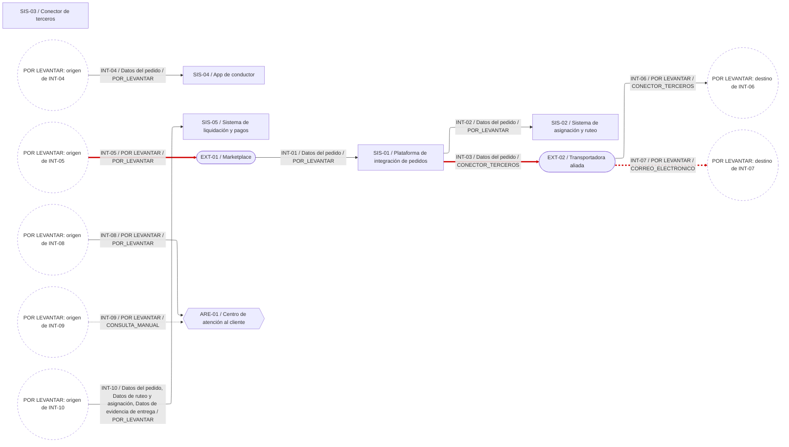

Entrego la plantilla v1.1 diligenciada con FUE-01 (conocimiento 01) como única fuente de hechos. Las áreas, los sistemas y los intercambios son los que el enunciado nombra o describe. Todo lo que el enunciado no dice quedó como `POR LEVANTAR` y tiene su pregunta en la hoja `POR_LEVANTAR`. No hay datos de otras fuentes. La estructura del metamodelo es la del conocimiento 06; las decisiones del Arquitecto Líder están incorporadas.

# 1. Propósito del artefacto y conceptos que cubre

**Propósito.** Registrar el AS-IS de integración que describe el enunciado: quién envía qué información de estado del pedido a quién, por qué mecanismo, y qué problemas se reportan. Incluye los intercambios informales (correo y consultas del centro de atención). No propone soluciones ni juzga a las áreas.

**Conceptos cubiertos.** Los 11 del metamodelo. Extremo (abstracto) y la raíz no tienen hoja propia, como aprobaste.

**Criterios de diligenciamiento.**
- Cada dato lleva en `Fuente` la cita literal de FUE-01 con su párrafo del apartado "Caso de estudio". Las citas se verificaron una a una contra el texto del PDF: 92 citas, todas literales.
- Un extremo se registra como `origen` o `destino` solo si el enunciado lo nombra como emisor o receptor de ese flujo. Si no, queda `POR LEVANTAR`. No completé extremos por deducción.
- Un valor de enumeración (mecanismo, oportunidad) se registra solo si el enunciado lo dice. Excepción declarada: INT-09 como CONSULTA_MANUAL, por tu indicación.
- Las afirmaciones de Operaciones, Producto y Finanzas se registran como `AFIRMACION_AREA`, con Fuente ENUNCIADO_CASO. Los relatos de fallas del enunciado se registran como `HIPOTESIS`, porque ningún problema tiene evidencia de sistema o documento (R5).
- Los conductores y afiliados son personas, no extremos del metamodelo. No se registran como extremos.
- Los canales WhatsApp, línea telefónica y chat embebido no se registran como Sistema, porque el enunciado no dice que lo sean (B10).
- `NO APLICA (Fuente-id)` no se usó: el enunciado no confirma ninguna ausencia.

**Volumen del levantamiento**

| Hoja | Filas | Celdas POR LEVANTAR |
|---|---|---|
| Sistema | 5 | 10 |
| ParticipanteExterno | 2 | 1 |
| Area | 5 | 5 |
| Intercambio | 10 | 52 |
| GrupoInformacion | 5 | 2 |
| EstadoPedido | 6 | 0 |
| ModalidadEntrega | 3 | 0 |
| Problema | 6 | 4 |
| Fuente | 1 | 1 |
| RutaExpress_marketplaces | 1 | 0 |
| RutaExpress_aliados | 1 | 0 |
| Intercambio_transporta | 12 | 15 |
| Intercambio_estadosReportados | 2 | 0 |
| Intercambio_modalidades | 5 | 0 |
| Intercambio_problemas | 4 | 0 |
| Intercambio_fuentes | 10 | 0 |
| Problema_reportadoPor | 3 | 0 |
| Problema_afectados | 3 | 0 |
| Problema_fuentes | 6 | 0 |
| EstadoPedido_siguientes | 5 | 0 |
| POR_LEVANTAR (preguntas) | 44 | — |
| Total filas de datos (sin guía, catálogos ni preguntas) | 95 | 90 |

Distribución de `Nivel`: HECHO 57, AFIRMACION_AREA 8, HIPOTESIS 8, POR LEVANTAR (filas sin dato) 5.

# 2. El artefacto

## 2.1 Hojas diligenciadas

Archivos en `artefactos/3d_diligenciado/csv/<Hoja>.csv` (23 hojas, mismos nombres). La hoja `POR_LEVANTAR` está en la parte 3.

### Hojas de concepto

**Hoja `Sistema`** (5 filas)

| id | nombre | funcion | tecnologia | responsable | Fuente | Nivel |
|---|---|---|---|---|---|---|
| SIS-01 | Plataforma de integración de pedidos | Recibe la orden del marketplace, valida que los datos de dirección y contacto estén completos y enruta el pedido según el tipo de entrega. Captura los datos iniciales del pedido. | POR LEVANTAR | POR LEVANTAR | FUE-01 §Caso de estudio, párr. 2: «la plataforma de integración de pedidos, que recibe la orden, valida que los datos de dirección y contacto estén completos, y la enruta según el tipo de entrega» · párr. 4: «La plataforma de integración captura los datos iniciales del pedido.» | HECHO |
| SIS-02 | Sistema de asignación y ruteo | Calcula la ruta óptima y asigna un conductor disponible según zona y capacidad. Genera asignaciones y estados de tránsito. | POR LEVANTAR | POR LEVANTAR | FUE-01 §Caso de estudio, párr. 2: «pasa al sistema de asignación y ruteo, que calcula la ruta óptima y asigna un conductor disponible según zona y capacidad» · párr. 4: «El sistema de ruteo genera asignaciones y estados de tránsito.» | HECHO |
| SIS-03 | Conector de terceros | Traduce el formato interno al que cada aliado requiere. Traduce y a veces pierde información en el camino. | POR LEVANTAR | POR LEVANTAR | FUE-01 §Caso de estudio, párr. 2: «Si el pedido va por transportadora aliada, se envía a través de un conector de terceros que traduce el formato interno al que cada aliado requiere» · párr. 4: «El conector de terceros traduce y a veces pierde información en el camino.» | HECHO |
| SIS-04 | App de conductor | El conductor recibe el pedido en la app, que registra recogida, tránsito y entrega, incluyendo evidencia fotográfica y firma digital. Produce evidencia de entrega. | POR LEVANTAR | POR LEVANTAR | FUE-01 §Caso de estudio, párr. 2: «Una vez asignado, el conductor recibe el pedido en la app de conductor, que registra recogida, tránsito y entrega, incluyendo evidencia fotográfica y firma digital» · párr. 4: «La app de conductor produce evidencia de entrega.» | HECHO |
| SIS-05 | Sistema de liquidación y pagos | Calcula lo que se debe pagar a cada conductor o transportadora aliada según las entregas completadas y lo que se debe cobrar al marketplace según el SLA cumplido. Consolida los datos anteriores. | POR LEVANTAR | POR LEVANTAR | FUE-01 §Caso de estudio, párr. 2: «el sistema de liquidación y pagos calcula lo que se le debe pagar a cada conductor o transportadora aliada según las entregas completadas, y lo que se le debe cobrar al marketplace según el SLA cumplido» · párr. 4: «El sistema de liquidación consolida todo lo anterior para calcular pagos y cobros y es, de los cinco sistemas, el que más sufre cuando hay inconsistencia aguas arriba.» | HECHO |

**Hoja `ParticipanteExterno`** (2 filas)

| id | nombre | pais | Fuente | Nivel |
|---|---|---|---|---|
| EXT-01 | Marketplace | Colombia y Perú | FUE-01 §Caso de estudio, párr. 1: «atiende a los principales marketplaces de e-commerce en Colombia y Perú» · párr. 2: «un marketplace envía un pedido a través de la plataforma de integración de pedidos» · Participante genérico: el enunciado no nombra marketplaces. | HECHO |
| EXT-02 | Transportadora aliada | POR LEVANTAR | FUE-01 §Caso de estudio, párr. 1: «alianzas con transportadoras locales en ciudades donde no tiene operación directa» · párr. 2: «(flota propia, afiliado o transportadora aliada)» · Participante genérico: el enunciado no nombra aliados ni su país. | HECHO |

**Hoja `Area`** (5 filas)

| id | nombre | lider | Fuente | Nivel |
|---|---|---|---|---|
| ARE-01 | Centro de atención al cliente | POR LEVANTAR | FUE-01 §Caso de estudio, párr. 2: «el centro de atención al cliente recibe consultas sobre el estado del pedido a través de WhatsApp, línea telefónica y un chat embebido en el sitio del marketplace» | HECHO |
| ARE-02 | Operaciones | POR LEVANTAR | FUE-01 §Caso de estudio, párr. 5: «Operaciones dice que el problema es el conector de terceros, que traduce mal y tarde» | HECHO |
| ARE-03 | Producto | POR LEVANTAR | FUE-01 §Caso de estudio, párr. 5: «Producto insiste en que el problema es que la app de conductor no fuerza actualización de estado en tiempo real» | HECHO |
| ARE-04 | Finanzas | POR LEVANTAR | FUE-01 §Caso de estudio, párr. 5: «Finanzas afirma que el verdadero problema es que liquidación no tiene cómo validar entregas de forma independiente» | HECHO |
| ARE-05 | Comercial | POR LEVANTAR | FUE-01 §Caso de estudio, párr. 5: «Comercial presiona porque el contrato se firma en 10 semanas y no puede esperar un rediseño completo» | HECHO |

**Hoja `Intercambio`** (10 filas)

| id | nombre | mecanismo | oportunidad | latenciaObservada | transformaFormato | volumenDiario | origen | destino | Fuente | Nivel |
|---|---|---|---|---|---|---|---|---|---|---|
| INT-01 | Envío del pedido del marketplace a la plataforma de integración | POR_LEVANTAR | POR_LEVANTAR | POR LEVANTAR | POR LEVANTAR | POR LEVANTAR | EXT-01 | SIS-01 | FUE-01 §Caso de estudio, párr. 2: «un marketplace envía un pedido a través de la plataforma de integración de pedidos» | HECHO |
| INT-02 | Pase del pedido de flota propia o afiliado al sistema de asignación y ruteo | POR_LEVANTAR | POR_LEVANTAR | POR LEVANTAR | POR LEVANTAR | POR LEVANTAR | SIS-01 | SIS-02 | FUE-01 §Caso de estudio, párr. 2: «la plataforma de integración de pedidos, que recibe la orden, valida que los datos de dirección y contacto estén completos, y la enruta según el tipo de entrega» · párr. 2: «pasa al sistema de asignación y ruteo, que calcula la ruta óptima y asigna un conductor disponible según zona y capacidad» | HECHO |
| INT-03 | Envío del pedido a la transportadora aliada a través del conector de terceros | CONECTOR_TERCEROS | POR_LEVANTAR | POR LEVANTAR | VERDADERO | POR LEVANTAR | SIS-01 | EXT-02 | FUE-01 §Caso de estudio, párr. 2: «la plataforma de integración de pedidos, que recibe la orden, valida que los datos de dirección y contacto estén completos, y la enruta según el tipo de entrega» · párr. 2: «Si el pedido va por transportadora aliada, se envía a través de un conector de terceros que traduce el formato interno al que cada aliado requiere» | HECHO |
| INT-04 | Recepción del pedido por el conductor en la app de conductor | POR_LEVANTAR | POR_LEVANTAR | POR LEVANTAR | POR LEVANTAR | POR LEVANTAR | POR LEVANTAR | SIS-04 | FUE-01 §Caso de estudio, párr. 2: «Una vez asignado, el conductor recibe el pedido en la app de conductor, que registra recogida, tránsito y entrega, incluyendo evidencia fotográfica y firma digital» | HECHO |
| INT-05 | Confirmación de entrega completada al marketplace | POR_LEVANTAR | POR_LEVANTAR | POR LEVANTAR | POR LEVANTAR | POR LEVANTAR | POR LEVANTAR | EXT-01 | FUE-01 §Caso de estudio, párr. 3: «un conductor puede marcar una entrega como completada en la app sin que el marketplace reciba la confirmación a tiempo por una falla en la integración» | HECHO |
| INT-06 | Reporte de estado de la transportadora aliada por el conector | CONECTOR_TERCEROS | POR_LEVANTAR | POR LEVANTAR | POR LEVANTAR | POR LEVANTAR | EXT-02 | POR LEVANTAR | FUE-01 §Caso de estudio, párr. 3: «una transportadora aliada puede reportar el estado por correo en lugar de hacerlo por el conector, generando que el pedido quede “en tránsito” en el sistema interno mientras ya fue entregado» | HECHO |
| INT-07 | Reporte de estado de la transportadora aliada por correo | CORREO_ELECTRONICO | POR_LEVANTAR | POR LEVANTAR | POR LEVANTAR | POR LEVANTAR | EXT-02 | POR LEVANTAR | FUE-01 §Caso de estudio, párr. 3: «una transportadora aliada puede reportar el estado por correo en lugar de hacerlo por el conector, generando que el pedido quede “en tránsito” en el sistema interno mientras ya fue entregado» | HECHO |
| INT-08 | Consultas de estado del pedido al centro de atención al cliente | POR_LEVANTAR | POR_LEVANTAR | POR LEVANTAR | POR LEVANTAR | POR LEVANTAR | POR LEVANTAR | ARE-01 | FUE-01 §Caso de estudio, párr. 2: «el centro de atención al cliente recibe consultas sobre el estado del pedido a través de WhatsApp, línea telefónica y un chat embebido en el sitio del marketplace» | HECHO |
| INT-09 | Consulta del estado real por el centro de atención cruzando varios sistemas | CONSULTA_MANUAL | POR_LEVANTAR | POR LEVANTAR | POR LEVANTAR | POR LEVANTAR | POR LEVANTAR | ARE-01 | FUE-01 §Caso de estudio, párr. 2: «Para resolver las consultas se debe consultar el estado real cruzando información de varios de estos sistemas» · Mecanismo CONSULTA_MANUAL por indicación del Arquitecto Líder; el enunciado no dice que la consulta sea manual. | HECHO |
| INT-10 | Consolidación de los datos anteriores en el sistema de liquidación y pagos | POR_LEVANTAR | POR_LEVANTAR | POR LEVANTAR | POR LEVANTAR | POR LEVANTAR | POR LEVANTAR | SIS-05 | FUE-01 §Caso de estudio, párr. 4: «El sistema de liquidación consolida todo lo anterior para calcular pagos y cobros y es, de los cinco sistemas, el que más sufre cuando hay inconsistencia aguas arriba.» | HECHO |

**Hoja `GrupoInformacion`** (5 filas)

| id | nombre | descripcion | productor | Fuente | Nivel |
|---|---|---|---|---|---|
| GRP-01 | Datos del pedido | Datos iniciales del pedido, incluidos los de dirección y contacto que la plataforma valida. | SIS-01 | FUE-01 §Caso de estudio, párr. 4: «cinco grupos de información: datos del pedido, datos de ruteo y asignación, datos de evidencia de entrega, datos de terceros (conductores y transportadoras), y datos de liquidación» · párr. 4: «La plataforma de integración captura los datos iniciales del pedido.» | HECHO |
| GRP-02 | Datos de ruteo y asignación | Asignaciones y estados de tránsito generados por el sistema de ruteo. | SIS-02 | FUE-01 §Caso de estudio, párr. 4: «cinco grupos de información: datos del pedido, datos de ruteo y asignación, datos de evidencia de entrega, datos de terceros (conductores y transportadoras), y datos de liquidación» · párr. 4: «El sistema de ruteo genera asignaciones y estados de tránsito.» | HECHO |
| GRP-03 | Datos de evidencia de entrega | Evidencia de entrega: evidencia fotográfica y firma digital. | SIS-04 | FUE-01 §Caso de estudio, párr. 4: «cinco grupos de información: datos del pedido, datos de ruteo y asignación, datos de evidencia de entrega, datos de terceros (conductores y transportadoras), y datos de liquidación» · párr. 4: «La app de conductor produce evidencia de entrega.» | HECHO |
| GRP-04 | Datos de terceros | Datos de conductores y transportadoras. | POR LEVANTAR | FUE-01 §Caso de estudio, párr. 4: «cinco grupos de información: datos del pedido, datos de ruteo y asignación, datos de evidencia de entrega, datos de terceros (conductores y transportadoras), y datos de liquidación» | HECHO |
| GRP-05 | Datos de liquidación | Datos de liquidación; el sistema de liquidación consolida los datos anteriores para calcular pagos y cobros. | POR LEVANTAR | FUE-01 §Caso de estudio, párr. 4: «cinco grupos de información: datos del pedido, datos de ruteo y asignación, datos de evidencia de entrega, datos de terceros (conductores y transportadoras), y datos de liquidación» · párr. 4: «El sistema de liquidación consolida todo lo anterior para calcular pagos y cobros y es, de los cinco sistemas, el que más sufre cuando hay inconsistencia aguas arriba.» | HECHO |

**Hoja `EstadoPedido`** (6 filas)

| nombre | descripcion | Fuente | Nivel |
|---|---|---|---|
| En ruteo | Pedido dentro del flujo de ruteo (sistema de asignación y ruteo), al que también reingresa tras una entrega fallida. El enunciado no nombra este estado. | FUE-01 §Caso de estudio, párr. 2: «pasa al sistema de asignación y ruteo, que calcula la ruta óptima y asigna un conductor disponible según zona y capacidad» · párr. 3: «Un pedido puede fallar en la entrega y reingresar al flujo de ruteo» | HECHO |
| Asignado | Pedido con conductor asignado por el sistema de asignación y ruteo. | FUE-01 §Caso de estudio, párr. 2: «Una vez asignado, el conductor recibe el pedido en la app de conductor» | HECHO |
| Recogida | Recogida del pedido, registrada en la app de conductor. | FUE-01 §Caso de estudio, párr. 2: «registra recogida, tránsito y entrega» | HECHO |
| En tránsito | Pedido en tránsito. Es también el estado que queda en el sistema interno cuando la aliada reporta por correo. | FUE-01 §Caso de estudio, párr. 2: «registra recogida, tránsito y entrega» · párr. 3: «“en tránsito”» | HECHO |
| Entregado | Entrega completada. | FUE-01 §Caso de estudio, párr. 3: «marcar una entrega como completada» · párr. 3: «mientras ya fue entregado» | HECHO |
| Entrega fallida | El pedido falla en la entrega y puede reingresar al flujo de ruteo. | FUE-01 §Caso de estudio, párr. 3: «Un pedido puede fallar en la entrega y reingresar al flujo de ruteo» | HECHO |

**Hoja `ModalidadEntrega`** (3 filas)

| nombre | Fuente | Nivel |
|---|---|---|
| Flota propia | FUE-01 §Caso de estudio, párr. 2: «(flota propia, afiliado o transportadora aliada)» | HECHO |
| Afiliado | FUE-01 §Caso de estudio, párr. 2: «(flota propia, afiliado o transportadora aliada)» | HECHO |
| Transportadora aliada | FUE-01 §Caso de estudio, párr. 2: «(flota propia, afiliado o transportadora aliada)» | HECHO |

**Hoja `Problema`** (6 filas)

| id | descripcion | efecto | Fuente | Nivel |
|---|---|---|---|---|
| PRB-01 | Un conductor marca una entrega como completada en la app y el marketplace no recibe la confirmación a tiempo por una falla en la integración. | El marketplace no recibe a tiempo la confirmación de entrega. El enunciado dice que los desfases afectan directamente la liquidación: hay conductores que reclaman pagos por entregas que el sistema no reconoce y marketplaces que disputan cobros por SLAs que según ellos no se cumplieron. | FUE-01 §Caso de estudio, párr. 3: «un conductor puede marcar una entrega como completada en la app sin que el marketplace reciba la confirmación a tiempo por una falla en la integración» · párr. 3: «Estos desfases afectan directamente la liquidación: hay conductores que reclaman pagos por entregas que el sistema no reconoce, y marketplaces que disputan cobros por SLAs que según ellos no se cumplieron.» | HIPOTESIS |
| PRB-02 | Una transportadora aliada reporta el estado por correo en lugar de hacerlo por el conector y el pedido queda «en tránsito» en el sistema interno mientras ya fue entregado. | El estado del pedido queda desfasado en el sistema interno. El enunciado dice que los desfases afectan directamente la liquidación: hay conductores que reclaman pagos por entregas que el sistema no reconoce y marketplaces que disputan cobros por SLAs que según ellos no se cumplieron. | FUE-01 §Caso de estudio, párr. 3: «una transportadora aliada puede reportar el estado por correo en lugar de hacerlo por el conector, generando que el pedido quede “en tránsito” en el sistema interno mientras ya fue entregado» · párr. 3: «Estos desfases afectan directamente la liquidación: hay conductores que reclaman pagos por entregas que el sistema no reconoce, y marketplaces que disputan cobros por SLAs que según ellos no se cumplieron.» | HIPOTESIS |
| PRB-03 | El conector de terceros traduce y a veces pierde información en el camino. | POR LEVANTAR | FUE-01 §Caso de estudio, párr. 4: «El conector de terceros traduce y a veces pierde información en el camino.» | HIPOTESIS |
| PRB-04 | Operaciones afirma que el problema es el conector de terceros, que traduce mal y tarde. | POR LEVANTAR | FUE-01 §Caso de estudio, párr. 5: «Operaciones dice que el problema es el conector de terceros, que traduce mal y tarde» | AFIRMACION_AREA |
| PRB-05 | Producto afirma que el problema es que la app de conductor no fuerza actualización de estado en tiempo real. | POR LEVANTAR | FUE-01 §Caso de estudio, párr. 5: «Producto insiste en que el problema es que la app de conductor no fuerza actualización de estado en tiempo real» | AFIRMACION_AREA |
| PRB-06 | Finanzas afirma que el verdadero problema es que liquidación no tiene cómo validar entregas de forma independiente. | POR LEVANTAR | FUE-01 §Caso de estudio, párr. 5: «Finanzas afirma que el verdadero problema es que liquidación no tiene cómo validar entregas de forma independiente» | AFIRMACION_AREA |

**Hoja `Fuente`** (1 filas)

| id | nombre | tipo | fecha |
|---|---|---|---|
| FUE-01 | Enunciado Workshop 2 Parte I – Caso RutaExpress (01_Enunciado_Workshop2_ParteI_Caso_RutaExpress.pdf) | ENUNCIADO_CASO | POR LEVANTAR |

### Hojas puente

**Hoja `RutaExpress_marketplaces`** (rol `marketplaces`; 1 filas)

| marketplaces | Fuente | Nivel |
|---|---|---|
| EXT-01 | FUE-01 §Caso de estudio, párr. 1: «atiende a los principales marketplaces de e-commerce en Colombia y Perú» | HECHO |

**Hoja `RutaExpress_aliados`** (rol `aliados`; 1 filas)

| aliados | Fuente | Nivel |
|---|---|---|
| EXT-02 | FUE-01 §Caso de estudio, párr. 1: «alianzas con transportadoras locales en ciudades donde no tiene operación directa» | HECHO |

**Hoja `Intercambio_transporta`** (-> GrupoInformacion; 12 filas)

| Intercambio | transporta | Fuente | Nivel |
|---|---|---|---|
| INT-01 | GRP-01 | FUE-01 §Caso de estudio, párr. 2: «un marketplace envía un pedido a través de la plataforma de integración de pedidos» · párr. 4: «La plataforma de integración captura los datos iniciales del pedido.» | HECHO |
| INT-02 | GRP-01 | FUE-01 §Caso de estudio, párr. 2: «pasa al sistema de asignación y ruteo, que calcula la ruta óptima y asigna un conductor disponible según zona y capacidad» | HECHO |
| INT-03 | GRP-01 | FUE-01 §Caso de estudio, párr. 2: «Si el pedido va por transportadora aliada, se envía a través de un conector de terceros que traduce el formato interno al que cada aliado requiere» | HECHO |
| INT-04 | GRP-01 | FUE-01 §Caso de estudio, párr. 2: «Una vez asignado, el conductor recibe el pedido en la app de conductor, que registra recogida, tránsito y entrega, incluyendo evidencia fotográfica y firma digital» | HECHO |
| INT-05 | POR LEVANTAR | POR LEVANTAR | POR LEVANTAR |
| INT-06 | POR LEVANTAR | POR LEVANTAR | POR LEVANTAR |
| INT-07 | POR LEVANTAR | POR LEVANTAR | POR LEVANTAR |
| INT-08 | POR LEVANTAR | POR LEVANTAR | POR LEVANTAR |
| INT-09 | POR LEVANTAR | POR LEVANTAR | POR LEVANTAR |
| INT-10 | GRP-01 | FUE-01 §Caso de estudio, párr. 4: «El sistema de liquidación consolida todo lo anterior para calcular pagos y cobros y es, de los cinco sistemas, el que más sufre cuando hay inconsistencia aguas arriba.» | HECHO |
| INT-10 | GRP-02 | FUE-01 §Caso de estudio, párr. 4: «El sistema de liquidación consolida todo lo anterior para calcular pagos y cobros y es, de los cinco sistemas, el que más sufre cuando hay inconsistencia aguas arriba.» | HECHO |
| INT-10 | GRP-03 | FUE-01 §Caso de estudio, párr. 4: «El sistema de liquidación consolida todo lo anterior para calcular pagos y cobros y es, de los cinco sistemas, el que más sufre cuando hay inconsistencia aguas arriba.» | HECHO |

**Hoja `Intercambio_estadosReportados`** (-> EstadoPedido; 2 filas)

| Intercambio | estadosReportados | Fuente | Nivel |
|---|---|---|---|
| INT-05 | Entregado | FUE-01 §Caso de estudio, párr. 3: «un conductor puede marcar una entrega como completada en la app sin que el marketplace reciba la confirmación a tiempo por una falla en la integración» | HECHO |
| INT-07 | Entregado | FUE-01 §Caso de estudio, párr. 3: «una transportadora aliada puede reportar el estado por correo en lugar de hacerlo por el conector, generando que el pedido quede “en tránsito” en el sistema interno mientras ya fue entregado» | HECHO |

**Hoja `Intercambio_modalidades`** (-> ModalidadEntrega; 5 filas)

| Intercambio | modalidades | Fuente | Nivel |
|---|---|---|---|
| INT-02 | Flota propia | FUE-01 §Caso de estudio, párr. 2: «Si el pedido requiere flota propia o afiliados» | HECHO |
| INT-02 | Afiliado | FUE-01 §Caso de estudio, párr. 2: «Si el pedido requiere flota propia o afiliados» | HECHO |
| INT-03 | Transportadora aliada | FUE-01 §Caso de estudio, párr. 2: «Si el pedido va por transportadora aliada, se envía a través de un conector de terceros que traduce el formato interno al que cada aliado requiere» | HECHO |
| INT-06 | Transportadora aliada | FUE-01 §Caso de estudio, párr. 3: «una transportadora aliada puede reportar el estado por correo en lugar de hacerlo por el conector, generando que el pedido quede “en tránsito” en el sistema interno mientras ya fue entregado» | HECHO |
| INT-07 | Transportadora aliada | FUE-01 §Caso de estudio, párr. 3: «una transportadora aliada puede reportar el estado por correo en lugar de hacerlo por el conector, generando que el pedido quede “en tránsito” en el sistema interno mientras ya fue entregado» | HECHO |

**Hoja `Intercambio_problemas`** (-> Problema; 4 filas)

| Intercambio | problemas | Fuente | Nivel |
|---|---|---|---|
| INT-05 | PRB-01 | FUE-01 §Caso de estudio, párr. 3: «un conductor puede marcar una entrega como completada en la app sin que el marketplace reciba la confirmación a tiempo por una falla en la integración» | HIPOTESIS |
| INT-07 | PRB-02 | FUE-01 §Caso de estudio, párr. 3: «una transportadora aliada puede reportar el estado por correo en lugar de hacerlo por el conector, generando que el pedido quede “en tránsito” en el sistema interno mientras ya fue entregado» | HIPOTESIS |
| INT-03 | PRB-03 | FUE-01 §Caso de estudio, párr. 4: «El conector de terceros traduce y a veces pierde información en el camino.» | HIPOTESIS |
| INT-03 | PRB-04 | FUE-01 §Caso de estudio, párr. 5: «Operaciones dice que el problema es el conector de terceros, que traduce mal y tarde» | AFIRMACION_AREA |

**Hoja `Intercambio_fuentes`** (-> Fuente; 10 filas)

| Intercambio | fuentes |
|---|---|
| INT-01 | FUE-01 |
| INT-02 | FUE-01 |
| INT-03 | FUE-01 |
| INT-04 | FUE-01 |
| INT-05 | FUE-01 |
| INT-06 | FUE-01 |
| INT-07 | FUE-01 |
| INT-08 | FUE-01 |
| INT-09 | FUE-01 |
| INT-10 | FUE-01 |

**Hoja `Problema_reportadoPor`** (-> Area; 3 filas)

| Problema | reportadoPor | Fuente | Nivel |
|---|---|---|---|
| PRB-04 | ARE-02 | FUE-01 §Caso de estudio, párr. 5: «Operaciones dice que el problema es el conector de terceros, que traduce mal y tarde» | AFIRMACION_AREA |
| PRB-05 | ARE-03 | FUE-01 §Caso de estudio, párr. 5: «Producto insiste en que el problema es que la app de conductor no fuerza actualización de estado en tiempo real» | AFIRMACION_AREA |
| PRB-06 | ARE-04 | FUE-01 §Caso de estudio, párr. 5: «Finanzas afirma que el verdadero problema es que liquidación no tiene cómo validar entregas de forma independiente» | AFIRMACION_AREA |

**Hoja `Problema_afectados`** (-> Sistema; 3 filas)

| Problema | afectados | Fuente | Nivel |
|---|---|---|---|
| PRB-01 | SIS-05 | FUE-01 §Caso de estudio, párr. 3: «Estos desfases afectan directamente la liquidación: hay conductores que reclaman pagos por entregas que el sistema no reconoce, y marketplaces que disputan cobros por SLAs que según ellos no se cumplieron.» | HIPOTESIS |
| PRB-02 | SIS-05 | FUE-01 §Caso de estudio, párr. 3: «Estos desfases afectan directamente la liquidación: hay conductores que reclaman pagos por entregas que el sistema no reconoce, y marketplaces que disputan cobros por SLAs que según ellos no se cumplieron.» | HIPOTESIS |
| PRB-06 | SIS-05 | FUE-01 §Caso de estudio, párr. 5: «Finanzas afirma que el verdadero problema es que liquidación no tiene cómo validar entregas de forma independiente» | AFIRMACION_AREA |

**Hoja `Problema_fuentes`** (-> Fuente; 6 filas)

| Problema | fuentes |
|---|---|
| PRB-01 | FUE-01 |
| PRB-02 | FUE-01 |
| PRB-03 | FUE-01 |
| PRB-04 | FUE-01 |
| PRB-05 | FUE-01 |
| PRB-06 | FUE-01 |

**Hoja `EstadoPedido_siguientes`** (-> EstadoPedido, incluido el reingreso; 5 filas)

| EstadoPedido | siguientes | Fuente | Nivel |
|---|---|---|---|
| En ruteo | Asignado | FUE-01 §Caso de estudio, párr. 2: «pasa al sistema de asignación y ruteo, que calcula la ruta óptima y asigna un conductor disponible según zona y capacidad» | HECHO |
| Asignado | Recogida | FUE-01 §Caso de estudio, párr. 2: «Una vez asignado, el conductor recibe el pedido en la app de conductor, que registra recogida, tránsito y entrega, incluyendo evidencia fotográfica y firma digital» | HECHO |
| Recogida | En tránsito | FUE-01 §Caso de estudio, párr. 2: «registra recogida, tránsito y entrega» | HECHO |
| En tránsito | Entregado | FUE-01 §Caso de estudio, párr. 2: «registra recogida, tránsito y entrega» | HECHO |
| Entrega fallida | En ruteo | FUE-01 §Caso de estudio, párr. 3: «Un pedido puede fallar en la entrega y reingresar al flujo de ruteo» | HECHO |

### Hoja `Catalogos`

| Enumeracion | Valor |
|---|---|
| Mecanismo | INTEGRACION_SISTEMA |
| Mecanismo | CONECTOR_TERCEROS |
| Mecanismo | CORREO_ELECTRONICO |
| Mecanismo | CONSULTA_MANUAL |
| Mecanismo | POR_LEVANTAR |
| Oportunidad | TIEMPO_REAL |
| Oportunidad | DIFERIDA |
| Oportunidad | POR_LEVANTAR |
| TipoFuente | ENUNCIADO_CASO |
| TipoFuente | DOCUMENTO |
| TipoFuente | ENTREVISTA |
| TipoFuente | REGISTRO_SISTEMA |
| EBoolean (`transformaFormato`) | VERDADERO |
| EBoolean (`transformaFormato`) | FALSO |
| EBoolean (`transformaFormato`) | POR LEVANTAR |
| Nivel (columna de formato) | HECHO |
| Nivel (columna de formato) | AFIRMACION_AREA |
| Nivel (columna de formato) | HIPOTESIS |

### Hoja `00_GUIA`

| Hoja | Campo | Tipo o destino | Card. | Cómo se llena |
|---|---|---|---|---|
| (todas) | POR LEVANTAR | texto | — | Toda celda sin dato en ninguna fuente dice `POR LEVANTAR` (en enumerados, `POR_LEVANTAR`) y tiene su pregunta en la hoja `POR_LEVANTAR`. Significa que no se sabe. Nunca se infiere (R6). |
| (todas) | NO APLICA | texto | — | Ausencia confirmada por una fuente: `NO APLICA (Fuente-id)`, por ejemplo `NO APLICA (FUE-01)`. En esta entrega no se usó. |
| (todas) | Fuente | `FUE-nn §sección, párr. n: «cita literal»` | 1 o más | Columna de trazabilidad del formato (no es atributo del metamodelo; aprobada por el Arquitecto Líder). Varias citas se separan con ` · `; varias fuentes con `;`. Va en toda hoja de concepto y puente, excepto `Fuente`, `Intercambio_fuentes` y `Problema_fuentes`. |
| (todas las que tienen Fuente) | Nivel | enum Nivel (formato) | 1 | HECHO: lo dice el enunciado o un documento como hecho. AFIRMACION_AREA: lo dice un área; si viene del enunciado, la Fuente es de tipo ENUNCIADO_CASO. HIPOTESIS: afirmación sin evidencia de sistema. Un Problema cuyas fuentes son solo ENUNCIADO_CASO o la afirmación de un área no es causa confirmada (R5). En filas sin dato: `POR LEVANTAR`. |
| Sistema | id | EString | 1 | Formato `SIS-nn`. Único entre Sistema, ParticipanteExterno y Area. Es la llave. |
| Sistema | nombre | EString | 1 | Nombre usado en la empresa. |
| Sistema | funcion | EString | 1 | Qué hace el sistema en el flujo del pedido, según la fuente. |
| Sistema | tecnologia | EString | 1 | Plataforma o tecnología solo si una fuente la menciona; si no, `POR LEVANTAR`. |
| Sistema | responsable | llave de Area.id | 0..1 | Área dueña del sistema. |
| ParticipanteExterno | id | EString | 1 | Formato `EXT-nn`. Único entre Sistema, ParticipanteExterno y Area. Es la llave. |
| ParticipanteExterno | nombre | EString | 1 | Nombre usado en la empresa. |
| ParticipanteExterno | pais | EString | 1 | País donde opera con RutaExpress. Si es marketplace o aliado se registra en `RutaExpress_marketplaces` o `RutaExpress_aliados`. |
| Area | id | EString | 1 | Formato `ARE-nn`. Único entre Sistema, ParticipanteExterno y Area. Es la llave. |
| Area | nombre | EString | 1 | Nombre del equipo interno. |
| Area | lider | EString | 1 | Persona o cargo líder; es el interlocutor para el levantamiento. |
| Intercambio | id | EString | 1 | Formato `INT-nn`. Es la llave. |
| Intercambio | nombre | EString | 1 | Nombre corto. |
| Intercambio | mecanismo | enum Mecanismo | 1 | Cómo viaja la información. Valor de `Catalogos`. |
| Intercambio | oportunidad | enum Oportunidad | 1 | Si llega en tiempo real o diferida. Valor de `Catalogos`. Con CORREO_ELECTRONICO o CONSULTA_MANUAL no puede ser TIEMPO_REAL (R3). |
| Intercambio | latenciaObservada | EString | 1 | Retraso observado, en texto, citando su fuente. No se estima. |
| Intercambio | transformaFormato | EBoolean | 1 | Si el intercambio traduce el formato entre origen y destino. Valor de `Catalogos`. |
| Intercambio | volumenDiario | EInt | 1 | Cantidad de mensajes o pedidos al día, solo si una fuente la da. |
| Intercambio | origen | llave de Extremo (id) | 1 | Extremo del que sale el flujo. Se registra solo si el enunciado lo nombra como emisor de ese flujo. Distinto de `destino` (R1). |
| Intercambio | destino | llave de Extremo (id) | 1 | Extremo al que llega el flujo. Se registra solo si el enunciado lo nombra como receptor de ese flujo. |
| GrupoInformacion | id | EString | 1 | Formato `GRP-nn`. Es la llave. |
| GrupoInformacion | nombre | EString | 1 | Nombre del grupo de datos. |
| GrupoInformacion | descripcion | EString | 1 | Descripción del grupo de datos. |
| GrupoInformacion | productor | llave de Sistema.id | 0..1 | Sistema que genera el grupo de información, solo si la fuente lo dice. |
| EstadoPedido | nombre | EString | 1 | Estado del ciclo de vida del pedido. Es la llave. |
| EstadoPedido | descripcion | EString | 1 | Descripción del estado. |
| ModalidadEntrega | nombre | EString | 1 | Nombre de la modalidad. Es la llave. La transportadora aliada se escribe exactamente `Transportadora aliada` para que R4 funcione. |
| Problema | id | EString | 1 | Formato `PRB-nn`. Es la llave. |
| Problema | descripcion | EString | 1 | Qué falla. |
| Problema | efecto | EString | 1 | Qué consecuencia tiene, según la fuente. |
| Fuente | id | EString | 1 | Formato `FUE-nn`. Es la llave. |
| Fuente | nombre | EString | 1 | Nombre del documento, entrevista, registro o enunciado. |
| Fuente | tipo | enum TipoFuente | 1 | Valor de `Catalogos`. |
| Fuente | fecha | EDate | 1 | Fecha de la fuente, en formato AAAA-MM-DD. |
| RutaExpress_marketplaces | marketplaces | llave de ParticipanteExterno.id | * | Un registro por cada ParticipanteExterno que es marketplace. |
| RutaExpress_aliados | aliados | llave de ParticipanteExterno.id | * | Un registro por cada ParticipanteExterno que es transportadora aliada. |
| Intercambio_transporta | Intercambio, transporta | llaves de Intercambio.id y GrupoInformacion.id | * (mínimo 1 por intercambio) | Un registro por cada grupo que viaja en el intercambio (R2). Si no se sabe: `POR LEVANTAR`. |
| Intercambio_estadosReportados | Intercambio, estadosReportados | llaves de Intercambio.id y EstadoPedido.nombre | * | Un registro por cada estado que el intercambio comunica. |
| Intercambio_modalidades | Intercambio, modalidades | llaves de Intercambio.id y ModalidadEntrega.nombre | * | Un registro por cada modalidad en la que ocurre. Ver R4. |
| Intercambio_problemas | Intercambio, problemas | llaves de Intercambio.id y Problema.id | * | Un registro por cada problema reportado sobre el intercambio. |
| Intercambio_fuentes | Intercambio, fuentes | llaves de Intercambio.id y Fuente.id | * (mínimo 1 por intercambio) | Un registro por cada fuente de la que se obtuvo el intercambio (R2). |
| Problema_reportadoPor | Problema, reportadoPor | llaves de Problema.id y Area.id | * | Un registro por cada área que señala el problema. |
| Problema_afectados | Problema, afectados | llaves de Problema.id y Sistema.id | * | Un registro por cada sistema que sufre el efecto aguas abajo. |
| Problema_fuentes | Problema, fuentes | llaves de Problema.id y Fuente.id | * (mínimo 1 por problema) | Un registro por cada fuente que evidencia el problema (R2). Ver R5. |
| EstadoPedido_siguientes | EstadoPedido, siguientes | llaves de EstadoPedido.nombre (estado y estado siguiente) | * | Un registro por cada transición posible, incluidos los reingresos. |
| Catalogos | Enumeracion, Valor | texto | 1 | Lista cerrada. No se agregan valores sin aprobación del Arquitecto Líder. |
| POR_LEVANTAR | Hoja, Llave de la fila, Atributo o relación, Pregunta de levantamiento, Dirigida a, Estado, Fecha | texto | 1 | Una fila por dato pendiente. `Llave de la fila` admite varias llaves separadas por `;`. `Dirigida a` es el área que habla de ese componente en FUE-01 o el Arquitecto Líder. `Estado` es ABIERTA o CERRADA. |

## 2.2 Mapa de integración diligenciado (PV-INT-2, Mermaid con ELK)

Archivo: `artefactos/3d_diligenciado/mapa_integracion.mmd`. Generado a partir de las hojas `Intercambio`, `Intercambio_transporta` e `Intercambio_problemas`.

**Cómo leerlo.**
- Flechas rojas gruesas: INT-03 (PRB-03 y PRB-04), INT-05 (PRB-01) e INT-07 (PRB-02). INT-07 es además punteada por ser CORREO_ELECTRONICO (combinación aprobada).
- Flechas punteadas: INT-07 (correo) e INT-09 (consulta manual).
- Círculos punteados "POR LEVANTAR": extremos que el enunciado no nombra. Es una representación provisional (B12).
- SIS-03 (conector de terceros) aparece sin flechas porque el intercambio pasa "a través de" él y el metamodelo no lo expresa (B9). Su efecto se ve en la flecha roja de INT-03.
- Las áreas Operaciones, Producto, Finanzas y Comercial no aparecen: solo reportan problemas o no participan en intercambios. PRB-05 y PRB-06 no se dibujan porque aún no están vinculados a un intercambio.

# 3. POR LEVANTAR / Preguntas

La hoja `POR_LEVANTAR` tiene 44 preguntas abiertas, que cubren las 90 celdas `POR LEVANTAR` del libro. `Dirigida a` es el área que habla de ese componente en FUE-01; si ninguna lo hace, el Arquitecto Líder. `Llave de la fila` admite varias llaves separadas por `;`. Fecha de las preguntas: 2026-10-23.

| Hoja | Llave de la fila | Atributo o relación | Pregunta de levantamiento | Dirigida a | Estado | Fecha |
|---|---|---|---|---|---|---|
| Fuente | FUE-01 | fecha | ¿Cuál es la fecha del enunciado FUE-01? El documento no la trae. | Arquitecto Líder | ABIERTA | 2026-10-23 |
| Sistema | SIS-01; SIS-02; SIS-03; SIS-04; SIS-05 | responsable | ¿Qué área es dueña de cada uno de los cinco sistemas? El enunciado no lo dice. | Arquitecto Líder | ABIERTA | 2026-10-23 |
| Sistema | SIS-01; SIS-02; SIS-03; SIS-04; SIS-05 | tecnologia | ¿Qué plataforma o tecnología usa cada sistema? Solo se registra si una fuente la menciona. | Arquitecto Líder | ABIERTA | 2026-10-23 |
| Sistema | SIS-02 | nombre | El enunciado usa «sistema de asignación y ruteo» y «sistema de ruteo». ¿Son el mismo sistema? Se registró como uno solo. | Arquitecto Líder | ABIERTA | 2026-10-23 |
| ParticipanteExterno | EXT-01 | nombre; pais | ¿Qué marketplaces atiende RutaExpress, en qué país opera cada uno y cuál es «el marketplace más grande de la región»? Se registró un participante genérico. | Comercial (ARE-05) | ABIERTA | 2026-10-23 |
| ParticipanteExterno | EXT-02 | nombre; pais | ¿Qué transportadoras aliadas existen y en qué país y ciudades opera cada una? Se registró un participante genérico. | Operaciones (ARE-02) | ABIERTA | 2026-10-23 |
| Area | ARE-01; ARE-02; ARE-03; ARE-04; ARE-05 | lider | ¿Quién es el líder (persona o cargo) de cada área? | Arquitecto Líder | ABIERTA | 2026-10-23 |
| GrupoInformacion | GRP-04 | productor | ¿Qué sistema genera los datos de terceros (conductores y transportadoras)? | Operaciones (ARE-02) | ABIERTA | 2026-10-23 |
| GrupoInformacion | GRP-05 | productor | ¿Qué sistema genera los datos de liquidación? El enunciado dice que liquidación «consolida todo lo anterior», no que los produzca. | Finanzas (ARE-04) | ABIERTA | 2026-10-23 |
| Intercambio | INT-01; INT-02 | mecanismo; oportunidad; latenciaObservada; transformaFormato; volumenDiario | ¿Cómo viaja el pedido del marketplace a la plataforma y de la plataforma al ruteo (integración entre sistemas, conector, correo o consulta manual), con qué oportunidad, qué latencia se observa, si hay traducción de formato y cuántos mensajes al día? | Arquitecto Líder | ABIERTA | 2026-10-23 |
| Intercambio | INT-03 | oportunidad; latenciaObservada; volumenDiario | ¿Con qué oportunidad llega el pedido a la aliada por el conector, qué latencia se ha observado (con fuente) y cuántos pedidos al día? | Operaciones (ARE-02) | ABIERTA | 2026-10-23 |
| Intercambio | INT-04; INT-05 | mecanismo; oportunidad; latenciaObservada; transformaFormato; volumenDiario | ¿Cómo viaja el pedido a la app de conductor y la confirmación de entrega al marketplace, con qué oportunidad, qué latencia se observa, si hay traducción de formato y qué volumen diario? | Producto (ARE-03) | ABIERTA | 2026-10-23 |
| Intercambio | INT-06; INT-07 | oportunidad; latenciaObservada; transformaFormato; volumenDiario | ¿Con qué oportunidad llega el reporte de estado de la aliada por el conector y por correo, qué latencia se observa, si hay traducción de formato y qué volumen diario? | Operaciones (ARE-02) | ABIERTA | 2026-10-23 |
| Intercambio | INT-08 | mecanismo; oportunidad; latenciaObservada; transformaFormato; volumenDiario | ¿Cómo llegan las consultas de estado por WhatsApp, línea telefónica y chat embebido, con qué oportunidad y volumen diario? Los canales no tienen valor en la enumeración Mecanismo. | Centro de atención al cliente (ARE-01) | ABIERTA | 2026-10-23 |
| Intercambio | INT-09 | oportunidad; latenciaObservada; transformaFormato; volumenDiario | ¿Cuánto tarda y con qué frecuencia ocurre la consulta del estado real cruzando sistemas? | Centro de atención al cliente (ARE-01) | ABIERTA | 2026-10-23 |
| Intercambio | INT-10 | mecanismo; oportunidad; latenciaObservada; transformaFormato; volumenDiario | ¿Cómo y con qué oportunidad llegan los datos al sistema de liquidación, qué latencia se observa, si hay traducción de formato y qué volumen diario? | Finanzas (ARE-04) | ABIERTA | 2026-10-23 |
| Intercambio | INT-09 | mecanismo | El enunciado no dice que la consulta sea manual; se clasificó CONSULTA_MANUAL por indicación del Arquitecto Líder. ¿Se confirma con el área? | Centro de atención al cliente (ARE-01) | ABIERTA | 2026-10-23 |
| Intercambio | INT-04 | origen | ¿Qué sistema envía el pedido a la app de conductor? | Producto (ARE-03) | ABIERTA | 2026-10-23 |
| Intercambio | INT-05 | origen | ¿Qué sistema envía al marketplace la confirmación de entrega completada? | Producto (ARE-03) | ABIERTA | 2026-10-23 |
| Intercambio | INT-06; INT-07 | destino | ¿Qué sistema interno (el enunciado habla de «el sistema interno») o qué área recibe el reporte de estado de la aliada, por el conector y por correo? | Operaciones (ARE-02) | ABIERTA | 2026-10-23 |
| Intercambio | INT-08 | origen | ¿Quién origina las consultas en cada canal (cliente final, marketplace) y los canales WhatsApp, línea telefónica y chat embebido son sistemas? | Centro de atención al cliente (ARE-01) | ABIERTA | 2026-10-23 |
| Intercambio | INT-09 | origen | ¿A qué sistemas consulta el centro de atención? ¿«varios de estos sistemas» son los canales o los cinco sistemas? | Centro de atención al cliente (ARE-01) | ABIERTA | 2026-10-23 |
| Intercambio | INT-10 | origen | ¿Qué sistemas alimentan al sistema de liquidación y por qué mecanismo? Un intercambio tiene un solo origen. | Finanzas (ARE-04) | ABIERTA | 2026-10-23 |
| Intercambio | (intercambio no descrito) | Intercambio | ¿Cómo se comunican los pagos a conductores y transportadoras y los cobros al marketplace una vez calculados? El enunciado no describe ese flujo. | Finanzas (ARE-04) | ABIERTA | 2026-10-23 |
| Intercambio_transporta | INT-05 | transporta | ¿Qué grupos de información viajan en la confirmación de entrega al marketplace? | Producto (ARE-03) | ABIERTA | 2026-10-23 |
| Intercambio_transporta | INT-06; INT-07 | transporta | ¿Qué grupos de información viajan en el reporte de estado de la aliada? | Operaciones (ARE-02) | ABIERTA | 2026-10-23 |
| Intercambio_transporta | INT-08; INT-09 | transporta | ¿Qué grupos de información viajan en las consultas de estado y en la consulta del estado real? | Centro de atención al cliente (ARE-01) | ABIERTA | 2026-10-23 |
| Intercambio_transporta | INT-01; INT-02; INT-03; INT-04; INT-10 | transporta | ¿Viajan otros grupos además de los registrados (por ejemplo, datos de ruteo y asignación hacia la app o datos de terceros hacia la aliada)? | Arquitecto Líder | ABIERTA | 2026-10-23 |
| Intercambio_estadosReportados | INT-06 | estadosReportados | ¿Qué estados reporta la aliada por el conector? | Operaciones (ARE-02) | ABIERTA | 2026-10-23 |
| Intercambio_estadosReportados | INT-01; INT-02; INT-03; INT-04; INT-08; INT-09; INT-10 | estadosReportados | ¿Qué estados del pedido comunica cada uno de estos intercambios? | Arquitecto Líder | ABIERTA | 2026-10-23 |
| Intercambio_modalidades | INT-01; INT-04; INT-05; INT-08; INT-09; INT-10 | modalidades | ¿En qué modalidades (flota propia, afiliado, transportadora aliada) ocurre cada uno de estos intercambios? | Arquitecto Líder | ABIERTA | 2026-10-23 |
| Problema | PRB-03; PRB-04 | efecto | ¿Qué consecuencia concreta tiene que el conector traduzca mal, tarde o pierda información? | Operaciones (ARE-02) | ABIERTA | 2026-10-23 |
| Problema | PRB-05 | efecto | ¿Qué consecuencia concreta tiene que la app no fuerce la actualización de estado en tiempo real? | Producto (ARE-03) | ABIERTA | 2026-10-23 |
| Problema | PRB-06 | efecto | ¿Qué consecuencia concreta tiene que liquidación no pueda validar entregas de forma independiente? | Finanzas (ARE-04) | ABIERTA | 2026-10-23 |
| Problema | PRB-03; PRB-04 | descripcion | PRB-03 (enunciado) y PRB-04 (Operaciones) apuntan al conector de terceros. ¿Se consolidan en un solo problema o se mantienen separados? | Arquitecto Líder | ABIERTA | 2026-10-23 |
| Intercambio_problemas | PRB-03 | problemas | ¿La pérdida de información del conector afecta también el reporte de la aliada por el conector (INT-06)? | Operaciones (ARE-02) | ABIERTA | 2026-10-23 |
| Intercambio_problemas | PRB-05 | problemas | ¿Sobre qué intercambio recae el problema que señala Producto? | Producto (ARE-03) | ABIERTA | 2026-10-23 |
| Intercambio_problemas | PRB-06 | problemas | ¿Sobre qué intercambio recae el problema que señala Finanzas? | Finanzas (ARE-04) | ABIERTA | 2026-10-23 |
| Problema_reportadoPor | PRB-01; PRB-02; PRB-03 | reportadoPor | ¿Qué áreas, si alguna, señalan estos problemas? El enunciado los narra sin atribuirlos a un área. | Arquitecto Líder | ABIERTA | 2026-10-23 |
| Problema_afectados | PRB-03; PRB-04 | afectados | ¿Qué sistemas sufren el efecto aguas abajo del conector? | Operaciones (ARE-02) | ABIERTA | 2026-10-23 |
| Problema_afectados | PRB-05 | afectados | ¿Qué sistemas sufren el efecto aguas abajo de la falta de actualización de estado en la app? | Producto (ARE-03) | ABIERTA | 2026-10-23 |
| EstadoPedido | En ruteo; Asignado; Recogida; En tránsito; Entregado; Entrega fallida | nombre | ¿Cuál es el catálogo oficial de estados del pedido? El enunciado solo nombra «en tránsito»; los demás nombres se tomaron de los verbos del texto. ¿Existen estados previos a la asignación (recepción, validación)? | Producto (ARE-03) | ABIERTA | 2026-10-23 |
| EstadoPedido_siguientes | Recogida; En tránsito | siguientes | ¿Se confirma el orden Asignado, Recogida, En tránsito, Entregado? Se tomó del orden en que el enunciado enumera «recogida, tránsito y entrega». | Producto (ARE-03) | ABIERTA | 2026-10-23 |
| EstadoPedido_siguientes | Entrega fallida | EstadoPedido (estado previo) | ¿Desde qué estado se llega a «Entrega fallida»? El enunciado solo dice que el pedido puede fallar en la entrega y reingresar al flujo de ruteo. | Operaciones (ARE-02) | ABIERTA | 2026-10-23 |

Siguen abiertas las preguntas P7 (quién diligencia cada hoja), P8 (carpeta compartida) y P9 (nombres de archivo y carpetas), y las nuevas P11 y P12 de la entrega v1.1. No las resolví.

# 4. Control de conformidad

## 4.1 Verificaciones automáticas sobre el libro

| Verificación | Resultado | Detalle |
|---|---|---|
| Cada fila tiene el numero de columnas del encabezado y ninguna celda vacia | Cumple |  |
| Toda cita «...» de la columna Fuente aparece literal en el enunciado (FUE-01) | Cumple | 92 citas verificadas; fallos: [] |
| Ids unicos en Sistema | Cumple |  |
| Ids unicos en ParticipanteExterno | Cumple |  |
| Ids unicos en Area | Cumple |  |
| Ids unicos en Intercambio | Cumple |  |
| Ids unicos en GrupoInformacion | Cumple |  |
| Ids unicos en Problema | Cumple |  |
| Ids unicos en Fuente | Cumple |  |
| Ids unicos entre Sistema, ParticipanteExterno y Area (Extremo) | Cumple |  |
| Prefijos SIS-nn, EXT-nn, ARE-nn | Cumple |  |
| Ids de Intercambio con formato INT-nn | Cumple |  |
| Llaves unicas en EstadoPedido y ModalidadEntrega | Cumple |  |
| Integridad referencial: toda llave existe en su hoja destino (o es POR LEVANTAR / NO APLICA donde se admite) | Cumple | [] |
| mecanismo, oportunidad y transformaFormato con valores de Catalogos | Cumple |  |
| tipo de Fuente con valor de Catalogos | Cumple |  |
| Nivel con valor del catalogo (o POR LEVANTAR en filas sin dato) | Cumple |  |
| Hojas con Fuente tienen Nivel y viceversa | Cumple |  |
| R1 origen distinto de destino | Cumple | evaluable en 3 intercambios; no evaluable en 7 por extremo POR LEVANTAR: INT-04, INT-05, INT-06, INT-07, INT-08, INT-09, INT-10 |
| R2 todo Intercambio tiene >=1 grupo y >=1 Fuente; todo Problema tiene >=1 Fuente | Cumple |  |
| R3 CORREO_ELECTRONICO/CONSULTA_MANUAL no es TIEMPO_REAL | Cumple | INT-07 y INT-09 tienen oportunidad POR_LEVANTAR: no se viola, tampoco se confirma |
| R4 intercambios con extremo en aliados incluyen la modalidad Transportadora aliada | Cumple | aplica a INT-03, INT-06, INT-07 |
| R5 ningun Problema figura como confirmado: todas sus fuentes son ENUNCIADO_CASO y su Nivel es HIPOTESIS o AFIRMACION_AREA | Cumple | 6 problemas hipotesis |
| R6 toda celda sin dato dice POR LEVANTAR y no hay celdas vacias ni inferidas | Cumple | 90 celdas POR LEVANTAR / POR_LEVANTAR |
| Toda hoja con celdas POR LEVANTAR tiene su pregunta en POR_LEVANTAR | Cumple | [] |
| Cada columna con datos pendientes esta nombrada en alguna pregunta de POR_LEVANTAR | Cumple | [] |

## 4.2 Restricciones del metamodelo (BAC-12)

| ID | Resultado |
|---|---|
| R1 | Cumple donde es evaluable (INT-01, INT-02, INT-03). No evaluable en INT-04 a INT-10: tienen un extremo `POR LEVANTAR`. |
| R2 | Cumple. Los 10 intercambios y los 6 problemas tienen Fuente. Los intercambios INT-05 a INT-09 tienen el grupo transportado como `POR LEVANTAR` (fila en `Intercambio_transporta`). |
| R3 | Cumple. INT-07 (CORREO_ELECTRONICO) e INT-09 (CONSULTA_MANUAL) tienen oportunidad `POR_LEVANTAR`: no se viola, pero tampoco se confirma que sea DIFERIDA. |
| R4 | Cumple. INT-03, INT-06 e INT-07 tienen el extremo EXT-02 (aliados) y la modalidad `Transportadora aliada`. |
| R5 | Cumple. Los 6 problemas tienen solo fuente ENUNCIADO_CASO. Ninguno está confirmado: PRB-01 a PRB-03 son HIPOTESIS y PRB-04 a PRB-06 son AFIRMACION_AREA. Hace falta REGISTRO_SISTEMA o DOCUMENTO para confirmarlos. |
| R6 | Cumple. Ningún atributo se infirió. 90 celdas quedaron en `POR LEVANTAR` (o `POR_LEVANTAR` en enumerados), todas con pregunta. |

## 4.3 Conformidad con el metamodelo (F6)

- No hay conceptos, atributos ni relaciones fuera del metamodelo 06. Las columnas `Fuente` y `Nivel` son de formato y están aprobadas.
- Las llaves de las hojas puente apuntan a filas existentes. Los tipos y las enumeraciones se respetan.
- Los ids siguen el formato `SIS-nn`, `EXT-nn`, `ARE-nn`, `INT-nn`, `FUE-nn`. `GRP-nn` y `PRB-nn` son supuestos míos (P12).

## 4.4 Duplicados y contradicciones (F4)

- Una sola fuente: no hay contradicciones entre fuentes.
- Posible duplicado: PRB-03 (relato del enunciado: el conector pierde información) y PRB-04 (Operaciones: el conector traduce mal y tarde). Apuntan al mismo componente. Se mantienen separados porque tienen distinto nivel (HIPOTESIS y AFIRMACION_AREA). Pregunta abierta al Arquitecto Líder.
- El enunciado usa «sistema de asignación y ruteo» y «sistema de ruteo». Los registré como un solo sistema (SIS-02) y dejé la pregunta.
- Tensión visible entre áreas (R6, sin tomar partido): Operaciones señala al conector (PRB-04), Producto a la app de conductor (PRB-05) y Finanzas a la validación en liquidación (PRB-06). Las tres están registradas con su fuente y ninguna como causa confirmada.

## 4.5 Brechas nuevas

- **B8. Brecha de metamodelo: `Nivel` y R5 se solapan en Problema.** Ver v1.1. *Ajuste propuesto:* para Problema, `Nivel` solo toma HIPOTESIS o AFIRMACION_AREA hasta que haya REGISTRO_SISTEMA o DOCUMENTO. Así lo apliqué.
- **B9. Brecha de metamodelo: no se puede expresar que un intercambio pasa a través de un Sistema intermedio.** Intercambio solo tiene `origen` y `destino`. El enunciado dice que el pedido "se envía a través de un conector de terceros". Modelé un solo intercambio (INT-03, de la plataforma a la aliada, mecanismo CONECTOR_TERCEROS) y el conector quedó sin flechas en el mapa. *Ajuste propuesto:* agregar una relación `via (0..1) → Sistema` en Intercambio, o modelar el intercambio en dos tramos.
- **B10. Brecha de metamodelo: no hay dónde registrar a quien consulta ni los canales de consulta.** El cliente final, WhatsApp, la línea telefónica y el chat embebido no son Sistema, ParticipanteExterno (que es una empresa) ni Area. La enumeración Mecanismo tampoco tiene un valor para esos canales. INT-08 quedó con origen y mecanismo `POR LEVANTAR`. *Ajuste propuesto:* definir si esos canales son Sistema o agregar valores a Mecanismo.
- **B11. Brecha de metamodelo: un Intercambio tiene un solo origen.** El enunciado dice que liquidación "consolida todo lo anterior", que viene de varios sistemas. INT-10 quedó con origen `POR LEVANTAR`. *Ajuste propuesto:* un intercambio por cada sistema productor cuando se levante cuál alimenta a liquidación.
- **B12. Brecha del lenguaje gráfico (BAC-13): no define cómo dibujar un extremo `POR LEVANTAR` ni qué extremos aparecen en el mapa.** Usé un círculo de borde punteado para el primero. Para lo segundo, aparecen todos los Sistema y ParticipanteExterno y solo las Area que son origen o destino. *Ajuste propuesto:* aprobar o cambiar esta convención.
- **B13. Brecha de metamodelo: la preocupación de Comercial no cabe como Problema.** Comercial "presiona porque el contrato se firma en 10 semanas". No es una falla o desfase de un intercambio. La registré solo como Area (ARE-05). *Ajuste propuesto:* recogerla con el formato de preocupaciones por área (F5).

Total: 6 brechas nuevas (B8 a B13).

Este borrador es para tu revisión. No lo envío a las áreas. Solo tú lo apruebas.
