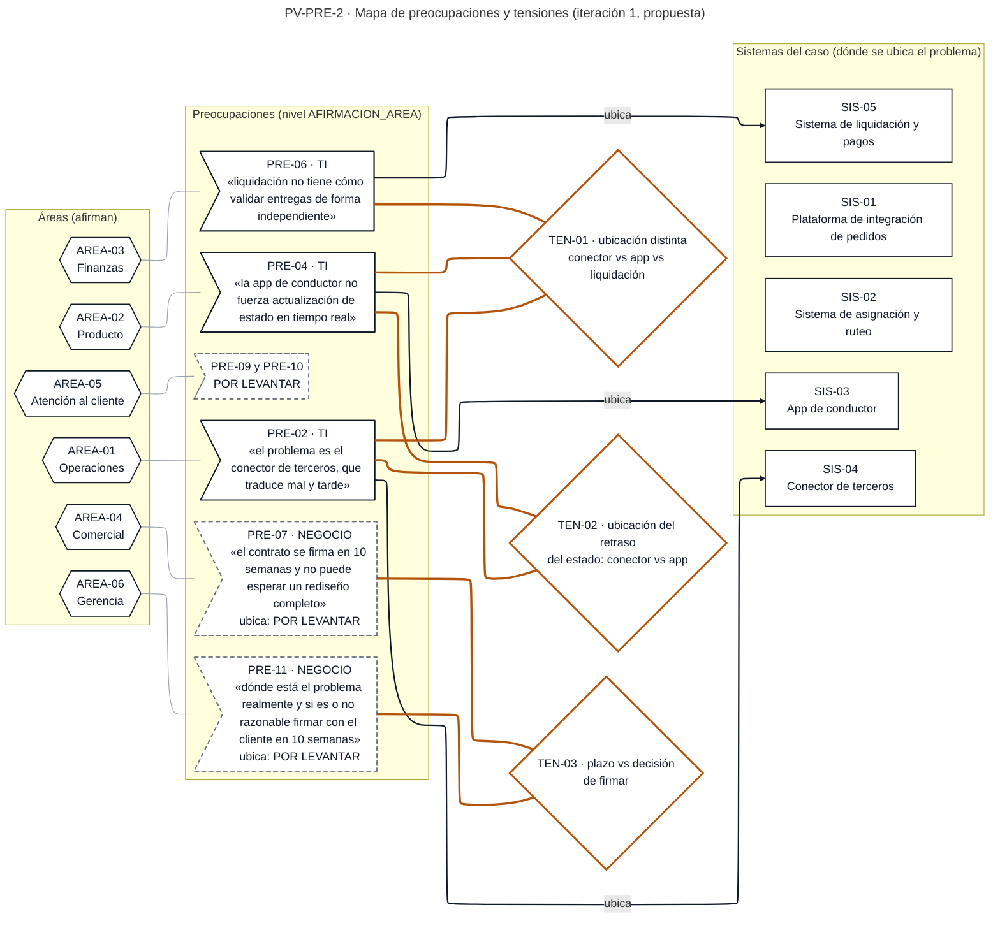
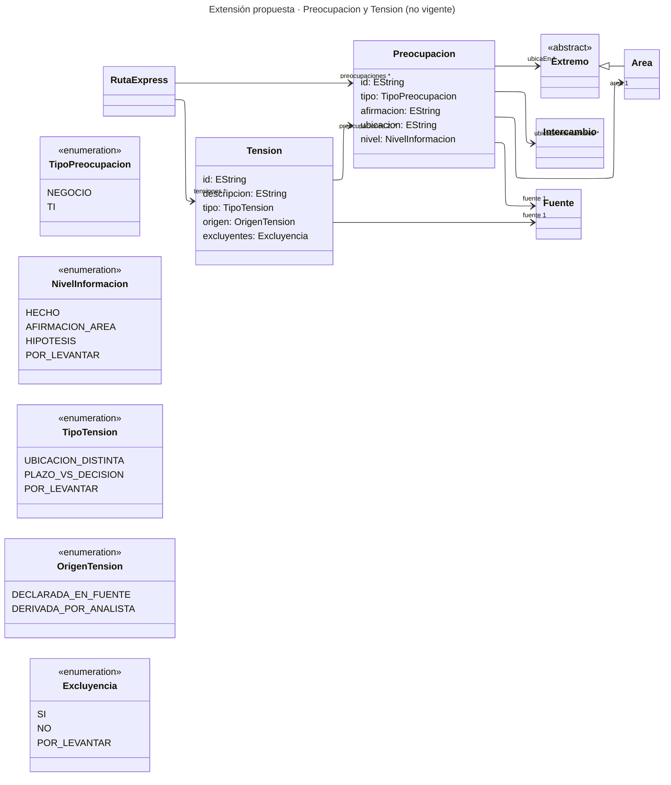

# Iteración 1 – Formato de preocupaciones y tensiones entre áreas (F5)

Para el arquitecto líder. Nada de lo que sigue está aprobado ni validado. Lo dejo como borrador para su decisión (R1).

Aviso previo. Este formato necesita conceptos que el metamodelo de Integración vigente no tiene (Preocupacion, Tension y un nivel de información). No modifico el metamodelo (R5). Marco esas partes como **PROPUESTA** y registro las brechas en la parte 4. Las hojas que sí vienen del metamodelo vigente (Area, Sistema, ParticipanteExterno, Fuente) conservan sus encabezados exactos.

---

## 1. Propósito del artefacto y conceptos que cubre

**Propósito.** Recoger, sin juzgarla, la afirmación de cada área sobre dónde está el problema, separando las preocupaciones de **negocio** de las de **TI**. Deja visibles las tensiones: dónde ubica el problema cada área y en qué punto exacto sus afirmaciones difieren. Es insumo para la etapa 4 (el documento 02 prevé "crear hipótesis de las posibles causas basándose en las quejas de las áreas") y se levanta en las reuniones con líderes de la etapa 3.

**Alcance de áreas.** Operaciones, Producto, Finanzas, Comercial, Atención al cliente y Gerencia. El enunciado nombra al "centro de atención al cliente"; uso "Atención al cliente" como nombre del área.

**Conceptos del metamodelo vigente que usa:** Area, Sistema, ParticipanteExterno, Extremo (abstracto), Intercambio (solo como llave hacia el formato PV-INT-1), Fuente.

**Conceptos nuevos (PROPUESTA, no están en el metamodelo):** Preocupacion, Tension y cinco enumeraciones (TipoPreocupacion, NivelInformacion, TipoTension, OrigenTension, Excluyencia).

**Puntos de vista propuestos (BAC-16):**

| ID | Punto de vista | Regla | Lenguaje |
|---|---|---|---|
| PV-PRE-1 | Edición: Preocupacion + Tension con las llaves a Area, Extremo, Intercambio y Fuente | Ninguna | Formato Excel (BAC-14), con CSV por hoja |
| PV-PRE-2 | Consulta: mapa de preocupaciones y tensiones | Solo Preocupaciones con afirmación distinta de POR LEVANTAR, más un marcador por Area sin ninguna | Mermaid `flowchart` con ELK (BAC-13) |

---

## 2. El artefacto

### 2.1 Artefacto vacío: estructura

Libro propuesto: `preocupaciones_v0.1.xlsx`. Cada hoja se exporta también como CSV UTF-8 (`preocupacion.csv`, `tension.csv`, etc.). Ruta sugerida en el repositorio `arquitectura-rutaexpress`: carpeta de la etapa 3, subcarpeta `preocupaciones/` (el nombre exacto de la carpeta de etapa lo confirma el líder). Los formatos `.xlsx` van a las áreas por la carpeta compartida corporativa, por confirmar con TI (toolbox).

| # | Hoja | Concepto | Encabezados (en orden) | Llave | Estado |
|---|---|---|---|---|---|
| 1 | `Preocupacion` | Preocupacion | id; area; tipo; afirmacion; ubicacion; nivel; Fuente | id. `area` → Area.id | PROPUESTA |
| 2 | `Tension` | Tension | id; descripcion; tipo; origen; excluyentes; Fuente | id | PROPUESTA |
| 3 | `Preocupacion_Extremo` | puente `ubicaEn (*)` → Extremo | preocupacion; extremo; Fuente | (preocupacion, extremo) | PROPUESTA |
| 4 | `Preocupacion_Intercambio` | puente `ubicaEnIntercambios (*)` → Intercambio | preocupacion; intercambio; Fuente | (preocupacion, intercambio). `intercambio` apunta a INT-nn del libro PV-INT-1 | PROPUESTA |
| 5 | `Tension_Preocupacion` | puente `preocupaciones (2..*)` → Preocupacion | tension; preocupacion; Fuente | (tension, preocupacion) | PROPUESTA |
| 6 | `Area` | Area (hereda id y nombre de Extremo) | id; nombre; lider; Fuente | id | VIGENTE |
| 7 | `Sistema` | Sistema (hereda id y nombre de Extremo) | id; nombre; funcion; tecnologia; responsable; Fuente | id. `responsable` → Area.id | VIGENTE |
| 8 | `ParticipanteExterno` | ParticipanteExterno (hereda id y nombre de Extremo) | id; nombre; pais; Fuente | id | VIGENTE |
| 9 | `Fuente` | Fuente | id; nombre; tipo; fecha | id | VIGENTE |
| 10 | `Catalogos` | Enumeraciones | enumeracion; valor; descripcion | (enumeracion, valor) | VIGENTE y PROPUESTA |
| 11 | `POR_LEVANTAR` | Hoja de control (PV-INT-1) | hoja; id; campo; pregunta; destinatario | (hoja, id, campo) | VIGENTE (columnas por definir) |

Los ids de Area, Sistema y ParticipanteExterno comparten el espacio de Extremo, por eso llevan prefijo distinto: AREA-nn, SIS-nn, EXT-nn. La hoja `Intercambio` no se duplica aquí. Vive en el libro PV-INT-1 y se consolida por `id`.

**Por qué tiene esta estructura**

1. **Una hoja por concepto y llaves entre hojas (BAC-14).** La afirmación de un área se registra una sola vez en `Preocupacion`, sin texto sobre las demás áreas. La contradicción vive en `Tension`, que apunta a las afirmaciones por llave. Así el formato no juzga a nadie y la tensión queda visible.
2. **Dos filas por área, NEGOCIO y TI.** Las 12 celdas (6 áreas por 2 tipos) muestran de inmediato a quién falta escuchar. Una celda sin dato se escribe `POR LEVANTAR`, no se deja en blanco.
3. **`afirmacion` literal separada de `nivel`.** Se aplica R3: una opinión de un área queda como AFIRMACION_AREA y no pasa a HECHO sin REGISTRO_SISTEMA o DOCUMENTO.
4. **`ubicacion` en texto, más puentes a Extremo e Intercambio.** Cada área dice dónde ubica el problema con las mismas llaves del metamodelo de Integración (Sistema, Intercambio). Eso hace comparables las posiciones y permite dibujar el mapa.
5. **`Tension` con `tipo`, `origen` y `excluyentes`.** `origen` separa la tensión declarada por una fuente de la que lee el analista. `excluyentes` (SI, NO, POR_LEVANTAR) dice si las afirmaciones se contradicen de verdad, y arranca en POR_LEVANTAR para no decidir quién tiene razón.
6. **Reuso de Area, Sistema, ParticipanteExterno y Fuente con sus encabezados vigentes.** El libro se puede unir al de PV-INT-1 por los ids, sin reescribir nada.
7. **Columna `Fuente` en cada fila (F1, R2).** Toda fila cita su origen o dice POR LEVANTAR.

### 2.2 Hoja `Catalogos`

| enumeracion | valor | descripcion |
|---|---|---|
| TipoFuente | ENUNCIADO_CASO | Vigente. Texto del enunciado del caso. |
| TipoFuente | DOCUMENTO | Vigente. |
| TipoFuente | ENTREVISTA | Vigente. |
| TipoFuente | REGISTRO_SISTEMA | Vigente. |
| TipoPreocupacion | NEGOCIO | PROPUESTA. La preocupación se refiere al proceso, el contrato, el SLA, un control financiero o un efecto en clientes. |
| TipoPreocupacion | TI | PROPUESTA. La preocupación se refiere al comportamiento o la capacidad de un sistema o de un intercambio. La clasificación es del analista y la valida el área. |
| NivelInformacion | HECHO | PROPUESTA (R3). Lo dice el enunciado o un documento como hecho. |
| NivelInformacion | AFIRMACION_AREA | PROPUESTA (R3). Lo dice un equipo. |
| NivelInformacion | HIPOTESIS | PROPUESTA (R3). Afirmación sin evidencia de sistema. |
| NivelInformacion | POR_LEVANTAR | PROPUESTA. No hay afirmación registrada. |
| TipoTension | UBICACION_DISTINTA | PROPUESTA. Las áreas ubican el problema en componentes distintos. |
| TipoTension | PLAZO_VS_DECISION | PROPUESTA. Un área trata el plazo como restricción y otra como decisión abierta. |
| TipoTension | POR_LEVANTAR | PROPUESTA. |
| OrigenTension | DECLARADA_EN_FUENTE | PROPUESTA. La fuente afirma el desacuerdo. |
| OrigenTension | DERIVADA_POR_ANALISTA | PROPUESTA. Lectura del analista sobre afirmaciones literales; debe validarse con las áreas. |
| Excluyencia | SI | PROPUESTA. Las afirmaciones no pueden ser ciertas a la vez. Exige evidencia. |
| Excluyencia | NO | PROPUESTA. Son compatibles. Exige evidencia o validación del líder. |
| Excluyencia | POR_LEVANTAR | PROPUESTA. Aún no se sabe. |

### 2.3 Levantamiento inicial (diligenciado solo con el enunciado)

Las afirmaciones de las áreas llegan **indirectas**: el enunciado las reporta ("Operaciones dice que…"). No hay entrevista con ninguna área. Por eso todas quedan en AFIRMACION_AREA y con Fuente ENUNCIADO_CASO.

**Hoja `Fuente`**

| id | nombre | tipo | fecha |
|---|---|---|---|
| FUE-01 | Enunciado Workshop 2 Parte I, "Caso de estudio: RutaExpress", párrafo 2 (proceso de despacho) | ENUNCIADO_CASO | POR LEVANTAR |
| FUE-02 | Enunciado Workshop 2 Parte I, "Caso de estudio: RutaExpress", párrafo 3 (secuencia no lineal, fallas de entrega) | ENUNCIADO_CASO | POR LEVANTAR |
| FUE-03 | Enunciado Workshop 2 Parte I, "Caso de estudio: RutaExpress", párrafo 4 (grupos de información) | ENUNCIADO_CASO | POR LEVANTAR |
| FUE-04 | Enunciado Workshop 2 Parte I, "Caso de estudio: RutaExpress", párrafo 5 (posiciones de las áreas y condición de la gerencia) | ENUNCIADO_CASO | POR LEVANTAR |

**Hoja `Area`**

| id | nombre | lider | Fuente |
|---|---|---|---|
| AREA-01 | Operaciones | POR LEVANTAR | FUE-04 |
| AREA-02 | Producto | POR LEVANTAR | FUE-04 |
| AREA-03 | Finanzas | POR LEVANTAR | FUE-04 |
| AREA-04 | Comercial | POR LEVANTAR | FUE-04 |
| AREA-05 | Atención al cliente | POR LEVANTAR | FUE-01 |
| AREA-06 | Gerencia | POR LEVANTAR | FUE-04 |

**Hoja `Sistema`.** Los cinco sistemas que el enunciado nombra. Las funciones son transcripciones o paráfrasis cercanas del texto.

| id | nombre | funcion | tecnologia | responsable | Fuente |
|---|---|---|---|---|---|
| SIS-01 | Plataforma de integración de pedidos | Recibe el pedido que envía el marketplace, valida que los datos de dirección y contacto estén completos y lo enruta según el tipo de entrega | POR LEVANTAR | POR LEVANTAR | FUE-01 |
| SIS-02 | Sistema de asignación y ruteo | Calcula la ruta óptima y asigna un conductor disponible según zona y capacidad | POR LEVANTAR | POR LEVANTAR | FUE-01 |
| SIS-03 | App de conductor | Registra recogida, tránsito y entrega, incluyendo evidencia fotográfica y firma digital | POR LEVANTAR | POR LEVANTAR | FUE-01 |
| SIS-04 | Conector de terceros | Traduce el formato interno al que cada aliado requiere | POR LEVANTAR | POR LEVANTAR | FUE-01 |
| SIS-05 | Sistema de liquidación y pagos | Calcula lo que se debe pagar a cada conductor o transportadora aliada según las entregas completadas, y lo que se debe cobrar al marketplace según el SLA cumplido | POR LEVANTAR | POR LEVANTAR | FUE-01 |

**Hoja `ParticipanteExterno`.** Vacía. El enunciado no nombra marketplaces ni aliados.

| id | nombre | pais | Fuente |
|---|---|---|---|
| (sin filas) | | | |

**Hoja `Preocupacion`**

| id | area | tipo | afirmacion | ubicacion | nivel | Fuente |
|---|---|---|---|---|---|---|
| PRE-01 | AREA-01 | NEGOCIO | POR LEVANTAR | POR LEVANTAR | POR_LEVANTAR | POR LEVANTAR |
| PRE-02 | AREA-01 | TI | «el problema es el conector de terceros, que traduce mal y tarde» | Conector de terceros (SIS-04) | AFIRMACION_AREA | FUE-04 |
| PRE-03 | AREA-02 | NEGOCIO | POR LEVANTAR | POR LEVANTAR | POR_LEVANTAR | POR LEVANTAR |
| PRE-04 | AREA-02 | TI | «el problema es que la app de conductor no fuerza actualización de estado en tiempo real» | App de conductor (SIS-03) | AFIRMACION_AREA | FUE-04 |
| PRE-05 | AREA-03 | NEGOCIO | POR LEVANTAR | POR LEVANTAR | POR_LEVANTAR | POR LEVANTAR |
| PRE-06 | AREA-03 | TI | «el verdadero problema es que liquidación no tiene cómo validar entregas de forma independiente» | Liquidación (SIS-05) | AFIRMACION_AREA | FUE-04 |
| PRE-07 | AREA-04 | NEGOCIO | «presiona porque el contrato se firma en 10 semanas y no puede esperar un rediseño completo» | POR LEVANTAR | AFIRMACION_AREA | FUE-04 |
| PRE-08 | AREA-04 | TI | POR LEVANTAR | POR LEVANTAR | POR_LEVANTAR | POR LEVANTAR |
| PRE-09 | AREA-05 | NEGOCIO | POR LEVANTAR | POR LEVANTAR | POR_LEVANTAR | POR LEVANTAR |
| PRE-10 | AREA-05 | TI | POR LEVANTAR | POR LEVANTAR | POR_LEVANTAR | POR LEVANTAR |
| PRE-11 | AREA-06 | NEGOCIO | «No quiero ideas de soluciones. Quiero saber cómo van a abordar el problema: qué van a mirar, en qué orden, y cómo me van a decir dónde está el problema realmente y si es o no razonable firmar con el cliente en 10 semanas.» | POR LEVANTAR (la gerencia pide que se determine) | AFIRMACION_AREA | FUE-04 |
| PRE-12 | AREA-06 | TI | POR LEVANTAR | POR LEVANTAR | POR_LEVANTAR | POR LEVANTAR |

Notas de lectura:

- PRE-11 es una condición de la gerencia, no una afirmación sobre la causa. Se registra en AFIRMACION_AREA porque lo dice un equipo. No es HECHO ni causa.
- La clasificación TI de PRE-06 es mía y está por validar con Finanzas (pregunta Q-08).
- Atención al cliente no tiene ninguna afirmación en el enunciado. Lo que el enunciado dice de ella es un hecho de proceso, no una preocupación suya (ver el bloque de hechos más abajo).

**Hoja `Preocupacion_Extremo`**

| preocupacion | extremo | Fuente |
|---|---|---|
| PRE-02 | SIS-04 | FUE-04 |
| PRE-04 | SIS-03 | FUE-04 |
| PRE-06 | SIS-05 | FUE-04 |

**Hoja `Preocupacion_Intercambio`.** Vacía. Depende de que se levanten los Intercambios en PV-INT-1 (pregunta Q-05 y Q-07).

| preocupacion | intercambio | Fuente |
|---|---|---|
| (sin filas) | | |

**Hoja `Tension`**

| id | descripcion | tipo | origen | excluyentes | Fuente |
|---|---|---|---|---|---|
| TEN-01 | Tres áreas ubican "el problema" en componentes distintos: Operaciones en el conector de terceros (SIS-04), Producto en la app de conductor (SIS-03) y Finanzas en la liquidación (SIS-05). El enunciado dice que "los equipos no coinciden en dónde está el problema". Punto de contradicción: cuál de esos componentes origina el problema. El enunciado no delimita "el problema" con una sola frase (pregunta Q-15). | UBICACION_DISTINTA | DECLARADA_EN_FUENTE | POR_LEVANTAR | FUE-04 |
| TEN-02 | Operaciones y Producto hablan de la oportunidad del estado, pero ubican el retraso en puntos distintos. Operaciones: el conector "traduce mal y tarde". Producto: la app "no fuerza actualización de estado en tiempo real". Lectura del analista: el enunciado no dice si ambas se refieren al mismo estado ni a las mismas modalidades. | UBICACION_DISTINTA | DERIVADA_POR_ANALISTA | POR_LEVANTAR | FUE-04 |
| TEN-03 | Comercial presenta las 10 semanas como restricción ("presiona porque el contrato se firma en 10 semanas"). La gerencia presenta firmar en 10 semanas como pregunta abierta ("si es o no razonable"). Lectura del analista: el enunciado no registra un desacuerdo explícito entre ambas. | PLAZO_VS_DECISION | DERIVADA_POR_ANALISTA | POR_LEVANTAR | FUE-04 |

**Hoja `Tension_Preocupacion`**

| tension | preocupacion | Fuente |
|---|---|---|
| TEN-01 | PRE-02 | FUE-04 |
| TEN-01 | PRE-04 | FUE-04 |
| TEN-01 | PRE-06 | FUE-04 |
| TEN-02 | PRE-02 | FUE-04 |
| TEN-02 | PRE-04 | FUE-04 |
| TEN-03 | PRE-07 | FUE-04 |
| TEN-03 | PRE-11 | FUE-04 |

**Hechos del enunciado que tocan estas afirmaciones (nivel HECHO; no confirman ninguna).** No tienen hoja propia en el formato (ver brecha B-3). Quedan aquí para contrastar en la etapa 4.

| Toca a | Texto del enunciado | Fuente |
|---|---|---|
| Operaciones (PRE-02) | El conector de terceros "traduce y a veces pierde información en el camino". | FUE-03 |
| Operaciones y Producto (TEN-02) | "Un conductor puede marcar una entrega como completada en la app sin que el marketplace reciba la confirmación a tiempo por una falla en la integración." El texto no dice en qué sistema está esa falla. | FUE-02 |
| Operaciones y Producto (TEN-02) | Una transportadora aliada "puede reportar el estado por correo en lugar de hacerlo por el conector", y el pedido queda "en tránsito" en el sistema interno aunque ya fue entregado. Este caso no coincide con ninguna de las dos afirmaciones. | FUE-02 |
| Finanzas (PRE-06) | La liquidación "es, de los cinco sistemas, el que más sufre cuando hay inconsistencia aguas arriba". Finanzas la ubica como el problema; el enunciado la describe como la más afectada. No se dice si ambas cosas son compatibles. | FUE-03 |
| Atención al cliente | Recibe consultas por WhatsApp, línea telefónica y chat embebido en el sitio del marketplace. "Para resolver las consultas se debe consultar el estado real cruzando información de varios de estos sistemas." | FUE-01 |

### 2.4 Vista PV-PRE-2: mapa de preocupaciones y tensiones

Archivo: `iter1_vista.mmd`. Es el mismo texto que el siguiente bloque, sin las cercas.

**Lenguaje gráfico (BAC-13) de la vista**

| Elemento | Representación | Origen del lenguaje |
|---|---|---|
| Area | Hexágono | Vigente (PV-INT-2) |
| Sistema | Rectángulo | Vigente (PV-INT-2) |
| Preocupacion | Bandera (forma asimétrica) | PROPUESTA |
| Tension | Rombo con borde naranja | PROPUESTA |
| El área afirma la preocupación | Línea fina gris | PROPUESTA |
| El área ubica el problema en un sistema | Flecha rotulada "ubica" | PROPUESTA |
| La preocupación participa en la tensión | Línea gruesa naranja | PROPUESTA |
| Afirmación o ubicación POR LEVANTAR | Borde punteado | PROPUESTA |

Esta vista no usa la flecha punteada ni la flecha roja gruesa. Esos estilos están reservados a Intercambio en PV-INT-2 y se evita mezclarlos. Los sistemas están en el orden en que los lista el enunciado, y esa posición no representa Intercambios (aún no se levantan). No pude renderizar el diagrama en este entorno; revisé la sintaxis a mano y conviene abrirlo en el editor Mermaid del equipo antes de aprobarlo.

Qué muestra el mapa, sin tomar partido:

- Las flechas "ubica" salen hacia tres sistemas distintos (SIS-04, SIS-03, SIS-05), y las tres convergen en TEN-01.
- Operaciones y Producto comparten TEN-02 porque ambos hablan de la oportunidad del estado.
- Comercial y Gerencia no ubican el problema en ningún sistema. Sus nodos son punteados y se unen en TEN-03.
- Atención al cliente aparece solo como marcador POR LEVANTAR.
- SIS-01 y SIS-02 no reciben ninguna ubicación de las áreas.

---

## 3. POR LEVANTAR / Preguntas

Todas las preguntas pasan por el arquitecto líder, que decide a quién se envían (R1). El destinatario es quien puede responderlas. Estas filas son el contenido de la hoja `POR_LEVANTAR` (columnas: hoja; id; campo; pregunta; destinatario).

| # | Hoja / id / campo | Pregunta | Destinatario |
|---|---|---|---|
| Q-01 | Area / AREA-01 a AREA-06 / lider | ¿Quién es la persona o el cargo líder de cada área, que será el interlocutor del levantamiento? | Gerencia, a través del arquitecto líder |
| Q-02 | Sistema / SIS-01 a SIS-05 / responsable y tecnologia | ¿Qué área es dueña de cada sistema y qué plataforma usa? Se registra solo si hay una fuente. | Gerencia y los líderes de aplicaciones |
| Q-03 | Fuente / FUE-01 a FUE-04 / fecha | ¿Cuál es la fecha del enunciado del caso? | Arquitecto líder |
| Q-04 | Preocupacion / PRE-01 / afirmacion | ¿Cuál es la preocupación de negocio de Operaciones (efecto en la operación)? | Operaciones |
| Q-05 | Preocupacion / PRE-02 / ubicacion, nivel | ¿Qué significa "traduce mal" (qué se pierde o se deforma) y "tarde" (cuánto, respecto de qué evento)? ¿Qué registros del conector lo respaldan? ¿En qué modalidades ocurre? ¿Qué Intercambio (INT-nn) es? | Operaciones |
| Q-06 | Preocupacion / PRE-03 / afirmacion | ¿Cuál es la preocupación de negocio de Producto? | Producto |
| Q-07 | Preocupacion / PRE-04 / ubicacion, nivel | ¿Qué estados deben actualizarse "en tiempo real" y en qué momento? ¿Hacia quién viaja esa actualización (qué Intercambio)? ¿En qué modalidades? ¿Qué registro de la app lo respalda? | Producto |
| Q-08 | Preocupacion / PRE-05 y PRE-06 | PRE-05: ¿cuál es la preocupación de negocio de Finanzas? PRE-06: ¿qué significa "validar entregas de forma independiente" y con qué datos? ¿Ubica la causa en la liquidación o en lo que le llega aguas arriba? ¿Se clasifica TI o NEGOCIO? | Finanzas |
| Q-09 | Preocupacion / PRE-07 y PRE-08 | PRE-07: ¿en qué componente o etapa ubica Comercial el problema? ¿Qué entiende por "rediseño completo" y qué área lo plantea? PRE-08: ¿cuál es su preocupación de TI? | Comercial |
| Q-10 | Documento nuevo / SLA | ¿Qué define el contrato por "tiempo real" y por "estado exacto de cualquier pedido"? Se pide el texto como Fuente tipo DOCUMENTO. | Comercial y Gerencia |
| Q-11 | Preocupacion / PRE-09 y PRE-10 | ¿Cuáles son las preocupaciones de negocio y de TI de Atención al cliente? ¿Qué sistemas consulta para cruzar el "estado real" y por qué mecanismo (no se asume que sea manual)? | Atención al cliente |
| Q-12 | Preocupacion / PRE-12 | ¿Tiene la gerencia alguna preocupación de TI propia? | Gerencia, a través del arquitecto líder |
| Q-13 | Tension / TEN-01 y TEN-02 / excluyentes | ¿Las afirmaciones de Operaciones y Producto se excluyen o son compatibles? El enunciado describe el conector para pedidos de transportadora aliada y la app para pedidos asignados a un conductor. No dice si el retraso que cada una señala ocurre en las mismas modalidades. | Operaciones y Producto, en sesión conjunta |
| Q-14 | Tension / TEN-03 / excluyentes | ¿Existe un desacuerdo explícito entre Comercial y Gerencia sobre firmar en 10 semanas, o es solo diferencia de énfasis? | Comercial y Gerencia |
| Q-15 | Tension / TEN-01 / descripcion | El enunciado dice "el problema" sin delimitarlo. ¿Qué formulación de "el problema" se toma como referencia común para comparar a las áreas? | Arquitecto líder |
| Q-16 | Fuente / FUE-04 / tipo | Las afirmaciones llegan reportadas por el enunciado. ¿Se harán entrevistas o actas por área para registrarlas como ENTREVISTA o DOCUMENTO? | Arquitecto líder |
| Q-17 | Repositorio y distribución | ¿Cuál es el nombre de la carpeta de la etapa en `arquitectura-rutaexpress` y cuál es la carpeta compartida corporativa? | Arquitecto líder y TI |
| Q-18 | Metamodelo | ¿Aprueba la extensión propuesta en la parte 4 (B-1, B-2, B-3)? | Arquitecto líder |

---

## 4. Control de conformidad

### 4.1 Restricciones verificadas

**Metamodelo vigente (BAC-12)**

| Restricción | Resultado |
|---|---|
| R1 a R4 (Intercambio) | No aplican: este libro no contiene filas de Intercambio. |
| R5 (Problema como hipótesis) | No aplica: no se creó ningún Problema. Las preocupaciones no se registran como Problemas. |
| R6 (sin dato, POR LEVANTAR) | Cumple. `lider`, `tecnologia`, `responsable`, `fecha` y los 7 campos de preocupación sin fuente están en POR LEVANTAR. No se infirió ningún dato. |
| Encabezados de Area, Sistema, ParticipanteExterno y Fuente | Coinciden con BAC-11. Se añade `Fuente` en las tres primeras por F1. |
| Enumeración TipoFuente | Cumple: solo se usa ENUNCIADO_CASO. |
| Herencia de Extremo | Id y nombre de Area y Sistema siguen el diagrama 06 (Extremo es superclase de Sistema, ParticipanteExterno y Area). |

**Restricciones propuestas para la extensión (N1 a N4), verificadas sobre los datos de esta iteración**

| ID | Restricción propuesta | Resultado |
|---|---|---|
| N1 | Toda Preocupacion tiene un Area y una Fuente. La Fuente solo puede ser POR LEVANTAR si afirmacion es POR LEVANTAR. | Cumple en las 12 filas. |
| N2 | Un nivel HECHO exige una Fuente REGISTRO_SISTEMA o DOCUMENTO (análoga a R5 vigente). | Cumple: no hay filas HECHO y todas las fuentes son ENUNCIADO_CASO. |
| N3 | Toda Tension referencia al menos 2 Preocupaciones de áreas distintas. | Cumple: TEN-01 tiene 3 áreas, TEN-02 tiene 2 y TEN-03 tiene 2. |
| N4 | `excluyentes` es POR_LEVANTAR mientras no haya evidencia (REGISTRO_SISTEMA o DOCUMENTO) o validación del líder. | Cumple en las 3 tensiones. |

Las llaves de `Preocupacion_Extremo` (SIS-03, SIS-04, SIS-05) existen en la hoja `Sistema`. Las filas puente coinciden con la columna `ubicacion` de PRE-02, PRE-04 y PRE-06. PRE-07 y PRE-11 no tienen fila puente porque su ubicación es POR LEVANTAR.

### 4.2 Conformidad con el metamodelo: resultado de F6

**Las hojas `Preocupacion`, `Tension` y las tres hojas puente NO son conformes con el metamodelo vigente.** Usan conceptos, atributos y relaciones que no están en él. El resto del libro sí lo es. Esto queda abierto hasta que el líder decida sobre B-1, B-2 y B-3.

### 4.3 Brechas de metamodelo

| ID | Brecha de metamodelo | Ajuste propuesto (decide el líder) |
|---|---|---|
| B-1 | No existe un concepto para la afirmación de un área. `Problema` no sirve: cuelga de `Intercambio`, y de las 5 afirmaciones del enunciado solo una (la del conector) se acerca a un intercambio. Finanzas señala un sistema, y Comercial y Gerencia no señalan ningún componente. | Añadir `Preocupacion` (id, tipo, afirmacion, ubicacion, nivel; relaciones `area` 1, `ubicaEn` *, `ubicaEnIntercambios` *, `fuente` 1), con raíz en `RutaExpress.preocupaciones`. |
| B-2 | No existe un concepto para la tensión entre áreas. | Añadir `Tension` (id, descripcion, tipo, origen, excluyentes; relaciones `preocupaciones` 2..* y `fuente` 1), con raíz en `RutaExpress.tensiones`. |
| B-3 | El nivel de información de R3 (HECHO, AFIRMACION DE ÁREA, HIPÓTESIS) solo existe como regla de rol, no como atributo, y el metamodelo solo lo cubre para `Problema` (R5). Los hechos del enunciado que contrastan una afirmación tampoco tienen dónde registrarse. | Añadir la enumeración `NivelInformacion` en `Preocupacion`. Los hechos de contraste quedan fuera del formato, o se decide crear un concepto para ellos. |
| B-4 | `Area` no distingue a la gerencia como patrocinador del estudio. Además, `TipoFuente` no tiene un valor para una instrucción del arquitecto líder, así que el rol de patrocinador no se pudo registrar con fuente. | Opcional: atributo `rolEnEstudio` en `Area` y un valor nuevo en `TipoFuente`. Mientras tanto, Gerencia se registra como un Area más. |
| B-5 | No hay concepto para ubicar una preocupación en un contrato, un SLA o un plazo (caso de Comercial). | Por ahora `ubicacion` queda POR LEVANTAR. Opcional: un concepto `Contrato`, que sería un cambio mayor. |
| B-6 | La hoja de control `POR_LEVANTAR` está nombrada en PV-INT-1 pero sus columnas no están definidas. | Se propone: hoja; id; campo; pregunta; destinatario. |

**Diagrama de la extensión propuesta (BAC-09)**

### 4.4 Límites de esta iteración

- No se propuso ninguna solución ni se tomó posición sobre firmar el contrato (R4). La neutralidad entre áreas se mantuvo: ninguna afirmación se calificó como más probable.
- No se registró ninguna cifra, latencia, tecnología, volumen, responsable ni nombre de aliado o marketplace.
- Las tres tensiones son lecturas del enunciado. Solo TEN-01 está declarada por la fuente ("los equipos no coinciden en dónde está el problema"). TEN-02 y TEN-03 son lecturas mías y están marcadas como tales para que las áreas las validen.
- Quedan para la siguiente iteración, si el líder lo decide: aprobar o ajustar B-1 a B-3, entrevistar a las áreas (Q-04 a Q-14) y levantar los Intercambios que alimenten `Preocupacion_Intercambio`.
