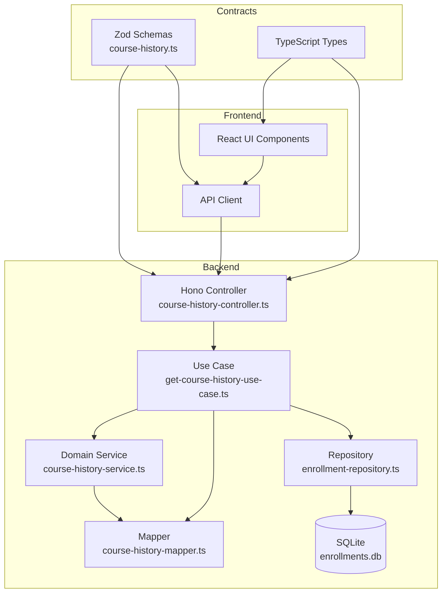
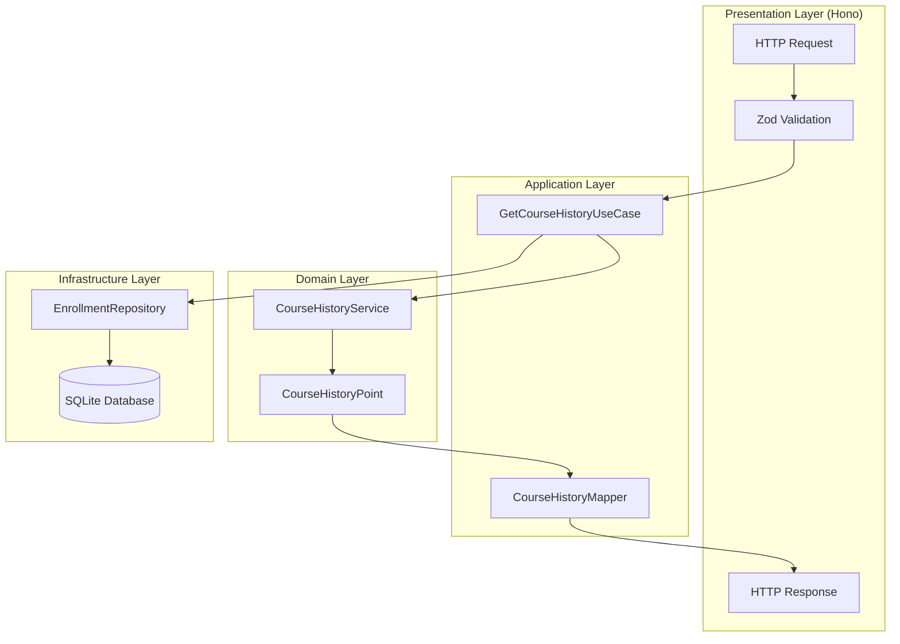
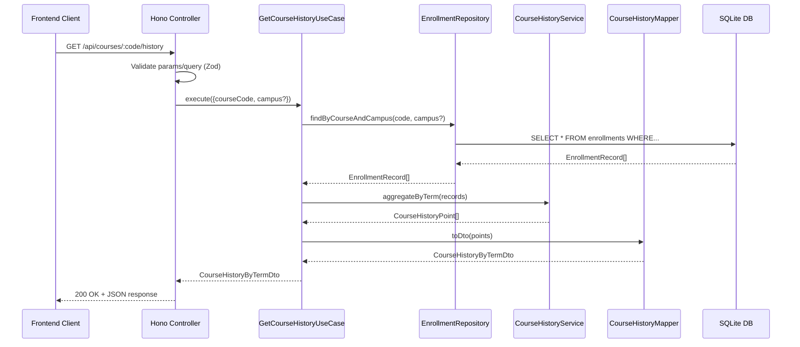
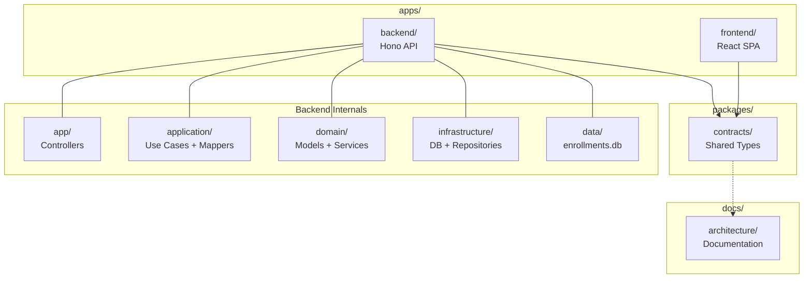
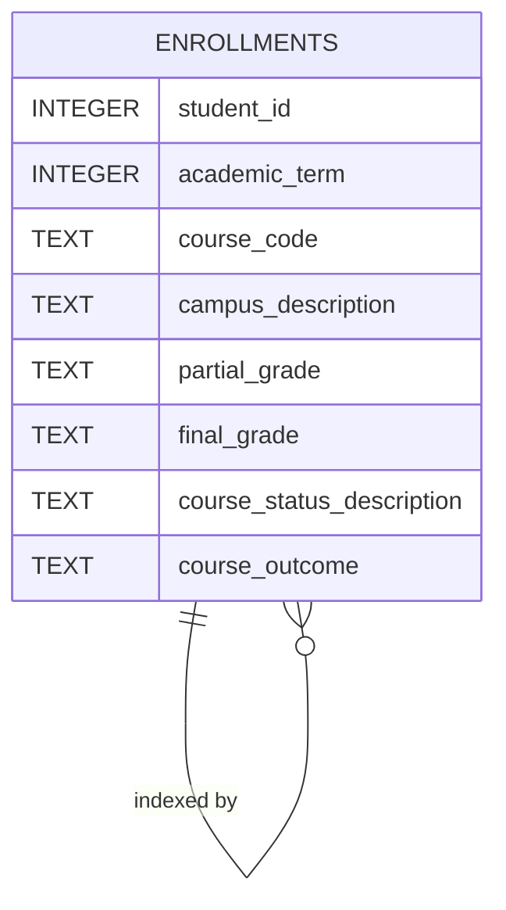
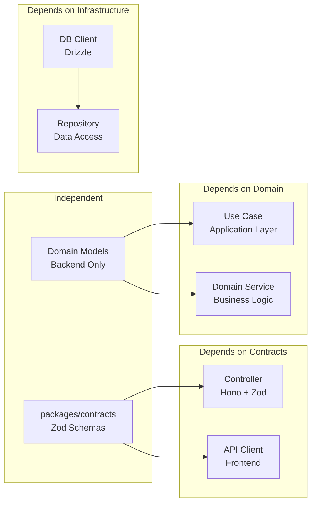
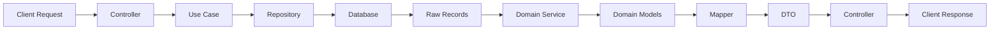

# Architecture Diagrams

## System Overview



## Layered Architecture



## Data Flow



## Monorepo Structure



## Database Schema



## Component Dependencies



## Request-Response Cycle



## Technology Stack

```mermaid
graph TB
    subgraph "Frontend Layer"
        React[React 18<br/>UI Framework]
        Vite[Vite<br/>Build Tool]
        TypeScript[TypeScript<br/>Type Safety]
    end
    
    subgraph "Backend Layer"
        Hono[Hono<br/>Web Framework]
        Zod[Zod<br/>Validation]
        OpenAPI[hono-zod-openapi<br/>API Docs]
    end
    
    subgraph "Data Layer"
        SQLite[SQLite<br/>Database]
        Drizzle[Drizzle ORM<br/>Query Builder]
        BetterSQLite[better-sqlite3<br/>Driver]
    end
    
    subgraph "Shared Layer"
        Contracts[TypeScript Contracts<br/>packages/contracts]
        ZodSchemas[Zod Schemas<br/>Single Source of Truth]
    end
    
    React --> TypeScript
    Vite --> React
    Hono --> Zod
    Hono --> OpenAPI
    Drizzle --> BetterSQLite
    BetterSQLite --> SQLite
    Contracts --> ZodSchemas
    TypeScript --> Contracts
    OpenAPI --> ZodSchemas