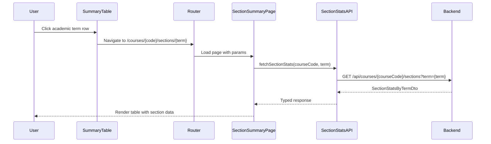
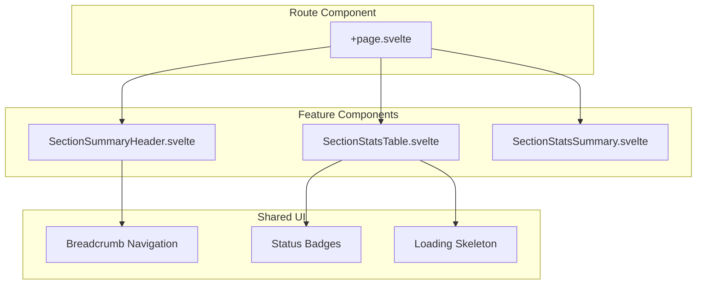

# Section Summary Page - Frontend Architecture

## 1. Overview

### 1.1 Problem Statement

The existing frontend displays aggregate enrollment statistics per academic term in the dashboard's summary table. However, users cannot:

- View enrollment statistics broken down by section within a specific term
- Analyze pass/fail/withdrawn rates per section for planning decisions
- Navigate directly to section-level details from the summary or forecast tables

### 1.2 Goal

Create a new frontend page (`/courses/[code]/sections/[term]`) that:

- Displays section-level statistics for a specific course and academic term
- Presents data in a sortable table following existing UI patterns
- Supports navigation from dashboard summary table and forecast backtesting table
- Provides clear navigation back to the originating dashboard

### 1.3 Design Principles

1. **Consistency**: Follow existing patterns from course-history and forecasts features
2. **Reuse**: Leverage existing UI components (shadcn-svelte, Tailwind patterns)
3. **Separation of Concerns**: API module, store, components, and logic clearly separated
4. **Future-Ready**: Design navigation to support linking from multiple sources

---

## 2. Architecture Overview

### 2.1 System Context

```mermaid
flowchart TB
    subgraph "Existing Pages"
        DASH[Dashboard<br>/]
        FORECAST[Forecast Accuracy<br>/courses/[code]/accuracy]
    end

    subgraph "New Page"
        SECTION[Section Summary<br>/courses/[code]/sections/[term]]
    end

    subgraph "Backend API"
        API[GET /api/courses/{courseCode}/sections?term={term}]
    end

    DASH -->|Click academic_term| SECTION
    FORECAST -->|Click academic_term| SECTION
    SECTION -->|Back navigation| DASH
    SECTION -->|Fetch data| API
```

### 2.2 Data Flow



---

## 3. Route Structure

### 3.1 URL Design

```
/courses/[code]/sections/[term]
```

| Parameter | Type | Example | Description |
|-----------|------|---------|-------------|
| `code` | string | `ISIS-3204` | Course code (XXXX-DDDD format) |
| `term` | string | `202410` | Academic term identifier |

### 3.2 Route Files

```
src/routes/courses/[code]/sections/[term]/
├── +page.svelte          # Page component
└── +page.ts              # Optional: SSR data loading (if needed)
```

### 3.3 URL Examples

| Source | Navigation URL |
|--------|---------------|
| Dashboard summary table | `/courses/ISIS-3204/sections/202410` |
| Forecast accuracy table | `/courses/ISIS-3204/sections/202410` |
| Direct access | `/courses/ISIS-3204/sections/202410` |

---

## 4. Component Architecture

### 4.1 Component Hierarchy



### 4.2 Component Responsibilities

| Component | Responsibility | Location |
|-----------|---------------|----------|
| `+page.svelte` | Route orchestration, param extraction, layout | `src/routes/.../+page.svelte` |
| `SectionSummaryHeader.svelte` | Breadcrumb nav, title, back button | `src/lib/features/section-summary/components/` |
| `SectionStatsTable.svelte` | Data table with sorting, loading/error states | `src/lib/features/section-summary/components/` |
| `SectionStatsSummary.svelte` | Aggregate metrics display | `src/lib/features/section-summary/components/` |

### 4.3 Feature Module Structure

```
src/lib/features/section-summary/
├── components/
│   ├── SectionSummaryHeader.svelte
│   ├── SectionStatsTable.svelte
│   ├── SectionStatsSummary.svelte
│   └── SectionStatsTableSkeleton.svelte
├── api/
│   └── section-stats.api.ts
├── types/
│   └── section-stats.types.ts
└── index.ts
```

---

## 5. API Integration

### 5.1 API Module

**Location**: `src/lib/features/section-summary/api/section-stats.api.ts`

```typescript
import type { SectionStatsByTermDto } from '@app/contracts';

const SECTIONS_PATH = '/api/courses';

export interface FetchSectionStatsOptions {
  courseCode: string;
  term: number;
}

export async function fetchSectionStats(
  options: FetchSectionStatsOptions
): Promise<SectionStatsByTermDto> {
  const { courseCode, term } = options;

  // Validate course code format
  if (!/^[A-Z]{4}-\d{4}$/.test(courseCode)) {
    throw new Error('Invalid course code format');
  }

  const baseUrl = import.meta.env.VITE_API_BASE_URL ?? 'http://localhost:3000';
  const url = `${baseUrl}${SECTIONS_PATH}/${courseCode}/sections?term=${term}`;

  const response = await fetch(url);

  if (!response.ok) {
    if (response.status === 404) {
      throw new Error('Course or term not found');
    }
    throw new Error(`Failed to fetch section stats: ${response.statusText}`);
  }

  return response.json();
}
```

### 5.2 Backend Endpoint Reference

| Endpoint | Method | Response |
|----------|--------|----------|
| `/api/courses/{courseCode}/sections?term={term}` | GET | `SectionStatsByTermDto` |

See [Backend Architecture](../../use-cases/get-section-stats/architecture.md) for full API documentation.

---

## 6. Data Model

### 6.1 Types (from contracts)

```typescript
// Re-exported from @app/contracts
export type {
  SectionStatDto,
  TermSectionStatsDto,
  SectionStatsByTermDto
} from '@app/contracts';
```

### 6.2 Display Data Structure

```typescript
// For table display
interface SectionTableRow {
  section: number;
  enrolled: number;
  passed: number;
  failed: number;
  withdrawn: number;
  passRate: number;  // Computed: (passed / enrolled) * 100
}

// For summary display
interface SectionSummaryData {
  totalSections: number;
  totalEnrolled: number;
  totalPassed: number;
  totalFailed: number;
  totalWithdrawn: number;
  overallPassRate: number;
}
```

---

## 7. UI/UX Design

### 7.1 Page Layout

```
┌─────────────────────────────────────────────────────────────┐
│  Dashboard / ISIS-3204 / Sections / 2024-10                 │  ← Breadcrumb
├─────────────────────────────────────────────────────────────┤
│                                                             │
│  Section Statistics for ISIS-3204                           │  ← Title
│  Academic Term: 2024-10 (Spring)                            │  ← Subtitle
│                                                             │
├─────────────────────────────────────────────────────────────┤
│  ┌─────────┐  ┌─────────┐  ┌─────────┐                      │
│  │ Total   │  │ Overall │  │ Sections│                      │  ← Summary Cards
│  │ 83      │  │ 80.7%   │  │ 3       │                      │
│  │Enrolled │  │Pass Rate│  │         │                      │
│  └─────────┘  └─────────┘  └─────────┘                      │
├─────────────────────────────────────────────────────────────┤
│                                                             │
│  ┌─────────┬──────────┬────────┬────────┬──────────┬──────┐│
│  │ Section │ Enrolled │ Passed │ Failed │ Withdrawn│ Rate ││  ← Table Header
│  ├─────────┼──────────┼────────┼────────┼──────────┼──────┤│
│  │    3    │    25    │   20   │    3   │     2    │ 80%  ││
│  │    2    │    30    │   25   │    4   │     1    │ 83%  ││
│  │    1    │    28    │   22   │    5   │     1    │ 79%  ││
│  └─────────┴──────────┴────────┴────────┴──────────┴──────┘│
│                                                             │
└─────────────────────────────────────────────────────────────┘
```

### 7.2 Table Columns

| Column | Description | Sortable | Format |
|--------|-------------|----------|--------|
| Section | Section number | Yes (default: desc) | Integer |
| Enrolled | Total students | Yes | Integer |
| Passed | Students who passed | Yes | Integer (emerald) |
| Failed | Students who failed | Yes | Integer (red) |
| Withdrawn | Students who withdrew | Yes | Integer (amber) |
| Pass Rate | passed/enrolled * 100 | Yes | Percentage with badge |

### 7.3 Color Coding (Consistent with existing)

| Element | Condition | Color Class |
|---------|-----------|-------------|
| Pass Rate Badge | >= 80% | `bg-emerald-500/20 text-emerald-400` |
| Pass Rate Badge | >= 60% | `bg-amber-500/20 text-amber-400` |
| Pass Rate Badge | < 60% | `bg-red-500/20 text-red-400` |
| Passed Count | Always | `text-emerald-400` |
| Failed Count | Always | `text-red-400` |
| Withdrawn Count | Always | `text-amber-400` |

### 7.4 States

| State | Display |
|-------|---------|
| Loading | Skeleton table with 5 rows |
| Error | Error message with retry button |
| No Data | Empty state with explanation |
| Success | Table with data |

---

## 8. Navigation Design

### 8.1 Entry Points

#### From Dashboard Summary Table

```svelte
<!-- In SummaryTable.svelte -->
<tr
  class="cursor-pointer hover:bg-slate-800/60"
  onclick={() => goto(`/courses/${courseCode}/sections/${term}`)}
>
  <td>{formatTerm(term)}</td>
  <!-- ... other cells ... -->
</tr>
```

#### From Forecast Accuracy Table

```svelte
<!-- In AccuracyTable.svelte -->
<tr
  class="cursor-pointer hover:bg-slate-800/60"
  onclick={() => goto(`/courses/${courseCode}/sections/${row.academicTerm}`)}
>
  <td>{formatTerm(row.academicTerm)}</td>
  <!-- ... other cells ... -->
</tr>
```

### 8.2 Exit Points (Back Navigation)

```svelte
<!-- In SectionSummaryHeader.svelte -->
<nav class="mb-2 text-sm">
  <a href="/" class="text-slate-400 hover:text-slate-200">Dashboard</a>
  <span class="mx-2 text-slate-600">/</span>
  <a href="/" class="text-slate-400 hover:text-slate-200">{courseCode}</a>
  <span class="mx-2 text-slate-600">/</span>
  <span class="text-slate-200">Sections</span>
  <span class="mx-2 text-slate-600">/</span>
  <span class="text-slate-200">{formatTerm(term)}</span>
</nav>
```

### 8.3 Future: Query Parameter for Return Path

To support returning to the correct originating page:

```
/courses/ISIS-3204/sections/202410?from=accuracy
/courses/ISIS-3204/sections/202410?from=dashboard
```

```svelte
<script lang="ts">
  const from = $page.url.searchParams.get('from');
  const backUrl = from === 'accuracy'
    ? `/courses/${courseCode}/accuracy`
    : '/';
</script>
```

---

## 9. Error Handling

### 9.1 Validation Errors

| Error | Handling |
|-------|----------|
| Invalid course code format | Show error state, suggest valid format |
| Invalid term format | Show error state, redirect to dashboard |

### 9.2 API Errors

| HTTP Status | User Message |
|-------------|--------------|
| 400 | "Invalid request parameters" |
| 404 | "No section data found for this course and term" |
| 500 | "Server error. Please try again later." |

### 9.3 No Data Response

When API returns empty `terms` array:

```svelte
<div class="text-center py-12">
  <Icon name="chart-bar" class="w-12 h-12 text-slate-600 mx-auto mb-4" />
  <h3 class="text-lg font-medium text-slate-300">No Section Data</h3>
  <p class="text-slate-500 mt-2">
    No section statistics are available for {courseCode} in term {formatTerm(term)}.
  </p>
  <a href="/" class="text-blue-400 hover:text-blue-300 mt-4 inline-block">
    Return to Dashboard
  </a>
</div>
```

---

## 10. Accessibility

### 10.1 Table Accessibility

```svelte
<table role="grid" aria-label="Section statistics for {courseCode}">
  <thead>
    <tr>
      <th
        scope="col"
        aria-sort={sortColumn === 'section' ? sortDirection : 'none'}
        tabindex="0"
        onkeydown={(e) => e.key === 'Enter' && toggleSort('section')}
      >
        Section
      </th>
      <!-- ... -->
    </tr>
  </thead>
</table>
```

### 10.2 Loading State

```svelte
<div aria-busy="true" aria-label="Loading section statistics">
  <SectionStatsTableSkeleton />
</div>
```

---

## 11. Related Documents

- [Backend: Get Section Stats Architecture](../../use-cases/get-section-stats/architecture.md)
- [Backend: Get Section Stats Implementation](../../use-cases/get-section-stats/implementation-guide.md)
- [General Architecture](../../general-architecture.md)
- [Frontend Guidelines](../../../guidelines/frontend_guidelines.md)
- [TypeScript Guidelines](../../../guidelines/typescript_guidelines.md)
