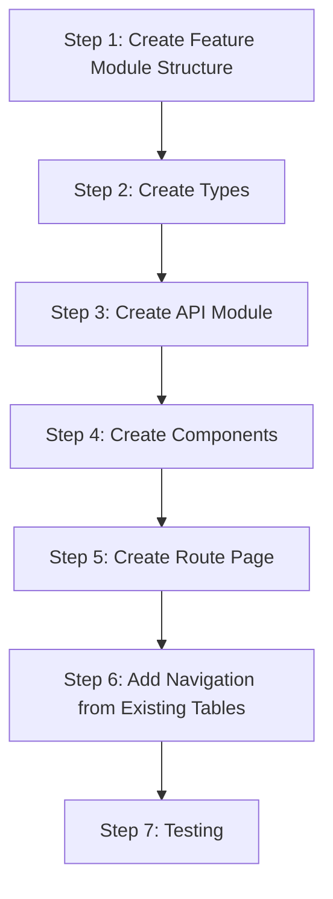

# Section Summary Page - Implementation Guide

## Overview

This guide provides step-by-step instructions for implementing the section summary page in the frontend.

---

## Prerequisites

Before starting, ensure:

- The backend `get-section-stats` endpoint is implemented and working
- You have read the [Architecture Document](./architecture.md)
- You understand the [Frontend Guidelines](../../../guidelines/frontend_guidelines.md)

---

## Implementation Steps



---

## Step 1: Create Feature Module Structure

### 1.1 Create Directory Structure

```bash
mkdir -p apps/frontend/src/lib/features/section-summary/components
mkdir -p apps/frontend/src/lib/features/section-summary/api
mkdir -p apps/frontend/src/lib/features/section-summary/types
```

### 1.2 Create Index File

**Location**: `src/lib/features/section-summary/index.ts`

```typescript
// Components
export { default as SectionSummaryHeader } from './components/SectionSummaryHeader.svelte';
export { default as SectionStatsTable } from './components/SectionStatsTable.svelte';
export { default as SectionStatsSummary } from './components/SectionStatsSummary.svelte';
export { default as SectionStatsTableSkeleton } from './components/SectionStatsTableSkeleton.svelte';

// API
export { fetchSectionStats } from './api/section-stats.api';

// Types
export type * from './types/section-stats.types';
```

---

## Step 2: Create Types

### 2.1 Create Types File

**Location**: `src/lib/features/section-summary/types/section-stats.types.ts`

```typescript
import type {
  SectionStatDto,
  TermSectionStatsDto,
  SectionStatsByTermDto,
} from '@app/contracts';

// Re-export contract types
export type { SectionStatDto, TermSectionStatsDto, SectionStatsByTermDto };

/**
 * Extended section row with computed pass rate for table display
 */
export interface SectionTableRow extends SectionStatDto {
  passRate: number;
}

/**
 * Summary data computed from section stats
 */
export interface SectionSummaryData {
  totalSections: number;
  totalEnrolled: number;
  totalPassed: number;
  totalFailed: number;
  totalWithdrawn: number;
  overallPassRate: number;
}

/**
 * Sort column options for the section stats table
 */
export type SectionSortColumn =
  | 'section'
  | 'enrolled'
  | 'passed'
  | 'failed'
  | 'withdrawn'
  | 'passRate';

/**
 * Sort direction
 */
export type SortDirection = 'asc' | 'desc';
```

---

## Step 3: Create API Module

### 3.1 Create API File

**Location**: `src/lib/features/section-summary/api/section-stats.api.ts`

```typescript
import type { SectionStatsByTermDto } from '@app/contracts';

const DEFAULT_API_BASE_URL = 'http://localhost:3000';
const COURSES_PATH = '/api/courses';

const getApiBaseUrl = (): string => {
  return import.meta.env.VITE_API_BASE_URL ?? DEFAULT_API_BASE_URL;
};

const COURSE_CODE_PATTERN = /^[A-Z]{4}-\d{4}$/;

export interface FetchSectionStatsOptions {
  courseCode: string;
  term: number;
}

/**
 * Fetches section statistics for a specific course and academic term.
 *
 * @param options - The course code and term to fetch stats for
 * @returns Section statistics grouped by term
 * @throws Error if validation fails or API request fails
 */
export async function fetchSectionStats(
  options: FetchSectionStatsOptions,
): Promise<SectionStatsByTermDto> {
  const { courseCode, term } = options;

  // Validate course code format
  if (!COURSE_CODE_PATTERN.test(courseCode)) {
    throw new Error(
      'Invalid course code format. Expected format: XXXX-DDDD (e.g., ISIS-3204)',
    );
  }

  // Validate term is a positive integer
  if (!Number.isInteger(term) || term <= 0) {
    throw new Error('Invalid academic term. Expected a positive integer.');
  }

  const baseUrl = getApiBaseUrl();
  const url = `${baseUrl}${COURSES_PATH}/${courseCode}/sections?term=${term}`;

  const response = await fetch(url);

  if (!response.ok) {
    if (response.status === 404) {
      throw new Error(
        `No section data found for course ${courseCode} in term ${term}`,
      );
    }

    if (response.status === 400) {
      const errorData = await response.json().catch(() => null);
      const message = errorData?.error?.message ?? 'Invalid request parameters';
      throw new Error(message);
    }

    throw new Error(
      `Failed to fetch section statistics: ${response.statusText}`,
    );
  }

  return response.json() as Promise<SectionStatsByTermDto>;
}
```

---

## Step 4: Create Components

### 4.1 Create Header Component

**Location**: `src/lib/features/section-summary/components/SectionSummaryHeader.svelte`

```svelte
<script lang="ts">
  import { formatTerm } from '$lib/utils/formatters';

  interface Props {
    courseCode: string;
    term: number;
    class?: string;
  }

  let { courseCode, term, class: className = '' }: Props = $props();

  const formattedTerm = $derived(formatTerm(term));
</script>

<header class={className}>
  <!-- Breadcrumb Navigation -->
  <nav class="mb-2 text-sm" aria-label="Breadcrumb">
    <ol class="flex items-center space-x-2">
      <li>
        <a href="/" class="text-slate-400 hover:text-slate-200 transition-colors">
          Dashboard
        </a>
      </li>
      <li>
        <span class="text-slate-600">/</span>
      </li>
      <li>
        <span class="text-slate-400">{courseCode}</span>
      </li>
      <li>
        <span class="text-slate-600">/</span>
      </li>
      <li>
        <span class="text-slate-400">Sections</span>
      </li>
      <li>
        <span class="text-slate-600">/</span>
      </li>
      <li>
        <span class="text-slate-200" aria-current="page">{formattedTerm}</span>
      </li>
    </ol>
  </nav>

  <!-- Page Title -->
  <div class="mt-4">
    <h1 class="text-2xl font-semibold text-slate-50">
      Section Statistics
    </h1>
    <p class="text-slate-400 mt-1">
      <span class="font-mono text-slate-200">{courseCode}</span>
      <span class="mx-2">·</span>
      <span>{formattedTerm}</span>
    </p>
  </div>
</header>
```

### 4.2 Create Summary Component

**Location**: `src/lib/features/section-summary/components/SectionStatsSummary.svelte`

```svelte
<script lang="ts">
  import type { SectionSummaryData } from '../types/section-stats.types';
  import { formatPercent } from '$lib/utils/formatters';

  interface Props {
    summary: SectionSummaryData;
    class?: string;
  }

  let { summary, class: className = '' }: Props = $props();
</script>

<div class="grid grid-cols-3 gap-4 {className}">
  <!-- Total Enrolled -->
  <div class="rounded-lg border border-slate-800 bg-slate-900/50 p-4">
    <p class="text-sm text-slate-400">Total Enrolled</p>
    <p class="mt-1 text-2xl font-semibold font-mono text-slate-50">
      {summary.totalEnrolled.toLocaleString()}
    </p>
  </div>

  <!-- Overall Pass Rate -->
  <div class="rounded-lg border border-slate-800 bg-slate-900/50 p-4">
    <p class="text-sm text-slate-400">Overall Pass Rate</p>
    <p class="mt-1 text-2xl font-semibold font-mono {
      summary.overallPassRate >= 80
        ? 'text-emerald-400'
        : summary.overallPassRate >= 60
          ? 'text-amber-400'
          : 'text-red-400'
    }">
      {formatPercent(summary.overallPassRate)}
    </p>
  </div>

  <!-- Number of Sections -->
  <div class="rounded-lg border border-slate-800 bg-slate-900/50 p-4">
    <p class="text-sm text-slate-400">Sections</p>
    <p class="mt-1 text-2xl font-semibold font-mono text-slate-50">
      {summary.totalSections}
    </p>
  </div>
</div>
```

### 4.3 Create Table Skeleton Component

**Location**: `src/lib/features/section-summary/components/SectionStatsTableSkeleton.svelte`

```svelte
<script lang="ts">
  interface Props {
    rows?: number;
    class?: string;
  }

  let { rows = 5, class: className = '' }: Props = $props();

  const skeletonRows = Array.from({ length: rows }, (_, i) => i);
</script>

<div
  class="rounded-lg border border-slate-800 overflow-hidden {className}"
  aria-busy="true"
  aria-label="Loading section statistics"
>
  <table class="w-full">
    <thead class="bg-slate-800/50">
      <tr>
        <th class="px-4 py-3 text-left text-sm font-medium text-slate-400">Section</th>
        <th class="px-4 py-3 text-right text-sm font-medium text-slate-400">Enrolled</th>
        <th class="px-4 py-3 text-right text-sm font-medium text-slate-400">Passed</th>
        <th class="px-4 py-3 text-right text-sm font-medium text-slate-400">Failed</th>
        <th class="px-4 py-3 text-right text-sm font-medium text-slate-400">Withdrawn</th>
        <th class="px-4 py-3 text-right text-sm font-medium text-slate-400">Pass Rate</th>
      </tr>
    </thead>
    <tbody class="divide-y divide-slate-800">
      {#each skeletonRows as _}
        <tr class="animate-pulse">
          <td class="px-4 py-3">
            <div class="h-5 w-8 rounded bg-slate-700"></div>
          </td>
          <td class="px-4 py-3">
            <div class="h-5 w-12 rounded bg-slate-700 ml-auto"></div>
          </td>
          <td class="px-4 py-3">
            <div class="h-5 w-10 rounded bg-slate-700 ml-auto"></div>
          </td>
          <td class="px-4 py-3">
            <div class="h-5 w-8 rounded bg-slate-700 ml-auto"></div>
          </td>
          <td class="px-4 py-3">
            <div class="h-5 w-8 rounded bg-slate-700 ml-auto"></div>
          </td>
          <td class="px-4 py-3">
            <div class="h-5 w-16 rounded bg-slate-700 ml-auto"></div>
          </td>
        </tr>
      {/each}
    </tbody>
  </table>
</div>
```

### 4.4 Create Main Table Component

**Location**: `src/lib/features/section-summary/components/SectionStatsTable.svelte`

```svelte
<script lang="ts">
  import type {
    SectionTableRow,
    SectionSortColumn,
    SortDirection,
    SectionSummaryData,
    SectionStatsByTermDto,
  } from '../types/section-stats.types';
  import { fetchSectionStats } from '../api/section-stats.api';
  import { formatPercent } from '$lib/utils/formatters';
  import SectionStatsTableSkeleton from './SectionStatsTableSkeleton.svelte';
  import SectionStatsSummary from './SectionStatsSummary.svelte';

  interface Props {
    courseCode: string;
    term: number;
    class?: string;
  }

  let { courseCode, term, class: className = '' }: Props = $props();

  // State
  let isLoading = $state(true);
  let error = $state<string | null>(null);
  let data = $state<SectionStatsByTermDto | null>(null);

  // Sorting
  let sortColumn = $state<SectionSortColumn>('section');
  let sortDirection = $state<SortDirection>('desc');

  // Computed: transform sections to table rows with pass rate
  const tableRows = $derived.by((): SectionTableRow[] => {
    if (!data?.terms?.[0]?.sections) return [];

    return data.terms[0].sections.map(section => ({
      ...section,
      passRate: section.enrolled > 0
        ? (section.passed / section.enrolled) * 100
        : 0,
    }));
  });

  // Computed: sorted rows
  const sortedRows = $derived.by((): SectionTableRow[] => {
    if (tableRows.length === 0) return [];

    return [...tableRows].sort((a, b) => {
      const aVal = a[sortColumn];
      const bVal = b[sortColumn];
      const modifier = sortDirection === 'asc' ? 1 : -1;
      return (aVal - bVal) * modifier;
    });
  });

  // Computed: summary data
  const summary = $derived.by((): SectionSummaryData | null => {
    if (!data?.terms?.[0]?.totals) return null;

    const totals = data.terms[0].totals;
    return {
      totalSections: totals.totalSections,
      totalEnrolled: totals.totalEnrolled,
      totalPassed: totals.totalPassed,
      totalFailed: totals.totalFailed,
      totalWithdrawn: totals.totalWithdrawn,
      overallPassRate: totals.totalEnrolled > 0
        ? (totals.totalPassed / totals.totalEnrolled) * 100
        : 0,
    };
  });

  // Toggle sort
  function toggleSort(column: SectionSortColumn): void {
    if (sortColumn === column) {
      sortDirection = sortDirection === 'asc' ? 'desc' : 'asc';
    } else {
      sortColumn = column;
      sortDirection = 'desc';
    }
  }

  // Get sort indicator
  function getSortIndicator(column: SectionSortColumn): string {
    if (sortColumn !== column) return '';
    return sortDirection === 'asc' ? ' ↑' : ' ↓';
  }

  // Fetch data on mount and when params change
  $effect(() => {
    if (!courseCode || !term) {
      data = null;
      return;
    }

    (async () => {
      isLoading = true;
      error = null;

      try {
        const result = await fetchSectionStats({ courseCode, term });
        data = result;
      } catch (e) {
        error = e instanceof Error ? e.message : 'Failed to load section statistics';
        data = null;
      } finally {
        isLoading = false;
      }
    })();
  });

  // Retry handler
  function handleRetry(): void {
    error = null;
    isLoading = true;
    fetchSectionStats({ courseCode, term })
      .then(result => {
        data = result;
      })
      .catch(e => {
        error = e instanceof Error ? e.message : 'Failed to load section statistics';
      })
      .finally(() => {
        isLoading = false;
      });
  }

  // Pass rate badge styling
  function getPassRateBadgeClass(rate: number): string {
    if (rate >= 80) return 'bg-emerald-500/20 text-emerald-400';
    if (rate >= 60) return 'bg-amber-500/20 text-amber-400';
    return 'bg-red-500/20 text-red-400';
  }
</script>

<div class={className}>
  <!-- Loading State -->
  {#if isLoading}
    <SectionStatsTableSkeleton rows={5} />

  <!-- Error State -->
  {:else if error}
    <div class="rounded-lg border border-red-800/50 bg-red-900/20 p-6 text-center">
      <svg
        class="mx-auto h-12 w-12 text-red-400"
        fill="none"
        viewBox="0 0 24 24"
        stroke="currentColor"
      >
        <path
          stroke-linecap="round"
          stroke-linejoin="round"
          stroke-width="2"
          d="M12 9v2m0 4h.01m-6.938 4h13.856c1.54 0 2.502-1.667 1.732-3L13.732 4c-.77-1.333-2.694-1.333-3.464 0L3.34 16c-.77 1.333.192 3 1.732 3z"
        />
      </svg>
      <p class="mt-4 text-red-300">{error}</p>
      <button
        class="mt-4 rounded-md bg-red-600 px-4 py-2 text-sm font-medium text-white hover:bg-red-500 transition-colors"
        onclick={handleRetry}
      >
        Try Again
      </button>
    </div>

  <!-- No Data State -->
  {:else if !data || data.terms.length === 0}
    <div class="rounded-lg border border-slate-800 bg-slate-900/50 p-8 text-center">
      <svg
        class="mx-auto h-12 w-12 text-slate-600"
        fill="none"
        viewBox="0 0 24 24"
        stroke="currentColor"
      >
        <path
          stroke-linecap="round"
          stroke-linejoin="round"
          stroke-width="2"
          d="M9 17v-2m3 2v-4m3 4v-6m2 10H7a2 2 0 01-2-2V5a2 2 0 012-2h5.586a1 1 0 01.707.293l5.414 5.414a1 1 0 01.293.707V19a2 2 0 01-2 2z"
        />
      </svg>
      <h3 class="mt-4 text-lg font-medium text-slate-300">No Section Data</h3>
      <p class="mt-2 text-slate-500">
        No section statistics are available for this course and term.
      </p>
      <a
        href="/"
        class="mt-4 inline-block text-blue-400 hover:text-blue-300 transition-colors"
      >
        Return to Dashboard
      </a>
    </div>

  <!-- Data State -->
  {:else}
    <!-- Summary Cards -->
    {#if summary}
      <SectionStatsSummary {summary} class="mb-6" />
    {/if}

    <!-- Data Table -->
    <div class="rounded-lg border border-slate-800 overflow-hidden">
      <table class="w-full" role="grid" aria-label="Section statistics">
        <thead class="bg-slate-800/50">
          <tr>
            {#each [
              { key: 'section', label: 'Section', align: 'left' },
              { key: 'enrolled', label: 'Enrolled', align: 'right' },
              { key: 'passed', label: 'Passed', align: 'right' },
              { key: 'failed', label: 'Failed', align: 'right' },
              { key: 'withdrawn', label: 'Withdrawn', align: 'right' },
              { key: 'passRate', label: 'Pass Rate', align: 'right' },
            ] as column}
              <th
                class="px-4 py-3 text-sm font-medium text-slate-400 cursor-pointer hover:text-slate-200 transition-colors select-none {column.align === 'right' ? 'text-right' : 'text-left'}"
                scope="col"
                aria-sort={sortColumn === column.key
                  ? sortDirection === 'asc' ? 'ascending' : 'descending'
                  : 'none'}
                tabindex="0"
                onclick={() => toggleSort(column.key as SectionSortColumn)}
                onkeydown={(e) => e.key === 'Enter' && toggleSort(column.key as SectionSortColumn)}
              >
                {column.label}{getSortIndicator(column.key as SectionSortColumn)}
              </th>
            {/each}
          </tr>
        </thead>
        <tbody class="divide-y divide-slate-800">
          {#each sortedRows as row (row.section)}
            <tr class="hover:bg-slate-800/40 transition-colors">
              <td class="px-4 py-3 font-mono text-slate-200">
                {row.section}
              </td>
              <td class="px-4 py-3 text-right font-mono text-slate-300">
                {row.enrolled}
              </td>
              <td class="px-4 py-3 text-right font-mono text-emerald-400">
                {row.passed}
              </td>
              <td class="px-4 py-3 text-right font-mono text-red-400">
                {row.failed}
              </td>
              <td class="px-4 py-3 text-right font-mono text-amber-400">
                {row.withdrawn}
              </td>
              <td class="px-4 py-3 text-right">
                <span class="inline-flex items-center rounded-full px-2.5 py-0.5 text-xs font-medium {getPassRateBadgeClass(row.passRate)}">
                  {formatPercent(row.passRate)}
                </span>
              </td>
            </tr>
          {/each}
        </tbody>
      </table>
    </div>
  {/if}
</div>
```

---

## Step 5: Create Route Page

### 5.1 Create Route Directory

```bash
mkdir -p apps/frontend/src/routes/courses/\[code\]/sections/\[term\]
```

### 5.2 Create Page Component

**Location**: `src/routes/courses/[code]/sections/[term]/+page.svelte`

```svelte
<script lang="ts">
  import { page } from '$app/stores';
  import { goto } from '$app/navigation';
  import {
    SectionSummaryHeader,
    SectionStatsTable,
  } from '$lib/features/section-summary';

  // Extract route parameters
  const courseCode = $derived($page.params.code?.toUpperCase() ?? '');
  const term = $derived(parseInt($page.params.term ?? '0', 10));

  // Validation
  const isCourseCodeValid = $derived(/^[A-Z]{4}-\d{4}$/.test(courseCode));
  const isTermValid = $derived(Number.isInteger(term) && term > 0);
  const isValid = $derived(isCourseCodeValid && isTermValid);

  // Redirect if invalid
  $effect(() => {
    if (!isValid && typeof window !== 'undefined') {
      goto('/');
    }
  });
</script>

<svelte:head>
  <title>
    {isValid ? `Sections - ${courseCode} - ${term}` : 'Section Summary'}
  </title>
</svelte:head>

<main class="min-h-screen bg-slate-950 text-slate-50">
  <div class="mx-auto max-w-5xl px-6 py-8">
    {#if isValid}
      <SectionSummaryHeader {courseCode} {term} />

      <div class="mt-8">
        <SectionStatsTable {courseCode} {term} />
      </div>
    {:else}
      <div class="flex items-center justify-center py-24">
        <div class="text-center">
          <p class="text-slate-400">Redirecting to dashboard...</p>
        </div>
      </div>
    {/if}
  </div>
</main>
```

---

## Step 6: Add Navigation from Existing Tables

### 6.1 Update SummaryTable.svelte

**Location**: `src/lib/features/dashboard/components/SummaryTable.svelte`

Add clickable rows to navigate to section summary:

```svelte
<script lang="ts">
  import { goto } from '$app/navigation';

  // ... existing code ...

  function handleTermClick(term: number): void {
    goto(`/courses/${courseCode}/sections/${term}`);
  }
</script>

<!-- In the template, update the table row -->
<tbody class="divide-y divide-slate-800">
  {#each sortedHistory as [termStr, stats] (termStr)}
    {@const term = parseInt(termStr, 10)}
    <tr
      class="cursor-pointer hover:bg-slate-800/60 transition-colors"
      onclick={() => handleTermClick(term)}
      onkeydown={(e) => e.key === 'Enter' && handleTermClick(term)}
      tabindex="0"
      role="button"
      aria-label="View section details for term {formatTerm(term)}"
    >
      <!-- ... existing cells ... -->
    </tr>
  {/each}
</tbody>
```

### 6.2 Update AccuracyTable.svelte (Future)

**Location**: `src/lib/features/forecasts/components/AccuracyTable.svelte`

Similar pattern - add clickable rows:

```svelte
<script lang="ts">
  import { goto } from '$app/navigation';

  // ... existing code ...

  function handleTermClick(term: number): void {
    goto(`/courses/${courseCode}/sections/${term}?from=accuracy`);
  }
</script>

<!-- In the template, update table rows to be clickable -->
<tr
  class="cursor-pointer hover:bg-slate-800/60 transition-colors"
  onclick={() => handleTermClick(row.academicTerm)}
  tabindex="0"
>
  <!-- ... existing cells ... -->
</tr>
```

---

## Step 7: Testing

### 7.1 Manual Testing Checklist

- [ ] Navigate to `/courses/ISIS-3204/sections/202410` directly
- [ ] Verify data loads correctly
- [ ] Test sorting by each column
- [ ] Test invalid course code redirect
- [ ] Test invalid term redirect
- [ ] Test empty data state
- [ ] Test error state with network disconnect
- [ ] Test retry button functionality
- [ ] Test breadcrumb navigation back to dashboard
- [ ] Test keyboard navigation (Tab, Enter on sortable headers)

### 7.2 Test Navigation from Dashboard

- [ ] Click on a term row in SummaryTable
- [ ] Verify navigation to correct section summary page
- [ ] Verify correct course code and term displayed
- [ ] Click breadcrumb to return to dashboard

### 7.3 Verify Accessibility

- [ ] Screen reader announces table data correctly
- [ ] Sortable columns have correct aria-sort attributes
- [ ] Loading state announces "Loading"
- [ ] Focus management works correctly

---

## File Summary

### New Files to Create

| File | Purpose |
|------|---------|
| `src/lib/features/section-summary/index.ts` | Feature module exports |
| `src/lib/features/section-summary/types/section-stats.types.ts` | TypeScript types |
| `src/lib/features/section-summary/api/section-stats.api.ts` | API integration |
| `src/lib/features/section-summary/components/SectionSummaryHeader.svelte` | Header with breadcrumb |
| `src/lib/features/section-summary/components/SectionStatsSummary.svelte` | Summary cards |
| `src/lib/features/section-summary/components/SectionStatsTable.svelte` | Main data table |
| `src/lib/features/section-summary/components/SectionStatsTableSkeleton.svelte` | Loading skeleton |
| `src/routes/courses/[code]/sections/[term]/+page.svelte` | Route page |

### Files to Modify

| File | Changes |
|------|---------|
| `src/lib/features/dashboard/components/SummaryTable.svelte` | Add click navigation to sections |
| `src/lib/features/forecasts/components/AccuracyTable.svelte` | Add click navigation to sections (future) |

---

## Related Documents

- [Architecture Document](./architecture.md)
- [System Impact](./system-impact.md)
- [Backend: Get Section Stats](../../use-cases/get-section-stats/implementation-guide.md)
