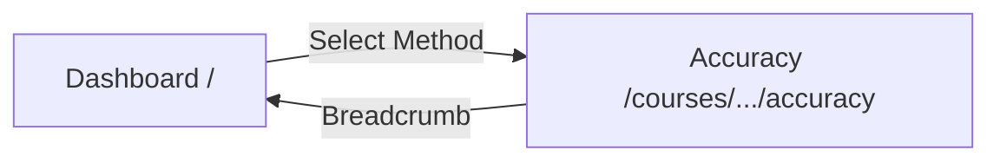
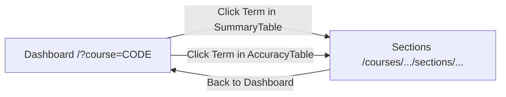

# Section Summary Page - System Impact Analysis

## Overview

This document analyzes the impact of adding the section summary page to the frontend application.

---

## 1. Affected Components

### 1.1 New Components

| Component | Location | Purpose |
|-----------|----------|---------|
| Section Summary Feature Module | `src/lib/features/section-summary/` | New feature for section statistics |
| Section Summary Route | `src/routes/courses/[code]/sections/[term]/` | New route page |

### 1.2 Modified Components

| Component | Location | Change Type | Risk |
|-----------|----------|-------------|------|
| `SummaryTable.svelte` | `src/lib/features/dashboard/components/` | Add navigation | Low |
| `AccuracyTable.svelte` | `src/lib/features/forecasts/components/` | Add navigation | Low |
| `+page.svelte` (Dashboard) | `src/routes/` | Read course query param | Low |

---

## 2. Routing Impact

### 2.1 New Route

```
/courses/[code]/sections/[term]
```

### 2.2 Route Parameter Considerations

| Parameter | Validation | Error Handling |
|-----------|------------|----------------|
| `code` | `/^[A-Z]{4}-\d{4}$/` | Redirect to dashboard |
| `term` | Positive integer | Redirect to dashboard |

### 2.3 URL Structure Alignment

The new route follows the established pattern:

| Existing Route | New Route |
|----------------|-----------|
| `/courses/[code]/accuracy` | `/courses/[code]/sections/[term]` |

Both use `[code]` as the course identifier parameter, maintaining consistency.

---

## 3. API Dependencies

### 3.1 Backend Endpoint Required

```
GET /api/courses/{courseCode}/sections?term={term}
```

**Prerequisite**: The `get-section-stats` backend use-case must be implemented and deployed before this frontend feature can function.

### 3.2 Contract Dependency

The frontend relies on types from `@app/contracts`:

```typescript
import type {
  SectionStatDto,
  TermSectionStatsDto,
  SectionStatsByTermDto,
} from '@app/contracts';
```

---

## 4. Navigation Flow Changes

### 4.1 Current Navigation Flow



### 4.2 New Navigation Flow



The section summary page navigates back to the Dashboard with the course code as a query parameter (`/?course={courseCode}`), ensuring the course input is pre-filled when returning.

### 4.3 User Journey Impact

| Current State | New State |
|---------------|-----------|
| Term column is read-only | Term column is clickable, navigates to section details |
| No section-level visibility | Full section breakdown available |
| Single navigation level | Two-level navigation (dashboard → sections) |
| N/A | Return navigation preserves course context |

---

## 5. UX Considerations

### 5.1 Visual Affordances

The summary table and accuracy table must visually indicate that rows are clickable:

- **Cursor**: `cursor-pointer` on hover
- **Background**: `hover:bg-slate-800/60` on hover
- **Feedback**: Immediate navigation on click

### 5.2 Mental Model

Users will learn that:
- Clicking on a term row navigates to section details
- Breadcrumbs and "Back to Dashboard" button return to the Dashboard with the same course loaded
- Section page shows breakdown of aggregate data

### 5.3 Potential Confusion Points

| Issue | Mitigation |
|-------|------------|
| Not obvious that rows are clickable | Add hover effect, cursor change |
| May expect section page from accuracy page | Consistent behavior across both tables |
| Unknown where to return | Clear breadcrumb navigation |

---

## 6. Performance Impact

### 6.1 Bundle Size

| Addition | Estimated Size |
|----------|---------------|
| New components (5 files) | ~8-12 KB |
| New API module | ~1-2 KB |
| New types | < 1 KB |

**Total impact**: Minimal (~15 KB uncompressed)

### 6.2 Network Requests

| Page | Requests | Notes |
|------|----------|-------|
| Dashboard | Unchanged | No new requests |
| Section Summary | 1 new request | `/api/courses/{code}/sections?term={term}` |

### 6.3 Data Volume

Expected response size: 1-5 KB (typically 1-5 sections per term)

---

## 7. State Management Impact

### 7.1 No Global Store Required

The section summary page uses local component state via `$state` runes. This is appropriate because:

- Data is specific to a single route
- No sharing with other pages required
- Simple fetch → display flow

### 7.2 Store Integration

The Dashboard page uses `dashboardStore` to load course data from the URL query parameter:
- `dashboardStore` - Used to pre-fill course code when navigating back from section summary via `?course={code}` query parameter
- `methodSelectorStore` - No changes

---

## 8. Testing Impact

### 8.1 New Test Coverage Required

| Test Type | Scope |
|-----------|-------|
| Unit | API module, type validation |
| Component | Each new component |
| Integration | Route loading, navigation |
| E2E | Full user journey |

### 8.2 Existing Tests

| Test Area | Impact |
|-----------|--------|
| Dashboard tests | May need updates for clickable rows |
| Accuracy table tests | May need updates for clickable rows |
| Navigation tests | Add new route coverage |

---

## 9. Accessibility Impact

### 9.1 New Accessibility Requirements

| Requirement | Implementation |
|-------------|----------------|
| Keyboard navigation | Table rows focusable and activatable |
| Screen reader support | Proper aria labels and roles |
| Sort indicators | `aria-sort` attribute on headers |
| Loading announcement | `aria-busy` on loading state |

### 9.2 Compliance

The implementation follows existing accessibility patterns established in `AccuracyTable.svelte`.

---

## 10. Future Considerations

### 10.1 Multi-Term View

The backend already supports querying multiple terms. A future enhancement could show section comparison across terms:

```
/courses/ISIS-3204/sections?terms=202410,202420
```

### 10.2 Section Comparison Dashboard

Long-term, section data could be visualized in charts comparing:
- Section performance over time
- Section size distribution
- Pass rate trends by section

---

## 11. Rollout Recommendations

### 11.1 Prerequisites

1. Backend `get-section-stats` endpoint deployed
2. Contract types published
3. Frontend build and tests passing

### 11.2 Phased Rollout

| Phase | Scope | Risk |
|-------|-------|------|
| 1 | Section summary page (direct URL access) | Low |
| 2 | Navigation from SummaryTable | Low |
| 3 | Navigation from AccuracyTable | Low |

### 11.3 Rollback Plan

If issues arise:
1. Remove navigation handlers from existing tables (1-line changes)
2. Route remains accessible but not discoverable
3. No data corruption possible (read-only feature)

---

## 12. Summary

### 12.1 Low-Risk Changes

- New isolated feature module
- No modifications to existing stores
- Follows established patterns
- Read-only data flow

### 12.2 Medium-Risk Changes

- Navigation behavior changes in existing tables
- User expectations may need adjustment

### 12.3 Dependencies

- Backend endpoint must be available
- Contract types must be exported

---

## Related Documents

- [Architecture Document](./architecture.md)
- [Implementation Guide](./implementation-guide.md)
- [Backend: Get Section Stats](../../use-cases/get-section-stats/system-impact.md)
