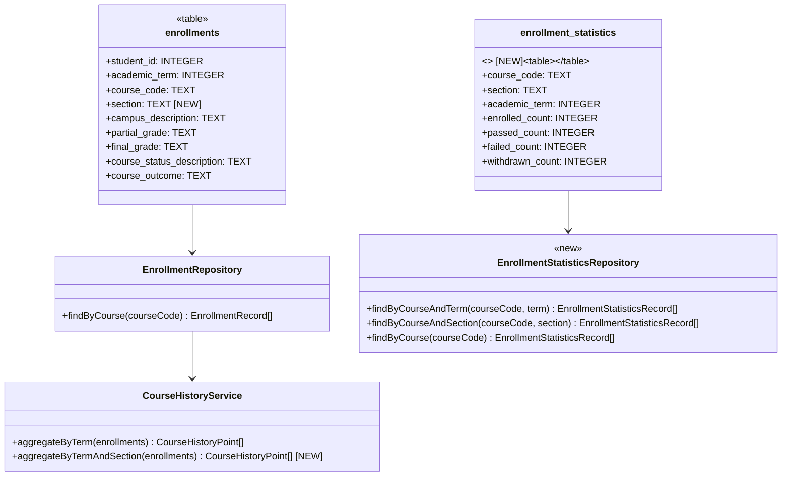
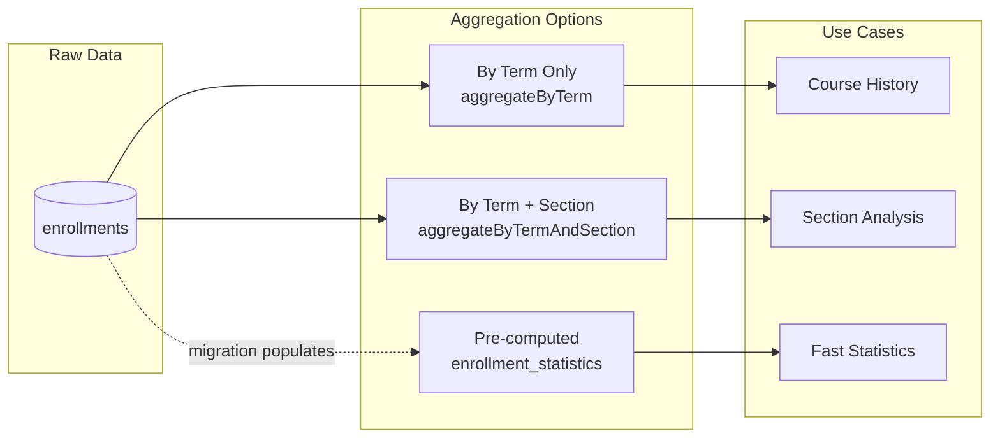

# Add Section Field to Enrollments Table

## 1. Overview

### 1.1 Problem Statement

The current `enrollments` table lacks course section information, which prevents:

- Analyzing enrollment patterns at the section level
- Distinguishing between different offerings of the same course in a term
- Creating aggregated statistics per section for reporting and forecasting

### 1.2 Goals

1. **Add `section` field** to the `enrollments` table to track which section a student enrolled in
2. **Create an aggregated statistics table** (`enrollment_statistics`) that consolidates enrollment counts by course, section, and academic term
3. **Maintain backward compatibility** with existing queries and APIs

### 1.3 Assumptions

- The `section` field data is assumed to exist and be correct (data sourcing is out of scope)
- A course can have multiple sections per academic term
- A student can only enroll in one section of a course per term

---

## 2. Current State Analysis

### 2.1 Current Schema

```sql
CREATE TABLE enrollments (
  student_id INTEGER NOT NULL,
  academic_term INTEGER NOT NULL,
  course_code TEXT NOT NULL,
  campus_description TEXT,
  partial_grade TEXT,
  final_grade TEXT,
  course_status_description TEXT,
  course_outcome TEXT NOT NULL CHECK (course_outcome IN ('P', 'F', 'W')),
  PRIMARY KEY (student_id, academic_term, course_code)
) WITHOUT ROWID;

CREATE INDEX idx_enrollments_course_term_outcome
ON enrollments (course_code, academic_term, course_outcome);
```

### 2.2 Files That Interact with Enrollments

| File | Purpose | Impact Level |
|------|---------|--------------|
| `apps/backend/src/infrastructure/db/schema/enrollments.ts` | Drizzle schema definition | **HIGH** - Must add section field |
| `apps/backend/src/infrastructure/repositories/enrollment-repository.ts` | `findByCourse()` query | **MEDIUM** - Type changes propagate |
| `apps/backend/src/infrastructure/repositories/enrollment-forecast-repository.ts` | Prerequisite-based queries | **LOW** - Doesn't need section |
| `apps/backend/src/domain/services/course-history-service.ts` | Aggregates by term | **HIGH** - Must support section aggregation |
| `apps/backend/src/domain/models/course-history.ts` | `CourseHistoryPoint` model | **HIGH** - Must support section |
| `apps/backend/src/infrastructure/providers/course-history-actual-provider.ts` | Actual enrollment provider | **MEDIUM** - May need section support |
| `apps/backend/tests/domain/course-history-service.test.ts` | Unit tests | **MEDIUM** - Update test data |

### 2.3 Data Flow Diagram

```mermaid
flowchart TB
    subgraph "Current Flow"
        DB[(enrollments.db)]
        ER[EnrollmentRepository]
        CHS[CourseHistoryService]
        UC[Use Cases]

        DB -->|findByCourse| ER
        ER -->|EnrollmentRecord[]| CHS
        CHS -->|aggregateByTerm| UC
    end

    subgraph "New Flow with Section"
        DB2[(enrollments.db)]
        EST[(enrollment_statistics)]
        ER2[EnrollmentRepository]
        ESR[EnrollmentStatisticsRepository]
        CHS2[CourseHistoryService]
        UC2[Use Cases]

        DB2 -->|with section| ER2
        DB2 -->|aggregate| EST
        EST --> ESR
        ER2 --> CHS2
        ESR --> UC2
        CHS2 --> UC2
    end
```

---

## 3. Proposed Changes

### 3.1 Schema Changes

#### 3.1.1 Modified `enrollments` Table

```sql
CREATE TABLE enrollments (
  student_id INTEGER NOT NULL,
  academic_term INTEGER NOT NULL,
  course_code TEXT NOT NULL,
  section TEXT NOT NULL,                    -- NEW FIELD
  campus_description TEXT,
  partial_grade TEXT,
  final_grade TEXT,
  course_status_description TEXT,
  course_outcome TEXT NOT NULL CHECK (course_outcome IN ('P', 'F', 'W')),
  PRIMARY KEY (student_id, academic_term, course_code, section)  -- UPDATED PRIMARY KEY
) WITHOUT ROWID;

-- Updated existing index
CREATE INDEX idx_enrollments_course_term_outcome
ON enrollments (course_code, academic_term, course_outcome);

-- New index for section-based queries
CREATE INDEX idx_enrollments_course_section_term
ON enrollments (course_code, section, academic_term);
```

#### 3.1.2 New `enrollment_statistics` Table

```sql
CREATE TABLE enrollment_statistics (
  course_code TEXT NOT NULL,
  section TEXT NOT NULL,
  academic_term INTEGER NOT NULL,
  enrolled_count INTEGER NOT NULL DEFAULT 0,
  passed_count INTEGER NOT NULL DEFAULT 0,
  failed_count INTEGER NOT NULL DEFAULT 0,
  withdrawn_count INTEGER NOT NULL DEFAULT 0,
  PRIMARY KEY (course_code, section, academic_term)
) WITHOUT ROWID;

-- Index for course-level aggregation queries
CREATE INDEX idx_enrollment_stats_course_term
ON enrollment_statistics (course_code, academic_term);
```

### 3.2 New Table Design Rationale

The `enrollment_statistics` table serves as a **materialized aggregation** of enrollment data:

| Field | Type | Description |
|-------|------|-------------|
| `course_code` | TEXT | Course identifier (e.g., "ISIS-3204") |
| `section` | TEXT | Section identifier (e.g., "01", "02", "A1") |
| `academic_term` | INTEGER | Term code (e.g., 202410) |
| `enrolled_count` | INTEGER | Total students enrolled in the section |
| `passed_count` | INTEGER | Students with outcome 'P' |
| `failed_count` | INTEGER | Students with outcome 'F' |
| `withdrawn_count` | INTEGER | Students with outcome 'W' |

**Benefits:**
- Pre-computed aggregations avoid expensive runtime queries
- Enables fast section-level and course-level statistics
- Supports historical analysis without scanning raw enrollment data

---

## 4. Code Changes

### 4.1 Infrastructure Layer

#### 4.1.1 Update Drizzle Schema

**File:** `apps/backend/src/infrastructure/db/schema/enrollments.ts`

```typescript
import { integer, sqliteTable, text } from 'drizzle-orm/sqlite-core';

export const enrollments = sqliteTable('enrollments', {
  studentId: integer('student_id').notNull(),
  academicTerm: integer('academic_term').notNull(),
  courseCode: text('course_code').notNull(),
  section: text('section').notNull(),              // NEW FIELD
  campusDescription: text('campus_description'),
  partialGrade: text('partial_grade'),
  finalGrade: text('final_grade'),
  courseStatusDescription: text('course_status_description'),
  courseOutcome: text('course_outcome', { length: 1 }).notNull(),
});

// NEW TABLE
export const enrollmentStatistics = sqliteTable('enrollment_statistics', {
  courseCode: text('course_code').notNull(),
  section: text('section').notNull(),
  academicTerm: integer('academic_term').notNull(),
  enrolledCount: integer('enrolled_count').notNull().default(0),
  passedCount: integer('passed_count').notNull().default(0),
  failedCount: integer('failed_count').notNull().default(0),
  withdrawnCount: integer('withdrawn_count').notNull().default(0),
});
```

#### 4.1.2 New Repository for Statistics

**File:** `apps/backend/src/infrastructure/repositories/enrollment-statistics-repository.ts`

```typescript
import type { InferSelectModel } from 'drizzle-orm';
import { and, eq } from 'drizzle-orm';
import type { DbClient } from '../db/client';
import { enrollmentStatistics } from '../db/schema/enrollments';

export type EnrollmentStatisticsRecord = InferSelectModel<typeof enrollmentStatistics>;

export interface EnrollmentStatisticsRepository {
  findByCourseAndTerm(courseCode: string, academicTerm: number): Promise<EnrollmentStatisticsRecord[]>;
  findByCourseAndSection(courseCode: string, section: string): Promise<EnrollmentStatisticsRecord[]>;
  findByCourse(courseCode: string): Promise<EnrollmentStatisticsRecord[]>;
  findByCourseSectionAndTerm(
    courseCode: string,
    section: string,
    academicTerm: number
  ): Promise<EnrollmentStatisticsRecord | null>;
}

export const createEnrollmentStatisticsRepository = (
  dbClient: DbClient,
): EnrollmentStatisticsRepository => {
  return {
    async findByCourseAndTerm(courseCode: string, academicTerm: number) {
      return dbClient
        .select()
        .from(enrollmentStatistics)
        .where(
          and(
            eq(enrollmentStatistics.courseCode, courseCode),
            eq(enrollmentStatistics.academicTerm, academicTerm),
          ),
        );
    },

    async findByCourseAndSection(courseCode: string, section: string) {
      return dbClient
        .select()
        .from(enrollmentStatistics)
        .where(
          and(
            eq(enrollmentStatistics.courseCode, courseCode),
            eq(enrollmentStatistics.section, section),
          ),
        )
        .orderBy(enrollmentStatistics.academicTerm);
    },

    async findByCourse(courseCode: string) {
      return dbClient
        .select()
        .from(enrollmentStatistics)
        .where(eq(enrollmentStatistics.courseCode, courseCode))
        .orderBy(enrollmentStatistics.academicTerm, enrollmentStatistics.section);
    },

    async findByCourseSectionAndTerm(courseCode: string, section: string, academicTerm: number) {
      const rows = await dbClient
        .select()
        .from(enrollmentStatistics)
        .where(
          and(
            eq(enrollmentStatistics.courseCode, courseCode),
            eq(enrollmentStatistics.section, section),
            eq(enrollmentStatistics.academicTerm, academicTerm),
          ),
        );
      return rows[0] ?? null;
    },
  };
};
```

### 4.2 Domain Layer

#### 4.2.1 Update Course History Model

**File:** `apps/backend/src/domain/models/course-history.ts`

```typescript
export type CourseOutcome = 'P' | 'F' | 'W';

export interface CourseHistoryPoint {
  readonly academicTerm: number;
  readonly courseCode: string;
  readonly section?: string;                    // NEW OPTIONAL FIELD
  readonly totalEnrollments: number;
  readonly passedCount: number;
  readonly failedCount: number;
  readonly withdrawnCount: number;
}

// NEW: Section-level statistics
export interface SectionStatistics {
  readonly courseCode: string;
  readonly section: string;
  readonly academicTerm: number;
  readonly enrolledCount: number;
  readonly passedCount: number;
  readonly failedCount: number;
  readonly withdrawnCount: number;
}
```

#### 4.2.2 Update Course History Service

**File:** `apps/backend/src/domain/services/course-history-service.ts`

```typescript
import type { CourseHistoryPoint, CourseOutcome } from '../models/course-history';

export interface EnrollmentForHistory {
  readonly academicTerm: number;
  readonly courseCode: string;
  readonly section?: string;                    // NEW OPTIONAL FIELD
  readonly courseOutcome: CourseOutcome;
}

export interface CourseHistoryService {
  aggregateByTerm(enrollments: EnrollmentForHistory[]): CourseHistoryPoint[];
  aggregateByTermAndSection(enrollments: EnrollmentForHistory[]): CourseHistoryPoint[];  // NEW METHOD
}

export const createCourseHistoryService = (): CourseHistoryService => {
  // Existing aggregateByTerm implementation...

  const aggregateByTermAndSection = (
    enrollments: EnrollmentForHistory[],
  ): CourseHistoryPoint[] => {
    const byTermAndSection = new Map<string, CourseHistoryPoint>();

    for (const enrollment of enrollments) {
      const section = enrollment.section ?? 'UNKNOWN';
      const key = `${enrollment.academicTerm}-${section}`;

      const existing = byTermAndSection.get(key);

      if (existing === undefined) {
        const initialPoint: CourseHistoryPoint = {
          academicTerm: enrollment.academicTerm,
          courseCode: enrollment.courseCode,
          section,
          totalEnrollments: 0,
          passedCount: 0,
          failedCount: 0,
          withdrawnCount: 0,
        };
        byTermAndSection.set(key, initialPoint);
      }

      const current = byTermAndSection.get(key);
      if (current === undefined) continue;

      const nextTotals = getNextTotals(current, enrollment.courseOutcome);
      byTermAndSection.set(key, nextTotals);
    }

    return Array.from(byTermAndSection.values()).sort(
      (left, right) => {
        const termDiff = left.academicTerm - right.academicTerm;
        if (termDiff !== 0) return termDiff;
        return (left.section ?? '').localeCompare(right.section ?? '');
      },
    );
  };

  return { aggregateByTerm, aggregateByTermAndSection };
};
```

### 4.3 Type Updates

The `EnrollmentRecord` type from `enrollment-repository.ts` is auto-inferred from the Drizzle schema. After updating the schema, the type will automatically include:

```typescript
// Auto-generated type will now include:
export type EnrollmentRecord = {
  studentId: number;
  academicTerm: number;
  courseCode: string;
  section: string;              // NEW FIELD
  campusDescription: string | null;
  partialGrade: string | null;
  finalGrade: string | null;
  courseStatusDescription: string | null;
  courseOutcome: string;
};
```

---

## 5. Migration Strategy

### 5.1 SQLite Migration Script

**File:** `migrations/001_add_section_field.sql`

```sql
-- Step 1: Create new table with updated schema
CREATE TABLE enrollments_new (
  student_id INTEGER NOT NULL,
  academic_term INTEGER NOT NULL,
  course_code TEXT NOT NULL,
  section TEXT NOT NULL DEFAULT '01',           -- Default for existing data
  campus_description TEXT,
  partial_grade TEXT,
  final_grade TEXT,
  course_status_description TEXT,
  course_outcome TEXT NOT NULL CHECK (course_outcome IN ('P', 'F', 'W')),
  PRIMARY KEY (student_id, academic_term, course_code, section)
) WITHOUT ROWID;

-- Step 2: Copy existing data with default section
INSERT INTO enrollments_new (
  student_id, academic_term, course_code, section,
  campus_description, partial_grade, final_grade,
  course_status_description, course_outcome
)
SELECT
  student_id, academic_term, course_code, '01',
  campus_description, partial_grade, final_grade,
  course_status_description, course_outcome
FROM enrollments;

-- Step 3: Drop old table
DROP TABLE enrollments;

-- Step 4: Rename new table
ALTER TABLE enrollments_new RENAME TO enrollments;

-- Step 5: Recreate indexes
CREATE INDEX idx_enrollments_course_term_outcome
ON enrollments (course_code, academic_term, course_outcome);

CREATE INDEX idx_enrollments_course_section_term
ON enrollments (course_code, section, academic_term);

-- Step 6: Create enrollment_statistics table
CREATE TABLE enrollment_statistics (
  course_code TEXT NOT NULL,
  section TEXT NOT NULL,
  academic_term INTEGER NOT NULL,
  enrolled_count INTEGER NOT NULL DEFAULT 0,
  passed_count INTEGER NOT NULL DEFAULT 0,
  failed_count INTEGER NOT NULL DEFAULT 0,
  withdrawn_count INTEGER NOT NULL DEFAULT 0,
  PRIMARY KEY (course_code, section, academic_term)
) WITHOUT ROWID;

CREATE INDEX idx_enrollment_stats_course_term
ON enrollment_statistics (course_code, academic_term);

-- Step 7: Populate enrollment_statistics from enrollments
INSERT INTO enrollment_statistics (
  course_code, section, academic_term,
  enrolled_count, passed_count, failed_count, withdrawn_count
)
SELECT
  course_code,
  section,
  academic_term,
  COUNT(*) as enrolled_count,
  SUM(CASE WHEN course_outcome = 'P' THEN 1 ELSE 0 END) as passed_count,
  SUM(CASE WHEN course_outcome = 'F' THEN 1 ELSE 0 END) as failed_count,
  SUM(CASE WHEN course_outcome = 'W' THEN 1 ELSE 0 END) as withdrawn_count
FROM enrollments
GROUP BY course_code, section, academic_term;
```

### 5.2 Migration Considerations

1. **Backup First:** Always backup `enrollments.db` before migration
2. **Default Section Value:** Historical data without section info gets default value '01'
3. **Data Validation:** Verify row counts match after migration
4. **Index Verification:** Ensure all indexes are properly created
5. **Statistics Population:** The `enrollment_statistics` table is populated as part of migration

### 5.3 Rollback Script

```sql
-- Rollback: Remove section field (data loss warning)
CREATE TABLE enrollments_old (
  student_id INTEGER NOT NULL,
  academic_term INTEGER NOT NULL,
  course_code TEXT NOT NULL,
  campus_description TEXT,
  partial_grade TEXT,
  final_grade TEXT,
  course_status_description TEXT,
  course_outcome TEXT NOT NULL CHECK (course_outcome IN ('P', 'F', 'W')),
  PRIMARY KEY (student_id, academic_term, course_code)
) WITHOUT ROWID;

-- Warning: This will fail if there are duplicate (student_id, academic_term, course_code) with different sections
INSERT INTO enrollments_old
SELECT student_id, academic_term, course_code, campus_description,
       partial_grade, final_grade, course_status_description, course_outcome
FROM enrollments
GROUP BY student_id, academic_term, course_code;

DROP TABLE enrollments;
ALTER TABLE enrollments_old RENAME TO enrollments;

CREATE INDEX idx_enrollments_course_term_outcome
ON enrollments (course_code, academic_term, course_outcome);

DROP TABLE enrollment_statistics;
```

---

## 6. Impact Analysis

### 6.1 Breaking Changes

| Component | Breaking Change | Mitigation |
|-----------|-----------------|------------|
| `EnrollmentRecord` type | New required `section` field | All consumers auto-update via type inference |
| Primary Key | Changed from 3 to 4 columns | Migration handles data transformation |
| `findByCourse()` results | Now include `section` field | No code changes needed (additive) |

### 6.2 Non-Breaking Changes

- `CourseHistoryPoint.section` is optional for backward compatibility
- `EnrollmentForHistory.section` is optional for backward compatibility
- Existing `aggregateByTerm()` method continues to work unchanged
- New `aggregateByTermAndSection()` method is additive

### 6.3 Files Requiring Modification

| File | Changes Required |
|------|------------------|
| `apps/backend/src/infrastructure/db/schema/enrollments.ts` | Add `section` field, add `enrollmentStatistics` table |
| `apps/backend/src/domain/models/course-history.ts` | Add optional `section` to `CourseHistoryPoint`, add `SectionStatistics` |
| `apps/backend/src/domain/services/course-history-service.ts` | Add `section` to `EnrollmentForHistory`, add `aggregateByTermAndSection()` |
| `apps/backend/tests/domain/course-history-service.test.ts` | Add tests for section aggregation |

### 6.4 Files NOT Requiring Changes

| File | Reason |
|------|--------|
| `enrollment-repository.ts` | Type auto-inferred, queries return all columns |
| `enrollment-forecast-repository.ts` | Queries don't need section data |
| `course-history-actual-provider.ts` | Uses `aggregateByTerm()` which remains unchanged |
| Frontend code | No direct dependency on raw enrollment data |

---

## 7. Component Diagrams

### 7.1 Updated Class Diagram



### 7.2 Data Aggregation Flow



---

## 8. Testing Strategy

### 8.1 Unit Tests

**New tests for `course-history-service.test.ts`:**

```typescript
describe('aggregateByTermAndSection', () => {
  it('should aggregate enrollments by term and section', () => {
    const enrollments: EnrollmentForHistory[] = [
      { academicTerm: 202410, courseCode: 'ISIS-3204', section: '01', courseOutcome: 'P' },
      { academicTerm: 202410, courseCode: 'ISIS-3204', section: '01', courseOutcome: 'P' },
      { academicTerm: 202410, courseCode: 'ISIS-3204', section: '02', courseOutcome: 'F' },
      { academicTerm: 202420, courseCode: 'ISIS-3204', section: '01', courseOutcome: 'W' },
    ];

    const result = service.aggregateByTermAndSection(enrollments);

    expect(result).toHaveLength(3);
    expect(result[0]).toEqual({
      academicTerm: 202410,
      courseCode: 'ISIS-3204',
      section: '01',
      totalEnrollments: 2,
      passedCount: 2,
      failedCount: 0,
      withdrawnCount: 0,
    });
  });

  it('should handle missing section as UNKNOWN', () => {
    const enrollments: EnrollmentForHistory[] = [
      { academicTerm: 202410, courseCode: 'ISIS-3204', courseOutcome: 'P' },
    ];

    const result = service.aggregateByTermAndSection(enrollments);

    expect(result[0].section).toBe('UNKNOWN');
  });
});
```

### 8.2 Integration Tests

```typescript
describe('EnrollmentStatisticsRepository', () => {
  it('should return all sections for a course and term', async () => {
    const stats = await repository.findByCourseAndTerm('ISIS-3204', 202410);

    expect(stats.length).toBeGreaterThan(0);
    expect(stats[0]).toHaveProperty('section');
    expect(stats[0]).toHaveProperty('enrolledCount');
  });

  it('should return historical data for a specific section', async () => {
    const stats = await repository.findByCourseAndSection('ISIS-3204', '01');

    expect(stats.every(s => s.section === '01')).toBe(true);
  });
});
```

### 8.3 Migration Verification

```sql
-- Verify migration success
SELECT
  'enrollments' as table_name,
  COUNT(*) as row_count
FROM enrollments
UNION ALL
SELECT
  'enrollment_statistics',
  COUNT(*)
FROM enrollment_statistics;

-- Verify statistics match raw data
SELECT
  e.course_code,
  e.section,
  e.academic_term,
  COUNT(*) as actual_enrolled,
  es.enrolled_count as computed_enrolled,
  CASE WHEN COUNT(*) = es.enrolled_count THEN 'MATCH' ELSE 'MISMATCH' END as status
FROM enrollments e
JOIN enrollment_statistics es
  ON e.course_code = es.course_code
  AND e.section = es.section
  AND e.academic_term = es.academic_term
GROUP BY e.course_code, e.section, e.academic_term;
```

---

## 9. Performance Considerations

### 9.1 Query Performance

| Query Type | Before | After |
|------------|--------|-------|
| Find by course | O(n) where n = enrollments | Same |
| Aggregate by term | O(n) in-memory | Same |
| Aggregate by term+section | N/A | O(n) in-memory |
| Section statistics | N/A | O(1) via `enrollment_statistics` |

### 9.2 Index Usage

The new index `idx_enrollments_course_section_term` optimizes queries that filter by:
- Course + Section + Term
- Course + Section (uses prefix)

### 9.3 Storage Impact

- `section` field: ~10-20 bytes per row
- With ~200MB database: Estimated increase of 5-10%
- `enrollment_statistics`: Much smaller (aggregated rows only)

---

## 10. Future Enhancements

### 10.1 API Endpoints for Section Statistics

```
GET /api/courses/{courseCode}/sections
GET /api/courses/{courseCode}/sections/{section}/statistics
GET /api/courses/{courseCode}/statistics?term=202410
```

### 10.2 Section-Based Forecasting

Enable forecasting models to:
- Predict enrollment per section
- Suggest optimal number of sections
- Identify high-demand sections

### 10.3 Automatic Statistics Refresh

Create a mechanism to keep `enrollment_statistics` in sync:
- Trigger on insert/update/delete
- Scheduled batch refresh
- On-demand recalculation

---

## 11. Related Documents

- [General Architecture](../../general-architecture.md)
- [Forecast Accuracy & Backtesting](../forecast-accuracy-backtesting/architecture.md)
- [Multi-Term Forecast Abstraction](../multi-term-forecast-abstraction/architecture.md)
