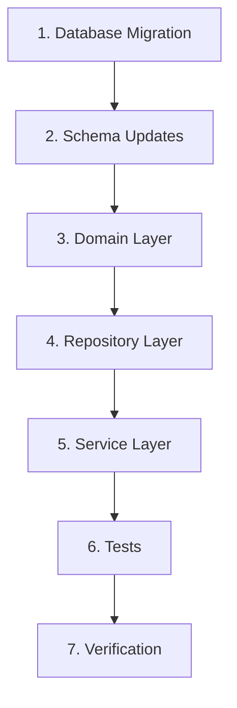

# Implementation Guide: Add Section Field to Enrollments

## 1. Prerequisites

Before starting implementation, ensure:

- [ ] Backup of `enrollments.db` exists
- [ ] Section data source is identified and validated
- [ ] All team members are aware of schema changes
- [ ] No active write operations to the database during migration

---

## 2. Implementation Order

The implementation must follow this order to maintain system stability:



---

## 3. Step-by-Step Implementation

### Step 1: Database Migration

**Location:** Create `scripts/migrations/` directory if it doesn't exist

**File:** `scripts/migrations/001_add_section_field.sql`

Execute the migration script from the architecture document against the SQLite database:

```bash
# Backup first
cp apps/backend/data/enrollments.db apps/backend/data/enrollments.db.backup

# Run migration
sqlite3 apps/backend/data/enrollments.db < scripts/migrations/001_add_section_field.sql

# Verify
sqlite3 apps/backend/data/enrollments.db "SELECT COUNT(*) FROM enrollments; SELECT COUNT(*) FROM enrollment_statistics;"
```

### Step 2: Update Drizzle Schema

**File:** `apps/backend/src/infrastructure/db/schema/enrollments.ts`

```typescript
import { integer, sqliteTable, text } from 'drizzle-orm/sqlite-core';

export const enrollments = sqliteTable('enrollments', {
  studentId: integer('student_id').notNull(),
  academicTerm: integer('academic_term').notNull(),
  courseCode: text('course_code').notNull(),
  section: text('section').notNull(),
  campusDescription: text('campus_description'),
  partialGrade: text('partial_grade'),
  finalGrade: text('final_grade'),
  courseStatusDescription: text('course_status_description'),
  courseOutcome: text('course_outcome', { length: 1 }).notNull(),
});

export const enrollmentStatistics = sqliteTable('enrollment_statistics', {
  courseCode: text('course_code').notNull(),
  section: text('section').notNull(),
  academicTerm: integer('academic_term').notNull(),
  enrolledCount: integer('enrolled_count').notNull().default(0),
  passedCount: integer('passed_count').notNull().default(0),
  failedCount: integer('failed_count').notNull().default(0),
  withdrawnCount: integer('withdrawn_count').notNull().default(0),
});
```

### Step 3: Update Domain Models

**File:** `apps/backend/src/domain/models/course-history.ts`

```typescript
export type CourseOutcome = 'P' | 'F' | 'W';

export interface CourseHistoryPoint {
  readonly academicTerm: number;
  readonly courseCode: string;
  readonly section?: string;
  readonly totalEnrollments: number;
  readonly passedCount: number;
  readonly failedCount: number;
  readonly withdrawnCount: number;
}

export interface SectionStatistics {
  readonly courseCode: string;
  readonly section: string;
  readonly academicTerm: number;
  readonly enrolledCount: number;
  readonly passedCount: number;
  readonly failedCount: number;
  readonly withdrawnCount: number;
}
```

### Step 4: Update Course History Service

**File:** `apps/backend/src/domain/services/course-history-service.ts`

Add the `section` field to `EnrollmentForHistory` interface and implement `aggregateByTermAndSection`:

```typescript
import type { CourseHistoryPoint, CourseOutcome } from '../models/course-history';

export interface EnrollmentForHistory {
  readonly academicTerm: number;
  readonly courseCode: string;
  readonly section?: string;
  readonly courseOutcome: CourseOutcome;
}

export interface CourseHistoryService {
  aggregateByTerm(enrollments: EnrollmentForHistory[]): CourseHistoryPoint[];
  aggregateByTermAndSection(enrollments: EnrollmentForHistory[]): CourseHistoryPoint[];
}

export const createCourseHistoryService = (): CourseHistoryService => {
  const aggregateByTerm = (
    enrollments: EnrollmentForHistory[],
  ): CourseHistoryPoint[] => {
    // Existing implementation unchanged
    const byTerm = new Map<number, CourseHistoryPoint>();

    for (const enrollment of enrollments) {
      const existing = byTerm.get(enrollment.academicTerm);

      if (existing === undefined) {
        const initialPoint: CourseHistoryPoint = {
          academicTerm: enrollment.academicTerm,
          courseCode: enrollment.courseCode,
          totalEnrollments: 0,
          passedCount: 0,
          failedCount: 0,
          withdrawnCount: 0,
        };

        byTerm.set(enrollment.academicTerm, initialPoint);
      }

      const current = byTerm.get(enrollment.academicTerm);
      if (current === undefined) {
        continue;
      }

      const nextTotals = getNextTotals(current, enrollment.courseOutcome);
      byTerm.set(enrollment.academicTerm, nextTotals);
    }

    return Array.from(byTerm.values()).sort(
      (left, right) => left.academicTerm - right.academicTerm,
    );
  };

  const aggregateByTermAndSection = (
    enrollments: EnrollmentForHistory[],
  ): CourseHistoryPoint[] => {
    const byTermAndSection = new Map<string, CourseHistoryPoint>();

    for (const enrollment of enrollments) {
      const section = enrollment.section ?? 'UNKNOWN';
      const key = `${enrollment.academicTerm}-${section}`;

      const existing = byTermAndSection.get(key);

      if (existing === undefined) {
        const initialPoint: CourseHistoryPoint = {
          academicTerm: enrollment.academicTerm,
          courseCode: enrollment.courseCode,
          section,
          totalEnrollments: 0,
          passedCount: 0,
          failedCount: 0,
          withdrawnCount: 0,
        };
        byTermAndSection.set(key, initialPoint);
      }

      const current = byTermAndSection.get(key);
      if (current === undefined) continue;

      const nextTotals = getNextTotals(current, enrollment.courseOutcome);
      byTermAndSection.set(key, nextTotals);
    }

    return Array.from(byTermAndSection.values()).sort((left, right) => {
      const termDiff = left.academicTerm - right.academicTerm;
      if (termDiff !== 0) return termDiff;
      return (left.section ?? '').localeCompare(right.section ?? '');
    });
  };

  return { aggregateByTerm, aggregateByTermAndSection };
};

const getNextTotals = (
  point: CourseHistoryPoint,
  outcome: CourseOutcome,
): CourseHistoryPoint => {
  let passedCount = point.passedCount;
  let failedCount = point.failedCount;
  let withdrawnCount = point.withdrawnCount;

  if (outcome === 'P') {
    passedCount += 1;
  } else if (outcome === 'F') {
    failedCount += 1;
  } else if (outcome === 'W') {
    withdrawnCount += 1;
  }

  return {
    academicTerm: point.academicTerm,
    courseCode: point.courseCode,
    section: point.section,
    totalEnrollments: point.totalEnrollments + 1,
    passedCount,
    failedCount,
    withdrawnCount,
  };
};
```

### Step 5: Create Statistics Repository

**File:** `apps/backend/src/infrastructure/repositories/enrollment-statistics-repository.ts`

```typescript
import type { InferSelectModel } from 'drizzle-orm';
import { and, eq } from 'drizzle-orm';
import { createDbContext, type DbClient } from '../db/client';
import { enrollmentStatistics } from '../db/schema/enrollments';

export type EnrollmentStatisticsRecord = InferSelectModel<
  typeof enrollmentStatistics
>;

export interface EnrollmentStatisticsRepository {
  findByCourseAndTerm(
    courseCode: string,
    academicTerm: number,
  ): Promise<EnrollmentStatisticsRecord[]>;
  findByCourseAndSection(
    courseCode: string,
    section: string,
  ): Promise<EnrollmentStatisticsRecord[]>;
  findByCourse(courseCode: string): Promise<EnrollmentStatisticsRecord[]>;
  findByCourseSectionAndTerm(
    courseCode: string,
    section: string,
    academicTerm: number,
  ): Promise<EnrollmentStatisticsRecord | null>;
}

export const createEnrollmentStatisticsRepository = (
  dbClient: DbClient,
): EnrollmentStatisticsRepository => {
  return {
    async findByCourseAndTerm(
      courseCode: string,
      academicTerm: number,
    ): Promise<EnrollmentStatisticsRecord[]> {
      return dbClient
        .select()
        .from(enrollmentStatistics)
        .where(
          and(
            eq(enrollmentStatistics.courseCode, courseCode),
            eq(enrollmentStatistics.academicTerm, academicTerm),
          ),
        );
    },

    async findByCourseAndSection(
      courseCode: string,
      section: string,
    ): Promise<EnrollmentStatisticsRecord[]> {
      return dbClient
        .select()
        .from(enrollmentStatistics)
        .where(
          and(
            eq(enrollmentStatistics.courseCode, courseCode),
            eq(enrollmentStatistics.section, section),
          ),
        )
        .orderBy(enrollmentStatistics.academicTerm);
    },

    async findByCourse(
      courseCode: string,
    ): Promise<EnrollmentStatisticsRecord[]> {
      return dbClient
        .select()
        .from(enrollmentStatistics)
        .where(eq(enrollmentStatistics.courseCode, courseCode))
        .orderBy(
          enrollmentStatistics.academicTerm,
          enrollmentStatistics.section,
        );
    },

    async findByCourseSectionAndTerm(
      courseCode: string,
      section: string,
      academicTerm: number,
    ): Promise<EnrollmentStatisticsRecord | null> {
      const rows = await dbClient
        .select()
        .from(enrollmentStatistics)
        .where(
          and(
            eq(enrollmentStatistics.courseCode, courseCode),
            eq(enrollmentStatistics.section, section),
            eq(enrollmentStatistics.academicTerm, academicTerm),
          ),
        );
      return rows[0] ?? null;
    },
  };
};

const { dbClient } = createDbContext();
export const enrollmentStatisticsRepository =
  createEnrollmentStatisticsRepository(dbClient);
```

### Step 6: Update Schema Exports

**File:** `apps/backend/src/infrastructure/db/schema/index.ts` (if it exists)

Ensure the new `enrollmentStatistics` table is exported:

```typescript
export * from './enrollments';
// enrollmentStatistics is now exported alongside enrollments
```

### Step 7: Add Tests

**File:** `apps/backend/tests/domain/course-history-service.test.ts`

Add new test cases:

```typescript
describe('aggregateByTermAndSection', () => {
  const service = createCourseHistoryService();

  it('should aggregate enrollments by term and section', () => {
    const enrollments: EnrollmentForHistory[] = [
      {
        academicTerm: 202410,
        courseCode: 'ISIS-3204',
        section: '01',
        courseOutcome: 'P',
      },
      {
        academicTerm: 202410,
        courseCode: 'ISIS-3204',
        section: '01',
        courseOutcome: 'P',
      },
      {
        academicTerm: 202410,
        courseCode: 'ISIS-3204',
        section: '02',
        courseOutcome: 'F',
      },
      {
        academicTerm: 202420,
        courseCode: 'ISIS-3204',
        section: '01',
        courseOutcome: 'W',
      },
    ];

    const result = service.aggregateByTermAndSection(enrollments);

    expect(result).toHaveLength(3);

    // Term 202410, Section 01
    expect(result[0]).toEqual({
      academicTerm: 202410,
      courseCode: 'ISIS-3204',
      section: '01',
      totalEnrollments: 2,
      passedCount: 2,
      failedCount: 0,
      withdrawnCount: 0,
    });

    // Term 202410, Section 02
    expect(result[1]).toEqual({
      academicTerm: 202410,
      courseCode: 'ISIS-3204',
      section: '02',
      totalEnrollments: 1,
      passedCount: 0,
      failedCount: 1,
      withdrawnCount: 0,
    });

    // Term 202420, Section 01
    expect(result[2]).toEqual({
      academicTerm: 202420,
      courseCode: 'ISIS-3204',
      section: '01',
      totalEnrollments: 1,
      passedCount: 0,
      failedCount: 0,
      withdrawnCount: 1,
    });
  });

  it('should handle missing section as UNKNOWN', () => {
    const enrollments: EnrollmentForHistory[] = [
      { academicTerm: 202410, courseCode: 'ISIS-3204', courseOutcome: 'P' },
    ];

    const result = service.aggregateByTermAndSection(enrollments);

    expect(result[0].section).toBe('UNKNOWN');
  });

  it('should sort by term first, then by section', () => {
    const enrollments: EnrollmentForHistory[] = [
      {
        academicTerm: 202420,
        courseCode: 'ISIS-3204',
        section: '01',
        courseOutcome: 'P',
      },
      {
        academicTerm: 202410,
        courseCode: 'ISIS-3204',
        section: '02',
        courseOutcome: 'P',
      },
      {
        academicTerm: 202410,
        courseCode: 'ISIS-3204',
        section: '01',
        courseOutcome: 'P',
      },
    ];

    const result = service.aggregateByTermAndSection(enrollments);

    expect(result.map((r) => `${r.academicTerm}-${r.section}`)).toEqual([
      '202410-01',
      '202410-02',
      '202420-01',
    ]);
  });

  it('should return empty array for empty input', () => {
    const result = service.aggregateByTermAndSection([]);
    expect(result).toEqual([]);
  });
});
```

---

## 4. Verification Checklist

After implementation, verify:

### Database

- [ ] `enrollments` table has `section` column
- [ ] Primary key includes `section`
- [ ] All existing rows have default section value '01'
- [ ] `enrollment_statistics` table exists and is populated
- [ ] Indexes are created

```sql
-- Verify structure
PRAGMA table_info(enrollments);
PRAGMA table_info(enrollment_statistics);

-- Verify indexes
SELECT name, sql FROM sqlite_master WHERE type='index' AND tbl_name IN ('enrollments', 'enrollment_statistics');

-- Verify data consistency
SELECT COUNT(*) FROM enrollments;
SELECT SUM(enrolled_count) FROM enrollment_statistics;
```

### Code

- [ ] TypeScript compiles without errors: `npx tsc --noEmit`
- [ ] All tests pass: `npm test`
- [ ] Application starts successfully
- [ ] Existing API endpoints work correctly

### Runtime

- [ ] `GET /api/courses/{code}/forecasts/{method}/accuracy` works
- [ ] Course history returns data with section information (if using new method)
- [ ] No performance degradation observed

---

## 5. Troubleshooting

### Migration Fails

**Symptom:** `UNIQUE constraint failed` error

**Cause:** Duplicate (student_id, academic_term, course_code) entries

**Solution:**
```sql
-- Find duplicates
SELECT student_id, academic_term, course_code, COUNT(*)
FROM enrollments
GROUP BY student_id, academic_term, course_code
HAVING COUNT(*) > 1;

-- If duplicates exist, they need different sections or deduplication
```

### TypeScript Errors After Schema Update

**Symptom:** Type errors in files using `EnrollmentRecord`

**Solution:** The type is auto-inferred. Ensure you:
1. Saved the schema file
2. Restarted the TypeScript server
3. Run `npx tsc --noEmit` to see actual errors

### Tests Fail

**Symptom:** Existing tests fail after changes

**Solution:** Update test fixtures to include `section` field:

```typescript
// Before
const enrollment = { academicTerm: 202410, courseCode: 'ISIS-3204', courseOutcome: 'P' };

// After
const enrollment = { academicTerm: 202410, courseCode: 'ISIS-3204', section: '01', courseOutcome: 'P' };
```

---

## 6. Rollback Procedure

If issues arise, rollback:

```bash
# Stop application
# Restore database backup
cp apps/backend/data/enrollments.db.backup apps/backend/data/enrollments.db

# Revert code changes
git checkout apps/backend/src/infrastructure/db/schema/enrollments.ts
git checkout apps/backend/src/domain/models/course-history.ts
git checkout apps/backend/src/domain/services/course-history-service.ts

# Remove new files
rm apps/backend/src/infrastructure/repositories/enrollment-statistics-repository.ts

# Restart application
```
