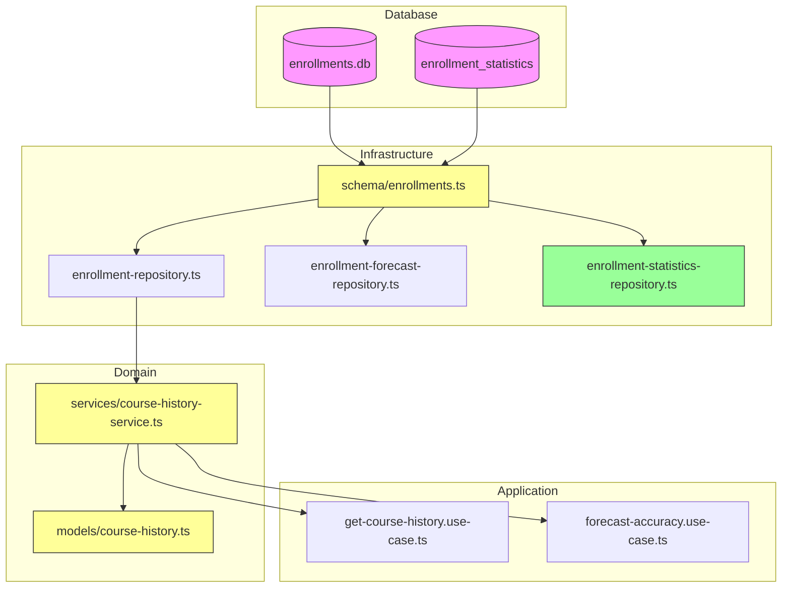

# System Impact: Add Section Field to Enrollments

## 1. Impact Summary

| Category | Impact Level | Description |
|----------|--------------|-------------|
| Database Schema | **HIGH** | New column, modified PK, new table |
| Infrastructure Layer | **MEDIUM** | Schema updates, new repository |
| Domain Layer | **MEDIUM** | Model and service extensions |
| Application Layer | **LOW** | Optional enhancements |
| Presentation Layer | **LOW** | No required changes |
| Frontend | **NONE** | No direct impact |

---

## 2. Detailed Impact by Layer

### 2.1 Database Layer

#### Changes Required

| Item | Current | After Change |
|------|---------|--------------|
| `enrollments` columns | 8 | 9 (+section) |
| `enrollments` PK | (student_id, academic_term, course_code) | (student_id, academic_term, course_code, **section**) |
| Tables count | 2 (enrollments, prerequisites) | 3 (+**enrollment_statistics**) |
| Indexes | 1 | 3 (+section index, +statistics index) |

#### Database Size Impact

| Metric | Estimate |
|--------|----------|
| Section column overhead | ~10-20 bytes/row |
| With 2M rows | ~20-40 MB increase |
| Statistics table | ~1-5 MB (aggregated) |
| Total increase | ~5-10% of current size |

#### Query Performance Impact

| Query Type | Impact | Notes |
|------------|--------|-------|
| `findByCourse` | None | Returns additional column |
| Insert operations | Minimal | Additional column validation |
| PK lookups | None | Index still efficient |
| Section-filtered queries | Improved | New index available |

### 2.2 Infrastructure Layer

#### Files Modified

| File | Change Type | Risk |
|------|-------------|------|
| `db/schema/enrollments.ts` | Add column + table | Low |
| `repositories/enrollment-repository.ts` | None (auto-typed) | None |
| `repositories/enrollment-forecast-repository.ts` | None | None |

#### New Files

| File | Purpose |
|------|---------|
| `repositories/enrollment-statistics-repository.ts` | Query statistics table |

#### Type Changes

```typescript
// EnrollmentRecord type change (auto-inferred)
// Before
type EnrollmentRecord = {
  studentId: number;
  academicTerm: number;
  courseCode: string;
  // ... other fields
};

// After
type EnrollmentRecord = {
  studentId: number;
  academicTerm: number;
  courseCode: string;
  section: string;  // NEW
  // ... other fields
};
```

### 2.3 Domain Layer

#### Files Modified

| File | Change | Backward Compatible |
|------|--------|---------------------|
| `models/course-history.ts` | Add optional `section` to `CourseHistoryPoint` | Yes |
| `services/course-history-service.ts` | Add optional `section` to interface, new method | Yes |

#### Interface Changes

```typescript
// EnrollmentForHistory - BACKWARD COMPATIBLE
interface EnrollmentForHistory {
  readonly academicTerm: number;
  readonly courseCode: string;
  readonly section?: string;      // OPTIONAL - existing code works
  readonly courseOutcome: CourseOutcome;
}

// CourseHistoryPoint - BACKWARD COMPATIBLE
interface CourseHistoryPoint {
  readonly academicTerm: number;
  readonly courseCode: string;
  readonly section?: string;      // OPTIONAL - existing code works
  // ... rest unchanged
}
```

#### New Domain Concepts

```typescript
// New interface for section-level data
interface SectionStatistics {
  readonly courseCode: string;
  readonly section: string;
  readonly academicTerm: number;
  readonly enrolledCount: number;
  readonly passedCount: number;
  readonly failedCount: number;
  readonly withdrawnCount: number;
}
```

### 2.4 Application Layer

#### Existing Use Cases

| Use Case | Impact | Changes Required |
|----------|--------|------------------|
| `get-course-history.use-case.ts` | None | Optional: support section filtering |
| `forecast-accuracy.use-case.ts` | None | Uses `aggregateByTerm`, unchanged |

#### Potential New Use Cases

| Use Case | Description |
|----------|-------------|
| `get-section-statistics.use-case.ts` | Fetch statistics per section |
| `get-course-sections.use-case.ts` | List all sections for a course |

### 2.5 Presentation Layer

#### Existing Controllers

| Controller | Impact | Changes Required |
|------------|--------|------------------|
| `forecast-accuracy.controller.ts` | None | No changes needed |

#### Potential New Endpoints

| Endpoint | Purpose |
|----------|---------|
| `GET /api/courses/{code}/sections` | List course sections |
| `GET /api/courses/{code}/sections/{section}/statistics` | Section statistics |
| `GET /api/courses/{code}/statistics` | All sections statistics |

### 2.6 Frontend

**No direct impact.** The frontend doesn't directly query the database or depend on the `enrollments` table structure.

However, if new API endpoints are added, the frontend could:
- Display section-level statistics
- Filter accuracy by section
- Show section distribution charts

---

## 3. Risk Assessment

### 3.1 High Risk Items

| Risk | Probability | Impact | Mitigation |
|------|-------------|--------|------------|
| Migration data loss | Low | Critical | Backup before migration |
| Duplicate PK violation | Medium | High | Validate data before migration |
| Application downtime | Low | Medium | Test migration on copy first |

### 3.2 Medium Risk Items

| Risk | Probability | Impact | Mitigation |
|------|-------------|--------|------------|
| Type errors in tests | High | Low | Update test fixtures |
| Performance regression | Low | Medium | Monitor query times |
| Incomplete migration | Low | Medium | Verification queries |

### 3.3 Low Risk Items

| Risk | Probability | Impact | Mitigation |
|------|-------------|--------|------------|
| API breaking changes | Very Low | Medium | All changes are additive |
| Frontend issues | Very Low | Low | No frontend dependencies |

---

## 4. Dependency Graph



Legend:
- Pink: Database (modified)
- Yellow: Existing files (modified)
- Green: New files

---

## 5. Test Impact

### 5.1 Unit Tests

| Test File | Impact | Action Required |
|-----------|--------|-----------------|
| `course-history-service.test.ts` | Medium | Add section tests, update fixtures |
| Other domain tests | Low | May need fixture updates |

### 5.2 Integration Tests

| Test Area | Impact | Action Required |
|-----------|--------|-----------------|
| Repository tests | Low | Add statistics repository tests |
| Database tests | Medium | Run against migrated DB |

### 5.3 E2E Tests

| Test Area | Impact | Action Required |
|-----------|--------|-----------------|
| API tests | None | Existing endpoints unchanged |

---

## 6. Documentation Impact

### 6.1 New Documentation

| Document | Location |
|----------|----------|
| Architecture overview | `docs/architecture/use-cases/add-section-to-enrollments/architecture.md` |
| Implementation guide | `docs/architecture/use-cases/add-section-to-enrollments/implementation-guide.md` |
| System impact (this doc) | `docs/architecture/use-cases/add-section-to-enrollments/system-impact.md` |

### 6.2 Existing Documentation Updates

| Document | Update Required |
|----------|-----------------|
| `general-architecture.md` | Add reference to section feature |
| `forecast-accuracy-backtesting/architecture.md` | No change (doesn't use section) |

---

## 7. Rollback Plan

### 7.1 Pre-Migration Checklist

- [ ] Database backup created
- [ ] Backup verified (can be restored)
- [ ] Code changes in separate branch
- [ ] Rollback script prepared

### 7.2 Rollback Steps

1. **Stop application**
2. **Restore database:**
   ```bash
   cp apps/backend/data/enrollments.db.backup apps/backend/data/enrollments.db
   ```
3. **Revert code:**
   ```bash
   git checkout main -- apps/backend/src/
   ```
4. **Restart application**
5. **Verify functionality**

### 7.3 Rollback Time Estimate

| Step | Time |
|------|------|
| Stop application | <1 min |
| Restore database | 1-5 min (depends on size) |
| Revert code | <1 min |
| Restart & verify | 2-5 min |
| **Total** | **5-15 min** |

---

## 8. Monitoring & Verification

### 8.1 Post-Migration Checks

```sql
-- Verify enrollments table structure
PRAGMA table_info(enrollments);

-- Verify primary key includes section
SELECT sql FROM sqlite_master WHERE name = 'enrollments';

-- Verify statistics table
SELECT COUNT(*) as stats_rows FROM enrollment_statistics;

-- Verify data consistency
SELECT
  (SELECT COUNT(*) FROM enrollments) as enrollments_count,
  (SELECT SUM(enrolled_count) FROM enrollment_statistics) as stats_total;
```

### 8.2 Application Health Checks

| Check | Endpoint | Expected |
|-------|----------|----------|
| API Health | `GET /api/health` | 200 OK |
| Course History | `GET /api/courses/ISIS-3204/history` | Returns data |
| Forecast Accuracy | `GET /api/courses/ISIS-3204/forecasts/.../accuracy?term=202410` | Returns data |

### 8.3 Performance Monitoring

Watch for:
- Query execution time > 500ms
- Memory usage spikes
- Error rate increases

---

## 9. Summary

### What Changes

1. **Database:** New `section` column in `enrollments`, new `enrollment_statistics` table
2. **Schema:** Updated Drizzle schema with new column and table
3. **Domain:** Optional `section` field in models and services
4. **Repository:** New `enrollment-statistics-repository.ts`

### What Doesn't Change

1. **Existing APIs:** All endpoints remain functional
2. **Frontend:** No changes required
3. **Forecast logic:** Doesn't depend on section data
4. **Backtesting:** Uses term-level aggregation (unchanged)

### Key Decisions

1. **Backward compatible:** Optional `section` field preserves existing behavior
2. **Pre-computed statistics:** New table avoids runtime aggregation cost
3. **Default section:** Historical data gets '01' as default section
