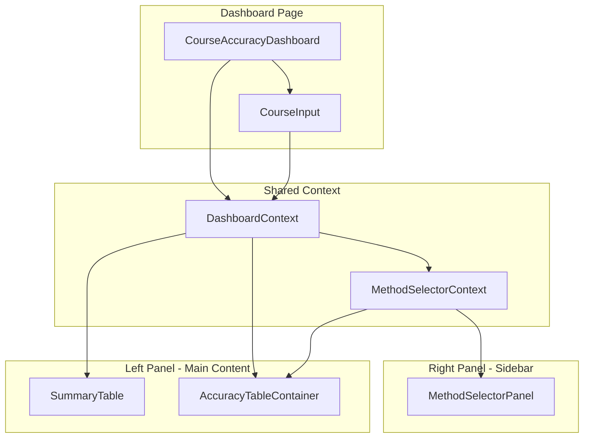
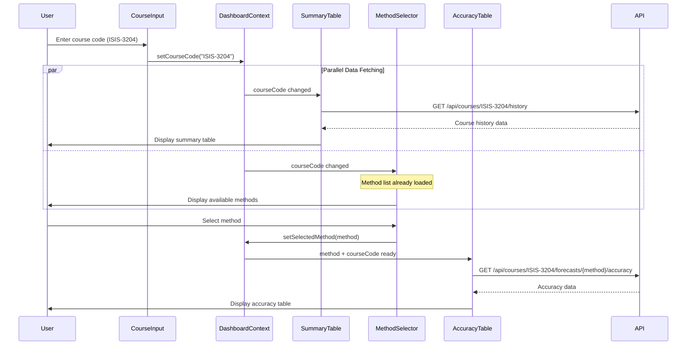
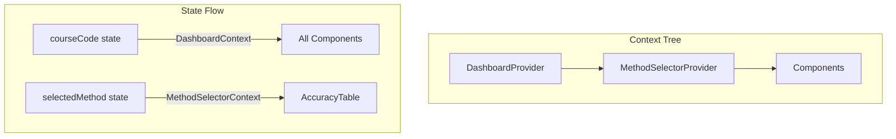

# Course Accuracy Dashboard Architecture

## 1. Overview

### 1.1 Problem Statement

Currently, the forecast accuracy features exist as separate components:

- **Summary Table**: Shows historical enrollment data for a course
- **Forecast Accuracy Backtesting**: Compares forecast predictions with actual enrollments
- **Method Selector**: Allows users to select a forecasting method

Users must navigate between pages or manually coordinate course codes across components. This creates friction and reduces usability.

### 1.2 Goal

Create a **unified Course Accuracy Dashboard** that:

- Combines summary table and forecast accuracy backtesting on a single page
- Uses a **shared course input** for both components
- Integrates with the existing method selector sidebar
- Provides a cohesive user experience for analyzing forecast accuracy

### 1.3 Design Principles

1. **Component Reuse**: Leverage existing AccuracyTable and Summary components
2. **Shared State**: Single source of truth for course code input
3. **Minimal Changes**: Extend existing components, don't rewrite
4. **Backward Compatibility**: Existing component APIs remain functional
5. **Progressive Enhancement**: Page works even if one section fails to load

---

## 2. Architecture Overview

### 2.1 Component Hierarchy



### 2.2 Data Flow



---

## 3. Page Layout

### 3.1 Desktop Layout (> 1024px)

```
┌─────────────────────────────────────────────────────────────────────────────┐
│                                Header                                        │
├─────────────────────────────────────────────────────────────────────────────┤
│                                                                             │
│  ┌──────────────────────────────────────────────────────────────────────┐  │
│  │  Course Code: [ISIS-3204____________] [Search]                        │  │
│  └──────────────────────────────────────────────────────────────────────┘  │
│                                                                             │
├───────────────────────────────────────────────────┬─────────────────────────┤
│                                                   │                         │
│  ┌─────────────────────────────────────────────┐  │    Method Selector      │
│  │           Summary Table                      │  │  ┌─────────────────┐   │
│  │  ┌──────────┬────────────┬─────────────┐    │  │  │ Method 1        │   │
│  │  │  Term    │ Enrollment │   Pass Rate │    │  │  │ Description...  │   │
│  │  ├──────────┼────────────┼─────────────┤    │  │  └─────────────────┘   │
│  │  │ 202510   │    44      │    85%      │    │  │  ┌─────────────────┐   │
│  │  │ 202420   │    40      │    82%      │    │  │  │ Method 2 ✓      │   │
│  │  │ 202410   │    38      │    79%      │    │  │  │ Description...  │   │
│  │  └──────────┴────────────┴─────────────┘    │  │  └─────────────────┘   │
│  └─────────────────────────────────────────────┘  │  ┌─────────────────┐   │
│                                                   │  │ Method 3        │   │
│  ┌─────────────────────────────────────────────┐  │  │ Description...  │   │
│  │      Forecast Accuracy Backtesting          │  │  └─────────────────┘   │
│  │  ┌────────┬──────────┬────────┬──────────┐  │  │                         │
│  │  │  Term  │ Forecast │ Actual │ Accuracy │  │  │                         │
│  │  ├────────┼──────────┼────────┼──────────┤  │  │                         │
│  │  │ 202510 │    45    │   44   │  97.73%  │  │  │                         │
│  │  │ 202420 │    35    │   40   │  87.50%  │  │  │                         │
│  │  │ 202410 │    42    │   38   │  89.47%  │  │  │                         │
│  │  └────────┴──────────┴────────┴──────────┘  │  │                         │
│  │                                             │  │                         │
│  │  Summary: Avg Accuracy 91.57% | MAPE 8.43% │  │                         │
│  └─────────────────────────────────────────────┘  │                         │
│                                                   │                         │
└───────────────────────────────────────────────────┴─────────────────────────┘
```

### 3.2 Component Sections

| Section | Component | Data Source | Dependencies |
|---------|-----------|-------------|--------------|
| Course Input | `CourseInput` | User input | None |
| Summary Table | `SummaryTable` | `/api/courses/{code}/history` | courseCode |
| Method Selector | `MethodSelectorPanel` | `/api/forecasts/methods` | courseCode |
| Accuracy Table | `AccuracyTableContainer` | `/api/courses/{code}/forecasts/{method}/accuracy` | courseCode + selectedMethod |

---

## 4. Component Design

### 4.1 DashboardContext

Central context for sharing course code across all components.

```typescript
// Location: apps/frontend/src/contexts/DashboardContext.tsx

interface DashboardContextValue {
  /** Current course code entered by user */
  courseCode: string | null;

  /** Set the course code */
  setCourseCode: (code: string | null) => void;

  /** Whether course code is valid format */
  isValidCourseCode: boolean;

  /** Validation error message */
  validationError: string | null;

  /** Course data loading state */
  isLoading: boolean;

  /** Course exists in database */
  courseExists: boolean | null;
}
```

**Responsibilities:**

- Store and validate course code input
- Provide loading/error states
- Coordinate between summary table and accuracy components

### 4.2 CourseInput

Shared input component for entering course codes.

```typescript
// Location: apps/frontend/src/components/dashboard/CourseInput.tsx

interface CourseInputProps {
  /** Initial course code value */
  initialValue?: string;

  /** Callback when course code changes */
  onChange?: (courseCode: string | null) => void;

  /** Placeholder text */
  placeholder?: string;

  /** Show validation errors inline */
  showErrors?: boolean;

  /** Auto-focus on mount */
  autoFocus?: boolean;
}
```

**Features:**

- Course code format validation (XXXX-DDDD)
- Debounced input (300ms delay before triggering fetch)
- Clear button
- Autocomplete suggestions (future enhancement)
- Keyboard shortcuts (Enter to search)

### 4.3 SummaryTable

Displays historical enrollment summary for a course.

```typescript
// Location: apps/frontend/src/components/dashboard/SummaryTable.tsx

interface SummaryTableProps {
  /** Course code to display summary for */
  courseCode: string;

  /** Optional: limit number of terms displayed */
  maxTerms?: number;

  /** Show/hide specific columns */
  columns?: {
    passRate?: boolean;
    failedCount?: boolean;
    withdrawnCount?: boolean;
  };
}
```

**Data Source:**

- Uses existing `useCourseHistory` hook
- Endpoint: `GET /api/courses/{courseCode}/history`

**Display Columns:**

| Column | Description |
|--------|-------------|
| Term | Academic term (e.g., 202510) |
| Enrollment | Total students enrolled |
| Passed | Students who passed |
| Failed | Students who failed |
| Withdrawn | Students who withdrew |
| Pass Rate | Percentage passed |

### 4.4 Integration with Existing Components

The dashboard reuses these existing components with minimal modifications:

```typescript
// CourseAccuracyDashboard.tsx
import { MethodSelectorPanel } from '../forecasts/MethodSelectorPanel';
import { AccuracyTableContainer } from '../forecasts/AccuracyTableContainer';

function CourseAccuracyDashboard() {
  return (
    <DashboardProvider>
      <MethodSelectorProvider>
        <div className="dashboard-layout">
          {/* Shared Course Input */}
          <header className="dashboard-header">
            <CourseInputWithContext />
          </header>

          {/* Main Content Area */}
          <main className="dashboard-main">
            <SummaryTableWithContext />
            <AccuracyTableWithContext />
          </main>

          {/* Sidebar */}
          <aside className="dashboard-sidebar">
            <MethodSelectorPanel />
          </aside>
        </div>
      </MethodSelectorProvider>
    </DashboardProvider>
  );
}
```

---

## 5. State Management

### 5.1 Context Hierarchy



### 5.2 State Dependencies

| State | Provider | Consumers |
|-------|----------|-----------|
| `courseCode` | DashboardContext | SummaryTable, AccuracyTable, MethodSelector |
| `selectedMethod` | MethodSelectorContext | AccuracyTable |
| `methods[]` | MethodSelectorContext | MethodSelectorPanel |

### 5.3 URL State Synchronization

Persist dashboard state in URL for shareability:

```typescript
// URL format: /?course=ISIS-3204&method=potential-students

function useDashboardUrl() {
  const [searchParams, setSearchParams] = useSearchParams();

  const courseCode = searchParams.get('course');
  const methodId = searchParams.get('method');

  const updateUrl = (updates: { course?: string; method?: string }) => {
    const newParams = new URLSearchParams(searchParams);
    if (updates.course) newParams.set('course', updates.course);
    if (updates.method) newParams.set('method', updates.method);
    setSearchParams(newParams);
  };

  return { courseCode, methodId, updateUrl };
}
```

---

## 6. Data Fetching Strategy

### 6.1 Parallel Loading

When course code changes, fetch data in parallel:

```typescript
// Parallel fetch on course code change
useEffect(() => {
  if (!isValidCourseCode) return;

  // These run in parallel
  fetchCourseHistory(courseCode);   // For SummaryTable
  // AccuracyTable waits for method selection
}, [courseCode, isValidCourseCode]);
```

### 6.2 Conditional Fetching

| Component | Fetch When |
|-----------|------------|
| SummaryTable | courseCode is valid |
| MethodSelector | Component mounts (one-time) |
| AccuracyTable | courseCode is valid AND method is selected |

### 6.3 Cache Strategy

```typescript
// React Query configuration
const queryConfig = {
  // Course history - longer cache (data rarely changes)
  courseHistory: {
    staleTime: 1000 * 60 * 30, // 30 minutes
    cacheTime: 1000 * 60 * 60, // 1 hour
  },

  // Methods list - very stable
  forecastMethods: {
    staleTime: 1000 * 60 * 60, // 1 hour
    cacheTime: 1000 * 60 * 60 * 24, // 24 hours
  },

  // Accuracy data - shorter cache (may want fresher data)
  forecastAccuracy: {
    staleTime: 1000 * 60 * 5, // 5 minutes
    cacheTime: 1000 * 60 * 30, // 30 minutes
  },
};
```

---

## 7. Loading & Error States

### 7.1 Initial State (No Course Selected)

```
┌────────────────────────────────────────────────────────────────────┐
│  Course Code: [________________________] [Search]                   │
└────────────────────────────────────────────────────────────────────┘

┌────────────────────────────────────────────────────────────────────┐
│                                                                     │
│                    Enter a course code to begin                     │
│                                                                     │
│              Example: ISIS-3204, MATE-1105, FISI-1028              │
│                                                                     │
└────────────────────────────────────────────────────────────────────┘
```

### 7.2 Loading State

```
┌────────────────────────────────────────────────────────────────────┐
│  Course Code: [ISIS-3204_______________] [Search]  ⟳ Loading...    │
└────────────────────────────────────────────────────────────────────┘

┌────────────────────────────────────────────────────────────────────┐
│  Summary Table                                                      │
│  ┌────────────────────────────────────────────────────────────┐    │
│  │ ░░░░░░░░░░░░░░░░░░░░░░░░░░░░░░░░░░░░░░░░░░░░░░░░░░░░░░░░░ │    │
│  │ ░░░░░░░░░░░░░░░░░░░░░░░░░░░░░░░░░░░░░░░░░░░░░░░░░░░░░░░░░ │    │
│  │ ░░░░░░░░░░░░░░░░░░░░░░░░░░░░░░░░░░░░░░░░░░░░░░░░░░░░░░░░░ │    │
│  └────────────────────────────────────────────────────────────┘    │
└────────────────────────────────────────────────────────────────────┘
```

### 7.3 Error States

**Invalid Course Code Format:**

```
┌────────────────────────────────────────────────────────────────────┐
│  Course Code: [ISIS3204________________] [Search]                   │
│               ⚠ Invalid format. Use XXXX-DDDD (e.g., ISIS-3204)   │
└────────────────────────────────────────────────────────────────────┘
```

**Course Not Found:**

```
┌────────────────────────────────────────────────────────────────────┐
│                                                                     │
│                  ⚠ Course "ISIS-9999" not found                    │
│                                                                     │
│           Check the course code and try again.                      │
│                                                                     │
└────────────────────────────────────────────────────────────────────┘
```

### 7.4 Partial Error Handling

If accuracy data fails but summary loads:

```typescript
function DashboardContent() {
  const { courseCode } = useDashboard();

  return (
    <>
      {/* Always show if we have course code */}
      <SummaryTable courseCode={courseCode} />

      {/* Show accuracy table with its own error boundary */}
      <ErrorBoundary fallback={<AccuracyTableError />}>
        <AccuracyTableContainer courseCode={courseCode} />
      </ErrorBoundary>
    </>
  );
}
```

---

## 8. Accessibility

### 8.1 Keyboard Navigation

| Key | Action |
|-----|--------|
| `Tab` | Move between interactive elements |
| `Enter` | Submit course code / Select method |
| `Escape` | Clear course input |
| `Arrow keys` | Navigate within tables / method list |

### 8.2 Screen Reader Support

```tsx
// Course Input with announcements
<div role="search" aria-label="Course search">
  <label htmlFor="course-input">Course Code</label>
  <input
    id="course-input"
    aria-describedby="course-format-hint"
    aria-invalid={hasError}
  />
  <span id="course-format-hint">Format: XXXX-DDDD</span>
</div>

// Live region for status updates
<div aria-live="polite" aria-atomic="true">
  {isLoading && "Loading course data..."}
  {error && `Error: ${error.message}`}
  {data && `Loaded ${data.terms.length} terms for ${courseCode}`}
</div>
```

---

## 9. Responsive Design

### 9.1 Breakpoints

| Breakpoint | Layout |
|------------|--------|
| Desktop (> 1024px) | Side-by-side: main content + sidebar |
| Tablet (768-1024px) | Stacked: collapsible sidebar |
| Mobile (< 768px) | Single column, bottom sheet for methods |

### 9.2 Mobile Layout

```
┌───────────────────────────────────┐
│           Header                   │
├───────────────────────────────────┤
│  Course: [ISIS-3204_____] [🔍]    │
├───────────────────────────────────┤
│                                   │
│       Summary Table               │
│  (scrollable horizontal)          │
│                                   │
├───────────────────────────────────┤
│                                   │
│    Accuracy Backtesting           │
│  (card layout per term)           │
│                                   │
├───────────────────────────────────┤
│  Method: Potential Students  [▼]  │  ← Tap to expand
└───────────────────────────────────┘
```

---

## 10. Integration Points

### 10.1 With Existing MethodSelectorContext

The dashboard wraps the existing context:

```typescript
// DashboardProvider integrates with MethodSelectorProvider
function DashboardProvider({ children }: { children: React.ReactNode }) {
  const [courseCode, setCourseCode] = useState<string | null>(null);

  const value = useMemo(() => ({
    courseCode,
    setCourseCode,
    // ... validation logic
  }), [courseCode]);

  return (
    <DashboardContext.Provider value={value}>
      {/* Wrap in MethodSelectorProvider for method selection */}
      <MethodSelectorProvider>
        {children}
      </MethodSelectorProvider>
    </DashboardContext.Provider>
  );
}
```

### 10.2 Prop Drilling Elimination

Before (components needed courseCode passed):

```tsx
<AccuracyTableContainer courseCode={courseCode} />
```

After (components get courseCode from context):

```tsx
function AccuracyTableWithContext() {
  const { courseCode } = useDashboard();

  if (!courseCode) return <AccuracyTableEmpty />;

  return <AccuracyTableContainer courseCode={courseCode} />;
}
```

---

## 11. Future Enhancements

### 11.1 Course Autocomplete

```typescript
// Debounced search suggestions
function useCourseAutocomplete(query: string) {
  return useQuery({
    queryKey: ['course-suggestions', query],
    queryFn: () => fetchCourseSuggestions(query),
    enabled: query.length >= 2,
  });
}
```

### 11.2 Recent Courses

```typescript
// Store recently viewed courses in localStorage
function useRecentCourses() {
  const [recent, setRecent] = useLocalStorage<string[]>('recent-courses', []);

  const addRecent = (courseCode: string) => {
    setRecent(prev => [courseCode, ...prev.filter(c => c !== courseCode)].slice(0, 5));
  };

  return { recent, addRecent };
}
```

### 11.3 Export Dashboard Data

```typescript
function exportDashboard(courseCode: string, data: DashboardData) {
  const csv = generateCSV({
    summary: data.history,
    accuracy: data.accuracyResults,
  });

  downloadFile(csv, `${courseCode}-dashboard-export.csv`);
}
```

### 11.4 Side-by-Side Method Comparison

Allow selecting multiple methods to compare accuracy:

```
┌─────────────────────────────────────────────────────────────────────┐
│  Comparison Mode: [Method A ▼] vs [Method B ▼]                      │
├─────────────────────────────────────────────────────────────────────┤
│  Term   │ Method A Forecast │ Method B Forecast │ Actual │ Best    │
├─────────┼───────────────────┼───────────────────┼────────┼─────────┤
│ 202510  │   45 (97.7%)      │   43 (97.7%)      │   44   │  Tie    │
│ 202420  │   35 (87.5%)      │   39 (97.5%)      │   40   │  B ✓   │
└─────────┴───────────────────┴───────────────────┴────────┴─────────┘
```

---

## 12. Related Documents

- [Frontend Method Selector](../frontend-method-selector/architecture.md) - Method selection component
- [Frontend Accuracy Table](../frontend-accuracy-table/architecture.md) - Accuracy display component
- [Forecast Accuracy Backtesting](../forecast-accuracy-backtesting/architecture.md) - Backend API
- [Get Course History by Term](../get-course-history-by-term/architecture.md) - Course history endpoint
- [Implementation Guide](./implementation-guide.md)
- [System Impact](./system-impact.md)
- [Testing Guide](./testing-guide.md)
