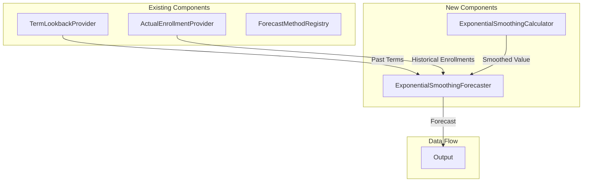
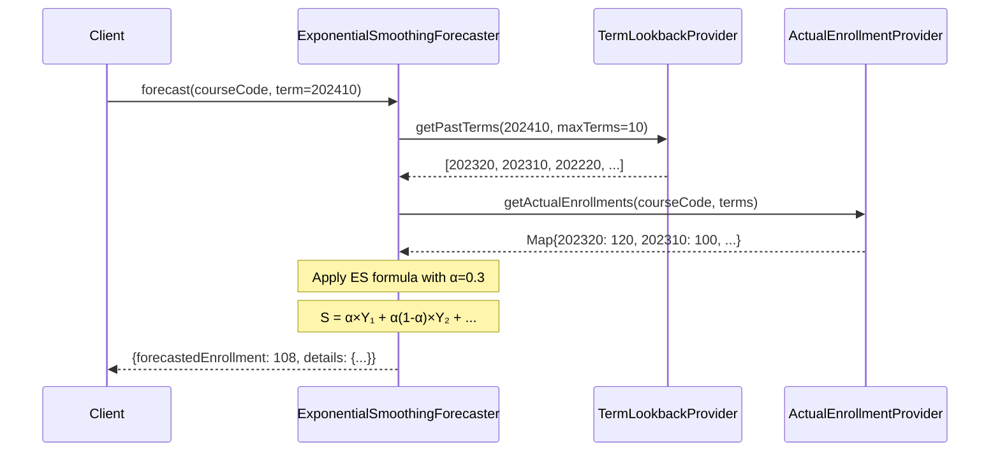
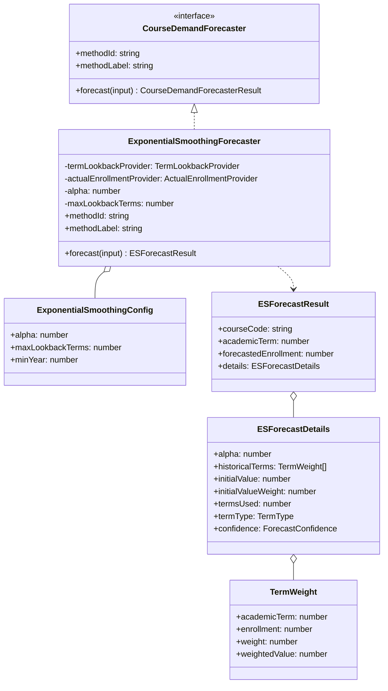

# Exponential Smoothing Forecaster - Architecture Document

## 1. Overview

### 1.1 Problem Statement

The existing **Weighted Moving Average (WMA) Forecaster** uses fixed weights (0.50, 0.30, 0.20) applied to exactly 3 historical terms. While effective, this approach has limitations:

- **Fixed window size**: Only considers 3 terms, ignoring older but potentially relevant data
- **Static weights**: Cannot adapt to different course volatility patterns
- **No tunability**: Weights are predetermined, not adjustable per course or scenario
- **Abrupt cutoff**: Data beyond the 3-term window is completely ignored

An **Exponential Smoothing** approach addresses these limitations by using a tunable smoothing parameter that naturally incorporates all available historical data with exponentially decaying influence.

### 1.2 Goal

Create an **Exponential Smoothing Forecaster** that predicts enrollment using Simple Exponential Smoothing (SES):

```
S_t = α × Y_{t-1} + (1 - α) × S_{t-1}
```

Where:
- **S_t**: Smoothed value (forecast) at time t
- **Y_{t-1}**: Actual enrollment from the most recent term
- **S_{t-1}**: Previous smoothed value
- **α (alpha)**: Smoothing parameter (0 < α < 1)

### 1.3 Why Exponential Smoothing?

**Exponential Smoothing** is a time-series forecasting technique where:
- Weights decrease **exponentially** as observations age
- The smoothing parameter **α** controls the rate of decay
- **All historical data** contributes to the forecast (weighted appropriately)

| Method | Weights | Parameters | Historical Data Used |
|--------|---------|------------|---------------------|
| Simple Moving Average (SMA) | Equal | None | Fixed window (n terms) |
| Weighted Moving Average (WMA) | Fixed (0.50, 0.30, 0.20) | None | Fixed 3 terms |
| **Exponential Smoothing (ES)** | Exponentially decaying | α (smoothing factor) | All available terms |

### 1.4 Design Principles

1. **Term-Type Awareness**: Only use terms of the same type (semesters vs. intersessions)
2. **Tunable Parameter**: Allow configuration of smoothing factor α
3. **Sensible Defaults**: Provide a default α that works well for typical course patterns
4. **Graceful Degradation**: Handle edge cases when limited historical data is available
5. **Transparency**: Expose calculation details including effective weights in forecast output

---

## 2. Smoothing Parameter α (Alpha)

### 2.1 Parameter Definition

The smoothing parameter **α** (alpha) controls how much weight is given to recent observations versus historical smoothed values:

| α Value | Behavior | Use Case |
|---------|----------|----------|
| **High (0.7-0.9)** | More responsive to recent changes | Volatile courses, rapidly changing demand |
| **Medium (0.3-0.5)** | Balanced responsiveness | Typical courses with moderate stability |
| **Low (0.1-0.3)** | Smoother, more stable forecasts | Stable courses with consistent enrollment |

### 2.2 Default Value: α = 0.3

**Recommended default: α = 0.3**

Rationale:
- **Conservative approach**: Provides stable forecasts that aren't overly reactive to single-term fluctuations
- **Academic context**: Course enrollment tends to be relatively stable semester-to-semester
- **Effective window**: With α = 0.3, approximately 90% of the weight is concentrated in the last 7 terms
- **Comparison with WMA**: Similar to WMA's emphasis on recent terms but with smoother decay

### 2.3 Valid Range

```
0 < α < 1
```

- **α = 0**: Would ignore all new data (invalid)
- **α = 1**: Would only use the most recent term (equivalent to naive forecast)
- **Typical range**: 0.1 to 0.5 for most academic enrollment scenarios

### 2.4 Effective Weight Distribution

With exponential smoothing, the weight for observation `k` terms ago is:

```
w_k = α × (1 - α)^k
```

**Example weight distribution for different α values:**

| Terms Ago | α = 0.2 | α = 0.3 | α = 0.5 |
|-----------|---------|---------|---------|
| 0 (T₁) | 20.0% | 30.0% | 50.0% |
| 1 (T₂) | 16.0% | 21.0% | 25.0% |
| 2 (T₃) | 12.8% | 14.7% | 12.5% |
| 3 (T₄) | 10.2% | 10.3% | 6.25% |
| 4 (T₅) | 8.2% | 7.2% | 3.12% |
| Cumulative (5 terms) | 67.2% | 83.2% | 96.9% |

---

## 3. Academic Term Classification

### 3.1 Term Types

Academic terms follow the format `YYYYSS` where:
- `YYYY`: Year (e.g., 2024)
- `SS`: Semester code (e.g., 10, 20, 15)

| Semester Code | Type | Description |
|---------------|------|-------------|
| `10` | Main Semester | Spring/First semester |
| `20` | Main Semester | Fall/Second semester |
| `11` - `19` | Intersession/Summer | Mid-year intensive terms |

### 3.2 Term-Type-Aware Lookback Strategy

The forecaster uses **only terms of the same type** for lookback:

#### Main Semester Terms (10, 20)

For a target term like `202410` (Spring 2024), use previous **main semester** terms:
- `202320` (Fall 2023) - T₁
- `202310` (Spring 2023) - T₂
- `202220` (Fall 2022) - T₃
- `202210` (Spring 2022) - T₄
- ... and so on

Example sequence: `[202110, 202120, 202210, 202220, 202310, 202320, 202410]`
→ For `202410`, lookback: `[202320, 202310, 202220, 202210, ...]`

#### Intersession/Summer Terms (11-19)

For a target term like `202415` (Summer 2024), use previous **same-type intersession** terms:
- `202315` (Summer 2023) - T₁
- `202215` (Summer 2022) - T₂
- `202115` (Summer 2021) - T₃
- `202015` (Summer 2020) - T₄
- ... and so on

Example sequence: `[202015, 202115, 202215, 202315, 202415]`
→ For `202415`, lookback: `[202315, 202215, 202115, 202015]`

### 3.3 Rationale for Term-Type Separation

Different term types have fundamentally different enrollment patterns:

| Characteristic | Main Semester | Intersession/Summer |
|---------------|---------------|---------------------|
| Duration | 16-18 weeks | 4-8 weeks |
| Enrollment size | Higher | Lower |
| Course availability | Full catalog | Limited offerings |
| Student motivation | Regular progression | Catch-up/advance |

Mixing term types would introduce noise and reduce forecast accuracy.

---

## 4. Exponential Smoothing Formula

### 4.1 Recursive Formula

Simple Exponential Smoothing uses the recursive formula:

```
S_t = α × Y_{t-1} + (1 - α) × S_{t-1}
```

Which can be expanded to show all historical contributions:

```
S_t = α × Y_{t-1} + α(1-α) × Y_{t-2} + α(1-α)² × Y_{t-3} + ... + (1-α)^n × S_0
```

Where:
- `Y_k` = Actual enrollment at term k
- `S_0` = Initial smoothed value
- `n` = Number of historical terms available

### 4.2 Equivalent Weight Representation

The formula can be expressed as a weighted average:

```
S_t = Σ(w_k × Y_k) + residual_weight × S_0
```

Where:
- `w_k = α × (1 - α)^k` for the k-th most recent term
- `residual_weight = (1 - α)^n` applied to initial value

### 4.3 Example Calculation

**Parameters**: α = 0.3, Target term = 202410

**Historical data** (main semester terms):

| Term | Position | Enrollment (Y) | Weight | Weighted Value |
|------|----------|----------------|--------|----------------|
| 202320 | T₁ | 120 | 0.300 | 36.00 |
| 202310 | T₂ | 100 | 0.210 | 21.00 |
| 202220 | T₃ | 110 | 0.147 | 16.17 |
| 202210 | T₄ | 105 | 0.103 | 10.82 |
| 202120 | T₅ | 95 | 0.072 | 6.84 |
| Initial (S₀) | - | 100 | 0.168 | 16.81 |
| **Total** | | | **1.000** | **107.64** |

**Forecast for 202410**: round(107.64) = **108 students**

### 4.4 Comparison with Other Methods

Using the same data (last 3 terms: 120, 100, 110):

| Method | Formula | Result |
|--------|---------|--------|
| Simple Moving Average | (120 + 100 + 110) / 3 | 110 |
| Weighted Moving Average | 0.50×120 + 0.30×100 + 0.20×110 | 112 |
| **Exponential Smoothing (α=0.3)** | Uses all terms with decay | 108 |

---

## 5. Initial Value (S₀) Strategy

### 5.1 The Initialization Problem

Exponential smoothing requires an initial smoothed value `S₀` to start the recursion. The choice of `S₀` affects forecasts, especially when limited historical data is available.

### 5.2 Initialization Methods

| Method | Formula | Pros | Cons |
|--------|---------|------|------|
| **First Observation** | S₀ = Y₁ (oldest term) | Simple | Sensitive to outliers |
| **Average of First k Terms** | S₀ = avg(Y₁, Y₂, ..., Y_k) | More robust | Requires multiple terms |
| **Backcasting** | Run ES backwards | Most accurate | Complex |

### 5.3 Recommended Strategy: First Observation with Fallback

```typescript
function getInitialValue(enrollments: number[]): number {
  if (enrollments.length === 0) {
    return 0; // No data available
  }

  // Use the oldest available term as S₀
  return enrollments[enrollments.length - 1];
}
```

**Rationale**:
- **Simplicity**: Easy to implement and explain
- **Minimal assumptions**: Doesn't require minimum term count
- **Diminishing impact**: S₀ influence decreases exponentially as more data becomes available

### 5.4 Impact of Initial Value

The influence of S₀ decays as `(1-α)^n`:

| Terms Available | α = 0.3 | S₀ Influence |
|-----------------|---------|--------------|
| 1 | 0.70 | 70% (high) |
| 3 | 0.34 | 34% (moderate) |
| 5 | 0.17 | 17% (low) |
| 10 | 0.03 | 3% (negligible) |

With sufficient historical data (5+ terms), the initial value has minimal impact.

---

## 6. Edge Cases and Handling

### 6.1 Very Short Histories

#### Case 1: Only 1 Historical Term Available

**Strategy**: Use the single term directly (equivalent to naive forecast)

```
Forecast = Y₁
```

Set confidence to `low` and note in details.

#### Case 2: Only 2 Historical Terms Available

**Strategy**: Apply exponential smoothing with available data

```
S = α × Y₁ + (1-α) × Y₂
```

Set confidence to `medium`.

#### Case 3: No Historical Data

**Strategy**: Return zero forecast with `insufficient` confidence

```json
{
  "forecastedEnrollment": 0,
  "details": {
    "dataAvailable": false,
    "fallbackReason": "NO_HISTORICAL_DATA",
    "confidence": "insufficient"
  }
}
```

### 6.2 Missing Terms (Gaps in Data)

When a term has no enrollment data (course not offered):

**Strategy**: Skip the missing term but maintain exponential decay

Example with gap at T₂:
- T₁: 120 (weight: α = 0.30)
- T₂: missing → skip
- T₃: 110 (weight: α(1-α) = 0.21)
- T₄: 105 (weight: α(1-α)² = 0.147)

```typescript
// Skip missing terms, apply weights to available data
const validTerms = enrollmentData.filter(d => d.enrollment !== null);
```

### 6.3 Outliers

Exponential smoothing naturally handles outliers through its smoothing mechanism:

- **High α (0.7+)**: More susceptible to outliers
- **Low α (0.3)**: Default setting provides natural outlier resistance

**No special outlier detection needed** for the default configuration.

For extreme cases, users can manually reduce α for courses with known anomalous terms.

### 6.4 Zero Enrollment Terms

If a historical term has zero enrollment:
- **Include it** in the calculation (may represent valid data: course not offered)
- The exponential smoothing will naturally weight it appropriately
- Document in details that a zero-enrollment term was included

### 6.5 Edge Case Summary

| Available Terms | Strategy | Confidence |
|-----------------|----------|------------|
| 5+ | Full exponential smoothing | `high` |
| 3-4 | Full exponential smoothing | `medium` |
| 2 | Limited exponential smoothing | `medium` |
| 1 | Direct value (naive forecast) | `low` |
| 0 | Error/fallback | `insufficient` |

---

## 7. Architecture Overview

### 7.1 System Context



### 7.2 High-Level Data Flow



---

## 8. Component Architecture

### 8.1 Class Diagram



### 8.2 Component Responsibilities

| Component | Responsibility | Layer |
|-----------|---------------|-------|
| `ExponentialSmoothingForecaster` | Orchestrate lookback, retrieval, and ES calculation | Domain |
| `TermLookbackProvider` | Generate term-type-aware past term list | Domain (Interface) |
| `ExponentialSmoothingConfig` | Store α and configuration parameters | Domain |

---

## 9. Domain Models

### 9.1 Configuration Model

```typescript
// Location: apps/backend/src/domain/forecasts/models/exponential-smoothing.ts

/**
 * Configuration for Exponential Smoothing forecaster.
 *
 * The smoothing parameter α controls the rate of decay:
 * - Higher α (0.7-0.9): More weight on recent data, responsive to changes
 * - Lower α (0.1-0.3): Smoother forecasts, more stable
 */
export interface ExponentialSmoothingConfig {
  /**
   * Smoothing parameter (0 < α < 1)
   * @default 0.3
   */
  readonly alpha: number;

  /**
   * Maximum number of past terms to consider.
   * Set to a reasonable limit to avoid excessive computation.
   * @default 10
   */
  readonly maxLookbackTerms: number;

  /**
   * Earliest year to consider for lookback.
   * @default 2018
   */
  readonly minYear: number;
}

/**
 * Default configuration: α = 0.3 (conservative, stable forecasts)
 */
export const DEFAULT_ES_CONFIG: Readonly<ExponentialSmoothingConfig> = {
  alpha: 0.3,
  maxLookbackTerms: 10,
  minYear: 2018,
} as const;

/**
 * Valid range for alpha parameter
 */
export const ALPHA_RANGE = {
  min: 0.01,
  max: 0.99,
} as const;
```

### 9.2 Forecast Result Models

```typescript
// Location: apps/backend/src/domain/forecasts/models/exponential-smoothing.ts

import type { TermType, ForecastConfidence } from './weighted-moving-average';

/**
 * Historical term data with exponential weight information
 */
export interface ESTermWeight {
  readonly academicTerm: number;
  readonly enrollment: number;
  /** Weight applied: α × (1-α)^k */
  readonly weight: number;
  readonly weightedValue: number;
}

/**
 * Detailed information about the Exponential Smoothing forecast
 */
export interface ESForecastDetails {
  /** Smoothing parameter used */
  readonly alpha: number;

  /** Historical enrollment data with exponential weights */
  readonly historicalTerms: ESTermWeight[];

  /** Initial smoothed value (S₀) */
  readonly initialValue: number;

  /** Weight applied to initial value: (1-α)^n */
  readonly initialValueWeight: number;

  /** Number of historical terms used */
  readonly termsUsed: number;

  /** Type of terms used (main-semester or intersession) */
  readonly termType: TermType;

  /** Confidence level based on data availability */
  readonly confidence: ForecastConfidence;

  /** Fallback reason if insufficient data */
  readonly fallbackReason?: string;

  /** Sum of all weights (should equal 1.0) */
  readonly totalWeight: number;
}

/**
 * Extended result type for Exponential Smoothing forecasts
 */
export interface ESForecastResult {
  readonly courseCode: string;
  readonly academicTerm: number;
  readonly forecastedEnrollment: number;
  readonly methodId: string;
  readonly methodLabel: string;
  readonly details: ESForecastDetails;
}
```

---

## 10. Forecasting Algorithm

### 10.1 Algorithm Overview

```typescript
// Pseudocode for the Exponential Smoothing forecaster

function forecast(courseCode: string, targetTerm: number, α: number): ESForecastResult {
  // Step 1: Determine term type
  const termType = getTermType(targetTerm);

  // Step 2: Get past terms of the same type
  const pastTerms = getPastTerms(targetTerm, maxLookbackTerms);

  // Step 3: Retrieve actual enrollments
  const enrollments = getActualEnrollments(courseCode, pastTerms);

  // Step 4: Filter to terms with data
  const validEnrollments = filterValidEnrollments(enrollments);

  // Step 5: Calculate initial value (S₀)
  const S0 = getInitialValue(validEnrollments);

  // Step 6: Apply exponential smoothing
  const forecast = applyExponentialSmoothing(validEnrollments, α, S0);

  // Step 7: Build result with details
  return buildResult(forecast, validEnrollments, α, S0);
}
```

### 10.2 Detailed Algorithm

```typescript
// Location: apps/backend/src/domain/forecasts/exponential-smoothing-forecaster.ts

async forecast(input: CourseDemandForecasterInput): Promise<ESForecastResult> {
  const { courseCode, academicTerm } = input;

  // Step 1: Determine term type and get past terms
  const termType = this.termLookbackProvider.getTermType(academicTerm);
  const pastTerms = this.termLookbackProvider.getPastTerms(
    academicTerm,
    this.config.maxLookbackTerms
  );

  // Step 2: Get actual enrollments for past terms
  const enrollmentMap = await this.actualEnrollmentProvider
    .getActualEnrollments(courseCode, pastTerms);

  // Step 3: Build enrollment data array (preserving order, most recent first)
  const enrollmentData = pastTerms
    .map(term => ({
      term,
      enrollment: enrollmentMap.get(term) ?? null,
    }))
    .filter((d): d is { term: number; enrollment: number } =>
      d.enrollment !== null
    );

  // Step 4: Handle no data case
  if (enrollmentData.length === 0) {
    return this.buildNoDataResult(courseCode, academicTerm, termType);
  }

  // Step 5: Calculate exponential smoothing
  const {
    forecast,
    termDetails,
    initialValue,
    initialValueWeight,
    totalWeight,
    confidence
  } = this.calculateES(enrollmentData);

  // Step 6: Build result
  return {
    courseCode,
    academicTerm,
    forecastedEnrollment: forecast,
    methodId: this.methodId,
    methodLabel: this.methodLabel,
    details: {
      alpha: this.config.alpha,
      historicalTerms: termDetails,
      initialValue,
      initialValueWeight,
      termsUsed: enrollmentData.length,
      termType,
      confidence,
      totalWeight,
    },
  };
}
```

### 10.3 Exponential Smoothing Calculation

```typescript
private calculateES(
  data: Array<{ term: number; enrollment: number }>
): {
  forecast: number;
  termDetails: ESTermWeight[];
  initialValue: number;
  initialValueWeight: number;
  totalWeight: number;
  confidence: ForecastConfidence;
} {
  const α = this.config.alpha;
  const n = data.length;

  // Calculate initial value (oldest term)
  const initialValue = data[n - 1].enrollment;

  // Calculate weights for each term
  const termDetails: ESTermWeight[] = [];
  let weightedSum = 0;
  let totalWeight = 0;

  for (let k = 0; k < n; k++) {
    const weight = α * Math.pow(1 - α, k);
    const weightedValue = data[k].enrollment * weight;

    termDetails.push({
      academicTerm: data[k].term,
      enrollment: data[k].enrollment,
      weight: this.round(weight, 4),
      weightedValue: this.round(weightedValue, 2),
    });

    weightedSum += weightedValue;
    totalWeight += weight;
  }

  // Add residual weight for initial value
  const initialValueWeight = Math.pow(1 - α, n);
  const initialContribution = initialValue * initialValueWeight;

  weightedSum += initialContribution;
  totalWeight += initialValueWeight;

  // Final forecast (rounded to nearest integer)
  const forecast = Math.round(weightedSum);

  // Assess confidence based on data availability
  const confidence = this.assessConfidence(n);

  return {
    forecast,
    termDetails,
    initialValue,
    initialValueWeight: this.round(initialValueWeight, 4),
    totalWeight: this.round(totalWeight, 4),
    confidence,
  };
}

private assessConfidence(termsUsed: number): ForecastConfidence {
  if (termsUsed >= 5) return 'high';
  if (termsUsed >= 3) return 'medium';
  if (termsUsed >= 1) return 'low';
  return 'insufficient';
}
```

---

## 11. API Contract

### 11.1 Method Registration

```typescript
// Registration metadata
{
  id: 'exponential-smoothing',
  label: 'Exponential Smoothing (α=0.3)',
  description:
    'Forecasts enrollment using Simple Exponential Smoothing. ' +
    'Applies exponentially decaying weights to all historical terms, ' +
    'with recent terms weighted more heavily. ' +
    'Default smoothing parameter α=0.3 provides stable, conservative forecasts. ' +
    'Uses term-type-aware lookback for main semesters (10, 20) and ' +
    'intersessions (11-19) separately.',
  shortDescription: 'Exponential smoothing forecast',
  category: 'trend-based',
  status: 'active',
  capabilities: {
    supportsMultiTerm: true,
    supportsBacktesting: true,
    requiresPrerequisites: false,
    requiresHistoricalData: true,
  },
}
```

### 11.2 Response Schema

```typescript
// Location: packages/contracts/src/forecasts/exponential-smoothing.dto.ts

import { z } from 'zod';

/**
 * Term weight data for exponential smoothing
 */
export const esTermWeightSchema = z.object({
  academicTerm: z.number().int(),
  enrollment: z.number().int().nonnegative(),
  weight: z.number().min(0).max(1),
  weightedValue: z.number().nonnegative(),
});

export type ESTermWeightDto = z.infer<typeof esTermWeightSchema>;

/**
 * ES forecast details
 */
export const esForecastDetailsSchema = z.object({
  /** Smoothing parameter used (0 < α < 1) */
  alpha: z.number().min(0.01).max(0.99),

  /** Historical terms with exponential weights */
  historicalTerms: z.array(esTermWeightSchema),

  /** Initial smoothed value (S₀) */
  initialValue: z.number().int().nonnegative(),

  /** Weight applied to initial value */
  initialValueWeight: z.number().min(0).max(1),

  /** Number of historical terms used */
  termsUsed: z.number().int().nonnegative(),

  /** Type of terms used */
  termType: z.enum(['main-semester', 'intersession']),

  /** Confidence level based on data availability */
  confidence: z.enum(['high', 'medium', 'low', 'insufficient']),

  /** Fallback reason if insufficient data */
  fallbackReason: z.string().optional(),

  /** Sum of all weights (should ≈ 1.0) */
  totalWeight: z.number().min(0).max(1.01),
});

export type ESForecastDetailsDto = z.infer<typeof esForecastDetailsSchema>;

/**
 * Full ES forecast result
 */
export const esForecastResultSchema = z.object({
  courseCode: z.string().regex(/^[A-Z]{4}-\d{4}$/),
  academicTerm: z.number().int().positive(),
  forecastedEnrollment: z.number().int().nonnegative(),
  methodId: z.literal('exponential-smoothing'),
  methodLabel: z.string(),
  details: esForecastDetailsSchema,
});

export type ESForecastResultDto = z.infer<typeof esForecastResultSchema>;
```

### 11.3 Example Response

```json
{
  "courseCode": "ISIS-3204",
  "academicTerm": 202410,
  "forecastedEnrollment": 108,
  "methodId": "exponential-smoothing",
  "methodLabel": "Exponential Smoothing (α=0.3)",
  "details": {
    "alpha": 0.3,
    "historicalTerms": [
      {
        "academicTerm": 202320,
        "enrollment": 120,
        "weight": 0.3000,
        "weightedValue": 36.00
      },
      {
        "academicTerm": 202310,
        "enrollment": 100,
        "weight": 0.2100,
        "weightedValue": 21.00
      },
      {
        "academicTerm": 202220,
        "enrollment": 110,
        "weight": 0.1470,
        "weightedValue": 16.17
      },
      {
        "academicTerm": 202210,
        "enrollment": 105,
        "weight": 0.1029,
        "weightedValue": 10.80
      },
      {
        "academicTerm": 202120,
        "enrollment": 95,
        "weight": 0.0720,
        "weightedValue": 6.84
      }
    ],
    "initialValue": 95,
    "initialValueWeight": 0.1681,
    "termsUsed": 5,
    "termType": "main-semester",
    "confidence": "high",
    "totalWeight": 1.0000
  }
}
```

### 11.4 Example Response (Limited Data)

```json
{
  "courseCode": "ISIS-3204",
  "academicTerm": 202015,
  "forecastedEnrollment": 43,
  "methodId": "exponential-smoothing",
  "methodLabel": "Exponential Smoothing (α=0.3)",
  "details": {
    "alpha": 0.3,
    "historicalTerms": [
      {
        "academicTerm": 201915,
        "enrollment": 50,
        "weight": 0.3000,
        "weightedValue": 15.00
      },
      {
        "academicTerm": 201815,
        "enrollment": 35,
        "weight": 0.2100,
        "weightedValue": 7.35
      }
    ],
    "initialValue": 35,
    "initialValueWeight": 0.4900,
    "termsUsed": 2,
    "termType": "intersession",
    "confidence": "medium",
    "totalWeight": 1.0000
  }
}
```

---

## 12. Integration with Historical Trend Forecaster Family

### 12.1 Forecaster Comparison

| Aspect | WMA Forecaster | ES Forecaster |
|--------|----------------|---------------|
| Method ID | `weighted-moving-average` | `exponential-smoothing` |
| Weight Pattern | Fixed (0.50, 0.30, 0.20) | Exponential decay (α-based) |
| Terms Used | Fixed 3 | Up to maxLookbackTerms (default: 10) |
| Parameters | None | α (smoothing factor) |
| Default Behavior | Prioritizes last 3 terms | Gradual decay over all terms |
| Responsiveness | Fixed | Tunable via α |
| Best For | Quick estimates, limited data | Stable patterns, more history |

### 12.2 Shared Components

Both forecasters share these existing components:

| Component | Purpose | Reuse Type |
|-----------|---------|------------|
| `TermLookbackProvider` | Term-type-aware lookback | Full reuse |
| `ActualEnrollmentProvider` | Historical enrollment data | Full reuse |
| `TermType` | Term classification | Full reuse |
| `ForecastConfidence` | Confidence levels | Full reuse |
| `MultiTermForecasterDecorator` | Multi-term support | Full reuse |
| `ForecastMethodRegistry` | Method registration | Full reuse |

### 12.3 Recommended Use Cases

| Scenario | Recommended Forecaster |
|----------|----------------------|
| New course (limited history) | Weighted Moving Average |
| Established course (5+ terms) | Exponential Smoothing |
| Volatile enrollment patterns | ES with higher α (0.5-0.7) |
| Stable enrollment patterns | ES with lower α (0.2-0.3) |
| Quick estimate needed | Weighted Moving Average |
| Maximum accuracy with history | Exponential Smoothing |

---

## 13. Configuration Options

### 13.1 Forecaster Options

| Option | Type | Default | Description |
|--------|------|---------|-------------|
| `alpha` | number | 0.3 | Smoothing parameter (0 < α < 1) |
| `maxLookbackTerms` | number | 10 | Maximum terms to consider |
| `minYear` | number | 2018 | Earliest year for lookback |

### 13.2 Preset Configurations

```typescript
// Preset configurations for different scenarios

export const ES_PRESETS = {
  /** Conservative: Very stable forecasts, slow to react */
  conservative: { alpha: 0.2, maxLookbackTerms: 15 },

  /** Standard: Balanced responsiveness (DEFAULT) */
  standard: { alpha: 0.3, maxLookbackTerms: 10 },

  /** Responsive: Adapts quickly to recent changes */
  responsive: { alpha: 0.5, maxLookbackTerms: 8 },

  /** Volatile: For courses with rapidly changing demand */
  volatile: { alpha: 0.7, maxLookbackTerms: 6 },
} as const;
```

---

## 14. Error Handling

### 14.1 Error Scenarios

| Scenario | Handling | Result |
|----------|----------|--------|
| No historical data | Return zero forecast | `confidence: 'insufficient'` |
| Single term only | Use direct value | `confidence: 'low'` |
| α out of range | Clamp to valid range | Log warning |
| Provider failure | Propagate error | Error response |

### 14.2 Graceful Degradation

When limited data is available:

```json
{
  "forecastedEnrollment": 50,
  "details": {
    "alpha": 0.3,
    "confidence": "low",
    "termsUsed": 1,
    "historicalTerms": [
      {
        "academicTerm": 202315,
        "enrollment": 50,
        "weight": 0.3000,
        "weightedValue": 15.00
      }
    ],
    "initialValue": 50,
    "initialValueWeight": 0.7000
  }
}
```

---

## 15. Performance Considerations

### 15.1 Efficiency

- **Single Query**: One database call for all historical enrollments
- **O(n) Calculation**: Linear in number of historical terms
- **Bounded n**: Limited by `maxLookbackTerms` (default: 10)

### 15.2 Caching Opportunities

| Cache Target | TTL | Invalidation |
|--------------|-----|--------------|
| Term lookback results | Infinite | Never (deterministic) |
| Enrollment data | 24 hours | On data import |
| ES forecast results | 1 hour | On data import |

---

## 16. Related Documents

- [General Architecture](../../general-architecture.md)
- [Weighted Moving Average Forecaster](../weighted-moving-average-forecaster/architecture.md)
- [Pass Rate Adjusted Forecaster](../pass-rate-adjusted-forecaster/architecture.md)
- [Implementation Guide](./implementation-guide.md)
- [Testing Guide](./testing-guide.md)
- [System Impact](./system-impact.md)
