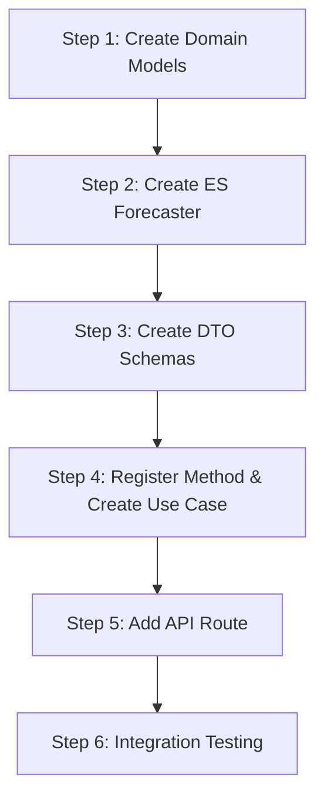

# Exponential Smoothing Forecaster - Implementation Guide

## Overview

This guide provides step-by-step instructions for implementing the **Exponential Smoothing Forecaster** using Simple Exponential Smoothing (SES) with a configurable smoothing parameter α. Follow each step in order to ensure proper integration with the existing codebase.

> **Note**: This forecaster complements the existing **Weighted Moving Average Forecaster** by providing tunable exponential decay weights instead of fixed weights.

---

## Prerequisites

Before starting, ensure you understand:

- The existing [General Architecture](../../general-architecture.md)
- The [Architecture Document](./architecture.md) for this feature
- The existing `ActualEnrollmentProvider` and `TermLookbackProvider` interfaces
- The [Weighted Moving Average Forecaster](../weighted-moving-average-forecaster/architecture.md) implementation

---

## Implementation Steps



---

## Step 1: Create Domain Models

### 1.1 Create ES Models

**Location**: `apps/backend/src/domain/forecasts/models/exponential-smoothing.ts`

```typescript
import type { TermType, ForecastConfidence } from './weighted-moving-average';

/**
 * Configuration for Exponential Smoothing forecaster.
 *
 * The smoothing parameter α controls the rate of decay:
 * - Higher α (0.7-0.9): More weight on recent data, responsive to changes
 * - Lower α (0.1-0.3): Smoother forecasts, more stable
 *
 * Formula: S_t = α × Y_{t-1} + (1-α) × S_{t-1}
 */
export interface ExponentialSmoothingConfig {
  /**
   * Smoothing parameter (0 < α < 1)
   *
   * Weight for most recent observation. Higher values make the
   * forecast more responsive to recent changes.
   *
   * @default 0.3
   */
  readonly alpha: number;

  /**
   * Maximum number of past terms to consider.
   * Set to a reasonable limit to bound computation and
   * ensure S₀ influence is negligible.
   *
   * @default 10
   */
  readonly maxLookbackTerms: number;

  /**
   * Earliest year to consider for lookback.
   * @default 2018
   */
  readonly minYear: number;
}

/**
 * Default configuration: α = 0.3 (conservative, stable forecasts)
 *
 * With α = 0.3:
 * - T₁ (most recent): 30% weight
 * - T₂: 21% weight
 * - T₃: 14.7% weight
 * - ...exponentially decaying
 */
export const DEFAULT_ES_CONFIG: Readonly<ExponentialSmoothingConfig> = {
  alpha: 0.3,
  maxLookbackTerms: 10,
  minYear: 2018,
} as const;

/**
 * Valid range for alpha parameter
 */
export const ALPHA_RANGE = {
  min: 0.01,
  max: 0.99,
} as const;

/**
 * Preset configurations for different scenarios
 */
export const ES_PRESETS = {
  /** Conservative: Very stable forecasts, slow to react */
  conservative: { alpha: 0.2, maxLookbackTerms: 15, minYear: 2018 },

  /** Standard: Balanced responsiveness (DEFAULT) */
  standard: { alpha: 0.3, maxLookbackTerms: 10, minYear: 2018 },

  /** Responsive: Adapts quickly to recent changes */
  responsive: { alpha: 0.5, maxLookbackTerms: 8, minYear: 2018 },

  /** Volatile: For courses with rapidly changing demand */
  volatile: { alpha: 0.7, maxLookbackTerms: 6, minYear: 2018 },
} as const;

/**
 * Historical term data with exponential weight information
 */
export interface ESTermWeight {
  /** Academic term number */
  readonly academicTerm: number;

  /** Actual enrollment for this term */
  readonly enrollment: number;

  /**
   * Exponential weight applied: α × (1-α)^k
   * where k is the position (0 = most recent)
   */
  readonly weight: number;

  /** enrollment × weight */
  readonly weightedValue: number;
}

/**
 * Detailed information about the Exponential Smoothing forecast
 */
export interface ESForecastDetails {
  /** Smoothing parameter used */
  readonly alpha: number;

  /** Historical enrollment data with exponential weights */
  readonly historicalTerms: ESTermWeight[];

  /**
   * Initial smoothed value (S₀).
   * Used as the base for exponential smoothing recursion.
   * Typically set to the oldest available term's enrollment.
   */
  readonly initialValue: number;

  /**
   * Weight applied to initial value: (1-α)^n
   * Represents the residual influence of S₀ on the forecast.
   */
  readonly initialValueWeight: number;

  /** Number of historical terms used in calculation */
  readonly termsUsed: number;

  /** Type of terms used (main-semester or intersession) */
  readonly termType: TermType;

  /** Confidence level based on data availability */
  readonly confidence: ForecastConfidence;

  /** Fallback reason if insufficient data */
  readonly fallbackReason?: string;

  /**
   * Sum of all weights (data + initial).
   * Should equal approximately 1.0.
   */
  readonly totalWeight: number;
}

/**
 * Extended result type for Exponential Smoothing forecasts
 */
export interface ESForecastResult {
  readonly courseCode: string;
  readonly academicTerm: number;
  readonly forecastedEnrollment: number;
  readonly methodId: string;
  readonly methodLabel: string;
  readonly details: ESForecastDetails;
}
```

### 1.2 Update Models Index

**Location**: `apps/backend/src/domain/forecasts/models/index.ts`

Add the export:

```typescript
export * from './conversion-rate';
export * from './pass-rate-adjusted';
export * from './weighted-moving-average';
export * from './exponential-smoothing'; // Add this line
```

---

## Step 2: Create Exponential Smoothing Forecaster

### 2.1 Create the Forecaster

**Location**: `apps/backend/src/domain/forecasts/exponential-smoothing-forecaster.ts`

```typescript
import type {
  CourseDemandForecaster,
  CourseDemandForecasterInput,
} from './course-demand-forecaster';
import type { TermLookbackProvider } from './term-lookback-provider';
import type { ActualEnrollmentProvider } from '../backtesting/actual-enrollment-provider';
import type {
  ESForecastResult,
  ESForecastDetails,
  ESTermWeight,
  ExponentialSmoothingConfig,
} from './models/exponential-smoothing';
import type { TermType, ForecastConfidence } from './models/weighted-moving-average';
import { DEFAULT_ES_CONFIG, ALPHA_RANGE } from './models/exponential-smoothing';

const METHOD_ID = 'exponential-smoothing';
const METHOD_LABEL = 'Exponential Smoothing';

export interface ESForecasterDeps {
  readonly termLookbackProvider: TermLookbackProvider;
  readonly actualEnrollmentProvider: ActualEnrollmentProvider;
}

export interface ESForecasterOptions {
  /** Smoothing parameter α (0 < α < 1). Default: 0.3 */
  alpha?: number;
  /** Maximum lookback terms. Default: 10 */
  maxLookbackTerms?: number;
  /** Minimum year for lookback. Default: 2018 */
  minYear?: number;
}

/**
 * Forecaster that predicts enrollment using Simple Exponential Smoothing (SES).
 *
 * Formula: S_t = α × Y_{t-1} + (1 - α) × S_{t-1}
 *
 * Where:
 * - S_t: Smoothed value (forecast) at time t
 * - Y_{t-1}: Actual enrollment from most recent term
 * - S_{t-1}: Previous smoothed value
 * - α: Smoothing parameter (0 < α < 1)
 *
 * Features:
 * - Exponentially decaying weights (recent data weighted more)
 * - Configurable smoothing parameter α
 * - Uses all available historical data (up to maxLookbackTerms)
 * - Term-type-aware lookback (main semesters vs intersessions)
 * - Graceful degradation with limited data
 *
 * @see WeightedMovingAverageForecaster for fixed-weight alternative
 */
export class ExponentialSmoothingForecaster implements CourseDemandForecaster {
  public readonly methodId: string = METHOD_ID;
  public readonly methodLabel: string;

  private readonly termLookbackProvider: TermLookbackProvider;
  private readonly actualEnrollmentProvider: ActualEnrollmentProvider;
  private readonly config: ExponentialSmoothingConfig;

  constructor(
    deps: ESForecasterDeps,
    options: ESForecasterOptions = {},
  ) {
    this.termLookbackProvider = deps.termLookbackProvider;
    this.actualEnrollmentProvider = deps.actualEnrollmentProvider;

    // Validate and apply alpha
    const alpha = this.validateAlpha(options.alpha ?? DEFAULT_ES_CONFIG.alpha);

    this.config = {
      alpha,
      maxLookbackTerms: options.maxLookbackTerms ?? DEFAULT_ES_CONFIG.maxLookbackTerms,
      minYear: options.minYear ?? DEFAULT_ES_CONFIG.minYear,
    };

    // Include alpha in method label for clarity
    this.methodLabel = `${METHOD_LABEL} (α=${this.config.alpha})`;
  }

  /**
   * Validates and clamps alpha to valid range [0.01, 0.99]
   */
  private validateAlpha(alpha: number): number {
    if (alpha <= ALPHA_RANGE.min) {
      console.warn(
        `Alpha ${alpha} is too low, clamping to ${ALPHA_RANGE.min}`
      );
      return ALPHA_RANGE.min;
    }
    if (alpha >= ALPHA_RANGE.max) {
      console.warn(
        `Alpha ${alpha} is too high, clamping to ${ALPHA_RANGE.max}`
      );
      return ALPHA_RANGE.max;
    }
    return alpha;
  }

  async forecast(
    input: CourseDemandForecasterInput,
  ): Promise<ESForecastResult> {
    const { courseCode, academicTerm } = input;

    // Step 1: Determine term type and get past terms
    const termType = this.termLookbackProvider.getTermType(academicTerm);
    const pastTerms = this.termLookbackProvider.getPastTerms(
      academicTerm,
      this.config.maxLookbackTerms,
    );

    // Step 2: Get actual enrollments for past terms
    const enrollmentMap = await this.actualEnrollmentProvider.getActualEnrollments(
      courseCode,
      pastTerms,
    );

    // Step 3: Build enrollment data array (preserving order, most recent first)
    // Filter out terms with no data
    const enrollmentData = pastTerms
      .map(term => ({
        term,
        enrollment: enrollmentMap.get(term) ?? null,
      }))
      .filter((d): d is { term: number; enrollment: number } =>
        d.enrollment !== null
      );

    // Step 4: Handle no data case
    if (enrollmentData.length === 0) {
      return this.buildNoDataResult(courseCode, academicTerm, termType);
    }

    // Step 5: Calculate Exponential Smoothing
    const {
      forecast,
      termDetails,
      initialValue,
      initialValueWeight,
      totalWeight,
      confidence,
    } = this.calculateES(enrollmentData);

    // Step 6: Build result
    return {
      courseCode,
      academicTerm,
      forecastedEnrollment: forecast,
      methodId: this.methodId,
      methodLabel: this.methodLabel,
      details: {
        alpha: this.config.alpha,
        historicalTerms: termDetails,
        initialValue,
        initialValueWeight,
        termsUsed: enrollmentData.length,
        termType,
        confidence,
        totalWeight,
      },
    };
  }

  /**
   * Calculates the Exponential Smoothing forecast.
   *
   * Uses the expanded form of SES:
   * S_t = α×Y₁ + α(1-α)×Y₂ + α(1-α)²×Y₃ + ... + (1-α)^n×S₀
   *
   * Where Y₁ is the most recent term and S₀ is the initial value
   * (set to the oldest available term's enrollment).
   */
  private calculateES(
    data: Array<{ term: number; enrollment: number }>
  ): {
    forecast: number;
    termDetails: ESTermWeight[];
    initialValue: number;
    initialValueWeight: number;
    totalWeight: number;
    confidence: ForecastConfidence;
  } {
    const α = this.config.alpha;
    const n = data.length;

    // Initial value S₀: use oldest available term
    const initialValue = data[n - 1].enrollment;

    // Calculate weights for each term
    // Weight for term k positions ago: α × (1-α)^k
    const termDetails: ESTermWeight[] = [];
    let weightedSum = 0;
    let cumulativeWeight = 0;

    for (let k = 0; k < n; k++) {
      const weight = α * Math.pow(1 - α, k);
      const weightedValue = data[k].enrollment * weight;

      termDetails.push({
        academicTerm: data[k].term,
        enrollment: data[k].enrollment,
        weight: this.round(weight, 4),
        weightedValue: this.round(weightedValue, 2),
      });

      weightedSum += weightedValue;
      cumulativeWeight += weight;
    }

    // Residual weight for initial value: (1-α)^n
    // This represents the "memory" of the initial state
    const initialValueWeight = Math.pow(1 - α, n);
    const initialContribution = initialValue * initialValueWeight;

    weightedSum += initialContribution;
    const totalWeight = cumulativeWeight + initialValueWeight;

    // Round to nearest integer for final forecast
    const forecast = Math.round(weightedSum);

    // Assess confidence based on data availability
    const confidence = this.assessConfidence(n);

    return {
      forecast,
      termDetails,
      initialValue,
      initialValueWeight: this.round(initialValueWeight, 4),
      totalWeight: this.round(totalWeight, 4),
      confidence,
    };
  }

  /**
   * Assesses forecast confidence based on available historical data.
   *
   * More data = higher confidence because:
   * - S₀ influence diminishes exponentially
   * - More terms provide better trend estimation
   */
  private assessConfidence(termsUsed: number): ForecastConfidence {
    if (termsUsed >= 5) return 'high';
    if (termsUsed >= 3) return 'medium';
    if (termsUsed >= 1) return 'low';
    return 'insufficient';
  }

  /**
   * Builds a result for when no historical data is available.
   */
  private buildNoDataResult(
    courseCode: string,
    academicTerm: number,
    termType: TermType,
  ): ESForecastResult {
    return {
      courseCode,
      academicTerm,
      forecastedEnrollment: 0,
      methodId: this.methodId,
      methodLabel: this.methodLabel,
      details: {
        alpha: this.config.alpha,
        historicalTerms: [],
        initialValue: 0,
        initialValueWeight: 0,
        termsUsed: 0,
        termType,
        confidence: 'insufficient',
        fallbackReason: 'NO_HISTORICAL_DATA',
        totalWeight: 0,
      },
    };
  }

  /**
   * Rounds a number to specified decimal places.
   */
  private round(value: number, decimals: number): number {
    const factor = Math.pow(10, decimals);
    return Math.round(value * factor) / factor;
  }
}
```

### 2.2 Update Forecasts Index

**Location**: `apps/backend/src/domain/forecasts/index.ts`

Add exports:

```typescript
export * from './course-demand-forecaster';
export * from './multi-term-forecaster.decorator';
export * from './potential-students-by-prerequisites-forecaster';
export * from './forecast-method-registry';
export * from './forecast-method-metadata';
export * from './in-memory-forecast-method-registry';

// Existing exports
export * from './models';
export * from './conversion-rate-calculator';
export * from './default-conversion-rate-calculator';
export * from './historical-conversion-provider';
export * from './pass-rate-adjusted-forecaster';

// WMA exports
export * from './term-lookback-provider';
export * from './weighted-moving-average-forecaster';

// ES exports (new)
export * from './exponential-smoothing-forecaster';
```

---

## Step 3: Create DTO Schemas

### 3.1 Create Contract Schema

**Location**: `packages/contracts/src/forecasts/exponential-smoothing.dto.ts`

```typescript
import { z } from 'zod';

/**
 * Term type classification (reused from WMA)
 */
export const termTypeSchema = z.enum(['main-semester', 'intersession']);

export type TermTypeDto = z.infer<typeof termTypeSchema>;

/**
 * Forecast confidence level (reused from WMA)
 */
export const forecastConfidenceSchema = z.enum([
  'high',
  'medium',
  'low',
  'insufficient',
]);

export type ForecastConfidenceDto = z.infer<typeof forecastConfidenceSchema>;

/**
 * Term weight data for exponential smoothing.
 * Shows how each historical term contributes to the forecast.
 */
export const esTermWeightSchema = z.object({
  academicTerm: z.number().int().describe('Academic term (e.g., 202410)'),
  enrollment: z.number().int().nonnegative().describe('Actual enrollment count'),
  weight: z.number().min(0).max(1).describe('Exponential weight: α × (1-α)^k'),
  weightedValue: z.number().nonnegative().describe('enrollment × weight'),
});

export type ESTermWeightDto = z.infer<typeof esTermWeightSchema>;

/**
 * Exponential Smoothing forecast details.
 * Provides full transparency into the calculation.
 */
export const esForecastDetailsSchema = z.object({
  /** Smoothing parameter α used (0 < α < 1) */
  alpha: z.number()
    .min(0.01)
    .max(0.99)
    .describe('Smoothing parameter controlling weight decay rate'),

  /** Historical terms with their exponential weights */
  historicalTerms: z.array(esTermWeightSchema)
    .describe('Historical enrollment data with applied weights'),

  /** Initial smoothed value (S₀) - typically oldest term */
  initialValue: z.number().int().nonnegative()
    .describe('Initial value used to start ES recursion'),

  /** Weight applied to initial value: (1-α)^n */
  initialValueWeight: z.number().min(0).max(1)
    .describe('Residual weight for initial value'),

  /** Number of historical terms used */
  termsUsed: z.number().int().nonnegative()
    .describe('Count of historical terms in calculation'),

  /** Type of terms used */
  termType: termTypeSchema
    .describe('Whether main-semester or intersession terms were used'),

  /** Confidence level based on data availability */
  confidence: forecastConfidenceSchema
    .describe('Forecast confidence based on available data'),

  /** Fallback reason if insufficient data */
  fallbackReason: z.string().optional()
    .describe('Explanation if forecast could not be computed'),

  /** Sum of all weights (should ≈ 1.0) */
  totalWeight: z.number().min(0).max(1.01)
    .describe('Sum of all weights including initial value weight'),
});

export type ESForecastDetailsDto = z.infer<typeof esForecastDetailsSchema>;

/**
 * Full Exponential Smoothing forecast result
 */
export const esForecastResultSchema = z.object({
  courseCode: z.string().regex(/^[A-Z]{4}-\d{4}$/, {
    message: 'courseCode must match pattern XXXX-DDDD',
  }),
  academicTerm: z.number().int().positive(),
  forecastedEnrollment: z.number().int().nonnegative(),
  methodId: z.literal('exponential-smoothing'),
  methodLabel: z.string(),
  details: esForecastDetailsSchema,
});

export type ESForecastResultDto = z.infer<typeof esForecastResultSchema>;

/**
 * Configuration options for ES forecaster (optional query params)
 */
export const esConfigQuerySchema = z.object({
  alpha: z.coerce.number().min(0.01).max(0.99).optional()
    .describe('Smoothing parameter (default: 0.3)'),
});

export type ESConfigQueryDto = z.infer<typeof esConfigQuerySchema>;
```

### 3.2 Update Forecasts Index

**Location**: `packages/contracts/src/forecasts/index.ts`

```typescript
export * from './course-demand-forecast.dto';
export * from './multi-term-forecast.dto';
export * from './forecast-accuracy.dto';
export * from './forecast-method.dto';
export * from './pass-rate-adjusted.dto';
export * from './weighted-moving-average.dto';
export * from './exponential-smoothing.dto'; // Add this line
```

---

## Step 4: Register Method & Create Use Case

### 4.1 Register Method Metadata

**Location**: Update the method registration in your application setup

```typescript
import type { ForecastMethodMetadata } from '../domain/forecasts/forecast-method-metadata';

const esMetadata: ForecastMethodMetadata = {
  id: 'exponential-smoothing',
  label: 'Exponential Smoothing (α=0.3)',
  description:
    'Forecasts enrollment using Simple Exponential Smoothing (SES). ' +
    'Applies exponentially decaying weights to all historical terms, ' +
    'with recent terms weighted more heavily. ' +
    'Default smoothing parameter α=0.3 provides stable, conservative forecasts. ' +
    'Uses term-type-aware lookback for main semesters (10, 20) and ' +
    'intersessions (11-19) separately.',
  shortDescription: 'Exponential smoothing with α=0.3',
  category: 'trend-based',
  status: 'active',
  capabilities: {
    supportsMultiTerm: true,
    supportsBacktesting: true,
    requiresPrerequisites: false,
    requiresHistoricalData: true,
  },
};

// Register in your method registry
registry.register(esMetadata);
```

### 4.2 Create Use Case

**Location**: `apps/backend/src/application/use-cases/forecasts/exponential-smoothing.use-case.ts`

```typescript
import type { ESForecastResultDto } from '@app/contracts';
import type { CourseDemandForecaster } from '../../../domain/forecasts/course-demand-forecaster';
import { MultiTermForecasterDecorator } from '../../../domain/forecasts/multi-term-forecaster.decorator';

export interface ESUseCaseInput {
  courseCode: string;
  academicTerm: number;
}

export interface ESUseCaseDeps {
  forecaster: CourseDemandForecaster;
}

export class ExponentialSmoothingUseCase {
  private readonly forecaster: CourseDemandForecaster;
  private readonly multiTermDecorator: MultiTermForecasterDecorator;

  constructor(deps: ESUseCaseDeps) {
    this.forecaster = deps.forecaster;
    this.multiTermDecorator = new MultiTermForecasterDecorator(
      this.forecaster,
      { maxTerms: 10, allowPartialFailure: true },
    );
  }

  /**
   * Execute ES forecast for a single academic term
   */
  async execute(
    input: ESUseCaseInput,
  ): Promise<ESForecastResultDto> {
    const result = await this.forecaster.forecast({
      courseCode: input.courseCode,
      academicTerm: input.academicTerm,
    });

    return {
      courseCode: result.courseCode,
      academicTerm: result.academicTerm,
      forecastedEnrollment: result.forecastedEnrollment,
      methodId: result.methodId as 'exponential-smoothing',
      methodLabel: result.methodLabel,
      details: result.details as ESForecastResultDto['details'],
    };
  }

  /**
   * Execute ES forecasts for multiple academic terms
   */
  async executeMultiple(
    input: Omit<ESUseCaseInput, 'academicTerm'>,
    terms: number[],
  ): Promise<{
    results: ESForecastResultDto[];
    errors: Array<{ term: number; message: string }>;
  }> {
    const { results, errors } = await this.multiTermDecorator.forecastMultiple(
      { courseCode: input.courseCode },
      terms,
    );

    return {
      results: results.map(r => ({
        courseCode: r.courseCode,
        academicTerm: r.academicTerm,
        forecastedEnrollment: r.forecastedEnrollment,
        methodId: r.methodId as 'exponential-smoothing',
        methodLabel: r.methodLabel,
        details: r.details as ESForecastResultDto['details'],
      })),
      errors: errors.map(e => ({
        term: e.term,
        message: e.error.message,
      })),
    };
  }
}
```

### 4.3 Create Factory Function

**Location**: `apps/backend/src/application/factories/exponential-smoothing-forecaster.factory.ts`

```typescript
import { ExponentialSmoothingForecaster } from '../../domain/forecasts/exponential-smoothing-forecaster';
import { DefaultTermLookbackProvider } from '../../infrastructure/providers/default-term-lookback-provider';
import { ExponentialSmoothingUseCase } from '../use-cases/forecasts/exponential-smoothing.use-case';
import { DEFAULT_ES_CONFIG } from '../../domain/forecasts/models/exponential-smoothing';

import type { ActualEnrollmentProvider } from '../../domain/backtesting/actual-enrollment-provider';
import type { ESForecasterOptions } from '../../domain/forecasts/exponential-smoothing-forecaster';

export interface CreateESUseCaseDeps {
  actualEnrollmentProvider: ActualEnrollmentProvider;
}

export interface CreateESUseCaseOptions {
  /** Smoothing parameter α (0 < α < 1). Default: 0.3 */
  alpha?: number;
  /** Maximum lookback terms. Default: 10 */
  maxLookbackTerms?: number;
  /** Earliest year to consider for lookback. Default: 2018 */
  minYear?: number;
}

/**
 * Creates an Exponential Smoothing forecast use case with the specified configuration.
 *
 * @example
 * // Create with default α = 0.3
 * const useCase = createExponentialSmoothingUseCase({
 *   actualEnrollmentProvider,
 * });
 *
 * @example
 * // Create with custom α for more responsive forecasts
 * const useCase = createExponentialSmoothingUseCase({
 *   actualEnrollmentProvider,
 * }, {
 *   alpha: 0.5,  // More responsive
 * });
 */
export function createExponentialSmoothingUseCase(
  deps: CreateESUseCaseDeps,
  options: CreateESUseCaseOptions = {},
): ExponentialSmoothingUseCase {
  // Create term lookback provider (shared with WMA)
  const termLookbackProvider = new DefaultTermLookbackProvider({
    minYear: options.minYear ?? DEFAULT_ES_CONFIG.minYear,
  });

  // Create ES forecaster with specified alpha
  const forecasterOptions: ESForecasterOptions = {
    alpha: options.alpha ?? DEFAULT_ES_CONFIG.alpha,
    maxLookbackTerms: options.maxLookbackTerms ?? DEFAULT_ES_CONFIG.maxLookbackTerms,
    minYear: options.minYear ?? DEFAULT_ES_CONFIG.minYear,
  };

  const forecaster = new ExponentialSmoothingForecaster(
    {
      termLookbackProvider,
      actualEnrollmentProvider: deps.actualEnrollmentProvider,
    },
    forecasterOptions,
  );

  return new ExponentialSmoothingUseCase({ forecaster });
}

/**
 * Creates an ES forecaster instance directly (for backtesting, etc.)
 */
export function createExponentialSmoothingForecaster(
  deps: CreateESUseCaseDeps,
  options: CreateESUseCaseOptions = {},
): ExponentialSmoothingForecaster {
  const termLookbackProvider = new DefaultTermLookbackProvider({
    minYear: options.minYear ?? DEFAULT_ES_CONFIG.minYear,
  });

  return new ExponentialSmoothingForecaster(
    {
      termLookbackProvider,
      actualEnrollmentProvider: deps.actualEnrollmentProvider,
    },
    {
      alpha: options.alpha ?? DEFAULT_ES_CONFIG.alpha,
      maxLookbackTerms: options.maxLookbackTerms ?? DEFAULT_ES_CONFIG.maxLookbackTerms,
      minYear: options.minYear ?? DEFAULT_ES_CONFIG.minYear,
    },
  );
}
```

---

## Step 5: Add API Route

### 5.1 Create Controller

**Location**: `apps/backend/src/presentation/controllers/forecasts/exponential-smoothing.controller.ts`

```typescript
import { OpenAPIHono } from '@hono/zod-openapi';
import { z } from 'zod';
import { esForecastResultSchema, esConfigQuerySchema } from '@app/contracts';
import { createForecastRoute } from '../../factories/forecast-route.factory';
import { createExponentialSmoothingUseCase } from '../../../application/factories/exponential-smoothing-forecaster.factory';

// Import your actual enrollment provider instance
import { actualEnrollmentProvider } from '../../../infrastructure/providers/actual-enrollment-provider';

export const registerESForecastRoute = (
  app: OpenAPIHono,
): void => {
  // Create use case with default alpha (can be overridden via query param)
  const defaultUseCase = createExponentialSmoothingUseCase({
    actualEnrollmentProvider,
  });

  createForecastRoute(app, {
    path: '/api/courses/{courseCode}/forecasts/exponential-smoothing',
    summary: 'Forecast enrollment using Exponential Smoothing',
    description:
      'Forecasts enrollment using Simple Exponential Smoothing (SES). ' +
      'Applies exponentially decaying weights to all historical terms. ' +
      'Default smoothing parameter α=0.3. ' +
      'Optionally pass ?alpha=0.5 to use a different smoothing factor. ' +
      'Uses term-type-aware lookback (main semesters vs intersessions).',
    tags: ['Forecasts'],
    resultSchema: esForecastResultSchema,

    // Extended query params to support alpha override
    querySchema: z.object({
      term: z.coerce.number().int().positive().optional(),
      terms: z.string().optional(),
      alpha: z.coerce.number().min(0.01).max(0.99).optional(),
    }),

    singleTermHandler: async (courseCode, term, query) => {
      // Use custom alpha if provided
      const alpha = query?.alpha;
      const useCase = alpha
        ? createExponentialSmoothingUseCase({ actualEnrollmentProvider }, { alpha })
        : defaultUseCase;

      return useCase.execute({
        courseCode,
        academicTerm: term,
      });
    },

    multiTermHandler: async (courseCode, terms, query) => {
      const alpha = query?.alpha;
      const useCase = alpha
        ? createExponentialSmoothingUseCase({ actualEnrollmentProvider }, { alpha })
        : defaultUseCase;

      return useCase.executeMultiple({ courseCode }, terms);
    },
  });
};
```

### 5.2 Register Route in Server

**Location**: Update `apps/backend/src/presentation/server.ts`

```typescript
import { registerESForecastRoute } from './controllers/forecasts/exponential-smoothing.controller';

// In your server setup:
registerESForecastRoute(app);
```

---

## Step 6: Integration Testing

### 6.1 Test the Implementation

After completing all steps, verify the implementation:

```bash
# Start the development server
npm run dev

# Test single-term request (main semester, default α=0.3)
curl "http://localhost:3000/api/courses/ISIS-3204/forecasts/exponential-smoothing?term=202410"

# Test with custom alpha
curl "http://localhost:3000/api/courses/ISIS-3204/forecasts/exponential-smoothing?term=202410&alpha=0.5"

# Test single-term request (intersession)
curl "http://localhost:3000/api/courses/ISIS-3204/forecasts/exponential-smoothing?term=202415"

# Test multi-term request
curl "http://localhost:3000/api/courses/ISIS-3204/forecasts/exponential-smoothing?terms=202410,202420,202510"
```

### 6.2 Verify Response Structure

**Expected response (full data, α=0.3):**

```json
{
  "courseCode": "ISIS-3204",
  "academicTerm": 202410,
  "forecastedEnrollment": 108,
  "methodId": "exponential-smoothing",
  "methodLabel": "Exponential Smoothing (α=0.3)",
  "details": {
    "alpha": 0.3,
    "historicalTerms": [
      {
        "academicTerm": 202320,
        "enrollment": 120,
        "weight": 0.3000,
        "weightedValue": 36.00
      },
      {
        "academicTerm": 202310,
        "enrollment": 100,
        "weight": 0.2100,
        "weightedValue": 21.00
      },
      {
        "academicTerm": 202220,
        "enrollment": 110,
        "weight": 0.1470,
        "weightedValue": 16.17
      },
      {
        "academicTerm": 202210,
        "enrollment": 105,
        "weight": 0.1029,
        "weightedValue": 10.81
      },
      {
        "academicTerm": 202120,
        "enrollment": 95,
        "weight": 0.0720,
        "weightedValue": 6.84
      }
    ],
    "initialValue": 95,
    "initialValueWeight": 0.1681,
    "termsUsed": 5,
    "termType": "main-semester",
    "confidence": "high",
    "totalWeight": 1.0000
  }
}
```

**Expected response (limited data, intersession):**

```json
{
  "courseCode": "ISIS-3204",
  "academicTerm": 202015,
  "forecastedEnrollment": 42,
  "methodId": "exponential-smoothing",
  "methodLabel": "Exponential Smoothing (α=0.3)",
  "details": {
    "alpha": 0.3,
    "historicalTerms": [
      {
        "academicTerm": 201915,
        "enrollment": 50,
        "weight": 0.3000,
        "weightedValue": 15.00
      },
      {
        "academicTerm": 201815,
        "enrollment": 35,
        "weight": 0.2100,
        "weightedValue": 7.35
      }
    ],
    "initialValue": 35,
    "initialValueWeight": 0.4900,
    "termsUsed": 2,
    "termType": "intersession",
    "confidence": "medium",
    "totalWeight": 1.0000
  }
}
```

---

## File Summary

### New Files to Create

| File | Purpose |
|------|---------|
| `apps/backend/src/domain/forecasts/models/exponential-smoothing.ts` | ES domain models |
| `apps/backend/src/domain/forecasts/exponential-smoothing-forecaster.ts` | Main ES forecaster |
| `packages/contracts/src/forecasts/exponential-smoothing.dto.ts` | DTO schemas |
| `apps/backend/src/application/use-cases/forecasts/exponential-smoothing.use-case.ts` | Use case |
| `apps/backend/src/application/factories/exponential-smoothing-forecaster.factory.ts` | Factory function |
| `apps/backend/src/presentation/controllers/forecasts/exponential-smoothing.controller.ts` | API controller |

### Files to Modify

| File | Changes |
|------|---------|
| `apps/backend/src/domain/forecasts/models/index.ts` | Add ES model export |
| `apps/backend/src/domain/forecasts/index.ts` | Add new exports |
| `packages/contracts/src/forecasts/index.ts` | Add DTO export |
| `apps/backend/src/presentation/server.ts` | Register route |
| Method registry setup | Register method metadata |

### Reused Files (No Changes Needed)

| File | Purpose |
|------|---------|
| `apps/backend/src/domain/forecasts/term-lookback-provider.ts` | Reuse interface from WMA |
| `apps/backend/src/infrastructure/providers/default-term-lookback-provider.ts` | Reuse implementation from WMA |

---

## Checklist

Use this checklist to track your implementation progress:

- [ ] Step 1: Create Domain Models
  - [ ] Create `exponential-smoothing.ts`
  - [ ] Update models index

- [ ] Step 2: Create ExponentialSmoothingForecaster
  - [ ] Create forecaster class
  - [ ] Update exports
  - [ ] Write unit tests

- [ ] Step 3: Create DTO Schemas
  - [ ] Create contract schemas
  - [ ] Update exports

- [ ] Step 4: Register Method & Create Use Case
  - [ ] Register method metadata
  - [ ] Create use case
  - [ ] Create factory function

- [ ] Step 5: Add API Route
  - [ ] Create controller
  - [ ] Register route
  - [ ] Test endpoints

- [ ] Step 6: Integration Testing
  - [ ] Run unit tests
  - [ ] Test API endpoints (main semester)
  - [ ] Test API endpoints (intersession)
  - [ ] Test custom alpha parameter
  - [ ] Test edge cases (limited data, no data)

---

## Alpha Tuning Guide

### When to Use Different Alpha Values

| Scenario | Recommended α | Rationale |
|----------|---------------|-----------|
| Stable enrollment patterns | 0.2-0.3 | Smooth forecasts, less reactive |
| New course (limited history) | 0.4-0.5 | Balance limited data |
| Volatile enrollment | 0.5-0.7 | Responsive to recent changes |
| After curriculum change | 0.6-0.8 | Quick adaptation to new patterns |

### Default α = 0.3 Weight Distribution

| Position | Weight | Cumulative |
|----------|--------|------------|
| T₁ | 30.0% | 30.0% |
| T₂ | 21.0% | 51.0% |
| T₃ | 14.7% | 65.7% |
| T₄ | 10.3% | 76.0% |
| T₅ | 7.2% | 83.2% |
| T₆ | 5.0% | 88.2% |
| T₇ | 3.5% | 91.8% |
| S₀ (residual) | 8.2% | 100.0% |

---

## Related Documents

- [Architecture Document](./architecture.md)
- [Testing Guide](./testing-guide.md)
- [System Impact](./system-impact.md)
- [General Architecture](../../general-architecture.md)
- [Weighted Moving Average Forecaster](../weighted-moving-average-forecaster/implementation-guide.md)
