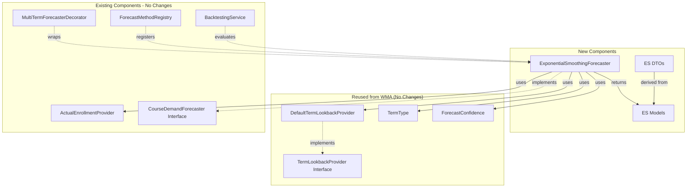
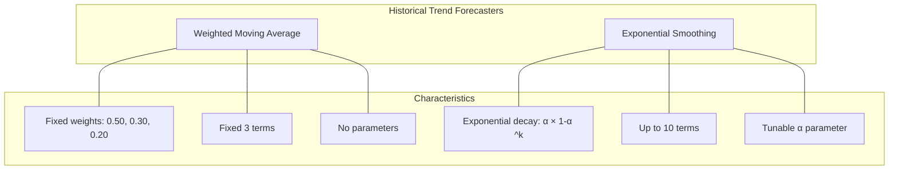

# Exponential Smoothing Forecaster - System Impact Analysis

## Overview

This document analyzes the impact of the **Exponential Smoothing Forecaster** on the existing system, including dependencies, performance considerations, and migration strategy.

> **Note**: This forecaster complements the existing **Weighted Moving Average Forecaster** by providing tunable exponential decay weights with a configurable smoothing parameter α.

---

## 1. Impact Summary

| Aspect | Impact Level | Description |
|--------|-------------|-------------|
| New Code | Low | Self-contained module with minimal footprint |
| Existing Code | None | No modifications to existing forecasters |
| Database | None | Uses existing `enrollments` table |
| API | Additive | New endpoint, no breaking changes |
| Performance | Minimal | Simple ES calculation, single DB query |
| Shared Components | Reuse | Leverages existing TermLookbackProvider |

---

## 2. Dependency Analysis

### 2.1 New Dependencies

The Exponential Smoothing Forecaster introduces no new external dependencies. It only requires:

| Dependency | Type | Status |
|------------|------|--------|
| `ActualEnrollmentProvider` | Existing Interface | Reused |
| `TermLookbackProvider` | Existing Interface | Reused (from WMA) |
| `CourseDemandForecaster` | Existing Interface | Implemented |

### 2.2 Dependency Graph



### 2.3 Existing Components - No Modifications Required

| Component | Reason |
|-----------|--------|
| `WeightedMovingAverageForecaster` | Independent forecaster |
| `PotentialStudentsByPrerequisitesForecaster` | Independent forecaster |
| `PassRateAdjustedForecaster` | Independent forecaster |
| `BacktestingService` | Already generic, works with any forecaster |
| `MultiTermForecasterDecorator` | Already generic, works with any forecaster |
| `ActualEnrollmentProvider` | Already provides required interface |
| `DefaultTermLookbackProvider` | Reused directly, no changes needed |

### 2.4 Code Reuse from WMA

| Component | Reuse Type | Purpose |
|-----------|------------|---------|
| `TermLookbackProvider` interface | Full reuse | Term-type-aware lookback |
| `DefaultTermLookbackProvider` | Full reuse | Get past terms |
| `TermType` | Full reuse | Term classification |
| `ForecastConfidence` | Full reuse | Confidence levels |

---

## 3. Database Impact

### 3.1 Schema Changes

**None required.** The forecaster uses the existing `enrollments` table.

### 3.2 Query Patterns

The forecaster uses the same query pattern as WMA, but may request more terms:

```sql
-- Get actual enrollments for past terms (up to 10 by default)
SELECT academic_term, COUNT(*) as enrollment
FROM enrollments
WHERE course_code = ?
  AND academic_term IN (?, ?, ?, ?, ?, ?, ?, ?, ?, ?)
GROUP BY academic_term;
```

This query:
- Uses existing indexes (`idx_enrollments_term_course_outcome`)
- Returns at most 10 rows (configurable)
- Has O(1) complexity with proper indexing

### 3.3 Performance Characteristics

| Metric | Value |
|--------|-------|
| Queries per forecast | 1 |
| Max rows returned | 10 (configurable) |
| Index utilization | Full |
| Estimated latency | < 10ms |

### 3.4 Comparison with WMA Query

| Aspect | WMA | ES |
|--------|-----|---|
| Terms requested | 3 (fixed) | Up to 10 (configurable) |
| Query complexity | Same | Same |
| Index usage | Same | Same |
| Estimated latency | < 5ms | < 10ms |

---

## 4. API Impact

### 4.1 New Endpoints

| Endpoint | Method | Description |
|----------|--------|-------------|
| `/api/courses/{courseCode}/forecasts/exponential-smoothing` | GET | Single/multi-term ES forecast |

### 4.2 Query Parameters

| Parameter | Type | Required | Description |
|-----------|------|----------|-------------|
| `term` | number | One of term/terms | Single academic term |
| `terms` | string | One of term/terms | Comma-separated terms |
| `alpha` | number | No | Custom smoothing parameter (0.01-0.99) |

### 4.3 No Breaking Changes

- Existing endpoints remain unchanged
- New endpoint follows established patterns
- Response schema is consistent with other forecasters

### 4.4 OpenAPI Documentation

The new endpoint will be automatically documented via `@hono/zod-openapi`:

```yaml
/api/courses/{courseCode}/forecasts/exponential-smoothing:
  get:
    summary: Forecast enrollment using Exponential Smoothing
    description: >
      Forecasts enrollment using Simple Exponential Smoothing (SES).
      Applies exponentially decaying weights to all historical terms.
      Default smoothing parameter α=0.3.
      Uses term-type-aware lookback (main semesters vs intersessions).
    parameters:
      - name: courseCode
        in: path
        required: true
        schema:
          type: string
          pattern: ^[A-Z]{4}-\d{4}$
      - name: term
        in: query
        schema:
          type: integer
      - name: terms
        in: query
        schema:
          type: string
      - name: alpha
        in: query
        schema:
          type: number
          minimum: 0.01
          maximum: 0.99
          default: 0.3
    responses:
      200:
        description: Successful ES forecast
        content:
          application/json:
            schema:
              $ref: '#/components/schemas/ESForecastResult'
```

---

## 5. Performance Analysis

### 5.1 Computational Complexity

| Operation | Complexity | Notes |
|-----------|------------|-------|
| Term lookback calculation | O(1) | Fixed max terms |
| Database query | O(1) | Indexed lookup |
| ES calculation | O(n) | Linear in terms used |
| Weight calculation | O(n) | One pass through data |
| **Total** | **O(n)** | Where n ≤ maxLookbackTerms |

### 5.2 Memory Usage

| Component | Memory | Notes |
|-----------|--------|-------|
| Term array | ~80 bytes | 10 × 8-byte numbers |
| Enrollment map | ~300 bytes | 10 key-value pairs |
| Weight calculations | ~160 bytes | 10 weights + values |
| Result object | ~800 bytes | Serialized response |
| **Total** | **< 2 KB** | Per request |

### 5.3 Comparison with Other Forecasters

| Forecaster | DB Queries | Complexity | Typical Latency |
|------------|------------|------------|-----------------|
| Weighted Moving Average | 1 | O(1) | < 5ms |
| **Exponential Smoothing** | 1 | O(n) | < 10ms |
| Potential Students | 2-3 | O(n) | 50-200ms |
| Pass Rate Adjusted | 4+ | O(n²) | 100-500ms |

The Exponential Smoothing Forecaster is very fast due to its simplicity, only slightly slower than WMA due to processing more terms.

---

## 6. Scalability Considerations

### 6.1 Multi-Term Requests

Multi-term ES forecasts are efficient because:
- Each term requires only one DB query
- Queries can be parallelized
- No dependency between terms
- ES calculation is O(n) per term

```typescript
// Efficient parallel execution
const forecasts = await Promise.all(
  terms.map(term => forecaster.forecast({ courseCode, academicTerm: term }))
);
```

### 6.2 Caching Opportunities

| Cache Target | TTL | Invalidation |
|--------------|-----|--------------|
| Term lookback results | Infinite | Never (deterministic) |
| Enrollment data | 24 hours | On data import |
| ES forecast results | 1 hour | On data import |
| Alpha presets | Infinite | Never |

### 6.3 Load Characteristics

Estimated capacity:

| Metric | Value |
|--------|-------|
| Requests/second | 800+ |
| Concurrent users | 100+ |
| Memory per instance | < 50 MB |

---

## 7. Integration Points

### 7.1 Method Registry

```typescript
// Registration in forecast method registry
registry.register({
  id: 'exponential-smoothing',
  label: 'Exponential Smoothing (α=0.3)',
  category: 'trend-based',
  status: 'active',
  capabilities: {
    supportsMultiTerm: true,
    supportsBacktesting: true,
    requiresPrerequisites: false,
    requiresHistoricalData: true,
  },
});
```

### 7.2 Frontend Integration

The frontend will need to:
1. Add the new method to the method selector dropdown
2. Handle the `exponential-smoothing` response format
3. Display ES weight breakdown in forecast details
4. Optionally: Add alpha slider/input for custom smoothing

**Minimal frontend changes required** if using generic forecast display components.

### 7.3 Backtesting Integration

The forecaster integrates with existing backtesting:

```typescript
// Works with existing BacktestingService
const results = await backtestingService.runBacktest({
  courseCode: 'ISIS-3204',
  forecaster: exponentialSmoothingForecaster,
  terms: [202310, 202320, 202410],
});

// Compare with WMA
const wmaResults = await backtestingService.runBacktest({
  courseCode: 'ISIS-3204',
  forecaster: weightedMovingAverageForecaster,
  terms: [202310, 202320, 202410],
});
```

---

## 8. Risk Assessment

### 8.1 Low Risk Items

| Risk | Mitigation |
|------|------------|
| Incorrect ES weights | Unit tests validate calculation |
| Alpha out of range | Input validation and clamping |
| Performance degradation | O(n) with bounded n |
| Weight sum ≠ 1.0 | Numerical precision handling |

### 8.2 Medium Risk Items

| Risk | Mitigation |
|------|------------|
| New courses with no history | Graceful degradation with `confidence: 'insufficient'` |
| Sparse historical data | Uses available data with adjusted confidence |
| S₀ impact on short histories | Document in response, user can check initialValueWeight |

### 8.3 No High Risk Items

The implementation is low-risk because:
- No modifications to existing code
- Uses established patterns from WMA
- Self-contained module
- Comprehensive test coverage
- Reuses proven components

---

## 9. Rollout Strategy

### 9.1 Phased Rollout

| Phase | Scope |
|-------|-------|
| 1. Development | Implementation + unit tests |
| 2. Integration | API integration + integration tests |
| 3. Validation | Backtesting against historical data, comparison with WMA |
| 4. Release | Production deployment |

### 9.2 Feature Flag (Optional)

```typescript
// Optional feature flag for gradual rollout
if (featureFlags.isEnabled('exponential-smoothing-forecaster')) {
  registerESForecastRoute(app);
}
```

### 9.3 Monitoring

Post-release monitoring:

| Metric | Threshold | Alert |
|--------|-----------|-------|
| Request latency | > 100ms | Warning |
| Error rate | > 1% | Critical |
| Forecast accuracy | MAPE > 30% | Review |
| Alpha usage distribution | N/A | Informational |

---

## 10. Documentation Updates

### 10.1 Files to Update

| File | Change |
|------|--------|
| `docs/architecture/general-architecture.md` | Add ES forecaster to list |
| `README.md` | Add feature description |
| OpenAPI spec | Auto-generated |

### 10.2 API Documentation

The new endpoint follows existing documentation patterns:

```markdown
## Exponential Smoothing Forecaster

Forecasts enrollment using Simple Exponential Smoothing (SES).

### Endpoint
`GET /api/courses/{courseCode}/forecasts/exponential-smoothing`

### Query Parameters
- `term` (optional): Single academic term (e.g., 202410)
- `terms` (optional): Comma-separated list of terms
- `alpha` (optional): Smoothing parameter (0.01-0.99, default: 0.3)

### Response
See [ESForecastResultDto](./exponential-smoothing.dto.ts)
```

---

## 11. Comparison with Existing Forecasters

### 11.1 Feature Matrix

| Feature | ES Forecaster | WMA Forecaster | Potential Students | Pass Rate Adjusted |
|---------|---------------|----------------|-------------------|-------------------|
| Prerequisites needed | No | No | Yes | Yes |
| Historical data needed | Yes | Yes | No | Yes |
| Captures trends | Excellent | Good | Poor | Good |
| New course support | Limited | Limited | Excellent | Limited |
| Computational cost | Very Low | Very Low | Medium | High |
| Interpretability | High | High | High | Medium |
| Configurable | Yes (α) | No | No | Yes |
| Terms used | Up to 10 | Fixed 3 | N/A | Up to 3 |

### 11.2 Historical Trend Forecaster Family



### 11.3 Use Case Recommendations

| Scenario | Recommended Forecaster |
|----------|----------------------|
| Established course with 5+ terms | Exponential Smoothing |
| New course with limited history | WMA (more robust with few terms) |
| Stable enrollment patterns | ES with low α (0.2-0.3) |
| Volatile enrollment | ES with high α (0.5-0.7) |
| Quick estimate needed | WMA (simpler, faster) |
| Maximum accuracy with history | ES (uses all available data) |
| New course with prerequisites | Potential Students |
| Calibrated prerequisite forecast | Pass Rate Adjusted |

---

## 12. ES vs WMA Detailed Comparison

### 12.1 Weight Distribution Comparison

For the same data (most recent 5 terms):

**WMA (0.50, 0.30, 0.20):**
| Term | Weight |
|------|--------|
| T₁ | 50.0% |
| T₂ | 30.0% |
| T₃ | 20.0% |
| T₄ | 0.0% |
| T₅ | 0.0% |

**ES (α=0.3):**
| Term | Weight |
|------|--------|
| T₁ | 30.0% |
| T₂ | 21.0% |
| T₃ | 14.7% |
| T₄ | 10.3% |
| T₅ | 7.2% |
| S₀ | 16.8% |

**ES (α=0.5):**
| Term | Weight |
|------|--------|
| T₁ | 50.0% |
| T₂ | 25.0% |
| T₃ | 12.5% |
| T₄ | 6.25% |
| T₅ | 3.12% |
| S₀ | 3.12% |

### 12.2 Response to Changes

| Scenario | WMA | ES (α=0.3) | ES (α=0.5) |
|----------|-----|------------|------------|
| Recent spike | 50% impact | 30% impact | 50% impact |
| Old anomaly (T₃) | 20% impact | 14.7% impact | 12.5% impact |
| Very old anomaly (T₅) | 0% impact | 7.2% impact | 3.1% impact |

---

## 13. Future Considerations

### 13.1 Potential Enhancements

| Enhancement | Priority | Complexity |
|-------------|----------|------------|
| Alpha auto-tuning | Medium | Medium |
| Seasonal ES (Holt-Winters) | Low | High |
| Trend detection | Medium | Medium |
| Ensemble with WMA | Low | Low |
| Confidence intervals | Medium | Medium |

### 13.2 Alpha Auto-Tuning (Future)

A future enhancement could automatically select optimal α:

```typescript
// Future: Auto-tune alpha based on historical accuracy
async function autoTuneAlpha(
  courseCode: string,
  terms: number[],
): Promise<number> {
  const alphaValues = [0.2, 0.3, 0.4, 0.5, 0.6];
  let bestAlpha = 0.3;
  let bestMAPE = Infinity;

  for (const alpha of alphaValues) {
    const forecaster = new ExponentialSmoothingForecaster({...}, { alpha });
    const results = await backtest(forecaster, courseCode, terms);

    if (results.mape < bestMAPE) {
      bestMAPE = results.mape;
      bestAlpha = alpha;
    }
  }

  return bestAlpha;
}
```

### 13.3 Integration Opportunities

- **Ensemble Forecasting**: Combine ES and WMA for improved accuracy
- **Adaptive Alpha**: Adjust α based on forecast accuracy over time
- **Seasonal Adjustment**: Add Holt-Winters for courses with seasonal patterns

---

## 14. Checklist for Release

### Pre-Release

- [ ] All unit tests passing
- [ ] Integration tests passing
- [ ] Backtesting validation complete
- [ ] Comparison with WMA documented
- [ ] Documentation updated
- [ ] Code review approved
- [ ] Performance benchmarks acceptable

### Release

- [ ] Feature deployed to staging
- [ ] Smoke tests passing
- [ ] Monitoring configured
- [ ] Feature enabled in production

### Post-Release

- [ ] Monitor error rates
- [ ] Monitor latency metrics
- [ ] Collect accuracy feedback
- [ ] Compare ES vs WMA accuracy
- [ ] Address any issues

---

## Related Documents

- [Architecture Document](./architecture.md)
- [Implementation Guide](./implementation-guide.md)
- [Testing Guide](./testing-guide.md)
- [General Architecture](../../general-architecture.md)
- [Weighted Moving Average Forecaster](../weighted-moving-average-forecaster/system-impact.md)
