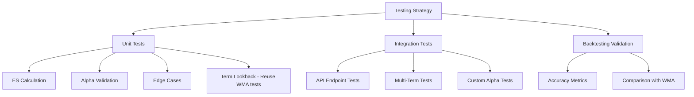

# Exponential Smoothing Forecaster - Testing Guide

## Overview

This guide provides a comprehensive testing strategy for the **Exponential Smoothing Forecaster**. It covers unit tests, integration tests, and backtesting validation with comparisons to the Weighted Moving Average forecaster.

> **Note**: This forecaster uses Simple Exponential Smoothing (SES) with a configurable smoothing parameter α (default: 0.3).

---

## Test Categories



---

## 1. Unit Tests

### 1.1 Exponential Smoothing Forecaster Tests

**File**: `apps/backend/src/domain/forecasts/__tests__/exponential-smoothing-forecaster.test.ts`

```typescript
import { describe, it, expect, vi, beforeEach } from 'vitest';
import { ExponentialSmoothingForecaster } from '../exponential-smoothing-forecaster';
import type { TermLookbackProvider } from '../term-lookback-provider';
import type { ActualEnrollmentProvider } from '../../backtesting/actual-enrollment-provider';

describe('ExponentialSmoothingForecaster', () => {
  // Mock dependencies
  const mockTermLookbackProvider: TermLookbackProvider = {
    getPastTerms: vi.fn(),
    getTermType: vi.fn(),
  };

  const mockActualEnrollmentProvider: ActualEnrollmentProvider = {
    getActualEnrollments: vi.fn(),
  };

  let forecaster: ExponentialSmoothingForecaster;

  beforeEach(() => {
    vi.clearAllMocks();

    forecaster = new ExponentialSmoothingForecaster(
      {
        termLookbackProvider: mockTermLookbackProvider,
        actualEnrollmentProvider: mockActualEnrollmentProvider,
      },
      { alpha: 0.3, maxLookbackTerms: 10 },
    );
  });

  describe('Exponential Smoothing Calculation', () => {
    it('should calculate ES with default alpha=0.3', async () => {
      // Setup: 5 terms of historical data
      vi.mocked(mockTermLookbackProvider.getTermType).mockReturnValue('main-semester');
      vi.mocked(mockTermLookbackProvider.getPastTerms).mockReturnValue([
        202320, 202310, 202220, 202210, 202120,
      ]);
      vi.mocked(mockActualEnrollmentProvider.getActualEnrollments).mockResolvedValue(
        new Map([
          [202320, 120], // T₁: 120 × 0.30 = 36.00
          [202310, 100], // T₂: 100 × 0.21 = 21.00
          [202220, 110], // T₃: 110 × 0.147 = 16.17
          [202210, 105], // T₄: 105 × 0.103 = 10.82
          [202120, 95],  // T₅: 95 × 0.072 = 6.84
          // S₀ = 95 × 0.168 = 15.98
          // Total ≈ 107.81 → 108
        ]),
      );

      const result = await forecaster.forecast({
        courseCode: 'ISIS-3204',
        academicTerm: 202410,
      });

      // Verify forecast (approximately 108)
      expect(result.forecastedEnrollment).toBeGreaterThanOrEqual(107);
      expect(result.forecastedEnrollment).toBeLessThanOrEqual(109);
      expect(result.details.confidence).toBe('high');
      expect(result.details.termsUsed).toBe(5);
      expect(result.details.alpha).toBe(0.3);
    });

    it('should apply exponentially decaying weights', async () => {
      vi.mocked(mockTermLookbackProvider.getTermType).mockReturnValue('main-semester');
      vi.mocked(mockTermLookbackProvider.getPastTerms).mockReturnValue([
        202320, 202310, 202220,
      ]);
      vi.mocked(mockActualEnrollmentProvider.getActualEnrollments).mockResolvedValue(
        new Map([
          [202320, 100],
          [202310, 100],
          [202220, 100],
        ]),
      );

      const result = await forecaster.forecast({
        courseCode: 'ISIS-3204',
        academicTerm: 202410,
      });

      // With all same values, forecast should equal that value
      expect(result.forecastedEnrollment).toBe(100);

      // Verify weights decay exponentially
      const weights = result.details.historicalTerms.map(t => t.weight);
      expect(weights[0]).toBeCloseTo(0.30, 2);   // α
      expect(weights[1]).toBeCloseTo(0.21, 2);   // α(1-α)
      expect(weights[2]).toBeCloseTo(0.147, 2);  // α(1-α)²
    });

    it('should include initial value weight in calculation', async () => {
      vi.mocked(mockTermLookbackProvider.getTermType).mockReturnValue('main-semester');
      vi.mocked(mockTermLookbackProvider.getPastTerms).mockReturnValue([
        202320, 202310, 202220,
      ]);
      vi.mocked(mockActualEnrollmentProvider.getActualEnrollments).mockResolvedValue(
        new Map([
          [202320, 100],
          [202310, 100],
          [202220, 100],
        ]),
      );

      const result = await forecaster.forecast({
        courseCode: 'ISIS-3204',
        academicTerm: 202410,
      });

      // Initial value weight should be (1-α)^n = 0.7^3 = 0.343
      expect(result.details.initialValueWeight).toBeCloseTo(0.343, 2);
      expect(result.details.initialValue).toBe(100);

      // Total weight should sum to approximately 1.0
      expect(result.details.totalWeight).toBeCloseTo(1.0, 2);
    });

    it('should round forecast to nearest integer', async () => {
      vi.mocked(mockTermLookbackProvider.getTermType).mockReturnValue('main-semester');
      vi.mocked(mockTermLookbackProvider.getPastTerms).mockReturnValue([
        202320, 202310, 202220,
      ]);
      vi.mocked(mockActualEnrollmentProvider.getActualEnrollments).mockResolvedValue(
        new Map([
          [202320, 123], // 123 × 0.30 = 36.9
          [202310, 107], // 107 × 0.21 = 22.47
          [202220, 115], // 115 × 0.147 = 16.905
          // S₀ = 115 × 0.343 = 39.445
          // Total = 115.72 → 116
        ]),
      );

      const result = await forecaster.forecast({
        courseCode: 'ISIS-3204',
        academicTerm: 202410,
      });

      expect(Number.isInteger(result.forecastedEnrollment)).toBe(true);
    });
  });

  describe('Custom Alpha Values', () => {
    it('should use custom alpha when provided', async () => {
      const customForecaster = new ExponentialSmoothingForecaster(
        {
          termLookbackProvider: mockTermLookbackProvider,
          actualEnrollmentProvider: mockActualEnrollmentProvider,
        },
        { alpha: 0.5, maxLookbackTerms: 10 },
      );

      vi.mocked(mockTermLookbackProvider.getTermType).mockReturnValue('main-semester');
      vi.mocked(mockTermLookbackProvider.getPastTerms).mockReturnValue([202320, 202310]);
      vi.mocked(mockActualEnrollmentProvider.getActualEnrollments).mockResolvedValue(
        new Map([
          [202320, 100],
          [202310, 80],
        ]),
      );

      const result = await customForecaster.forecast({
        courseCode: 'ISIS-3204',
        academicTerm: 202410,
      });

      expect(result.details.alpha).toBe(0.5);
      // First weight should be 0.5 (not 0.3)
      expect(result.details.historicalTerms[0].weight).toBeCloseTo(0.5, 2);
    });

    it('should clamp alpha to valid range [0.01, 0.99]', () => {
      // Test lower bound
      const lowAlphaForecaster = new ExponentialSmoothingForecaster(
        {
          termLookbackProvider: mockTermLookbackProvider,
          actualEnrollmentProvider: mockActualEnrollmentProvider,
        },
        { alpha: 0.001 },
      );
      expect(lowAlphaForecaster.methodLabel).toContain('0.01');

      // Test upper bound
      const highAlphaForecaster = new ExponentialSmoothingForecaster(
        {
          termLookbackProvider: mockTermLookbackProvider,
          actualEnrollmentProvider: mockActualEnrollmentProvider,
        },
        { alpha: 0.999 },
      );
      expect(highAlphaForecaster.methodLabel).toContain('0.99');
    });

    it('should produce more responsive forecasts with higher alpha', async () => {
      // Low alpha forecaster
      const lowAlphaForecaster = new ExponentialSmoothingForecaster(
        {
          termLookbackProvider: mockTermLookbackProvider,
          actualEnrollmentProvider: mockActualEnrollmentProvider,
        },
        { alpha: 0.2 },
      );

      // High alpha forecaster
      const highAlphaForecaster = new ExponentialSmoothingForecaster(
        {
          termLookbackProvider: mockTermLookbackProvider,
          actualEnrollmentProvider: mockActualEnrollmentProvider,
        },
        { alpha: 0.7 },
      );

      vi.mocked(mockTermLookbackProvider.getTermType).mockReturnValue('main-semester');
      vi.mocked(mockTermLookbackProvider.getPastTerms).mockReturnValue([
        202320, 202310, 202220,
      ]);
      // Recent spike in enrollment
      vi.mocked(mockActualEnrollmentProvider.getActualEnrollments).mockResolvedValue(
        new Map([
          [202320, 150], // Recent spike
          [202310, 100],
          [202220, 100],
        ]),
      );

      const lowResult = await lowAlphaForecaster.forecast({
        courseCode: 'ISIS-3204',
        academicTerm: 202410,
      });

      const highResult = await highAlphaForecaster.forecast({
        courseCode: 'ISIS-3204',
        academicTerm: 202410,
      });

      // High alpha should be more responsive to the spike
      expect(highResult.forecastedEnrollment).toBeGreaterThan(
        lowResult.forecastedEnrollment
      );
    });
  });

  describe('Edge Cases', () => {
    it('should handle single term with low confidence', async () => {
      vi.mocked(mockTermLookbackProvider.getTermType).mockReturnValue('intersession');
      vi.mocked(mockTermLookbackProvider.getPastTerms).mockReturnValue([202315]);
      vi.mocked(mockActualEnrollmentProvider.getActualEnrollments).mockResolvedValue(
        new Map([[202315, 75]]),
      );

      const result = await forecaster.forecast({
        courseCode: 'ISIS-3204',
        academicTerm: 202415,
      });

      // Single term: forecast = α × Y₁ + (1-α) × S₀ = 0.3×75 + 0.7×75 = 75
      expect(result.forecastedEnrollment).toBe(75);
      expect(result.details.confidence).toBe('low');
      expect(result.details.termsUsed).toBe(1);
    });

    it('should handle two terms with medium confidence', async () => {
      vi.mocked(mockTermLookbackProvider.getTermType).mockReturnValue('intersession');
      vi.mocked(mockTermLookbackProvider.getPastTerms).mockReturnValue([202315, 202215]);
      vi.mocked(mockActualEnrollmentProvider.getActualEnrollments).mockResolvedValue(
        new Map([
          [202315, 50],
          [202215, 35],
        ]),
      );

      const result = await forecaster.forecast({
        courseCode: 'ISIS-3204',
        academicTerm: 202415,
      });

      expect(result.details.confidence).toBe('medium');
      expect(result.details.termsUsed).toBe(2);
    });

    it('should return zero forecast with insufficient confidence when no data', async () => {
      vi.mocked(mockTermLookbackProvider.getTermType).mockReturnValue('main-semester');
      vi.mocked(mockTermLookbackProvider.getPastTerms).mockReturnValue([
        202320, 202310, 202220,
      ]);
      vi.mocked(mockActualEnrollmentProvider.getActualEnrollments).mockResolvedValue(
        new Map(), // No data for any term
      );

      const result = await forecaster.forecast({
        courseCode: 'ISIS-3204',
        academicTerm: 202410,
      });

      expect(result.forecastedEnrollment).toBe(0);
      expect(result.details.confidence).toBe('insufficient');
      expect(result.details.termsUsed).toBe(0);
      expect(result.details.fallbackReason).toBe('NO_HISTORICAL_DATA');
    });

    it('should handle missing terms in the middle', async () => {
      vi.mocked(mockTermLookbackProvider.getTermType).mockReturnValue('main-semester');
      vi.mocked(mockTermLookbackProvider.getPastTerms).mockReturnValue([
        202320, 202310, 202220, 202210, 202120,
      ]);
      // Missing 202310 and 202210
      vi.mocked(mockActualEnrollmentProvider.getActualEnrollments).mockResolvedValue(
        new Map([
          [202320, 120],
          // 202310 missing
          [202220, 110],
          // 202210 missing
          [202120, 95],
        ]),
      );

      const result = await forecaster.forecast({
        courseCode: 'ISIS-3204',
        academicTerm: 202410,
      });

      // Should only use available terms
      expect(result.details.termsUsed).toBe(3);
      expect(result.details.historicalTerms).toHaveLength(3);
      expect(result.details.historicalTerms.map(t => t.academicTerm)).toEqual([
        202320, 202220, 202120,
      ]);
    });

    it('should include zero enrollment terms in calculation', async () => {
      vi.mocked(mockTermLookbackProvider.getTermType).mockReturnValue('main-semester');
      vi.mocked(mockTermLookbackProvider.getPastTerms).mockReturnValue([
        202320, 202310, 202220,
      ]);
      vi.mocked(mockActualEnrollmentProvider.getActualEnrollments).mockResolvedValue(
        new Map([
          [202320, 100],
          [202310, 0],   // Zero enrollment (course not offered)
          [202220, 100],
        ]),
      );

      const result = await forecaster.forecast({
        courseCode: 'ISIS-3204',
        academicTerm: 202410,
      });

      // Zero should be included
      expect(result.details.termsUsed).toBe(3);
      expect(result.details.historicalTerms[1].enrollment).toBe(0);
      // Forecast should be lower due to zero term
      expect(result.forecastedEnrollment).toBeLessThan(100);
    });
  });

  describe('Term Type Handling', () => {
    it('should correctly report main-semester term type', async () => {
      vi.mocked(mockTermLookbackProvider.getTermType).mockReturnValue('main-semester');
      vi.mocked(mockTermLookbackProvider.getPastTerms).mockReturnValue([202320]);
      vi.mocked(mockActualEnrollmentProvider.getActualEnrollments).mockResolvedValue(
        new Map([[202320, 100]]),
      );

      const result = await forecaster.forecast({
        courseCode: 'ISIS-3204',
        academicTerm: 202410,
      });

      expect(result.details.termType).toBe('main-semester');
    });

    it('should correctly report intersession term type', async () => {
      vi.mocked(mockTermLookbackProvider.getTermType).mockReturnValue('intersession');
      vi.mocked(mockTermLookbackProvider.getPastTerms).mockReturnValue([202315]);
      vi.mocked(mockActualEnrollmentProvider.getActualEnrollments).mockResolvedValue(
        new Map([[202315, 50]]),
      );

      const result = await forecaster.forecast({
        courseCode: 'ISIS-3204',
        academicTerm: 202415,
      });

      expect(result.details.termType).toBe('intersession');
    });
  });

  describe('Confidence Assessment', () => {
    it.each([
      { terms: 5, expectedConfidence: 'high' },
      { terms: 6, expectedConfidence: 'high' },
      { terms: 4, expectedConfidence: 'medium' },
      { terms: 3, expectedConfidence: 'medium' },
      { terms: 2, expectedConfidence: 'medium' },
      { terms: 1, expectedConfidence: 'low' },
    ])('should return $expectedConfidence confidence for $terms terms', async ({ terms, expectedConfidence }) => {
      vi.mocked(mockTermLookbackProvider.getTermType).mockReturnValue('main-semester');

      const pastTerms = Array.from({ length: terms }, (_, i) => 202320 - i * 10);
      vi.mocked(mockTermLookbackProvider.getPastTerms).mockReturnValue(pastTerms);

      const enrollmentMap = new Map(pastTerms.map(term => [term, 100]));
      vi.mocked(mockActualEnrollmentProvider.getActualEnrollments).mockResolvedValue(
        enrollmentMap
      );

      const result = await forecaster.forecast({
        courseCode: 'ISIS-3204',
        academicTerm: 202410,
      });

      expect(result.details.confidence).toBe(expectedConfidence);
    });
  });

  describe('Metadata', () => {
    it('should have correct methodId', () => {
      expect(forecaster.methodId).toBe('exponential-smoothing');
    });

    it('should include alpha in methodLabel', () => {
      expect(forecaster.methodLabel).toContain('0.3');
    });

    it('should include methodId and methodLabel in result', async () => {
      vi.mocked(mockTermLookbackProvider.getTermType).mockReturnValue('main-semester');
      vi.mocked(mockTermLookbackProvider.getPastTerms).mockReturnValue([202320]);
      vi.mocked(mockActualEnrollmentProvider.getActualEnrollments).mockResolvedValue(
        new Map([[202320, 100]]),
      );

      const result = await forecaster.forecast({
        courseCode: 'ISIS-3204',
        academicTerm: 202410,
      });

      expect(result.methodId).toBe('exponential-smoothing');
      expect(result.methodLabel).toContain('Exponential Smoothing');
      expect(result.methodLabel).toContain('0.3');
    });
  });
});
```

### 1.2 ES Weight Calculation Tests

**File**: `apps/backend/src/domain/forecasts/__tests__/es-weight-calculation.test.ts`

```typescript
import { describe, it, expect } from 'vitest';
import { DEFAULT_ES_CONFIG, ALPHA_RANGE, ES_PRESETS } from '../models/exponential-smoothing';

describe('ES Configuration', () => {
  describe('DEFAULT_ES_CONFIG', () => {
    it('should have alpha = 0.3', () => {
      expect(DEFAULT_ES_CONFIG.alpha).toBe(0.3);
    });

    it('should have maxLookbackTerms = 10', () => {
      expect(DEFAULT_ES_CONFIG.maxLookbackTerms).toBe(10);
    });

    it('should have minYear = 2018', () => {
      expect(DEFAULT_ES_CONFIG.minYear).toBe(2018);
    });
  });

  describe('ALPHA_RANGE', () => {
    it('should have valid range bounds', () => {
      expect(ALPHA_RANGE.min).toBe(0.01);
      expect(ALPHA_RANGE.max).toBe(0.99);
    });

    it('should ensure alpha is strictly between 0 and 1', () => {
      expect(ALPHA_RANGE.min).toBeGreaterThan(0);
      expect(ALPHA_RANGE.max).toBeLessThan(1);
    });
  });

  describe('ES_PRESETS', () => {
    it('should have conservative preset with low alpha', () => {
      expect(ES_PRESETS.conservative.alpha).toBe(0.2);
    });

    it('should have standard preset matching default', () => {
      expect(ES_PRESETS.standard.alpha).toBe(DEFAULT_ES_CONFIG.alpha);
    });

    it('should have responsive preset with medium alpha', () => {
      expect(ES_PRESETS.responsive.alpha).toBe(0.5);
    });

    it('should have volatile preset with high alpha', () => {
      expect(ES_PRESETS.volatile.alpha).toBe(0.7);
    });

    it('should have increasing alpha across presets', () => {
      expect(ES_PRESETS.conservative.alpha).toBeLessThan(ES_PRESETS.standard.alpha);
      expect(ES_PRESETS.standard.alpha).toBeLessThan(ES_PRESETS.responsive.alpha);
      expect(ES_PRESETS.responsive.alpha).toBeLessThan(ES_PRESETS.volatile.alpha);
    });
  });
});

describe('ES Weight Formulas', () => {
  /**
   * Helper to calculate ES weight for term k positions ago
   */
  function calculateWeight(alpha: number, k: number): number {
    return alpha * Math.pow(1 - alpha, k);
  }

  /**
   * Helper to calculate initial value weight
   */
  function calculateInitialWeight(alpha: number, n: number): number {
    return Math.pow(1 - alpha, n);
  }

  describe('Weight calculation: w_k = α × (1-α)^k', () => {
    it('should calculate correct weights for α=0.3', () => {
      const alpha = 0.3;

      expect(calculateWeight(alpha, 0)).toBeCloseTo(0.300, 3);  // T₁
      expect(calculateWeight(alpha, 1)).toBeCloseTo(0.210, 3);  // T₂
      expect(calculateWeight(alpha, 2)).toBeCloseTo(0.147, 3);  // T₃
      expect(calculateWeight(alpha, 3)).toBeCloseTo(0.103, 3);  // T₄
      expect(calculateWeight(alpha, 4)).toBeCloseTo(0.072, 3);  // T₅
    });

    it('should calculate correct weights for α=0.5', () => {
      const alpha = 0.5;

      expect(calculateWeight(alpha, 0)).toBeCloseTo(0.500, 3);  // T₁
      expect(calculateWeight(alpha, 1)).toBeCloseTo(0.250, 3);  // T₂
      expect(calculateWeight(alpha, 2)).toBeCloseTo(0.125, 3);  // T₃
      expect(calculateWeight(alpha, 3)).toBeCloseTo(0.0625, 3); // T₄
    });

    it('should have weights summing to less than 1 (remainder is S₀ weight)', () => {
      const alpha = 0.3;
      const n = 5;

      let sum = 0;
      for (let k = 0; k < n; k++) {
        sum += calculateWeight(alpha, k);
      }

      const initialWeight = calculateInitialWeight(alpha, n);
      const total = sum + initialWeight;

      expect(total).toBeCloseTo(1.0, 10);
    });
  });

  describe('Initial value weight: (1-α)^n', () => {
    it('should decrease as more terms are available', () => {
      const alpha = 0.3;

      expect(calculateInitialWeight(alpha, 1)).toBeCloseTo(0.700, 3);
      expect(calculateInitialWeight(alpha, 3)).toBeCloseTo(0.343, 3);
      expect(calculateInitialWeight(alpha, 5)).toBeCloseTo(0.168, 3);
      expect(calculateInitialWeight(alpha, 10)).toBeCloseTo(0.028, 3);
    });

    it('should be negligible with sufficient data', () => {
      const alpha = 0.3;

      // With 10 terms, S₀ weight should be < 5%
      expect(calculateInitialWeight(alpha, 10)).toBeLessThan(0.05);

      // With 15 terms, S₀ weight should be < 1%
      expect(calculateInitialWeight(alpha, 15)).toBeLessThan(0.01);
    });
  });

  describe('Weight sum verification', () => {
    it.each([
      { alpha: 0.2, n: 5 },
      { alpha: 0.3, n: 5 },
      { alpha: 0.5, n: 5 },
      { alpha: 0.7, n: 5 },
      { alpha: 0.3, n: 10 },
      { alpha: 0.3, n: 3 },
    ])('weights should sum to 1.0 for α=$alpha, n=$n', ({ alpha, n }) => {
      let dataWeightsSum = 0;
      for (let k = 0; k < n; k++) {
        dataWeightsSum += calculateWeight(alpha, k);
      }

      const initialWeight = calculateInitialWeight(alpha, n);
      const total = dataWeightsSum + initialWeight;

      expect(total).toBeCloseTo(1.0, 10);
    });
  });
});
```

### 1.3 Comparison with WMA Tests

**File**: `apps/backend/src/domain/forecasts/__tests__/es-vs-wma-comparison.test.ts`

```typescript
import { describe, it, expect, vi, beforeEach } from 'vitest';
import { ExponentialSmoothingForecaster } from '../exponential-smoothing-forecaster';
import { WeightedMovingAverageForecaster } from '../weighted-moving-average-forecaster';
import type { TermLookbackProvider } from '../term-lookback-provider';
import type { ActualEnrollmentProvider } from '../../backtesting/actual-enrollment-provider';

describe('ES vs WMA Comparison', () => {
  const mockTermLookbackProvider: TermLookbackProvider = {
    getPastTerms: vi.fn(),
    getTermType: vi.fn(),
  };

  const mockActualEnrollmentProvider: ActualEnrollmentProvider = {
    getActualEnrollments: vi.fn(),
  };

  let esForecaster: ExponentialSmoothingForecaster;
  let wmaForecaster: WeightedMovingAverageForecaster;

  beforeEach(() => {
    vi.clearAllMocks();

    esForecaster = new ExponentialSmoothingForecaster(
      {
        termLookbackProvider: mockTermLookbackProvider,
        actualEnrollmentProvider: mockActualEnrollmentProvider,
      },
      { alpha: 0.3 },
    );

    wmaForecaster = new WeightedMovingAverageForecaster(
      {
        termLookbackProvider: mockTermLookbackProvider,
        actualEnrollmentProvider: mockActualEnrollmentProvider,
      },
    );
  });

  it('should produce similar results for stable data', async () => {
    vi.mocked(mockTermLookbackProvider.getTermType).mockReturnValue('main-semester');
    vi.mocked(mockTermLookbackProvider.getPastTerms).mockReturnValue([
      202320, 202310, 202220,
    ]);
    vi.mocked(mockActualEnrollmentProvider.getActualEnrollments).mockResolvedValue(
      new Map([
        [202320, 100],
        [202310, 100],
        [202220, 100],
      ]),
    );

    const esResult = await esForecaster.forecast({
      courseCode: 'ISIS-3204',
      academicTerm: 202410,
    });

    const wmaResult = await wmaForecaster.forecast({
      courseCode: 'ISIS-3204',
      academicTerm: 202410,
    });

    // Both should equal 100 for constant data
    expect(esResult.forecastedEnrollment).toBe(100);
    expect(wmaResult.forecastedEnrollment).toBe(100);
  });

  it('should produce different results for trending data', async () => {
    vi.mocked(mockTermLookbackProvider.getTermType).mockReturnValue('main-semester');
    vi.mocked(mockTermLookbackProvider.getPastTerms).mockReturnValue([
      202320, 202310, 202220, 202210, 202120,
    ]);
    // Upward trend
    vi.mocked(mockActualEnrollmentProvider.getActualEnrollments).mockResolvedValue(
      new Map([
        [202320, 150],
        [202310, 130],
        [202220, 110],
        [202210, 90],
        [202120, 70],
      ]),
    );

    const esResult = await esForecaster.forecast({
      courseCode: 'ISIS-3204',
      academicTerm: 202410,
    });

    // WMA only uses 3 terms
    vi.mocked(mockTermLookbackProvider.getPastTerms).mockReturnValue([
      202320, 202310, 202220,
    ]);

    const wmaResult = await wmaForecaster.forecast({
      courseCode: 'ISIS-3204',
      academicTerm: 202410,
    });

    // ES uses all 5 terms, WMA uses only 3
    expect(esResult.details.termsUsed).toBe(5);
    expect(wmaResult.details.termsUsed).toBe(3);

    // Both should capture upward trend but differently
    expect(esResult.forecastedEnrollment).toBeGreaterThan(100);
    expect(wmaResult.forecastedEnrollment).toBeGreaterThan(100);
  });

  it('ES with α=0.5 should have similar T₁ weight to WMA', async () => {
    const esHalfAlpha = new ExponentialSmoothingForecaster(
      {
        termLookbackProvider: mockTermLookbackProvider,
        actualEnrollmentProvider: mockActualEnrollmentProvider,
      },
      { alpha: 0.5 },
    );

    vi.mocked(mockTermLookbackProvider.getTermType).mockReturnValue('main-semester');
    vi.mocked(mockTermLookbackProvider.getPastTerms).mockReturnValue([
      202320, 202310, 202220,
    ]);
    vi.mocked(mockActualEnrollmentProvider.getActualEnrollments).mockResolvedValue(
      new Map([
        [202320, 100],
        [202310, 100],
        [202220, 100],
      ]),
    );

    const esResult = await esHalfAlpha.forecast({
      courseCode: 'ISIS-3204',
      academicTerm: 202410,
    });

    // ES α=0.5 gives T₁ weight of 0.5, same as WMA
    expect(esResult.details.historicalTerms[0].weight).toBeCloseTo(0.5, 2);
  });
});
```

---

## 2. Integration Tests

### 2.1 API Endpoint Tests

**File**: `apps/backend/src/presentation/controllers/forecasts/__tests__/exponential-smoothing.controller.test.ts`

```typescript
import { describe, it, expect, beforeAll, afterAll } from 'vitest';
import { app } from '../../../server';

describe('Exponential Smoothing Forecast API', () => {
  describe('GET /api/courses/:courseCode/forecasts/exponential-smoothing', () => {
    it('should return a valid ES forecast for main semester', async () => {
      const response = await app.request(
        '/api/courses/ISIS-3204/forecasts/exponential-smoothing?term=202410',
      );

      expect(response.status).toBe(200);

      const body = await response.json();
      expect(body.courseCode).toBe('ISIS-3204');
      expect(body.academicTerm).toBe(202410);
      expect(body.methodId).toBe('exponential-smoothing');
      expect(typeof body.forecastedEnrollment).toBe('number');
      expect(body.details.termType).toBe('main-semester');
      expect(body.details.alpha).toBe(0.3);
    });

    it('should return a valid ES forecast for intersession', async () => {
      const response = await app.request(
        '/api/courses/ISIS-3204/forecasts/exponential-smoothing?term=202415',
      );

      expect(response.status).toBe(200);

      const body = await response.json();
      expect(body.details.termType).toBe('intersession');
    });

    it('should include historical terms with exponential weights', async () => {
      const response = await app.request(
        '/api/courses/ISIS-3204/forecasts/exponential-smoothing?term=202410',
      );

      const body = await response.json();
      expect(body.details.historicalTerms).toBeInstanceOf(Array);

      if (body.details.termsUsed > 0) {
        const term = body.details.historicalTerms[0];
        expect(term).toHaveProperty('academicTerm');
        expect(term).toHaveProperty('enrollment');
        expect(term).toHaveProperty('weight');
        expect(term).toHaveProperty('weightedValue');
      }
    });

    it('should include initial value and its weight', async () => {
      const response = await app.request(
        '/api/courses/ISIS-3204/forecasts/exponential-smoothing?term=202410',
      );

      const body = await response.json();
      expect(body.details).toHaveProperty('initialValue');
      expect(body.details).toHaveProperty('initialValueWeight');
      expect(body.details).toHaveProperty('totalWeight');
    });

    it('should return 400 for invalid course code format', async () => {
      const response = await app.request(
        '/api/courses/INVALID/forecasts/exponential-smoothing?term=202410',
      );

      expect(response.status).toBe(400);
    });

    it('should return 400 for invalid term format', async () => {
      const response = await app.request(
        '/api/courses/ISIS-3204/forecasts/exponential-smoothing?term=invalid',
      );

      expect(response.status).toBe(400);
    });
  });

  describe('Custom Alpha Parameter', () => {
    it('should accept custom alpha via query parameter', async () => {
      const response = await app.request(
        '/api/courses/ISIS-3204/forecasts/exponential-smoothing?term=202410&alpha=0.5',
      );

      expect(response.status).toBe(200);

      const body = await response.json();
      expect(body.details.alpha).toBe(0.5);
    });

    it('should reject alpha below minimum', async () => {
      const response = await app.request(
        '/api/courses/ISIS-3204/forecasts/exponential-smoothing?term=202410&alpha=0.001',
      );

      expect(response.status).toBe(400);
    });

    it('should reject alpha above maximum', async () => {
      const response = await app.request(
        '/api/courses/ISIS-3204/forecasts/exponential-smoothing?term=202410&alpha=1.5',
      );

      expect(response.status).toBe(400);
    });
  });

  describe('Multi-Term Requests', () => {
    it('should handle multiple terms', async () => {
      const response = await app.request(
        '/api/courses/ISIS-3204/forecasts/exponential-smoothing?terms=202410,202420,202510',
      );

      expect(response.status).toBe(200);

      const body = await response.json();
      expect(body.results).toBeInstanceOf(Array);
      expect(body.results.length).toBeLessThanOrEqual(3);
    });

    it('should apply custom alpha to all terms', async () => {
      const response = await app.request(
        '/api/courses/ISIS-3204/forecasts/exponential-smoothing?terms=202410,202420&alpha=0.6',
      );

      expect(response.status).toBe(200);

      const body = await response.json();
      body.results.forEach((result: any) => {
        expect(result.details.alpha).toBe(0.6);
      });
    });
  });
});
```

### 2.2 Database Integration Tests

**File**: `apps/backend/src/__tests__/exponential-smoothing-integration.test.ts`

```typescript
import { describe, it, expect, beforeAll, afterAll } from 'vitest';
import { db } from '../infrastructure/database';
import { ExponentialSmoothingForecaster } from '../domain/forecasts/exponential-smoothing-forecaster';
import { DefaultTermLookbackProvider } from '../infrastructure/providers/default-term-lookback-provider';
import { DatabaseActualEnrollmentProvider } from '../infrastructure/providers/database-actual-enrollment-provider';

describe('Exponential Smoothing Forecaster - Database Integration', () => {
  let forecaster: ExponentialSmoothingForecaster;

  beforeAll(() => {
    const termLookbackProvider = new DefaultTermLookbackProvider({ minYear: 2018 });
    const actualEnrollmentProvider = new DatabaseActualEnrollmentProvider(db);

    forecaster = new ExponentialSmoothingForecaster(
      { termLookbackProvider, actualEnrollmentProvider },
      { alpha: 0.3, maxLookbackTerms: 10 },
    );
  });

  it('should forecast using real database data', async () => {
    const result = await forecaster.forecast({
      courseCode: 'ISIS-3204',
      academicTerm: 202410,
    });

    expect(result.courseCode).toBe('ISIS-3204');
    expect(result.academicTerm).toBe(202410);
    expect(typeof result.forecastedEnrollment).toBe('number');
    expect(result.forecastedEnrollment).toBeGreaterThanOrEqual(0);
    expect(result.details.alpha).toBe(0.3);
  });

  it('should use more terms than WMA (up to maxLookbackTerms)', async () => {
    const result = await forecaster.forecast({
      courseCode: 'ISIS-3204',
      academicTerm: 202410,
    });

    // ES can use more than 3 terms (WMA limit)
    expect(result.details.termsUsed).toBeLessThanOrEqual(10);
  });

  it('should handle course with sparse data', async () => {
    // Use a course that might have limited history
    const result = await forecaster.forecast({
      courseCode: 'ISIS-9999', // Hypothetical course with limited data
      academicTerm: 202410,
    });

    // Should not throw, should handle gracefully
    expect(result).toBeDefined();
    expect(['high', 'medium', 'low', 'insufficient']).toContain(result.details.confidence);
  });
});
```

---

## 3. Backtesting Validation

### 3.1 Accuracy Metrics Tests

**File**: `apps/backend/src/__tests__/exponential-smoothing-backtesting.test.ts`

```typescript
import { describe, it, expect } from 'vitest';
import { BacktestingService } from '../domain/backtesting/backtesting-service';
import { ExponentialSmoothingForecaster } from '../domain/forecasts/exponential-smoothing-forecaster';
import { WeightedMovingAverageForecaster } from '../domain/forecasts/weighted-moving-average-forecaster';

describe('Exponential Smoothing Forecaster - Backtesting', () => {
  describe('Accuracy Metrics', () => {
    it('should calculate MAE (Mean Absolute Error)', async () => {
      // Setup forecaster and backtesting service
      // ...

      const results = await backtestingService.runBacktest({
        courseCode: 'ISIS-3204',
        forecaster: esForecaster,
        terms: [202310, 202320, 202410],
      });

      expect(results.metrics.mae).toBeDefined();
      expect(results.metrics.mae).toBeGreaterThanOrEqual(0);
    });

    it('should calculate MAPE (Mean Absolute Percentage Error)', async () => {
      // ...

      expect(results.metrics.mape).toBeDefined();
      expect(results.metrics.mape).toBeGreaterThanOrEqual(0);
      expect(results.metrics.mape).toBeLessThanOrEqual(100);
    });
  });

  describe('Comparison with WMA', () => {
    it('should compare ES and WMA accuracy on the same course', async () => {
      const terms = [202310, 202320, 202410];

      const esResults = await backtestingService.runBacktest({
        courseCode: 'ISIS-3204',
        forecaster: esForecaster,
        terms,
      });

      const wmaResults = await backtestingService.runBacktest({
        courseCode: 'ISIS-3204',
        forecaster: wmaForecaster,
        terms,
      });

      // Both should produce valid results
      expect(esResults.metrics.mape).toBeDefined();
      expect(wmaResults.metrics.mape).toBeDefined();

      // Log comparison for analysis
      console.log(`ES MAPE: ${esResults.metrics.mape}%`);
      console.log(`WMA MAPE: ${wmaResults.metrics.mape}%`);
    });
  });

  describe('Alpha Sensitivity', () => {
    it('should test different alpha values for accuracy', async () => {
      const alphaValues = [0.2, 0.3, 0.4, 0.5, 0.6];
      const terms = [202310, 202320, 202410];

      const results: Array<{ alpha: number; mape: number }> = [];

      for (const alpha of alphaValues) {
        const forecaster = createESForecaster({ alpha });
        const backtest = await backtestingService.runBacktest({
          courseCode: 'ISIS-3204',
          forecaster,
          terms,
        });

        results.push({ alpha, mape: backtest.metrics.mape });
      }

      // Log results for analysis
      console.log('Alpha sensitivity results:');
      results.forEach(r => console.log(`  α=${r.alpha}: MAPE=${r.mape}%`));

      // All should produce valid results
      results.forEach(r => {
        expect(r.mape).toBeGreaterThanOrEqual(0);
      });
    });
  });
});
```

### 3.2 Manual Backtesting Script

**File**: `apps/backend/scripts/backtest-exponential-smoothing.ts`

```typescript
#!/usr/bin/env ts-node

/**
 * Backtest script for Exponential Smoothing Forecaster
 *
 * Usage:
 *   npx ts-node scripts/backtest-exponential-smoothing.ts --course ISIS-3204 --terms 202310,202320,202410 --alpha 0.3
 */

import { ExponentialSmoothingForecaster } from '../src/domain/forecasts/exponential-smoothing-forecaster';
import { WeightedMovingAverageForecaster } from '../src/domain/forecasts/weighted-moving-average-forecaster';
import { DefaultTermLookbackProvider } from '../src/infrastructure/providers/default-term-lookback-provider';
import { DatabaseActualEnrollmentProvider } from '../src/infrastructure/providers/database-actual-enrollment-provider';
import { db } from '../src/infrastructure/database';

async function runBacktest(courseCode: string, terms: number[], alpha: number) {
  const termLookbackProvider = new DefaultTermLookbackProvider({ minYear: 2018 });
  const actualEnrollmentProvider = new DatabaseActualEnrollmentProvider(db);

  const esForecaster = new ExponentialSmoothingForecaster(
    { termLookbackProvider, actualEnrollmentProvider },
    { alpha, maxLookbackTerms: 10 },
  );

  const wmaForecaster = new WeightedMovingAverageForecaster(
    { termLookbackProvider, actualEnrollmentProvider },
  );

  console.log(`\nBacktesting Forecasters for ${courseCode}`);
  console.log(`ES Alpha: ${alpha}`);
  console.log('='.repeat(70));

  const esResults: Array<{
    term: number;
    forecast: number;
    actual: number;
    error: number;
    termsUsed: number;
  }> = [];

  const wmaResults: Array<{
    term: number;
    forecast: number;
    actual: number;
    error: number;
    termsUsed: number;
  }> = [];

  for (const term of terms) {
    // ES Forecast
    const esForecast = await esForecaster.forecast({ courseCode, academicTerm: term });
    const actualMap = await actualEnrollmentProvider.getActualEnrollments(courseCode, [term]);
    const actual = actualMap.get(term) ?? 0;
    const esError = Math.abs(esForecast.forecastedEnrollment - actual);

    esResults.push({
      term,
      forecast: esForecast.forecastedEnrollment,
      actual,
      error: esError,
      termsUsed: esForecast.details.termsUsed,
    });

    // WMA Forecast
    const wmaForecast = await wmaForecaster.forecast({ courseCode, academicTerm: term });
    const wmaError = Math.abs(wmaForecast.forecastedEnrollment - actual);

    wmaResults.push({
      term,
      forecast: wmaForecast.forecastedEnrollment,
      actual,
      error: wmaError,
      termsUsed: wmaForecast.details.termsUsed,
    });

    console.log(`\nTerm ${term}:`);
    console.log(`  Actual:      ${actual}`);
    console.log(`  ES Forecast: ${esForecast.forecastedEnrollment} (error: ${esError}, terms: ${esForecast.details.termsUsed})`);
    console.log(`  WMA Forecast: ${wmaForecast.forecastedEnrollment} (error: ${wmaError}, terms: ${wmaForecast.details.termsUsed})`);
  }

  // Calculate summary metrics
  const validESResults = esResults.filter(r => r.actual > 0);
  const validWMAResults = wmaResults.filter(r => r.actual > 0);

  if (validESResults.length > 0) {
    const esMAE = validESResults.reduce((sum, r) => sum + r.error, 0) / validESResults.length;
    const esMAPE = validESResults.reduce((sum, r) => sum + (r.error / r.actual) * 100, 0) / validESResults.length;

    const wmaMAE = validWMAResults.reduce((sum, r) => sum + r.error, 0) / validWMAResults.length;
    const wmaMAPE = validWMAResults.reduce((sum, r) => sum + (r.error / r.actual) * 100, 0) / validWMAResults.length;

    console.log('\n' + '='.repeat(70));
    console.log('Summary Metrics:');
    console.log(`\n  Exponential Smoothing (α=${alpha}):`);
    console.log(`    MAE:  ${esMAE.toFixed(2)} students`);
    console.log(`    MAPE: ${esMAPE.toFixed(2)}%`);
    console.log(`\n  Weighted Moving Average:`);
    console.log(`    MAE:  ${wmaMAE.toFixed(2)} students`);
    console.log(`    MAPE: ${wmaMAPE.toFixed(2)}%`);
    console.log(`\n  Difference (ES - WMA):`);
    console.log(`    MAE:  ${(esMAE - wmaMAE).toFixed(2)} students`);
    console.log(`    MAPE: ${(esMAPE - wmaMAPE).toFixed(2)}%`);
  }
}

// Parse command line arguments
const args = process.argv.slice(2);
const courseIndex = args.indexOf('--course');
const termsIndex = args.indexOf('--terms');
const alphaIndex = args.indexOf('--alpha');

const courseCode = courseIndex >= 0 ? args[courseIndex + 1] : 'ISIS-3204';
const terms = termsIndex >= 0
  ? args[termsIndex + 1].split(',').map(Number)
  : [202310, 202320, 202410];
const alpha = alphaIndex >= 0 ? parseFloat(args[alphaIndex + 1]) : 0.3;

runBacktest(courseCode, terms, alpha).catch(console.error);
```

---

## 4. Test Data Setup

### 4.1 Test Database Seeding

**File**: `apps/backend/src/__tests__/fixtures/exponential-smoothing-fixtures.ts`

```typescript
/**
 * Test fixtures for Exponential Smoothing Forecaster tests
 */

export const testEnrollments = [
  // Main semester data for ISIS-3204 (more terms than WMA)
  { courseCode: 'ISIS-3204', academicTerm: 202120, enrollment: 95 },
  { courseCode: 'ISIS-3204', academicTerm: 202210, enrollment: 105 },
  { courseCode: 'ISIS-3204', academicTerm: 202220, enrollment: 110 },
  { courseCode: 'ISIS-3204', academicTerm: 202310, enrollment: 100 },
  { courseCode: 'ISIS-3204', academicTerm: 202320, enrollment: 120 },
  { courseCode: 'ISIS-3204', academicTerm: 202410, enrollment: 115 }, // Actual for verification

  // Intersession data for ISIS-3204
  { courseCode: 'ISIS-3204', academicTerm: 202015, enrollment: 40 },
  { courseCode: 'ISIS-3204', academicTerm: 202115, enrollment: 40 },
  { courseCode: 'ISIS-3204', academicTerm: 202215, enrollment: 35 },
  { courseCode: 'ISIS-3204', academicTerm: 202315, enrollment: 50 },
  { courseCode: 'ISIS-3204', academicTerm: 202415, enrollment: 45 }, // Actual for verification

  // Limited data course
  { courseCode: 'ISIS-4001', academicTerm: 202320, enrollment: 30 },
  // Only one term of data
];

export const expectedForecasts = {
  'ISIS-3204-202410-ES': {
    // ES with α=0.3, 5 terms:
    // 120×0.30 + 100×0.21 + 110×0.147 + 105×0.103 + 95×0.072 + 95×0.168
    // = 36 + 21 + 16.17 + 10.82 + 6.84 + 15.98 = 106.81 ≈ 107
    forecast: 107,
    confidence: 'high',
    termsUsed: 5,
  },
  'ISIS-3204-202410-WMA': {
    // WMA with only 3 terms:
    // 120×0.50 + 100×0.30 + 110×0.20 = 60 + 30 + 22 = 112
    forecast: 112,
    confidence: 'high',
    termsUsed: 3,
  },
  'ISIS-3204-202415-ES': {
    // ES with α=0.3, 4 intersession terms:
    forecast: 43,
    confidence: 'medium',
    termsUsed: 4,
  },
  'ISIS-4001-202410-ES': {
    // Only one term: 30 × 0.30 + 30 × 0.70 = 30
    forecast: 30,
    confidence: 'low',
    termsUsed: 1,
  },
};
```

---

## 5. Test Coverage Requirements

### 5.1 Minimum Coverage Targets

| Component | Line Coverage | Branch Coverage |
|-----------|---------------|-----------------|
| `ExponentialSmoothingForecaster` | 90% | 85% |
| `exponential-smoothing.ts` models | 95% | 90% |
| `exponential-smoothing.dto.ts` | 100% | 100% |

### 5.2 Critical Paths to Test

1. **ES weight calculation**: Verify exponential decay formula
2. **Initial value handling**: Verify S₀ calculation and weight
3. **Total weight sum**: Verify weights sum to 1.0
4. **Alpha validation**: Verify clamping to valid range
5. **Confidence assessment**: Verify correct levels based on data
6. **Term type separation**: Verify main vs intersession isolation
7. **Missing term handling**: Verify gaps are skipped correctly
8. **Rounding behavior**: Verify correct integer rounding

---

## 6. Running Tests

### 6.1 Commands

```bash
# Run all tests
npm test

# Run only ES forecaster tests
npm test -- --grep "Exponential"

# Run comparison tests
npm test -- --grep "ES vs WMA"

# Run with coverage
npm test -- --coverage

# Run integration tests
npm test -- --config vitest.integration.config.ts

# Run backtest script
npx ts-node scripts/backtest-exponential-smoothing.ts --course ISIS-3204 --alpha 0.3

# Compare different alpha values
for alpha in 0.2 0.3 0.4 0.5 0.6; do
  echo "Testing alpha=$alpha"
  npx ts-node scripts/backtest-exponential-smoothing.ts --course ISIS-3204 --alpha $alpha
done
```

### 6.2 CI Configuration

```yaml
# .github/workflows/test.yml (excerpt)
jobs:
  test:
    steps:
      - name: Run unit tests
        run: npm test -- --coverage

      - name: Run integration tests
        run: npm test -- --config vitest.integration.config.ts

      - name: Run ES backtesting validation
        run: npx ts-node scripts/backtest-exponential-smoothing.ts --course ISIS-3204

      - name: Upload coverage
        uses: codecov/codecov-action@v3
```

---

## 7. Alpha Tuning Test Matrix

### 7.1 Recommended Test Scenarios

| Scenario | Course Characteristics | Test Alpha Values |
|----------|----------------------|-------------------|
| Stable course | Consistent enrollment | 0.2, 0.3 |
| Growing course | Upward trend | 0.3, 0.4, 0.5 |
| Declining course | Downward trend | 0.3, 0.4, 0.5 |
| Volatile course | Large fluctuations | 0.4, 0.5, 0.6 |
| New course | Limited history | 0.4, 0.5 |

### 7.2 Expected Behavior by Alpha

| Alpha | Expected Behavior |
|-------|------------------|
| 0.2 | Smooth, slow to react, good for stable courses |
| 0.3 | Balanced (default), works for most cases |
| 0.5 | More responsive, T₁ weight matches WMA |
| 0.7 | Very responsive, reacts quickly to changes |

---

## Related Documents

- [Architecture Document](./architecture.md)
- [Implementation Guide](./implementation-guide.md)
- [System Impact](./system-impact.md)
- [General Architecture](../../general-architecture.md)
- [WMA Testing Guide](../weighted-moving-average-forecaster/testing-guide.md)
