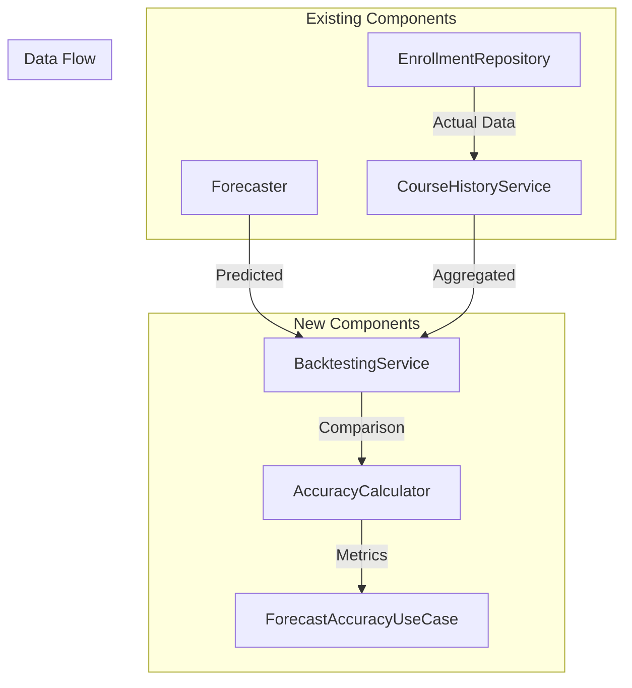
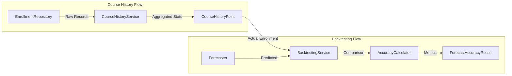
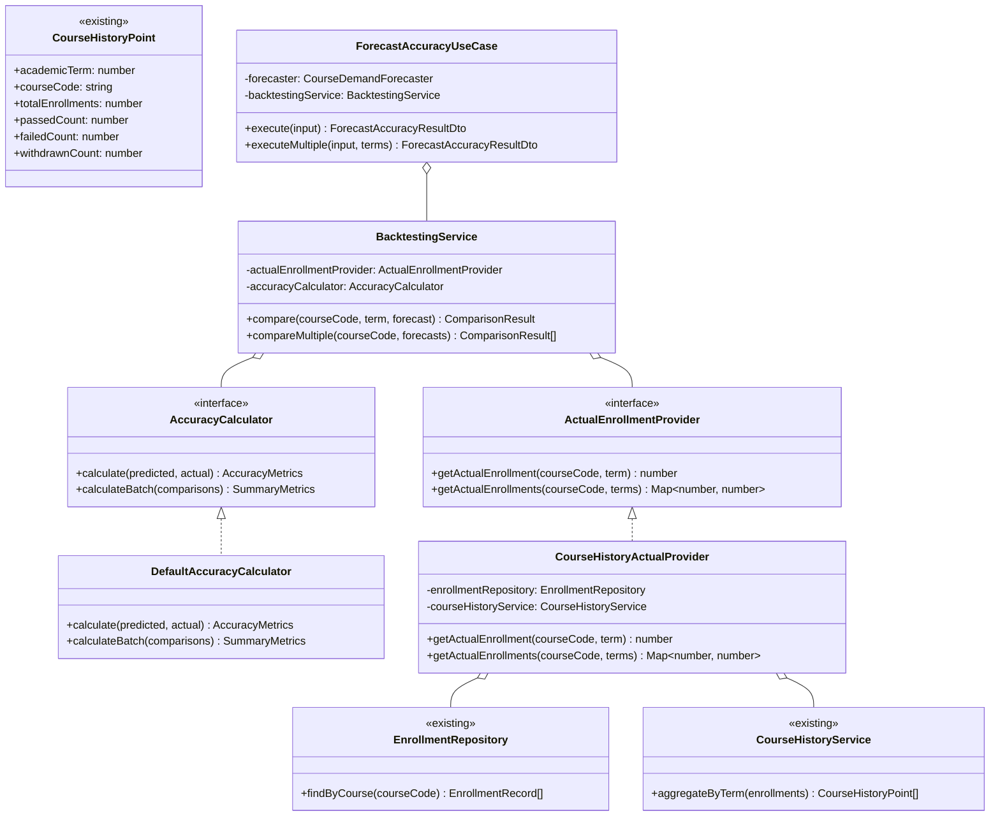
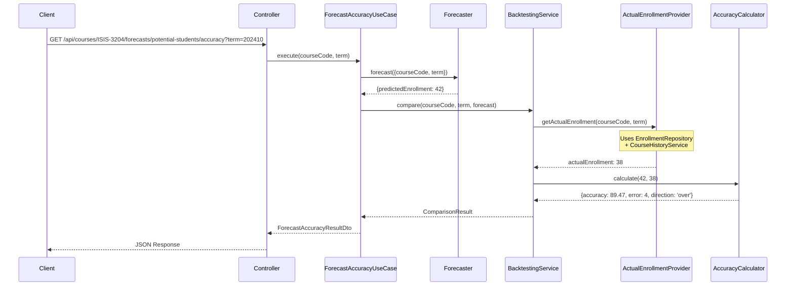
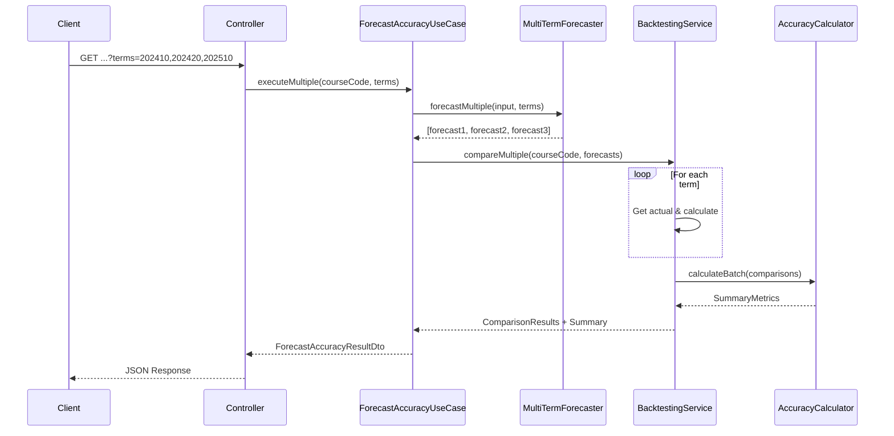

# Forecast Accuracy & Backtesting Architecture

## 1. Overview

### 1.1 Problem Statement

The forecasting system can predict potential student enrollments, but there's no way to:

- Validate forecast accuracy against actual enrollment data
- Measure how many students were over or under-predicted
- Calculate precision metrics for model evaluation
- Track forecaster performance over time

### 1.2 Goal

Create a **backtesting system** that compares forecast predictions with actual enrollments to:

- Calculate accuracy percentage for each forecast
- Determine absolute error (students over/under predicted)
- Provide summary metrics across multiple terms
- Enable model comparison and improvement

### 1.3 Design Principles

1. **Reuse Existing Components**: Leverage `course-history-service` and `enrollment-repository`
2. **Single Responsibility**: Separate accuracy calculation from data retrieval
3. **Extensibility**: Support different accuracy metrics and formulas
4. **Multi-Term Support**: Integrate with multi-term forecast abstraction

---

## 2. Architecture Overview

### 2.1 System Context



### 2.2 Integration with Course History

The backtesting feature integrates with existing `course-history` functionality:



---

## 3. Component Architecture

### 3.1 Class Diagram



### 3.2 Component Responsibilities

| Component | Responsibility | Layer |
|-----------|---------------|-------|
| `AccuracyCalculator` | Calculate accuracy metrics from predicted vs actual | Domain |
| `ActualEnrollmentProvider` | Get actual enrollment counts from database | Domain (Interface) |
| `CourseHistoryActualProvider` | Implementation using existing course-history | Infrastructure |
| `BacktestingService` | Orchestrate comparison between forecast and actual | Domain |
| `ForecastAccuracyUseCase` | Execute forecast, get actuals, calculate accuracy | Application |

---

## 4. Request Flow

### 4.1 Single Term Accuracy



### 4.2 Multi-Term Accuracy



---

## 5. Domain Models

### 5.1 Accuracy Metrics

```typescript
// Location: apps/backend/src/domain/backtesting/accuracy-metrics.ts

export interface AccuracyMetrics {
  /** Accuracy as percentage (0-100) */
  readonly accuracyPercentage: number;

  /** Absolute error: predicted - actual */
  readonly absoluteError: number;

  /** Direction of error */
  readonly errorDirection: 'over' | 'under' | 'exact';

  /** Absolute value of error */
  readonly studentsOff: number;

  /** Error as percentage of actual */
  readonly errorPercentage: number;
}

export interface SummaryMetrics {
  /** Average accuracy across all comparisons */
  readonly averageAccuracy: number;

  /** Total predicted enrollment */
  readonly totalPredicted: number;

  /** Total actual enrollment */
  readonly totalActual: number;

  /** Overall error (sum of individual errors) */
  readonly overallError: number;

  /** Mean Absolute Percentage Error */
  readonly mape: number;

  /** Root Mean Square Error */
  readonly rmse: number;

  /** Number of over-predictions */
  readonly overPredictions: number;

  /** Number of under-predictions */
  readonly underPredictions: number;

  /** Number of exact predictions */
  readonly exactPredictions: number;
}
```

### 5.2 Comparison Result

```typescript
// Location: apps/backend/src/domain/backtesting/comparison-result.ts

export interface ForecastData {
  readonly predictedEnrollment: number;
  readonly generatedAt?: string;
  readonly methodId: string;
  readonly methodLabel: string;
}

export interface ActualData {
  readonly realEnrollment: number;
  readonly dataSource: 'enrollments' | 'external';
}

export interface ComparisonResult {
  readonly academicTerm: number;
  readonly forecast: ForecastData;
  readonly actual: ActualData;
  readonly metrics: AccuracyMetrics;
}
```

---

## 6. Accuracy Calculation

### 6.1 Formulas

| Metric | Formula | Description |
|--------|---------|-------------|
| **Accuracy %** | `max(0, 100 - errorPercentage)` | Bounded 0-100 |
| **Error %** | `|predicted - actual| / actual × 100` | Relative error |
| **Absolute Error** | `predicted - actual` | Signed difference |
| **Students Off** | `|predicted - actual|` | Unsigned difference |
| **MAPE** | `mean(|predicted - actual| / actual) × 100` | Average relative error |
| **RMSE** | `sqrt(mean((predicted - actual)²))` | Root mean square error |

### 6.2 Edge Cases

| Scenario | Handling |
|----------|----------|
| Actual = 0 | Return 100% accuracy if predicted = 0, else 0% |
| Predicted = Actual | Return 100% accuracy, direction = 'exact' |
| Negative accuracy | Clamp to 0% |

### 6.3 Calculator Implementation

```typescript
// Location: apps/backend/src/domain/backtesting/default-accuracy-calculator.ts

export class DefaultAccuracyCalculator implements AccuracyCalculator {
  calculate(predicted: number, actual: number): AccuracyMetrics {
    // Handle edge case: actual is 0
    if (actual === 0) {
      return {
        accuracyPercentage: predicted === 0 ? 100 : 0,
        absoluteError: predicted,
        errorDirection: predicted === 0 ? 'exact' : 'over',
        studentsOff: predicted,
        errorPercentage: predicted === 0 ? 0 : 100,
      };
    }

    const absoluteError = predicted - actual;
    const studentsOff = Math.abs(absoluteError);
    const errorPercentage = (studentsOff / actual) * 100;
    const accuracyPercentage = Math.max(0, 100 - errorPercentage);

    let errorDirection: 'over' | 'under' | 'exact';
    if (absoluteError > 0) {
      errorDirection = 'over';
    } else if (absoluteError < 0) {
      errorDirection = 'under';
    } else {
      errorDirection = 'exact';
    }

    return {
      accuracyPercentage: Math.round(accuracyPercentage * 100) / 100,
      absoluteError,
      errorDirection,
      studentsOff,
      errorPercentage: Math.round(errorPercentage * 100) / 100,
    };
  }

  calculateBatch(comparisons: ComparisonResult[]): SummaryMetrics {
    if (comparisons.length === 0) {
      return this.emptySummary();
    }

    const metrics = comparisons.map(c => c.metrics);

    const totalPredicted = comparisons.reduce(
      (sum, c) => sum + c.forecast.predictedEnrollment, 0
    );
    const totalActual = comparisons.reduce(
      (sum, c) => sum + c.actual.realEnrollment, 0
    );

    const averageAccuracy = metrics.reduce(
      (sum, m) => sum + m.accuracyPercentage, 0
    ) / metrics.length;

    const mape = metrics.reduce(
      (sum, m) => sum + m.errorPercentage, 0
    ) / metrics.length;

    const squaredErrors = comparisons.map(
      c => Math.pow(c.forecast.predictedEnrollment - c.actual.realEnrollment, 2)
    );
    const rmse = Math.sqrt(
      squaredErrors.reduce((sum, se) => sum + se, 0) / squaredErrors.length
    );

    return {
      averageAccuracy: Math.round(averageAccuracy * 100) / 100,
      totalPredicted,
      totalActual,
      overallError: totalPredicted - totalActual,
      mape: Math.round(mape * 100) / 100,
      rmse: Math.round(rmse * 100) / 100,
      overPredictions: metrics.filter(m => m.errorDirection === 'over').length,
      underPredictions: metrics.filter(m => m.errorDirection === 'under').length,
      exactPredictions: metrics.filter(m => m.errorDirection === 'exact').length,
    };
  }

  private emptySummary(): SummaryMetrics {
    return {
      averageAccuracy: 0,
      totalPredicted: 0,
      totalActual: 0,
      overallError: 0,
      mape: 0,
      rmse: 0,
      overPredictions: 0,
      underPredictions: 0,
      exactPredictions: 0,
    };
  }
}
```

---

## 7. API Contract

### 7.1 Endpoint

```
GET /api/courses/{courseCode}/forecasts/{methodId}/accuracy
```

### 7.2 Request Parameters

#### Path Parameters

| Parameter | Type | Required | Description | Example |
|-----------|------|----------|-------------|---------|
| `courseCode` | string | Yes | Course code in XXXX-DDDD format | `ISIS-3204` |
| `methodId` | string | Yes | Forecaster method ID | `potential-students-by-prerequisites` |

#### Query Parameters

| Parameter | Type | Required | Description | Example |
|-----------|------|----------|-------------|---------|
| `term` | integer | No* | Single academic term | `202410` |
| `terms` | string | No* | Comma-separated terms | `202410,202420` |

*One of `term` or `terms` is required

### 7.3 Response Schema

```typescript
// Location: packages/contracts/src/forecasts/forecast-accuracy.dto.ts

export const forecastAccuracyResultSchema = z.object({
  courseCode: z.string().regex(/^[A-Z]{4}-\d{4}$/),

  method: z.object({
    id: z.string(),
    label: z.string(),
  }),

  comparisons: z.array(z.object({
    academicTerm: z.number().int(),
    forecast: z.object({
      predictedEnrollment: z.number().int().nonnegative(),
      generatedAt: z.string().datetime().optional(),
    }),
    actual: z.object({
      realEnrollment: z.number().int().nonnegative(),
      dataSource: z.enum(['enrollments', 'external']),
    }),
    metrics: z.object({
      accuracyPercentage: z.number().min(0).max(100),
      absoluteError: z.number().int(),
      errorDirection: z.enum(['over', 'under', 'exact']),
      studentsOff: z.number().int().nonnegative(),
      errorPercentage: z.number().nonnegative(),
    }),
  })),

  summary: z.object({
    averageAccuracy: z.number().min(0).max(100),
    totalPredicted: z.number().int().nonnegative(),
    totalActual: z.number().int().nonnegative(),
    overallError: z.number().int(),
    mape: z.number().nonnegative(),
    rmse: z.number().nonnegative(),
    overPredictions: z.number().int().nonnegative(),
    underPredictions: z.number().int().nonnegative(),
    exactPredictions: z.number().int().nonnegative(),
  }),

  metadata: z.object({
    requestedTerms: z.array(z.number().int()),
    processedAt: z.string().datetime(),
    termsWithData: z.number().int(),
    termsWithoutData: z.array(z.number().int()).optional(),
  }),
});

export type ForecastAccuracyResultDto = z.infer<
  typeof forecastAccuracyResultSchema
>;
```

---

## 8. Request & Response Examples

### 8.1 Single Term Request

**Request:**
```bash
curl "http://localhost:3000/api/courses/ISIS-3204/forecasts/potential-students-by-prerequisites/accuracy?term=202410"
```

**Response:**
```json
{
  "courseCode": "ISIS-3204",
  "method": {
    "id": "potential-students-by-prerequisites",
    "label": "Potential students by prerequisites (set-based)"
  },
  "comparisons": [
    {
      "academicTerm": 202410,
      "forecast": {
        "predictedEnrollment": 42,
        "generatedAt": "2025-11-21T10:30:00.000Z"
      },
      "actual": {
        "realEnrollment": 38,
        "dataSource": "enrollments"
      },
      "metrics": {
        "accuracyPercentage": 89.47,
        "absoluteError": 4,
        "errorDirection": "over",
        "studentsOff": 4,
        "errorPercentage": 10.53
      }
    }
  ],
  "summary": {
    "averageAccuracy": 89.47,
    "totalPredicted": 42,
    "totalActual": 38,
    "overallError": 4,
    "mape": 10.53,
    "rmse": 4.0,
    "overPredictions": 1,
    "underPredictions": 0,
    "exactPredictions": 0
  },
  "metadata": {
    "requestedTerms": [202410],
    "processedAt": "2025-11-21T15:30:00.000Z",
    "termsWithData": 1
  }
}
```

### 8.2 Multi-Term Request

**Request:**
```bash
curl "http://localhost:3000/api/courses/ISIS-3204/forecasts/potential-students-by-prerequisites/accuracy?terms=202410,202420,202510"
```

**Response:**
```json
{
  "courseCode": "ISIS-3204",
  "method": {
    "id": "potential-students-by-prerequisites",
    "label": "Potential students by prerequisites (set-based)"
  },
  "comparisons": [
    {
      "academicTerm": 202410,
      "forecast": {
        "predictedEnrollment": 42
      },
      "actual": {
        "realEnrollment": 38,
        "dataSource": "enrollments"
      },
      "metrics": {
        "accuracyPercentage": 89.47,
        "absoluteError": 4,
        "errorDirection": "over",
        "studentsOff": 4,
        "errorPercentage": 10.53
      }
    },
    {
      "academicTerm": 202420,
      "forecast": {
        "predictedEnrollment": 35
      },
      "actual": {
        "realEnrollment": 40,
        "dataSource": "enrollments"
      },
      "metrics": {
        "accuracyPercentage": 87.50,
        "absoluteError": -5,
        "errorDirection": "under",
        "studentsOff": 5,
        "errorPercentage": 12.50
      }
    },
    {
      "academicTerm": 202510,
      "forecast": {
        "predictedEnrollment": 45
      },
      "actual": {
        "realEnrollment": 44,
        "dataSource": "enrollments"
      },
      "metrics": {
        "accuracyPercentage": 97.73,
        "absoluteError": 1,
        "errorDirection": "over",
        "studentsOff": 1,
        "errorPercentage": 2.27
      }
    }
  ],
  "summary": {
    "averageAccuracy": 91.57,
    "totalPredicted": 122,
    "totalActual": 122,
    "overallError": 0,
    "mape": 8.43,
    "rmse": 3.42,
    "overPredictions": 2,
    "underPredictions": 1,
    "exactPredictions": 0
  },
  "metadata": {
    "requestedTerms": [202410, 202420, 202510],
    "processedAt": "2025-11-21T15:30:00.000Z",
    "termsWithData": 3
  }
}
```

### 8.3 JavaScript/TypeScript Usage

```typescript
// Fetch accuracy for multiple terms
async function getForecastAccuracy(
  courseCode: string,
  methodId: string,
  terms: number[]
): Promise<ForecastAccuracyResultDto> {
  const termsParam = terms.join(',');
  const response = await fetch(
    `/api/courses/${courseCode}/forecasts/${methodId}/accuracy?terms=${termsParam}`
  );
  return response.json();
}

// Usage
const accuracy = await getForecastAccuracy(
  'ISIS-3204',
  'potential-students-by-prerequisites',
  [202410, 202420, 202510]
);

// Display summary
console.log(`Average Accuracy: ${accuracy.summary.averageAccuracy}%`);
console.log(`MAPE: ${accuracy.summary.mape}%`);
console.log(`Total Error: ${accuracy.summary.overallError} students`);

// Analyze individual terms
accuracy.comparisons.forEach(c => {
  const direction = c.metrics.errorDirection === 'over' ? '+' :
                    c.metrics.errorDirection === 'under' ? '-' : '';
  console.log(
    `Term ${c.academicTerm}: ${c.metrics.accuracyPercentage}% ` +
    `(${direction}${c.metrics.studentsOff} students)`
  );
});
```

---

## 9. Integration with Existing Components

### 9.1 Reusing EnrollmentRepository

The `ActualEnrollmentProvider` wraps the existing `EnrollmentRepository`. Note that `EnrollmentRecord` has `courseOutcome` as a string that needs to be cast to `CourseOutcome` type for the service:

```typescript
// Uses existing findByCourse method from createEnrollmentRepository factory
const enrollments = await this.enrollmentRepository.findByCourse(courseCode);

// Convert EnrollmentRecord to EnrollmentForHistory
// EnrollmentRecord.courseOutcome is string, needs cast to 'P' | 'F' | 'W'
const forHistory = enrollments.map(e => ({
  academicTerm: e.academicTerm,
  courseCode: e.courseCode,
  courseOutcome: e.courseOutcome as 'P' | 'F' | 'W',
}));
```

### 9.2 Reusing CourseHistoryService

The provider uses `CourseHistoryService.aggregateByTerm()` (created via `createCourseHistoryService()` factory) to get enrollment counts:

```typescript
import { createCourseHistoryService } from '../../domain/services/course-history-service';

// Create service instance
const courseHistoryService = createCourseHistoryService();

// Aggregate enrollments by term (expects EnrollmentForHistory[])
const historyPoints = courseHistoryService.aggregateByTerm(forHistory);

// Get total enrollments for specific term
const termPoint = historyPoints.find(p => p.academicTerm === term);
const actualEnrollment = termPoint?.totalEnrollments ?? 0;
```

### 9.3 Optimized Batch Retrieval

For multi-term requests, fetch all data once:

```typescript
async getActualEnrollments(
  courseCode: string,
  terms: number[]
): Promise<Map<number, number | null>> {
  // Single database query
  const allEnrollments = await this.enrollmentRepository.findByCourse(courseCode);

  if (allEnrollments.length === 0) {
    // Return null for all terms when no data exists
    const result = new Map<number, number | null>();
    for (const term of terms) {
      result.set(term, null);
    }
    return result;
  }

  // Convert to EnrollmentForHistory format
  const forHistory = allEnrollments.map(e => ({
    academicTerm: e.academicTerm,
    courseCode: e.courseCode,
    courseOutcome: e.courseOutcome as 'P' | 'F' | 'W',
  }));

  // Aggregate all terms at once
  const historyPoints = this.courseHistoryService.aggregateByTerm(forHistory);

  // Build lookup map for O(1) access
  const pointsByTerm = new Map(
    historyPoints.map(p => [p.academicTerm, p.totalEnrollments]),
  );

  // Build result map (null for terms without data)
  const result = new Map<number, number | null>();
  for (const term of terms) {
    const enrollment = pointsByTerm.get(term) ?? null;
    result.set(term, enrollment);
  }

  return result;
}
```

---

## 10. Error Handling

### 10.1 Error Scenarios

| Scenario | HTTP Status | Error Code | Description |
|----------|-------------|------------|-------------|
| Invalid course code | 400 | `INVALID_COURSE_CODE` | Format doesn't match XXXX-DDDD |
| Invalid method ID | 400 | `INVALID_METHOD_ID` | Unknown forecaster method |
| No term provided | 400 | `MISSING_TERM` | Neither term nor terms provided |
| Course not found | 404 | `COURSE_NOT_FOUND` | No enrollment data for course |
| Term has no data | 200 | - | Include in `termsWithoutData` |

### 10.2 Partial Data Response

When some terms have no actual enrollment data:

```json
{
  "comparisons": [
    {
      "academicTerm": 202410,
      "forecast": { "predictedEnrollment": 42 },
      "actual": { "realEnrollment": 38, "dataSource": "enrollments" },
      "metrics": { ... }
    }
  ],
  "summary": { ... },
  "metadata": {
    "requestedTerms": [202410, 202420],
    "processedAt": "2025-11-21T15:30:00.000Z",
    "termsWithData": 1,
    "termsWithoutData": [202420]
  }
}
```

---

## 11. Performance Considerations

### 11.1 Database Optimization

- **Single Query**: Fetch all enrollments for course in one query
- **In-Memory Aggregation**: Use `CourseHistoryService` for fast aggregation
- **Caching**: Cache historical accuracy results (past terms won't change)

### 11.2 Parallel Execution

For multi-term requests:

```typescript
// Forecasts execute in parallel via MultiTermForecasterDecorator
const forecasts = await multiTermForecaster.forecastMultiple(input, terms);

// Single query for all actual enrollments
const actuals = await provider.getActualEnrollments(courseCode, terms);
```

### 11.3 Response Size

- Limit maximum terms per request (default: 10)
- Optional: Exclude detailed comparisons for summary-only requests

---

## 12. Future Enhancements

### 12.1 Historical Forecast Storage

Store forecasts for later backtesting:

```sql
CREATE TABLE forecast_history (
  id INTEGER PRIMARY KEY,
  course_code TEXT NOT NULL,
  academic_term INTEGER NOT NULL,
  method_id TEXT NOT NULL,
  predicted_enrollment INTEGER NOT NULL,
  generated_at TEXT NOT NULL,
  UNIQUE(course_code, academic_term, method_id, generated_at)
);
```

### 12.2 Forecast Method Comparison

Compare accuracy across different forecasters:

```
GET /api/courses/{courseCode}/forecasts/compare-accuracy?terms=202410,202420&methods=method1,method2
```

### 12.3 Trend Analysis

Track accuracy improvement over time:

```typescript
interface AccuracyTrend {
  period: string;
  averageAccuracy: number;
  trend: 'improving' | 'declining' | 'stable';
}
```

---

## 13. Related Documents

- [Multi-Term Forecast Abstraction](../multi-term-forecast-abstraction/architecture.md)
- [Potential Students by Prerequisites](../potential-students-by-prerequsites/doc.md)
- [General Architecture](../../general-architecture.md)
- [Implementation Guide](./implementation-guide.md)
- [Testing Guide](./testing-guide.md)
