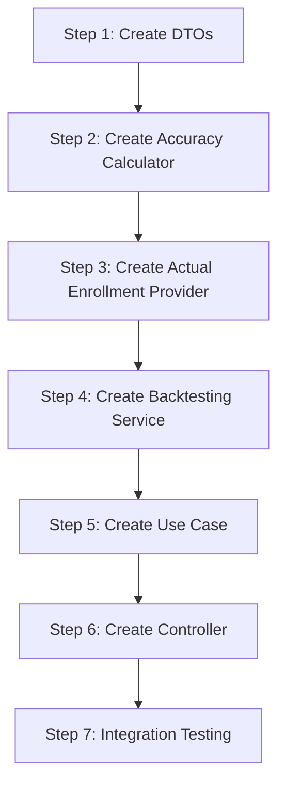

# Forecast Accuracy & Backtesting - Implementation Guide

## Overview

This guide provides step-by-step instructions for implementing the forecast accuracy and backtesting feature. Follow each step in order to ensure proper integration with existing components.

---

## Prerequisites

Before starting, ensure you understand:

- The [Architecture Document](./architecture.md) for this feature
- The existing [Course History Service](../../general-architecture.md)
- The [Multi-Term Forecast Abstraction](../multi-term-forecast-abstraction/architecture.md)

---

## Implementation Steps



---

## Step 1: Create DTO Schemas

### 1.1 Create the Accuracy DTO File

**Location**: `packages/contracts/src/forecasts/forecast-accuracy.dto.ts`

```typescript
import { z } from 'zod';

/**
 * Accuracy metrics for a single forecast comparison
 */
export const accuracyMetricsSchema = z.object({
  accuracyPercentage: z.number().min(0).max(100),
  absoluteError: z.number().int(),
  errorDirection: z.enum(['over', 'under', 'exact']),
  studentsOff: z.number().int().nonnegative(),
  errorPercentage: z.number().nonnegative(),
});

export type AccuracyMetricsDto = z.infer<typeof accuracyMetricsSchema>;

/**
 * Single comparison between forecast and actual
 */
export const comparisonItemSchema = z.object({
  academicTerm: z.number().int(),
  forecast: z.object({
    predictedEnrollment: z.number().int().nonnegative(),
    generatedAt: z.string().datetime().optional(),
  }),
  actual: z.object({
    realEnrollment: z.number().int().nonnegative(),
    dataSource: z.enum(['enrollments', 'external']),
  }),
  metrics: accuracyMetricsSchema,
});

export type ComparisonItemDto = z.infer<typeof comparisonItemSchema>;

/**
 * Summary metrics across all comparisons
 */
export const summaryMetricsSchema = z.object({
  averageAccuracy: z.number().min(0).max(100),
  totalPredicted: z.number().int().nonnegative(),
  totalActual: z.number().int().nonnegative(),
  overallError: z.number().int(),
  mape: z.number().nonnegative(),
  rmse: z.number().nonnegative(),
  overPredictions: z.number().int().nonnegative(),
  underPredictions: z.number().int().nonnegative(),
  exactPredictions: z.number().int().nonnegative(),
});

export type SummaryMetricsDto = z.infer<typeof summaryMetricsSchema>;

/**
 * Complete forecast accuracy result
 */
export const forecastAccuracyResultSchema = z.object({
  courseCode: z
    .string()
    .regex(/^[A-Z]{4}-\d{4}$/, {
      message: 'courseCode must match pattern XXXX-DDDD.',
    }),

  method: z.object({
    id: z.string(),
    label: z.string(),
  }),

  comparisons: z.array(comparisonItemSchema),

  summary: summaryMetricsSchema,

  metadata: z.object({
    requestedTerms: z.array(z.number().int()),
    processedAt: z.string().datetime(),
    termsWithData: z.number().int().nonnegative(),
    termsWithoutData: z.array(z.number().int()).optional(),
  }),
});

export type ForecastAccuracyResultDto = z.infer<
  typeof forecastAccuracyResultSchema
>;

/**
 * Input for accuracy request
 */
export const forecastAccuracyInputSchema = z.object({
  courseCode: z
    .string()
    .regex(/^[A-Z]{4}-\d{4}$/, {
      message: 'courseCode must match pattern XXXX-DDDD.',
    }),
  methodId: z.string().min(1),
  terms: z
    .array(z.number().int().nonnegative())
    .min(1, { message: 'At least one term is required' })
    .max(10, { message: 'Maximum 10 terms allowed per request' }),
});

export type ForecastAccuracyInputDto = z.infer<
  typeof forecastAccuracyInputSchema
>;
```

### 1.2 Export from Index

**Location**: `packages/contracts/src/forecasts/index.ts`

```typescript
export * from './course-demand-forecast.dto';
export * from './multi-term-forecast.dto';
export * from './forecast-accuracy.dto';
```

---

## Step 2: Create Accuracy Calculator

### 2.1 Create Domain Types

**Location**: `apps/backend/src/domain/backtesting/accuracy-metrics.ts`

```typescript
export interface AccuracyMetrics {
  readonly accuracyPercentage: number;
  readonly absoluteError: number;
  readonly errorDirection: 'over' | 'under' | 'exact';
  readonly studentsOff: number;
  readonly errorPercentage: number;
}

export interface SummaryMetrics {
  readonly averageAccuracy: number;
  readonly totalPredicted: number;
  readonly totalActual: number;
  readonly overallError: number;
  readonly mape: number;
  readonly rmse: number;
  readonly overPredictions: number;
  readonly underPredictions: number;
  readonly exactPredictions: number;
}
```

### 2.2 Create Calculator Interface

**Location**: `apps/backend/src/domain/backtesting/accuracy-calculator.ts`

```typescript
import type { AccuracyMetrics, SummaryMetrics } from './accuracy-metrics';
import type { ComparisonResult } from './comparison-result';

/**
 * Interface for calculating forecast accuracy metrics
 */
export interface AccuracyCalculator {
  /**
   * Calculate accuracy metrics for a single comparison
   */
  calculate(predicted: number, actual: number): AccuracyMetrics;

  /**
   * Calculate summary metrics across multiple comparisons
   */
  calculateBatch(comparisons: ComparisonResult[]): SummaryMetrics;
}
```

### 2.3 Create Default Implementation

**Location**: `apps/backend/src/domain/backtesting/default-accuracy-calculator.ts`

```typescript
import type { AccuracyCalculator } from './accuracy-calculator';
import type { AccuracyMetrics, SummaryMetrics } from './accuracy-metrics';
import type { ComparisonResult } from './comparison-result';

export class DefaultAccuracyCalculator implements AccuracyCalculator {
  calculate(predicted: number, actual: number): AccuracyMetrics {
    // Handle edge case: actual is 0
    if (actual === 0) {
      return {
        accuracyPercentage: predicted === 0 ? 100 : 0,
        absoluteError: predicted,
        errorDirection: predicted === 0 ? 'exact' : 'over',
        studentsOff: predicted,
        errorPercentage: predicted === 0 ? 0 : 100,
      };
    }

    const absoluteError = predicted - actual;
    const studentsOff = Math.abs(absoluteError);
    const errorPercentage = (studentsOff / actual) * 100;
    const accuracyPercentage = Math.max(0, 100 - errorPercentage);

    let errorDirection: 'over' | 'under' | 'exact';
    if (absoluteError > 0) {
      errorDirection = 'over';
    } else if (absoluteError < 0) {
      errorDirection = 'under';
    } else {
      errorDirection = 'exact';
    }

    return {
      accuracyPercentage: this.round(accuracyPercentage),
      absoluteError,
      errorDirection,
      studentsOff,
      errorPercentage: this.round(errorPercentage),
    };
  }

  calculateBatch(comparisons: ComparisonResult[]): SummaryMetrics {
    if (comparisons.length === 0) {
      return this.emptySummary();
    }

    const totalPredicted = comparisons.reduce(
      (sum, c) => sum + c.forecast.predictedEnrollment,
      0,
    );
    const totalActual = comparisons.reduce(
      (sum, c) => sum + c.actual.realEnrollment,
      0,
    );

    const metrics = comparisons.map(c => c.metrics);

    const averageAccuracy =
      metrics.reduce((sum, m) => sum + m.accuracyPercentage, 0) /
      metrics.length;

    const mape =
      metrics.reduce((sum, m) => sum + m.errorPercentage, 0) / metrics.length;

    const squaredErrors = comparisons.map(c =>
      Math.pow(
        c.forecast.predictedEnrollment - c.actual.realEnrollment,
        2,
      ),
    );
    const rmse = Math.sqrt(
      squaredErrors.reduce((sum, se) => sum + se, 0) / squaredErrors.length,
    );

    return {
      averageAccuracy: this.round(averageAccuracy),
      totalPredicted,
      totalActual,
      overallError: totalPredicted - totalActual,
      mape: this.round(mape),
      rmse: this.round(rmse),
      overPredictions: metrics.filter(m => m.errorDirection === 'over').length,
      underPredictions: metrics.filter(m => m.errorDirection === 'under').length,
      exactPredictions: metrics.filter(m => m.errorDirection === 'exact').length,
    };
  }

  private emptySummary(): SummaryMetrics {
    return {
      averageAccuracy: 0,
      totalPredicted: 0,
      totalActual: 0,
      overallError: 0,
      mape: 0,
      rmse: 0,
      overPredictions: 0,
      underPredictions: 0,
      exactPredictions: 0,
    };
  }

  private round(value: number): number {
    return Math.round(value * 100) / 100;
  }
}
```

### 2.4 Create Comparison Result Type

**Location**: `apps/backend/src/domain/backtesting/comparison-result.ts`

```typescript
import type { AccuracyMetrics } from './accuracy-metrics';

export interface ForecastData {
  readonly predictedEnrollment: number;
  readonly generatedAt?: string;
  readonly methodId: string;
  readonly methodLabel: string;
}

export interface ActualData {
  readonly realEnrollment: number;
  readonly dataSource: 'enrollments' | 'external';
}

export interface ComparisonResult {
  readonly academicTerm: number;
  readonly forecast: ForecastData;
  readonly actual: ActualData;
  readonly metrics: AccuracyMetrics;
}
```

---

## Step 3: Create Actual Enrollment Provider

### 3.1 Create Provider Interface

**Location**: `apps/backend/src/domain/backtesting/actual-enrollment-provider.ts`

```typescript
/**
 * Interface for retrieving actual enrollment data
 */
export interface ActualEnrollmentProvider {
  /**
   * Get actual enrollment count for a single term
   */
  getActualEnrollment(
    courseCode: string,
    term: number,
  ): Promise<number | null>;

  /**
   * Get actual enrollment counts for multiple terms
   * Returns a Map where key is term and value is enrollment count
   * Terms with no data will have null values
   */
  getActualEnrollments(
    courseCode: string,
    terms: number[],
  ): Promise<Map<number, number | null>>;
}
```

### 3.2 Create Implementation Using Course History

**Location**: `apps/backend/src/infrastructure/providers/course-history-actual-provider.ts`

```typescript
import type { ActualEnrollmentProvider } from '../../domain/backtesting/actual-enrollment-provider';
import type { EnrollmentRepository } from '../repositories/enrollment-repository';
import type { CourseHistoryService } from '../../domain/services/course-history-service';

export interface CourseHistoryActualProviderDeps {
  enrollmentRepository: EnrollmentRepository;
  courseHistoryService: CourseHistoryService;
}

/**
 * Implementation of ActualEnrollmentProvider using existing
 * EnrollmentRepository and CourseHistoryService
 */
export class CourseHistoryActualProvider implements ActualEnrollmentProvider {
  private readonly enrollmentRepository: EnrollmentRepository;
  private readonly courseHistoryService: CourseHistoryService;

  constructor(deps: CourseHistoryActualProviderDeps) {
    this.enrollmentRepository = deps.enrollmentRepository;
    this.courseHistoryService = deps.courseHistoryService;
  }

  async getActualEnrollment(
    courseCode: string,
    term: number,
  ): Promise<number | null> {
    const enrollments = await this.enrollmentRepository.findByCourse(courseCode);

    if (enrollments.length === 0) {
      return null;
    }

    const historyPoints = this.courseHistoryService.aggregateByTerm(
      enrollments.map(e => ({
        academicTerm: e.academicTerm,
        courseCode: e.courseCode,
        courseOutcome: e.courseOutcome as 'P' | 'F' | 'W',
      })),
    );

    const termPoint = historyPoints.find(p => p.academicTerm === term);

    return termPoint?.totalEnrollments ?? null;
  }

  async getActualEnrollments(
    courseCode: string,
    terms: number[],
  ): Promise<Map<number, number | null>> {
    const enrollments = await this.enrollmentRepository.findByCourse(courseCode);

    const result = new Map<number, number | null>();

    if (enrollments.length === 0) {
      // Return null for all terms
      for (const term of terms) {
        result.set(term, null);
      }
      return result;
    }

    const historyPoints = this.courseHistoryService.aggregateByTerm(
      enrollments.map(e => ({
        academicTerm: e.academicTerm,
        courseCode: e.courseCode,
        courseOutcome: e.courseOutcome as 'P' | 'F' | 'W',
      })),
    );

    // Build lookup map for O(1) access
    const pointsByTerm = new Map(
      historyPoints.map(p => [p.academicTerm, p.totalEnrollments]),
    );

    // Get enrollment for each requested term
    for (const term of terms) {
      const enrollment = pointsByTerm.get(term) ?? null;
      result.set(term, enrollment);
    }

    return result;
  }
}
```

---

## Step 4: Create Backtesting Service

### 4.1 Create Service

**Location**: `apps/backend/src/domain/backtesting/backtesting-service.ts`

```typescript
import type { AccuracyCalculator } from './accuracy-calculator';
import type { ActualEnrollmentProvider } from './actual-enrollment-provider';
import type { ComparisonResult } from './comparison-result';
import type { SummaryMetrics } from './accuracy-metrics';
import type { CourseDemandForecasterResult } from '../forecasts/course-demand-forecaster';

export interface BacktestingServiceDeps {
  actualEnrollmentProvider: ActualEnrollmentProvider;
  accuracyCalculator: AccuracyCalculator;
}

export interface BacktestingResult {
  comparisons: ComparisonResult[];
  summary: SummaryMetrics;
  termsWithoutData: number[];
}

/**
 * Service for comparing forecast predictions with actual enrollments
 */
export class BacktestingService {
  private readonly actualEnrollmentProvider: ActualEnrollmentProvider;
  private readonly accuracyCalculator: AccuracyCalculator;

  constructor(deps: BacktestingServiceDeps) {
    this.actualEnrollmentProvider = deps.actualEnrollmentProvider;
    this.accuracyCalculator = deps.accuracyCalculator;
  }

  /**
   * Compare a single forecast with actual enrollment
   */
  async compare(
    courseCode: string,
    forecast: CourseDemandForecasterResult,
  ): Promise<ComparisonResult | null> {
    const actual = await this.actualEnrollmentProvider.getActualEnrollment(
      courseCode,
      forecast.academicTerm,
    );

    if (actual === null) {
      return null;
    }

    const metrics = this.accuracyCalculator.calculate(
      forecast.forecastedEnrollment,
      actual,
    );

    return {
      academicTerm: forecast.academicTerm,
      forecast: {
        predictedEnrollment: forecast.forecastedEnrollment,
        methodId: forecast.methodId,
        methodLabel: forecast.methodLabel,
      },
      actual: {
        realEnrollment: actual,
        dataSource: 'enrollments',
      },
      metrics,
    };
  }

  /**
   * Compare multiple forecasts with actual enrollments
   */
  async compareMultiple(
    courseCode: string,
    forecasts: CourseDemandForecasterResult[],
  ): Promise<BacktestingResult> {
    const terms = forecasts.map(f => f.academicTerm);

    // Fetch all actual enrollments in one query
    const actuals = await this.actualEnrollmentProvider.getActualEnrollments(
      courseCode,
      terms,
    );

    const comparisons: ComparisonResult[] = [];
    const termsWithoutData: number[] = [];

    for (const forecast of forecasts) {
      const actual = actuals.get(forecast.academicTerm);

      if (actual === null || actual === undefined) {
        termsWithoutData.push(forecast.academicTerm);
        continue;
      }

      const metrics = this.accuracyCalculator.calculate(
        forecast.forecastedEnrollment,
        actual,
      );

      comparisons.push({
        academicTerm: forecast.academicTerm,
        forecast: {
          predictedEnrollment: forecast.forecastedEnrollment,
          methodId: forecast.methodId,
          methodLabel: forecast.methodLabel,
        },
        actual: {
          realEnrollment: actual,
          dataSource: 'enrollments',
        },
        metrics,
      });
    }

    const summary = this.accuracyCalculator.calculateBatch(comparisons);

    return {
      comparisons,
      summary,
      termsWithoutData,
    };
  }
}
```

### 4.2 Create Index File

**Location**: `apps/backend/src/domain/backtesting/index.ts`

```typescript
export * from './accuracy-metrics';
export * from './accuracy-calculator';
export * from './default-accuracy-calculator';
export * from './actual-enrollment-provider';
export * from './comparison-result';
export * from './backtesting-service';
```

---

## Step 5: Create Use Case

### 5.1 Create Use Case

**Location**: `apps/backend/src/application/use-cases/forecasts/forecast-accuracy.use-case.ts`

```typescript
import type { ForecastAccuracyResultDto } from '@app/contracts';
import type { CourseDemandForecaster } from '../../../domain/forecasts/course-demand-forecaster';
import type { BacktestingService } from '../../../domain/backtesting/backtesting-service';
import { MultiTermForecasterDecorator } from '../../../domain/forecasts/multi-term-forecaster.decorator';

export interface ForecastAccuracyUseCaseInput {
  courseCode: string;
  methodId: string;
  terms: number[];
}

export interface ForecastAccuracyUseCaseDeps {
  forecaster: CourseDemandForecaster;
  backtestingService: BacktestingService;
}

export class ForecastAccuracyUseCase {
  private readonly multiTermForecaster: MultiTermForecasterDecorator;
  private readonly backtestingService: BacktestingService;

  constructor(deps: ForecastAccuracyUseCaseDeps) {
    this.multiTermForecaster = new MultiTermForecasterDecorator(
      deps.forecaster,
      { maxTerms: 10, allowPartialFailure: true },
    );
    this.backtestingService = deps.backtestingService;
  }

  async execute(
    input: ForecastAccuracyUseCaseInput,
  ): Promise<ForecastAccuracyResultDto> {
    // Generate forecasts for all terms
    const { results: forecasts, errors: forecastErrors } =
      await this.multiTermForecaster.forecastMultiple(
        { courseCode: input.courseCode },
        input.terms,
      );

    if (forecasts.length === 0) {
      throw new Error('All forecasts failed');
    }

    // Compare forecasts with actual enrollments
    const backtestingResult = await this.backtestingService.compareMultiple(
      input.courseCode,
      forecasts,
    );

    // Build response DTO
    const methodId = forecasts[0]?.methodId ?? input.methodId;
    const methodLabel = forecasts[0]?.methodLabel ?? 'Unknown method';

    return {
      courseCode: input.courseCode,
      method: {
        id: methodId,
        label: methodLabel,
      },
      comparisons: backtestingResult.comparisons.map(c => ({
        academicTerm: c.academicTerm,
        forecast: {
          predictedEnrollment: c.forecast.predictedEnrollment,
          generatedAt: c.forecast.generatedAt,
        },
        actual: {
          realEnrollment: c.actual.realEnrollment,
          dataSource: c.actual.dataSource,
        },
        metrics: {
          accuracyPercentage: c.metrics.accuracyPercentage,
          absoluteError: c.metrics.absoluteError,
          errorDirection: c.metrics.errorDirection,
          studentsOff: c.metrics.studentsOff,
          errorPercentage: c.metrics.errorPercentage,
        },
      })),
      summary: backtestingResult.summary,
      metadata: {
        requestedTerms: input.terms,
        processedAt: new Date().toISOString(),
        termsWithData: backtestingResult.comparisons.length,
        ...(backtestingResult.termsWithoutData.length > 0 && {
          termsWithoutData: backtestingResult.termsWithoutData,
        }),
      },
    };
  }
}
```

---

## Step 6: Create Controller

### 6.1 Create Controller

**Location**: `apps/backend/src/presentation/controllers/forecasts/forecast-accuracy.controller.ts`

```typescript
import { z } from 'zod';
import { createRoute, OpenAPIHono } from '@hono/zod-openapi';
import { forecastAccuracyResultSchema } from '@app/contracts';
import { ForecastAccuracyUseCase } from '../../../application/use-cases/forecasts/forecast-accuracy.use-case';
import { PotentialStudentsByPrerequisitesForecaster } from '../../../domain/forecasts/potential-students-by-prerequisites-forecaster';
import { BacktestingService } from '../../../domain/backtesting/backtesting-service';
import { DefaultAccuracyCalculator } from '../../../domain/backtesting/default-accuracy-calculator';
import { CourseHistoryActualProvider } from '../../../infrastructure/providers/course-history-actual-provider';
import { enrollmentRepository } from '../../../infrastructure/repositories/enrollment-repository';
import { enrollmentForecastRepository } from '../../../infrastructure/repositories/enrollment-forecast-repository';
import { prerequisitesRepository } from '../../../infrastructure/repositories/prerequisites-repository';
import { createCourseHistoryService } from '../../../domain/services/course-history-service';

const COURSE_CODE_PATTERN = /^[A-Z]{4}-\d{4}$/;

const forecastAccuracyRoute = createRoute({
  method: 'get',
  path: '/api/courses/{courseCode}/forecasts/{methodId}/accuracy',
  request: {
    params: z.object({
      courseCode: z
        .string()
        .regex(COURSE_CODE_PATTERN, {
          message: 'courseCode must match pattern XXXX-DDDD.',
        }),
      methodId: z.string().min(1),
    }),
    query: z.object({
      term: z
        .string()
        .regex(/^\d+$/)
        .transform(val => parseInt(val, 10))
        .optional(),
      terms: z
        .string()
        .regex(/^\d+(,\d+)*$/)
        .transform(val => val.split(',').map(t => parseInt(t, 10)))
        .optional(),
    }).refine(
      data => data.term !== undefined || data.terms !== undefined,
      { message: 'Either term or terms query parameter is required' },
    ),
  },
  responses: {
    200: {
      description: 'Forecast accuracy comparison with actual enrollments',
      content: {
        'application/json': {
          schema: forecastAccuracyResultSchema,
        },
      },
    },
    400: {
      description: 'Invalid request parameters',
    },
    404: {
      description: 'Course or method not found',
    },
  },
  tags: ['Forecasts', 'Backtesting'],
});

export const registerForecastAccuracyRoute = (app: OpenAPIHono): void => {
  // Initialize dependencies
  const courseHistoryService = createCourseHistoryService();

  const actualProvider = new CourseHistoryActualProvider({
    enrollmentRepository,
    courseHistoryService,
  });

  const accuracyCalculator = new DefaultAccuracyCalculator();

  const backtestingService = new BacktestingService({
    actualEnrollmentProvider: actualProvider,
    accuracyCalculator,
  });

  // For now, only support potential-students-by-prerequisites method
  const forecaster = new PotentialStudentsByPrerequisitesForecaster({
    prerequisitesProvider: prerequisitesRepository,
    enrollmentHistoryProvider: enrollmentForecastRepository,
  });

  const useCase = new ForecastAccuracyUseCase({
    forecaster,
    backtestingService,
  });

  app.openapi(forecastAccuracyRoute, async (c) => {
    const { courseCode, methodId } = c.req.valid('param');
    const { term, terms } = c.req.valid('query');

    // Validate method ID
    if (methodId !== 'potential-students-by-prerequisites') {
      return c.json(
        { error: { code: 'INVALID_METHOD_ID', message: 'Unknown method ID' } },
        400,
      );
    }

    // Build terms array
    const termsArray = terms ?? (term !== undefined ? [term] : []);

    const result = await useCase.execute({
      courseCode,
      methodId,
      terms: termsArray,
    });

    return c.json(result, 200);
  });
};
```

### 6.2 Register Route in App

**Location**: Update your main app file to register the new route

```typescript
import { registerForecastAccuracyRoute } from './presentation/controllers/forecasts/forecast-accuracy.controller';

// In your app setup
registerForecastAccuracyRoute(app);
```

---

## Step 7: Integration Testing

### 7.1 Test the Implementation

```bash
# Start the development server
npm run dev

# Test single-term accuracy
curl "http://localhost:3000/api/courses/ISIS-3204/forecasts/potential-students-by-prerequisites/accuracy?term=202410"

# Test multi-term accuracy
curl "http://localhost:3000/api/courses/ISIS-3204/forecasts/potential-students-by-prerequisites/accuracy?terms=202410,202420,202510"
```

---

## File Summary

### New Files to Create

| File | Purpose | Layer |
|------|---------|-------|
| `packages/contracts/src/forecasts/forecast-accuracy.dto.ts` | DTO schemas | Contracts |
| `apps/backend/src/domain/backtesting/accuracy-metrics.ts` | Metric types | Domain |
| `apps/backend/src/domain/backtesting/accuracy-calculator.ts` | Calculator interface | Domain |
| `apps/backend/src/domain/backtesting/default-accuracy-calculator.ts` | Calculator implementation | Domain |
| `apps/backend/src/domain/backtesting/actual-enrollment-provider.ts` | Provider interface | Domain |
| `apps/backend/src/domain/backtesting/comparison-result.ts` | Result types | Domain |
| `apps/backend/src/domain/backtesting/backtesting-service.ts` | Main service | Domain |
| `apps/backend/src/domain/backtesting/index.ts` | Exports | Domain |
| `apps/backend/src/infrastructure/providers/course-history-actual-provider.ts` | Provider implementation | Infrastructure |
| `apps/backend/src/application/use-cases/forecasts/forecast-accuracy.use-case.ts` | Use case | Application |
| `apps/backend/src/presentation/controllers/forecasts/forecast-accuracy.controller.ts` | Controller | Presentation |

### Files to Modify

| File | Changes |
|------|---------|
| `packages/contracts/src/forecasts/index.ts` | Export accuracy DTOs |
| Main app file | Register accuracy route |

---

## Checklist

### Pre-Implementation

- [ ] Review architecture document
- [ ] Understand existing course-history components
- [ ] Set up development environment

### Implementation

- [ ] Step 1: Create DTOs
  - [ ] Create forecast-accuracy.dto.ts
  - [ ] Export from index

- [ ] Step 2: Create Accuracy Calculator
  - [ ] Create accuracy-metrics.ts
  - [ ] Create accuracy-calculator.ts interface
  - [ ] Create default-accuracy-calculator.ts
  - [ ] Create comparison-result.ts

- [ ] Step 3: Create Actual Enrollment Provider
  - [ ] Create provider interface
  - [ ] Create CourseHistoryActualProvider

- [ ] Step 4: Create Backtesting Service
  - [ ] Create backtesting-service.ts
  - [ ] Create index.ts exports

- [ ] Step 5: Create Use Case
  - [ ] Create forecast-accuracy.use-case.ts

- [ ] Step 6: Create Controller
  - [ ] Create controller
  - [ ] Register route

- [ ] Step 7: Testing
  - [ ] Write unit tests
  - [ ] Write integration tests
  - [ ] Manual testing

---

## Related Documents

- [Architecture Document](./architecture.md)
- [Testing Guide](./testing-guide.md)
- [Multi-Term Forecast Abstraction](../multi-term-forecast-abstraction/architecture.md)
