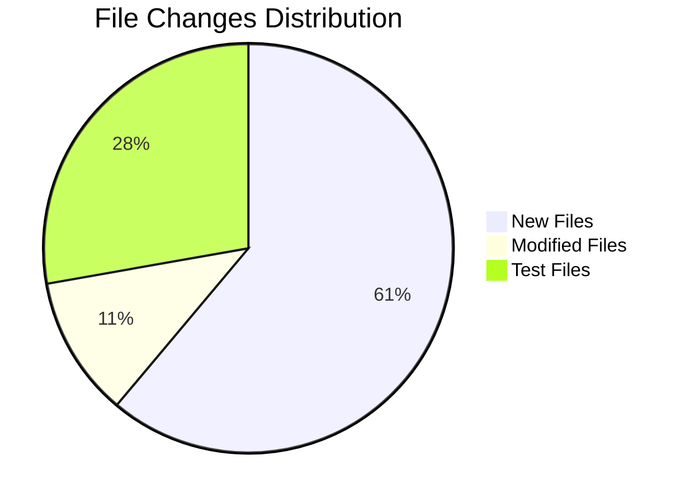
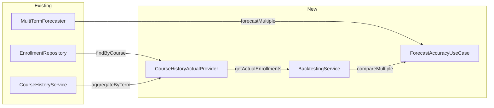
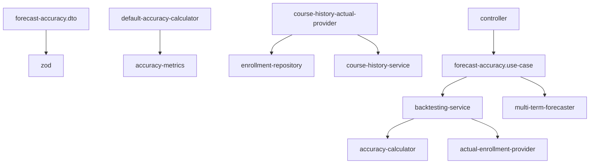

# Forecast Accuracy & Backtesting - System Impact Analysis

## Overview

This document analyzes the impact of implementing the forecast accuracy and backtesting feature on the existing codebase.

---

## Impact Summary



| Category | Count | Risk Level |
|----------|-------|------------|
| New Files | 11 | Low |
| Modified Files | 2 | Low |
| New Test Files | 5 | Low |
| Breaking Changes | 0 | None |
| Reused Components | 3 | - |

---

## Affected Directories

### Directory Tree

```
investigacion-app/
├── packages/
│   └── contracts/
│       └── src/
│           └── forecasts/
│               ├── index.ts                          [MODIFIED]
│               ├── forecast-accuracy.dto.ts          [NEW]
│               └── __tests__/
│                   └── forecast-accuracy.dto.test.ts [NEW]
│
├── apps/
│   └── backend/
│       └── src/
│           ├── domain/
│           │   ├── backtesting/                      [NEW DIRECTORY]
│           │   │   ├── index.ts                      [NEW]
│           │   │   ├── accuracy-metrics.ts           [NEW]
│           │   │   ├── accuracy-calculator.ts        [NEW]
│           │   │   ├── default-accuracy-calculator.ts [NEW]
│           │   │   ├── actual-enrollment-provider.ts [NEW]
│           │   │   ├── comparison-result.ts          [NEW]
│           │   │   ├── backtesting-service.ts        [NEW]
│           │   │   └── __tests__/
│           │   │       ├── default-accuracy-calculator.test.ts [NEW]
│           │   │       └── backtesting-service.test.ts [NEW]
│           │   │
│           │   └── services/
│           │       └── course-history-service.ts     [REUSED]
│           │
│           ├── infrastructure/
│           │   ├── repositories/
│           │   │   └── enrollment-repository.ts      [REUSED]
│           │   │
│           │   └── providers/                        [NEW DIRECTORY]
│           │       ├── course-history-actual-provider.ts [NEW]
│           │       └── __tests__/
│           │           └── course-history-actual-provider.test.ts [NEW]
│           │
│           ├── application/
│           │   └── use-cases/
│           │       └── forecasts/
│           │           ├── forecast-accuracy.use-case.ts [NEW]
│           │           └── __tests__/
│           │               └── forecast-accuracy.use-case.integration.test.ts [NEW]
│           │
│           └── presentation/
│               └── controllers/
│                   └── forecasts/
│                       └── forecast-accuracy.controller.ts [NEW]
│
└── docs/
    └── architecture/
        └── use-cases/
            └── forecast-accuracy-backtesting/
                ├── architecture.md                   [NEW]
                ├── implementation-guide.md           [NEW]
                ├── testing-guide.md                  [NEW]
                └── system-impact.md                  [NEW]
```

---

## Component Reuse Analysis

### Reused Existing Components

| Component | Location | Usage |
|-----------|----------|-------|
| `EnrollmentRepository` | `infrastructure/repositories/enrollment-repository.ts` | Get raw enrollment data |
| `CourseHistoryService` | `domain/services/course-history-service.ts` | Aggregate enrollments by term |
| `MultiTermForecasterDecorator` | `domain/forecasts/multi-term-forecaster.decorator.ts` | Batch forecast execution |

### Integration Points



---

## Detailed Impact Analysis

### 1. Contracts Package

#### New Files

| File | Purpose | Size Est. |
|------|---------|-----------|
| `forecast-accuracy.dto.ts` | DTO schemas for accuracy results | ~150 lines |

#### Modified Files

| File | Changes | Risk |
|------|---------|------|
| `forecasts/index.ts` | Add export for accuracy DTOs | Low |

#### API Contract

- New response type: `ForecastAccuracyResultDto`
- New input type: `ForecastAccuracyInputDto`
- No changes to existing types

---

### 2. Domain Layer

#### New Directory: `backtesting/`

| File | Purpose | Dependencies |
|------|---------|--------------|
| `accuracy-metrics.ts` | Type definitions | None |
| `accuracy-calculator.ts` | Calculator interface | accuracy-metrics |
| `default-accuracy-calculator.ts` | Implementation | accuracy-calculator |
| `actual-enrollment-provider.ts` | Provider interface | None |
| `comparison-result.ts` | Result types | accuracy-metrics |
| `backtesting-service.ts` | Main service | All above |
| `index.ts` | Exports | All above |

#### Impact Analysis

- **Isolated**: New directory with no impact on existing code
- **Extensible**: Interfaces allow future implementations
- **Testable**: Pure functions for calculations

---

### 3. Infrastructure Layer

#### New Directory: `providers/`

| File | Purpose | Dependencies |
|------|---------|--------------|
| `course-history-actual-provider.ts` | Implementation | EnrollmentRepository, CourseHistoryService |

#### Integration with Existing

```typescript
// Uses existing components without modification
const enrollments = await this.enrollmentRepository.findByCourse(courseCode);
const historyPoints = this.courseHistoryService.aggregateByTerm(enrollments);
```

---

### 4. Application Layer

#### New Files

| File | Purpose | Dependencies |
|------|---------|--------------|
| `forecast-accuracy.use-case.ts` | Orchestration | BacktestingService, MultiTermForecaster |

#### Responsibilities

- Execute forecasts for requested terms
- Compare with actual enrollments
- Build response DTO

---

### 5. Presentation Layer

#### New Files

| File | Purpose | Dependencies |
|------|---------|--------------|
| `forecast-accuracy.controller.ts` | HTTP endpoint | Use case, DTOs |

#### Route Registration

```typescript
// Add to app setup
registerForecastAccuracyRoute(app);
```

---

## API Impact

### New Endpoint

```
GET /api/courses/{courseCode}/forecasts/{methodId}/accuracy
```

### Query Parameters

| Parameter | Type | Description |
|-----------|------|-------------|
| `term` | integer | Single term |
| `terms` | string | Comma-separated terms |

### Response Codes

| Code | Description |
|------|-------------|
| 200 | Success |
| 400 | Invalid parameters |
| 404 | Course/method not found |

---

## Database Impact

### No Schema Changes Required

The feature uses existing tables:

- `enrollments` - Already contains all required data
- `course_prerequisites` - Already exists

### Query Patterns

```sql
-- Reuses existing query from EnrollmentRepository
SELECT * FROM enrollments
WHERE course_code = ?
ORDER BY academic_term;
```

---

## Performance Considerations

### Efficient Data Access

| Operation | Queries | Notes |
|-----------|---------|-------|
| Single term | 1 | Fetch all course enrollments |
| Multiple terms | 1 | Same query, filter in memory |

### Memory Usage

- Aggregation uses `Map` for O(1) lookups
- No additional data structures

### Caching Opportunities

- Historical terms won't change
- Can cache accuracy results per (course, term)

---

## Dependency Analysis

### External Dependencies

| Package | Version | Purpose | Status |
|---------|---------|---------|--------|
| None | - | No new external dependencies | - |

### Internal Dependencies



---

## Risk Assessment

### Risk Matrix

| Risk | Probability | Impact | Mitigation |
|------|-------------|--------|------------|
| Breaking existing endpoints | None | - | No modifications to existing endpoints |
| Performance degradation | Low | Low | Reuses optimized existing queries |
| Incorrect calculations | Low | Medium | Comprehensive unit tests |
| Integration failures | Low | Low | Uses well-tested existing components |

### Overall Risk Level: **LOW**

- All changes are additive
- Heavy reuse of existing tested components
- No database schema changes

---

## Migration Considerations

### Deployment

1. Deploy new code (no migrations needed)
2. Endpoint immediately available
3. No data migration required

### Rollback

1. Remove route registration
2. No database cleanup needed
3. Contracts remain (unused)

---

## Testing Requirements

### Unit Tests

| Component | Tests | Priority |
|-----------|-------|----------|
| DefaultAccuracyCalculator | 15+ | High |
| BacktestingService | 8+ | High |
| CourseHistoryActualProvider | 6+ | Medium |
| DTOs | 5+ | Medium |

### Integration Tests

| Scenario | Coverage |
|----------|----------|
| Use case with real data | End-to-end flow |
| Controller with mock use case | HTTP layer |

### Coverage Targets

- Overall: 85%
- Calculator: 95%
- Service: 90%

---

## Documentation Impact

### New Documentation

| File | Audience |
|------|----------|
| `architecture.md` | Architects, Senior Developers |
| `implementation-guide.md` | Developers |
| `testing-guide.md` | Developers, QA |
| `system-impact.md` | Tech Leads, DevOps |

### Updates to Existing Docs

- API documentation (OpenAPI)
- Frontend integration guide

---

## Monitoring & Observability

### Recommended Metrics

| Metric | Description |
|--------|-------------|
| `forecast_accuracy_requests` | Request count per endpoint |
| `forecast_accuracy_latency` | Response time percentiles |
| `forecast_accuracy_errors` | Error rate by type |

### Logging

```typescript
// Recommended log points
logger.info('Calculating accuracy', { courseCode, terms });
logger.debug('Comparison result', { term, accuracy });
logger.error('Accuracy calculation failed', { error });
```

---

## Checklist for Implementation

### Pre-Implementation

- [ ] Review architecture document
- [ ] Understand existing components
- [ ] Set up test environment

### Implementation

- [ ] Create DTOs
- [ ] Create domain types
- [ ] Create calculator
- [ ] Create provider
- [ ] Create service
- [ ] Create use case
- [ ] Create controller
- [ ] Register route

### Testing

- [ ] Unit tests for calculator
- [ ] Unit tests for service
- [ ] Unit tests for provider
- [ ] Integration tests
- [ ] Manual API testing

### Post-Implementation

- [ ] Code review
- [ ] Update API documentation
- [ ] Deploy to staging
- [ ] Performance testing
- [ ] Deploy to production

---

## File Count Summary

| Category | Count |
|----------|-------|
| New source files | 11 |
| New test files | 5 |
| Modified files | 2 |
| New documentation | 4 |
| **Total new files** | **20** |

---

## Related Documents

- [Architecture Document](./architecture.md)
- [Implementation Guide](./implementation-guide.md)
- [Testing Guide](./testing-guide.md)
- [Multi-Term Forecast Abstraction](../multi-term-forecast-abstraction/architecture.md)
