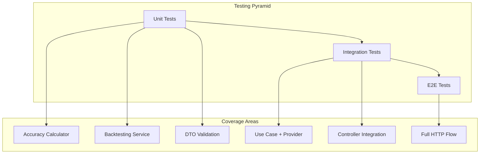

# Forecast Accuracy & Backtesting - Testing Guide

## Overview

This guide provides comprehensive testing strategies and examples for the forecast accuracy and backtesting feature.

---

## Testing Strategy



### Test Distribution

| Test Type | Coverage | Focus Areas |
|-----------|----------|-------------|
| Unit Tests | 70% | Calculator, Service, Provider |
| Integration Tests | 20% | Use Case, Database |
| E2E Tests | 10% | Full API flow |

---

## Unit Tests

### 1. DefaultAccuracyCalculator Tests

**Location**: `apps/backend/src/domain/backtesting/__tests__/default-accuracy-calculator.test.ts`

```typescript
import { describe, it, expect } from 'vitest';
import { DefaultAccuracyCalculator } from '../default-accuracy-calculator';

describe('DefaultAccuracyCalculator', () => {
  const calculator = new DefaultAccuracyCalculator();

  describe('calculate', () => {
    describe('basic calculations', () => {
      it('should calculate 100% accuracy when prediction equals actual', () => {
        const result = calculator.calculate(42, 42);

        expect(result.accuracyPercentage).toBe(100);
        expect(result.absoluteError).toBe(0);
        expect(result.errorDirection).toBe('exact');
        expect(result.studentsOff).toBe(0);
        expect(result.errorPercentage).toBe(0);
      });

      it('should calculate accuracy for over-prediction', () => {
        const result = calculator.calculate(42, 38);

        expect(result.accuracyPercentage).toBe(89.47);
        expect(result.absoluteError).toBe(4);
        expect(result.errorDirection).toBe('over');
        expect(result.studentsOff).toBe(4);
        expect(result.errorPercentage).toBe(10.53);
      });

      it('should calculate accuracy for under-prediction', () => {
        const result = calculator.calculate(35, 40);

        expect(result.accuracyPercentage).toBe(87.5);
        expect(result.absoluteError).toBe(-5);
        expect(result.errorDirection).toBe('under');
        expect(result.studentsOff).toBe(5);
        expect(result.errorPercentage).toBe(12.5);
      });

      it('should clamp accuracy to 0% for large errors', () => {
        const result = calculator.calculate(200, 50);

        expect(result.accuracyPercentage).toBe(0);
        expect(result.absoluteError).toBe(150);
        expect(result.errorDirection).toBe('over');
        expect(result.studentsOff).toBe(150);
        expect(result.errorPercentage).toBe(300);
      });
    });

    describe('edge cases', () => {
      it('should handle actual = 0 with prediction = 0', () => {
        const result = calculator.calculate(0, 0);

        expect(result.accuracyPercentage).toBe(100);
        expect(result.absoluteError).toBe(0);
        expect(result.errorDirection).toBe('exact');
      });

      it('should handle actual = 0 with prediction > 0', () => {
        const result = calculator.calculate(10, 0);

        expect(result.accuracyPercentage).toBe(0);
        expect(result.absoluteError).toBe(10);
        expect(result.errorDirection).toBe('over');
      });

      it('should handle small numbers correctly', () => {
        const result = calculator.calculate(1, 2);

        expect(result.accuracyPercentage).toBe(50);
        expect(result.absoluteError).toBe(-1);
        expect(result.errorDirection).toBe('under');
      });

      it('should handle large numbers correctly', () => {
        const result = calculator.calculate(1000, 950);

        expect(result.accuracyPercentage).toBe(94.74);
        expect(result.absoluteError).toBe(50);
        expect(result.errorDirection).toBe('over');
      });
    });

    describe('rounding', () => {
      it('should round to 2 decimal places', () => {
        const result = calculator.calculate(33, 100);

        expect(result.accuracyPercentage).toBe(33);
        expect(result.errorPercentage).toBe(67);
      });
    });
  });

  describe('calculateBatch', () => {
    it('should calculate summary for multiple comparisons', () => {
      const comparisons = [
        {
          academicTerm: 202410,
          forecast: { predictedEnrollment: 42, methodId: 't', methodLabel: 'T' },
          actual: { realEnrollment: 38, dataSource: 'enrollments' as const },
          metrics: calculator.calculate(42, 38),
        },
        {
          academicTerm: 202420,
          forecast: { predictedEnrollment: 35, methodId: 't', methodLabel: 'T' },
          actual: { realEnrollment: 40, dataSource: 'enrollments' as const },
          metrics: calculator.calculate(35, 40),
        },
      ];

      const summary = calculator.calculateBatch(comparisons);

      expect(summary.totalPredicted).toBe(77);
      expect(summary.totalActual).toBe(78);
      expect(summary.overallError).toBe(-1);
      expect(summary.overPredictions).toBe(1);
      expect(summary.underPredictions).toBe(1);
      expect(summary.exactPredictions).toBe(0);
      expect(summary.averageAccuracy).toBeCloseTo(88.49, 1);
    });

    it('should return empty summary for empty array', () => {
      const summary = calculator.calculateBatch([]);

      expect(summary.totalPredicted).toBe(0);
      expect(summary.totalActual).toBe(0);
      expect(summary.averageAccuracy).toBe(0);
      expect(summary.mape).toBe(0);
      expect(summary.rmse).toBe(0);
    });

    it('should calculate MAPE correctly', () => {
      const comparisons = [
        {
          academicTerm: 202410,
          forecast: { predictedEnrollment: 110, methodId: 't', methodLabel: 'T' },
          actual: { realEnrollment: 100, dataSource: 'enrollments' as const },
          metrics: calculator.calculate(110, 100),
        },
        {
          academicTerm: 202420,
          forecast: { predictedEnrollment: 90, methodId: 't', methodLabel: 'T' },
          actual: { realEnrollment: 100, dataSource: 'enrollments' as const },
          metrics: calculator.calculate(90, 100),
        },
      ];

      const summary = calculator.calculateBatch(comparisons);

      // MAPE = mean(10%, 10%) = 10%
      expect(summary.mape).toBe(10);
    });

    it('should calculate RMSE correctly', () => {
      const comparisons = [
        {
          academicTerm: 202410,
          forecast: { predictedEnrollment: 50, methodId: 't', methodLabel: 'T' },
          actual: { realEnrollment: 40, dataSource: 'enrollments' as const },
          metrics: calculator.calculate(50, 40),
        },
        {
          academicTerm: 202420,
          forecast: { predictedEnrollment: 30, methodId: 't', methodLabel: 'T' },
          actual: { realEnrollment: 40, dataSource: 'enrollments' as const },
          metrics: calculator.calculate(30, 40),
        },
      ];

      const summary = calculator.calculateBatch(comparisons);

      // RMSE = sqrt((100 + 100) / 2) = sqrt(100) = 10
      expect(summary.rmse).toBe(10);
    });
  });
});
```

### 2. BacktestingService Tests

**Location**: `apps/backend/src/domain/backtesting/__tests__/backtesting-service.test.ts`

```typescript
import { describe, it, expect, vi, beforeEach } from 'vitest';
import { BacktestingService } from '../backtesting-service';
import type { ActualEnrollmentProvider } from '../actual-enrollment-provider';
import type { AccuracyCalculator } from '../accuracy-calculator';
import { DefaultAccuracyCalculator } from '../default-accuracy-calculator';

describe('BacktestingService', () => {
  let mockProvider: ActualEnrollmentProvider;
  let service: BacktestingService;
  const calculator = new DefaultAccuracyCalculator();

  beforeEach(() => {
    mockProvider = {
      getActualEnrollment: vi.fn(),
      getActualEnrollments: vi.fn(),
    };

    service = new BacktestingService({
      actualEnrollmentProvider: mockProvider,
      accuracyCalculator: calculator,
    });
  });

  describe('compare', () => {
    it('should compare single forecast with actual', async () => {
      vi.mocked(mockProvider.getActualEnrollment).mockResolvedValue(38);

      const forecast = {
        courseCode: 'ISIS-3204',
        academicTerm: 202410,
        forecastedEnrollment: 42,
        methodId: 'test',
        methodLabel: 'Test',
        details: {},
      };

      const result = await service.compare('ISIS-3204', forecast);

      expect(result).not.toBeNull();
      expect(result!.academicTerm).toBe(202410);
      expect(result!.forecast.predictedEnrollment).toBe(42);
      expect(result!.actual.realEnrollment).toBe(38);
      expect(result!.metrics.absoluteError).toBe(4);
      expect(result!.metrics.errorDirection).toBe('over');
    });

    it('should return null when no actual data', async () => {
      vi.mocked(mockProvider.getActualEnrollment).mockResolvedValue(null);

      const forecast = {
        courseCode: 'ISIS-3204',
        academicTerm: 202410,
        forecastedEnrollment: 42,
        methodId: 'test',
        methodLabel: 'Test',
        details: {},
      };

      const result = await service.compare('ISIS-3204', forecast);

      expect(result).toBeNull();
    });
  });

  describe('compareMultiple', () => {
    it('should compare multiple forecasts', async () => {
      vi.mocked(mockProvider.getActualEnrollments).mockResolvedValue(
        new Map([
          [202410, 38],
          [202420, 40],
        ]),
      );

      const forecasts = [
        {
          courseCode: 'ISIS-3204',
          academicTerm: 202410,
          forecastedEnrollment: 42,
          methodId: 'test',
          methodLabel: 'Test',
          details: {},
        },
        {
          courseCode: 'ISIS-3204',
          academicTerm: 202420,
          forecastedEnrollment: 35,
          methodId: 'test',
          methodLabel: 'Test',
          details: {},
        },
      ];

      const result = await service.compareMultiple('ISIS-3204', forecasts);

      expect(result.comparisons).toHaveLength(2);
      expect(result.termsWithoutData).toHaveLength(0);
      expect(result.summary.totalPredicted).toBe(77);
      expect(result.summary.totalActual).toBe(78);
    });

    it('should track terms without data', async () => {
      vi.mocked(mockProvider.getActualEnrollments).mockResolvedValue(
        new Map([
          [202410, 38],
          [202420, null],
        ]),
      );

      const forecasts = [
        {
          courseCode: 'ISIS-3204',
          academicTerm: 202410,
          forecastedEnrollment: 42,
          methodId: 'test',
          methodLabel: 'Test',
          details: {},
        },
        {
          courseCode: 'ISIS-3204',
          academicTerm: 202420,
          forecastedEnrollment: 35,
          methodId: 'test',
          methodLabel: 'Test',
          details: {},
        },
      ];

      const result = await service.compareMultiple('ISIS-3204', forecasts);

      expect(result.comparisons).toHaveLength(1);
      expect(result.termsWithoutData).toContain(202420);
    });

    it('should handle all terms without data', async () => {
      vi.mocked(mockProvider.getActualEnrollments).mockResolvedValue(
        new Map([
          [202410, null],
          [202420, null],
        ]),
      );

      const forecasts = [
        {
          courseCode: 'ISIS-3204',
          academicTerm: 202410,
          forecastedEnrollment: 42,
          methodId: 'test',
          methodLabel: 'Test',
          details: {},
        },
        {
          courseCode: 'ISIS-3204',
          academicTerm: 202420,
          forecastedEnrollment: 35,
          methodId: 'test',
          methodLabel: 'Test',
          details: {},
        },
      ];

      const result = await service.compareMultiple('ISIS-3204', forecasts);

      expect(result.comparisons).toHaveLength(0);
      expect(result.termsWithoutData).toHaveLength(2);
      expect(result.summary.totalPredicted).toBe(0);
    });
  });
});
```

### 3. CourseHistoryActualProvider Tests

**Location**: `apps/backend/src/infrastructure/providers/__tests__/course-history-actual-provider.test.ts`

```typescript
import { describe, it, expect, vi, beforeEach } from 'vitest';
import { CourseHistoryActualProvider } from '../course-history-actual-provider';
import type { EnrollmentRepository } from '../../repositories/enrollment-repository';
import type { CourseHistoryService } from '../../../domain/services/course-history-service';

describe('CourseHistoryActualProvider', () => {
  let mockEnrollmentRepo: EnrollmentRepository;
  let mockHistoryService: CourseHistoryService;
  let provider: CourseHistoryActualProvider;

  beforeEach(() => {
    mockEnrollmentRepo = {
      findByCourse: vi.fn(),
    };

    mockHistoryService = {
      aggregateByTerm: vi.fn(),
    };

    provider = new CourseHistoryActualProvider({
      enrollmentRepository: mockEnrollmentRepo,
      courseHistoryService: mockHistoryService,
    });
  });

  describe('getActualEnrollment', () => {
    it('should return enrollment count for term', async () => {
      vi.mocked(mockEnrollmentRepo.findByCourse).mockResolvedValue([
        { academicTerm: 202410, courseCode: 'ISIS-3204', courseOutcome: 'P' },
        { academicTerm: 202410, courseCode: 'ISIS-3204', courseOutcome: 'P' },
      ] as any);

      vi.mocked(mockHistoryService.aggregateByTerm).mockReturnValue([
        {
          academicTerm: 202410,
          courseCode: 'ISIS-3204',
          totalEnrollments: 38,
          passedCount: 30,
          failedCount: 5,
          withdrawnCount: 3,
        },
      ]);

      const result = await provider.getActualEnrollment('ISIS-3204', 202410);

      expect(result).toBe(38);
    });

    it('should return null for term with no data', async () => {
      vi.mocked(mockEnrollmentRepo.findByCourse).mockResolvedValue([
        { academicTerm: 202410, courseCode: 'ISIS-3204', courseOutcome: 'P' },
      ] as any);

      vi.mocked(mockHistoryService.aggregateByTerm).mockReturnValue([
        {
          academicTerm: 202410,
          courseCode: 'ISIS-3204',
          totalEnrollments: 38,
          passedCount: 30,
          failedCount: 5,
          withdrawnCount: 3,
        },
      ]);

      const result = await provider.getActualEnrollment('ISIS-3204', 202420);

      expect(result).toBeNull();
    });

    it('should return null for course with no enrollments', async () => {
      vi.mocked(mockEnrollmentRepo.findByCourse).mockResolvedValue([]);

      const result = await provider.getActualEnrollment('ISIS-3204', 202410);

      expect(result).toBeNull();
    });
  });

  describe('getActualEnrollments', () => {
    it('should return map of enrollments for multiple terms', async () => {
      vi.mocked(mockEnrollmentRepo.findByCourse).mockResolvedValue([
        { academicTerm: 202410, courseCode: 'ISIS-3204', courseOutcome: 'P' },
        { academicTerm: 202420, courseCode: 'ISIS-3204', courseOutcome: 'P' },
      ] as any);

      vi.mocked(mockHistoryService.aggregateByTerm).mockReturnValue([
        {
          academicTerm: 202410,
          courseCode: 'ISIS-3204',
          totalEnrollments: 38,
          passedCount: 30,
          failedCount: 5,
          withdrawnCount: 3,
        },
        {
          academicTerm: 202420,
          courseCode: 'ISIS-3204',
          totalEnrollments: 40,
          passedCount: 32,
          failedCount: 5,
          withdrawnCount: 3,
        },
      ]);

      const result = await provider.getActualEnrollments(
        'ISIS-3204',
        [202410, 202420],
      );

      expect(result.get(202410)).toBe(38);
      expect(result.get(202420)).toBe(40);
    });

    it('should only query database once', async () => {
      vi.mocked(mockEnrollmentRepo.findByCourse).mockResolvedValue([]);
      vi.mocked(mockHistoryService.aggregateByTerm).mockReturnValue([]);

      await provider.getActualEnrollments('ISIS-3204', [202410, 202420, 202510]);

      expect(mockEnrollmentRepo.findByCourse).toHaveBeenCalledTimes(1);
    });
  });
});
```

### 4. DTO Validation Tests

**Location**: `packages/contracts/src/forecasts/__tests__/forecast-accuracy.dto.test.ts`

```typescript
import { describe, it, expect } from 'vitest';
import {
  forecastAccuracyResultSchema,
  forecastAccuracyInputSchema,
  accuracyMetricsSchema,
} from '../forecast-accuracy.dto';

describe('accuracyMetricsSchema', () => {
  it('should validate correct metrics', () => {
    const metrics = {
      accuracyPercentage: 89.47,
      absoluteError: 4,
      errorDirection: 'over',
      studentsOff: 4,
      errorPercentage: 10.53,
    };

    const result = accuracyMetricsSchema.safeParse(metrics);
    expect(result.success).toBe(true);
  });

  it('should reject invalid error direction', () => {
    const metrics = {
      accuracyPercentage: 89.47,
      absoluteError: 4,
      errorDirection: 'invalid',
      studentsOff: 4,
      errorPercentage: 10.53,
    };

    const result = accuracyMetricsSchema.safeParse(metrics);
    expect(result.success).toBe(false);
  });

  it('should reject accuracy > 100', () => {
    const metrics = {
      accuracyPercentage: 150,
      absoluteError: 0,
      errorDirection: 'exact',
      studentsOff: 0,
      errorPercentage: 0,
    };

    const result = accuracyMetricsSchema.safeParse(metrics);
    expect(result.success).toBe(false);
  });
});

describe('forecastAccuracyInputSchema', () => {
  it('should validate correct input', () => {
    const input = {
      courseCode: 'ISIS-3204',
      methodId: 'potential-students-by-prerequisites',
      terms: [202410, 202420],
    };

    const result = forecastAccuracyInputSchema.safeParse(input);
    expect(result.success).toBe(true);
  });

  it('should reject empty terms', () => {
    const input = {
      courseCode: 'ISIS-3204',
      methodId: 'test',
      terms: [],
    };

    const result = forecastAccuracyInputSchema.safeParse(input);
    expect(result.success).toBe(false);
  });

  it('should reject more than 10 terms', () => {
    const input = {
      courseCode: 'ISIS-3204',
      methodId: 'test',
      terms: Array.from({ length: 11 }, (_, i) => 202410 + i * 10),
    };

    const result = forecastAccuracyInputSchema.safeParse(input);
    expect(result.success).toBe(false);
  });
});

describe('forecastAccuracyResultSchema', () => {
  it('should validate complete result', () => {
    const result = {
      courseCode: 'ISIS-3204',
      method: {
        id: 'test',
        label: 'Test',
      },
      comparisons: [
        {
          academicTerm: 202410,
          forecast: { predictedEnrollment: 42 },
          actual: { realEnrollment: 38, dataSource: 'enrollments' },
          metrics: {
            accuracyPercentage: 89.47,
            absoluteError: 4,
            errorDirection: 'over',
            studentsOff: 4,
            errorPercentage: 10.53,
          },
        },
      ],
      summary: {
        averageAccuracy: 89.47,
        totalPredicted: 42,
        totalActual: 38,
        overallError: 4,
        mape: 10.53,
        rmse: 4,
        overPredictions: 1,
        underPredictions: 0,
        exactPredictions: 0,
      },
      metadata: {
        requestedTerms: [202410],
        processedAt: '2025-11-21T10:00:00.000Z',
        termsWithData: 1,
      },
    };

    const parsed = forecastAccuracyResultSchema.safeParse(result);
    expect(parsed.success).toBe(true);
  });
});
```

---

## Integration Tests

### Use Case Integration Test

**Location**: `apps/backend/src/application/use-cases/forecasts/__tests__/forecast-accuracy.use-case.integration.test.ts`

```typescript
import { describe, it, expect, beforeAll, afterAll } from 'vitest';
import { ForecastAccuracyUseCase } from '../forecast-accuracy.use-case';
import { BacktestingService } from '../../../../domain/backtesting/backtesting-service';
import { DefaultAccuracyCalculator } from '../../../../domain/backtesting/default-accuracy-calculator';
import { CourseHistoryActualProvider } from '../../../../infrastructure/providers/course-history-actual-provider';
import { createTestDatabase, seedTestData } from '../../../../test/helpers/database';

describe('ForecastAccuracyUseCase Integration', () => {
  let useCase: ForecastAccuracyUseCase;
  let cleanup: () => Promise<void>;

  beforeAll(async () => {
    const { db, cleanup: dbCleanup, repositories } = await createTestDatabase();
    cleanup = dbCleanup;

    // Seed test data
    await seedTestData(db, {
      prerequisites: [
        {
          courseCode: 'ISIS-3204',
          prerequisitesJson: '["ISIS-1304", "ISIS-1225"]',
        },
      ],
      enrollments: [
        // Prerequisites passed
        { studentId: 1, academicTerm: 202310, courseCode: 'ISIS-1304', courseOutcome: 'P' },
        { studentId: 1, academicTerm: 202310, courseCode: 'ISIS-1225', courseOutcome: 'P' },
        { studentId: 2, academicTerm: 202310, courseCode: 'ISIS-1304', courseOutcome: 'P' },
        { studentId: 2, academicTerm: 202310, courseCode: 'ISIS-1225', courseOutcome: 'P' },
        // Actual enrollments in target course
        { studentId: 1, academicTerm: 202410, courseCode: 'ISIS-3204', courseOutcome: 'P' },
        { studentId: 2, academicTerm: 202410, courseCode: 'ISIS-3204', courseOutcome: 'P' },
        { studentId: 3, academicTerm: 202410, courseCode: 'ISIS-3204', courseOutcome: 'P' },
      ],
    });

    // Setup dependencies
    const actualProvider = new CourseHistoryActualProvider({
      enrollmentRepository: repositories.enrollment,
      courseHistoryService: repositories.courseHistory,
    });

    const backtestingService = new BacktestingService({
      actualEnrollmentProvider: actualProvider,
      accuracyCalculator: new DefaultAccuracyCalculator(),
    });

    useCase = new ForecastAccuracyUseCase({
      forecaster: repositories.forecaster,
      backtestingService,
    });
  });

  afterAll(async () => {
    await cleanup();
  });

  it('should calculate accuracy for single term', async () => {
    const result = await useCase.execute({
      courseCode: 'ISIS-3204',
      methodId: 'potential-students-by-prerequisites',
      terms: [202410],
    });

    expect(result.courseCode).toBe('ISIS-3204');
    expect(result.comparisons).toHaveLength(1);
    expect(result.comparisons[0].actual.realEnrollment).toBe(3);
    expect(result.metadata.termsWithData).toBe(1);
  });

  it('should calculate accuracy for multiple terms', async () => {
    const result = await useCase.execute({
      courseCode: 'ISIS-3204',
      methodId: 'potential-students-by-prerequisites',
      terms: [202410, 202420],
    });

    expect(result.comparisons.length).toBeGreaterThanOrEqual(1);
    expect(result.summary.totalActual).toBeGreaterThan(0);
  });
});
```

---

## Test Fixtures

### Accuracy Test Fixtures

**Location**: `apps/backend/src/test/fixtures/accuracy.fixtures.ts`

```typescript
export const accuracyTestCases = [
  {
    name: 'Perfect prediction',
    predicted: 42,
    actual: 42,
    expected: {
      accuracyPercentage: 100,
      absoluteError: 0,
      errorDirection: 'exact',
      studentsOff: 0,
    },
  },
  {
    name: 'Over-prediction by 10%',
    predicted: 44,
    actual: 40,
    expected: {
      accuracyPercentage: 90,
      absoluteError: 4,
      errorDirection: 'over',
      studentsOff: 4,
    },
  },
  {
    name: 'Under-prediction by 20%',
    predicted: 40,
    actual: 50,
    expected: {
      accuracyPercentage: 80,
      absoluteError: -10,
      errorDirection: 'under',
      studentsOff: 10,
    },
  },
  {
    name: 'Extreme over-prediction',
    predicted: 100,
    actual: 10,
    expected: {
      accuracyPercentage: 0,
      absoluteError: 90,
      errorDirection: 'over',
      studentsOff: 90,
    },
  },
];

export const batchTestCases = [
  {
    name: 'Mixed predictions',
    comparisons: [
      { predicted: 50, actual: 45 }, // over
      { predicted: 40, actual: 45 }, // under
      { predicted: 45, actual: 45 }, // exact
    ],
    expectedSummary: {
      totalPredicted: 135,
      totalActual: 135,
      overallError: 0,
      overPredictions: 1,
      underPredictions: 1,
      exactPredictions: 1,
    },
  },
];
```

---

## Running Tests

### Commands

```bash
# Run all tests
npm test

# Run backtesting tests only
npm test -- apps/backend/src/domain/backtesting

# Run with coverage
npm run test:coverage

# Run specific test file
npm test -- default-accuracy-calculator.test.ts

# Run in watch mode
npm run test:watch
```

### Coverage Requirements

| Component | Minimum Coverage |
|-----------|-----------------|
| AccuracyCalculator | 95% |
| BacktestingService | 90% |
| ActualEnrollmentProvider | 85% |
| Use Case | 85% |
| DTOs | 100% |

---

## Test Scenarios Checklist

### Accuracy Calculations

- [ ] Perfect prediction (100% accuracy)
- [ ] Over-prediction (positive error)
- [ ] Under-prediction (negative error)
- [ ] Large error (0% accuracy)
- [ ] Edge case: actual = 0
- [ ] Edge case: very large numbers

### Batch Calculations

- [ ] Multiple comparisons
- [ ] Empty array
- [ ] All over-predictions
- [ ] All under-predictions
- [ ] Mixed predictions

### Data Retrieval

- [ ] Single term with data
- [ ] Single term without data
- [ ] Multiple terms all with data
- [ ] Multiple terms some without data
- [ ] Course with no enrollments

### Error Handling

- [ ] Invalid course code
- [ ] Invalid method ID
- [ ] Missing terms
- [ ] Forecaster errors

---

## Related Documents

- [Architecture Document](./architecture.md)
- [Implementation Guide](./implementation-guide.md)
- [System Impact](./system-impact.md)
