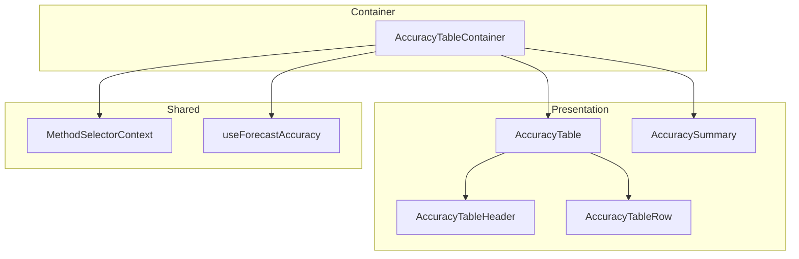
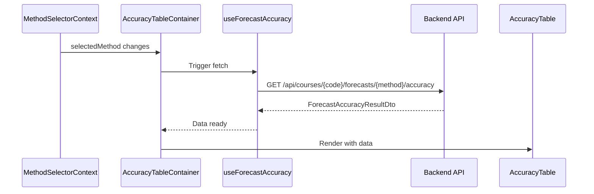

# Frontend Accuracy Table Architecture

## 1. Overview

### 1.1 Problem Statement

When a user selects a forecast method, they need to see:

- Backtesting accuracy data for each historical term
- Summary metrics across all terms
- Visual indicators for over/under predictions
- Easy-to-read comparison between forecast and actual values

### 1.2 Goal

Create an **accuracy table component** that:

- Fetches accuracy data when a method is selected
- Displays a table with one row per historical term
- Shows predicted vs actual enrollment
- Displays accuracy metrics (percentage, error direction)
- Provides summary statistics

### 1.3 Design Principles

1. **Data-Driven**: Table structure driven by API response
2. **Responsive**: Adapts to different screen sizes
3. **Sortable**: Allow sorting by term or accuracy
4. **Accessible**: Screen reader friendly
5. **Visual Clarity**: Clear indicators for accuracy levels

---

## 2. Architecture Overview

### 2.1 Component Hierarchy



### 2.2 Data Flow



---

## 3. Component Design

### 3.1 AccuracyTableContainer

The container component that fetches data and manages state.

```typescript
// Location: apps/frontend/src/components/forecasts/AccuracyTableContainer.tsx

interface AccuracyTableContainerProps {
  /** Course code to fetch accuracy for */
  courseCode: string;

  /** Optional: specific terms to fetch (defaults to all history) */
  terms?: number[];

  /** Optional CSS class */
  className?: string;
}
```

**Responsibilities:**
- Get selected method from context
- Fetch accuracy data via hook
- Handle loading/error states
- Render table and summary

### 3.2 AccuracyTable

The table presentation component.

```typescript
// Location: apps/frontend/src/components/forecasts/AccuracyTable.tsx

interface AccuracyTableProps {
  /** Comparison data for each term */
  comparisons: ComparisonItemDto[];

  /** Method metadata */
  method: { id: string; label: string };

  /** Sort configuration */
  sortBy?: 'term' | 'accuracy' | 'error';
  sortDirection?: 'asc' | 'desc';
  onSort?: (column: string) => void;
}
```

**Responsibilities:**
- Render table header with sortable columns
- Render row for each comparison
- Visual accuracy indicators

### 3.3 AccuracyTableRow

Individual row component.

```typescript
// Location: apps/frontend/src/components/forecasts/AccuracyTableRow.tsx

interface AccuracyTableRowProps {
  /** Comparison data */
  comparison: ComparisonItemDto;

  /** Show detailed breakdown */
  showDetails?: boolean;
}
```

**Responsibilities:**
- Display term, predicted, actual values
- Show accuracy percentage with color coding
- Display error direction indicator

### 3.4 AccuracySummary

Summary metrics component.

```typescript
// Location: apps/frontend/src/components/forecasts/AccuracySummary.tsx

interface AccuracySummaryProps {
  /** Summary metrics */
  summary: SummaryMetricsDto;

  /** Number of terms analyzed */
  termCount: number;
}
```

**Responsibilities:**
- Display average accuracy
- Show MAPE and RMSE
- Display over/under prediction counts

---

## 4. Visual Design

### 4.1 Table Layout

```
┌────────────────────────────────────────────────────────────────────────┐
│  Forecast Accuracy: Potential Students by Prerequisites               │
├──────────┬────────────┬────────────┬──────────────┬───────────────────┤
│  Term ▼  │  Forecast  │   Actual   │   Accuracy   │      Error        │
├──────────┼────────────┼────────────┼──────────────┼───────────────────┤
│  202510  │     45     │     44     │   97.73%  ██ │  +1 (over)    ↑   │
├──────────┼────────────┼────────────┼──────────────┼───────────────────┤
│  202420  │     35     │     40     │   87.50%  █░ │  -5 (under)   ↓   │
├──────────┼────────────┼────────────┼──────────────┼───────────────────┤
│  202410  │     42     │     38     │   89.47%  █░ │  +4 (over)    ↑   │
└──────────┴────────────┴────────────┴──────────────┴───────────────────┘

┌────────────────────────────────────────────────────────────────────────┐
│  Summary                                                               │
├────────────────────────────────────────────────────────────────────────┤
│  Average Accuracy: 91.57%    MAPE: 8.43%    RMSE: 3.42                │
│  Over-predictions: 2    Under-predictions: 1    Exact: 0              │
│  Total Forecast: 122    Total Actual: 122    Net Error: 0             │
└────────────────────────────────────────────────────────────────────────┘
```

### 4.2 Accuracy Indicators

| Accuracy Range | Color | Visual |
|----------------|-------|--------|
| 95-100% | Green | ████████ |
| 85-94% | Yellow | █████░░░ |
| 70-84% | Orange | ████░░░░ |
| < 70% | Red | ██░░░░░░ |

### 4.3 Error Direction Icons

| Direction | Icon | Color |
|-----------|------|-------|
| Over | ↑ | Blue |
| Under | ↓ | Orange |
| Exact | = | Green |

---

## 5. API Integration

### 5.1 Custom Hook

```typescript
// Location: apps/frontend/src/hooks/useForecastAccuracy.ts

interface UseForecastAccuracyOptions {
  courseCode: string;
  methodId: string | null;
  terms?: number[];
  enabled?: boolean;
}

interface UseForecastAccuracyResult {
  data: ForecastAccuracyResultDto | null;
  isLoading: boolean;
  isError: boolean;
  error: Error | null;
  refetch: () => void;
}

function useForecastAccuracy(
  options: UseForecastAccuracyOptions
): UseForecastAccuracyResult;
```

### 5.2 API Client

```typescript
// Location: apps/frontend/src/api/forecast-accuracy.ts

import type { ForecastAccuracyResultDto } from '@app/contracts';

const API_BASE = import.meta.env.VITE_API_URL || '';

export interface FetchAccuracyOptions {
  courseCode: string;
  methodId: string;
  terms?: number[];
}

export async function fetchForecastAccuracy(
  options: FetchAccuracyOptions
): Promise<ForecastAccuracyResultDto> {
  const { courseCode, methodId, terms } = options;

  let url = `${API_BASE}/api/courses/${courseCode}/forecasts/${methodId}/accuracy`;

  if (terms && terms.length > 0) {
    url += `?terms=${terms.join(',')}`;
  }

  const response = await fetch(url);

  if (!response.ok) {
    throw new Error(`Failed to fetch accuracy: ${response.status}`);
  }

  return response.json();
}
```

### 5.3 Getting Terms from Course History

When no specific terms are provided, fetch from course history:

```typescript
// Location: apps/frontend/src/hooks/useCourseTerms.ts

function useCourseTerms(courseCode: string) {
  // Fetch course history and extract terms
  const { data: history } = useCourseHistory(courseCode);

  const terms = useMemo(() => {
    if (!history) return [];
    return history.map(point => point.academicTerm).sort((a, b) => b - a);
  }, [history]);

  return terms;
}
```

---

## 6. State Management

### 6.1 Integration with MethodSelectorContext

```tsx
function AccuracyTableContainer({ courseCode }: { courseCode: string }) {
  const { selectedMethod } = useMethodSelector();
  const terms = useCourseTerms(courseCode);

  const { data, isLoading, error, refetch } = useForecastAccuracy({
    courseCode,
    methodId: selectedMethod?.id ?? null,
    terms,
    enabled: !!selectedMethod && terms.length > 0,
  });

  // ... render logic
}
```

### 6.2 Sorting State

```typescript
interface SortState {
  column: 'term' | 'accuracy' | 'error' | 'forecast' | 'actual';
  direction: 'asc' | 'desc';
}

function useTableSort(initialState: SortState) {
  const [sortState, setSortState] = useState(initialState);

  const toggleSort = (column: SortState['column']) => {
    setSortState(prev => ({
      column,
      direction:
        prev.column === column && prev.direction === 'asc' ? 'desc' : 'asc',
    }));
  };

  return { sortState, toggleSort };
}
```

---

## 7. Responsive Design

### 7.1 Desktop (> 1024px)

Full table with all columns visible.

### 7.2 Tablet (768-1024px)

- Hide RMSE from summary
- Condensed column widths

### 7.3 Mobile (< 768px)

Card-based layout instead of table:

```
┌─────────────────────────────────────┐
│  Term 202510                        │
├─────────────────────────────────────┤
│  Forecast: 45    Actual: 44        │
│  Accuracy: 97.73%  ████████████    │
│  Error: +1 (over) ↑                │
└─────────────────────────────────────┘
┌─────────────────────────────────────┐
│  Term 202420                        │
├─────────────────────────────────────┤
│  Forecast: 35    Actual: 40        │
│  Accuracy: 87.50%  █████████░░     │
│  Error: -5 (under) ↓               │
└─────────────────────────────────────┘
```

---

## 8. Accessibility

### 8.1 Table Semantics

```tsx
<table role="grid" aria-label="Forecast accuracy by term">
  <thead>
    <tr>
      <th scope="col" aria-sort={sortState.column === 'term' ? sortState.direction : 'none'}>
        Term
        <button aria-label="Sort by term">▼</button>
      </th>
      {/* ... other headers */}
    </tr>
  </thead>
  <tbody>
    {comparisons.map(c => (
      <tr key={c.academicTerm}>
        <td>{formatTerm(c.academicTerm)}</td>
        {/* ... other cells */}
      </tr>
    ))}
  </tbody>
</table>
```

### 8.2 Screen Reader Announcements

```tsx
// Announce accuracy with context
<td aria-label={`Accuracy ${c.metrics.accuracyPercentage} percent`}>
  <span aria-hidden="true">
    {c.metrics.accuracyPercentage}%
  </span>
</td>

// Announce error with direction
<td aria-label={`${Math.abs(c.metrics.absoluteError)} students ${c.metrics.errorDirection} predicted`}>
  {/* Visual representation */}
</td>
```

---

## 9. Loading & Error States

### 9.1 Loading State

```tsx
function AccuracyTableSkeleton() {
  return (
    <div className="accuracy-table-skeleton">
      <div className="skeleton-header" />
      {[1, 2, 3, 4, 5].map(i => (
        <div key={i} className="skeleton-row">
          <div className="skeleton-cell" />
          <div className="skeleton-cell" />
          <div className="skeleton-cell" />
          <div className="skeleton-cell" />
        </div>
      ))}
    </div>
  );
}
```

### 9.2 Error State

```tsx
function AccuracyTableError({ error, onRetry }: { error: Error; onRetry: () => void }) {
  return (
    <div className="accuracy-table-error">
      <AlertIcon />
      <h3>Failed to load accuracy data</h3>
      <p>{error.message}</p>
      <button onClick={onRetry}>Try Again</button>
    </div>
  );
}
```

### 9.3 No Method Selected

```tsx
function AccuracyTableEmpty() {
  return (
    <div className="accuracy-table-empty">
      <InfoIcon />
      <h3>Select a forecast method</h3>
      <p>Choose a method from the right panel to view accuracy data.</p>
    </div>
  );
}
```

### 9.4 No Data for Terms

```tsx
function AccuracyTableNoData({ termsWithoutData }: { termsWithoutData: number[] }) {
  return (
    <div className="accuracy-table-notice">
      <InfoIcon />
      <p>
        No enrollment data available for terms:{' '}
        {termsWithoutData.map(formatTerm).join(', ')}
      </p>
    </div>
  );
}
```

---

## 10. Performance Considerations

### 10.1 Caching

```typescript
// React Query configuration
useQuery({
  queryKey: ['forecast-accuracy', courseCode, methodId, terms],
  queryFn: () => fetchForecastAccuracy({ courseCode, methodId, terms }),
  staleTime: 1000 * 60 * 5, // 5 minutes
  refetchOnWindowFocus: false,
});
```

### 10.2 Memoization

```typescript
// Memoize sorted data
const sortedComparisons = useMemo(() => {
  if (!data?.comparisons) return [];

  return [...data.comparisons].sort((a, b) => {
    const multiplier = sortState.direction === 'asc' ? 1 : -1;

    switch (sortState.column) {
      case 'term':
        return (a.academicTerm - b.academicTerm) * multiplier;
      case 'accuracy':
        return (a.metrics.accuracyPercentage - b.metrics.accuracyPercentage) * multiplier;
      default:
        return 0;
    }
  });
}, [data?.comparisons, sortState]);
```

### 10.3 Virtualization (for many terms)

If displaying > 50 terms, consider virtualization:

```tsx
import { useVirtualizer } from '@tanstack/react-virtual';

function VirtualizedAccuracyTable({ comparisons }) {
  const parentRef = useRef<HTMLDivElement>(null);

  const rowVirtualizer = useVirtualizer({
    count: comparisons.length,
    getScrollElement: () => parentRef.current,
    estimateSize: () => 48,
  });

  // ... virtual rendering
}
```

---

## 11. Data Export (Future)

### 11.1 CSV Export

```typescript
function exportToCSV(data: ForecastAccuracyResultDto) {
  const headers = ['Term', 'Forecast', 'Actual', 'Accuracy %', 'Error', 'Direction'];
  const rows = data.comparisons.map(c => [
    c.academicTerm,
    c.forecast.predictedEnrollment,
    c.actual.realEnrollment,
    c.metrics.accuracyPercentage,
    c.metrics.absoluteError,
    c.metrics.errorDirection,
  ]);

  const csv = [headers, ...rows]
    .map(row => row.join(','))
    .join('\n');

  downloadFile(csv, `accuracy-${data.courseCode}-${data.method.id}.csv`);
}
```

---

## 12. Related Documents

- [Get Forecast Methods](../get-forecast-methods/architecture.md)
- [Frontend Method Selector](../frontend-method-selector/architecture.md)
- [Forecast Accuracy & Backtesting (Backend)](../forecast-accuracy-backtesting/architecture.md)
- [Implementation Guide](./implementation-guide.md)
