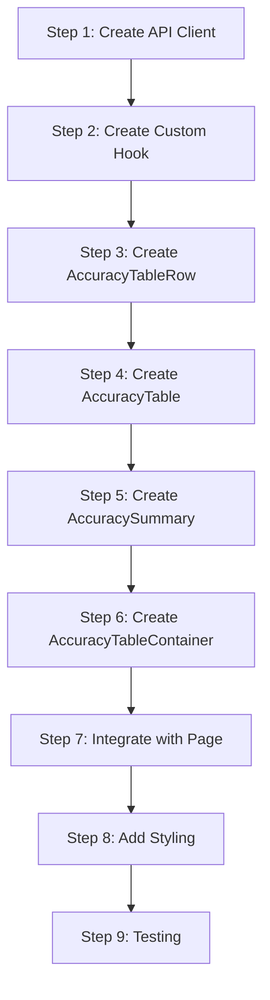

# Frontend Accuracy Table - Implementation Guide

## Overview

This guide provides step-by-step instructions for implementing the accuracy table component that displays forecast backtesting results.

---

## Prerequisites

Before starting, ensure:

- Backend [Forecast Accuracy & Backtesting](../forecast-accuracy-backtesting/implementation-guide.md) API is implemented
- [Frontend Method Selector](../frontend-method-selector/implementation-guide.md) is implemented
- [Architecture Document](./architecture.md) is reviewed

---

## Implementation Steps



---

## Step 1: Create API Client

### 1.1 Create Types

**Location**: `apps/frontend/src/types/forecast-accuracy.ts`

```typescript
export interface AccuracyMetrics {
  accuracyPercentage: number;
  absoluteError: number;
  errorDirection: 'over' | 'under' | 'exact';
  studentsOff: number;
  errorPercentage: number;
}

export interface ComparisonItem {
  academicTerm: number;
  forecast: {
    predictedEnrollment: number;
    generatedAt?: string;
  };
  actual: {
    realEnrollment: number;
    dataSource: 'enrollments' | 'external';
  };
  metrics: AccuracyMetrics;
}

export interface SummaryMetrics {
  averageAccuracy: number;
  totalPredicted: number;
  totalActual: number;
  overallError: number;
  mape: number;
  rmse: number;
  overPredictions: number;
  underPredictions: number;
  exactPredictions: number;
}

export interface ForecastAccuracyResult {
  courseCode: string;
  method: {
    id: string;
    label: string;
  };
  comparisons: ComparisonItem[];
  summary: SummaryMetrics;
  metadata: {
    requestedTerms: number[];
    processedAt: string;
    termsWithData: number;
    termsWithoutData?: number[];
  };
}
```

### 1.2 Create API Client

**Location**: `apps/frontend/src/api/forecast-accuracy.ts`

```typescript
import type { ForecastAccuracyResult } from '../types/forecast-accuracy';

const API_BASE = import.meta.env.VITE_API_URL || '';

export interface FetchAccuracyOptions {
  courseCode: string;
  methodId: string;
  terms?: number[];
}

export async function fetchForecastAccuracy(
  options: FetchAccuracyOptions
): Promise<ForecastAccuracyResult> {
  const { courseCode, methodId, terms } = options;

  let url = `${API_BASE}/api/courses/${courseCode}/forecasts/${methodId}/accuracy`;

  if (terms && terms.length > 0) {
    url += `?terms=${terms.join(',')}`;
  }

  const response = await fetch(url);

  if (!response.ok) {
    if (response.status === 404) {
      throw new Error('Course or method not found');
    }
    throw new Error(`Failed to fetch accuracy data: ${response.status}`);
  }

  return response.json();
}
```

---

## Step 2: Create Custom Hook

### 2.1 Using React Query

**Location**: `apps/frontend/src/hooks/useForecastAccuracy.ts`

```typescript
import { useQuery } from '@tanstack/react-query';
import {
  fetchForecastAccuracy,
  type FetchAccuracyOptions,
} from '../api/forecast-accuracy';
import type { ForecastAccuracyResult } from '../types/forecast-accuracy';

export interface UseForecastAccuracyOptions {
  courseCode: string;
  methodId: string | null;
  terms?: number[];
  enabled?: boolean;
}

export interface UseForecastAccuracyResult {
  data: ForecastAccuracyResult | null;
  isLoading: boolean;
  isError: boolean;
  error: Error | null;
  refetch: () => void;
}

export function useForecastAccuracy(
  options: UseForecastAccuracyOptions
): UseForecastAccuracyResult {
  const { courseCode, methodId, terms, enabled = true } = options;

  const query = useQuery({
    queryKey: ['forecast-accuracy', courseCode, methodId, terms],
    queryFn: () =>
      fetchForecastAccuracy({
        courseCode,
        methodId: methodId!,
        terms,
      }),
    enabled: enabled && !!methodId,
    staleTime: 1000 * 60 * 5, // 5 minutes
    refetchOnWindowFocus: false,
  });

  return {
    data: query.data ?? null,
    isLoading: query.isLoading,
    isError: query.isError,
    error: query.error,
    refetch: query.refetch,
  };
}
```

### 2.2 Hook for Course Terms

**Location**: `apps/frontend/src/hooks/useCourseTerms.ts`

```typescript
import { useMemo } from 'react';
import { useCourseHistory } from './useCourseHistory';

export function useCourseTerms(courseCode: string): number[] {
  const { data: history } = useCourseHistory(courseCode);

  return useMemo(() => {
    if (!history?.points) return [];
    return history.points
      .map(point => point.academicTerm)
      .sort((a, b) => b - a); // Descending (newest first)
  }, [history]);
}
```

---

## Step 3: Create AccuracyTableRow

**Location**: `apps/frontend/src/components/forecasts/AccuracyTableRow.tsx`

```tsx
import React from 'react';
import type { ComparisonItem } from '../../types/forecast-accuracy';
import { formatTerm } from '../../utils/formatters';
import './AccuracyTableRow.css';

interface AccuracyTableRowProps {
  comparison: ComparisonItem;
}

function getAccuracyClass(accuracy: number): string {
  if (accuracy >= 95) return 'accuracy-excellent';
  if (accuracy >= 85) return 'accuracy-good';
  if (accuracy >= 70) return 'accuracy-fair';
  return 'accuracy-poor';
}

function ErrorDirectionIcon({ direction }: { direction: 'over' | 'under' | 'exact' }) {
  switch (direction) {
    case 'over':
      return <span className="error-icon error-icon--over" aria-hidden="true">↑</span>;
    case 'under':
      return <span className="error-icon error-icon--under" aria-hidden="true">↓</span>;
    case 'exact':
      return <span className="error-icon error-icon--exact" aria-hidden="true">=</span>;
  }
}

function AccuracyBar({ accuracy }: { accuracy: number }) {
  const width = Math.min(100, Math.max(0, accuracy));
  return (
    <div className="accuracy-bar" aria-hidden="true">
      <div
        className={`accuracy-bar__fill ${getAccuracyClass(accuracy)}`}
        style={{ width: `${width}%` }}
      />
    </div>
  );
}

export function AccuracyTableRow({ comparison }: AccuracyTableRowProps) {
  const { academicTerm, forecast, actual, metrics } = comparison;

  return (
    <tr className="accuracy-row">
      <td className="accuracy-row__term">
        {formatTerm(academicTerm)}
      </td>
      <td className="accuracy-row__forecast">
        {forecast.predictedEnrollment}
      </td>
      <td className="accuracy-row__actual">
        {actual.realEnrollment}
      </td>
      <td
        className="accuracy-row__accuracy"
        aria-label={`${metrics.accuracyPercentage} percent accuracy`}
      >
        <div className="accuracy-row__accuracy-content">
          <span className="accuracy-row__accuracy-value">
            {metrics.accuracyPercentage.toFixed(1)}%
          </span>
          <AccuracyBar accuracy={metrics.accuracyPercentage} />
        </div>
      </td>
      <td
        className="accuracy-row__error"
        aria-label={`${metrics.studentsOff} students ${metrics.errorDirection} predicted`}
      >
        <span className={`error-value error-value--${metrics.errorDirection}`}>
          {metrics.errorDirection === 'under' ? '-' : '+'}
          {metrics.studentsOff}
        </span>
        <span className="error-label">({metrics.errorDirection})</span>
        <ErrorDirectionIcon direction={metrics.errorDirection} />
      </td>
    </tr>
  );
}
```

### 3.1 AccuracyTableRow Styles

**Location**: `apps/frontend/src/components/forecasts/AccuracyTableRow.css`

```css
.accuracy-row {
  border-bottom: 1px solid var(--color-border, #e2e8f0);
}

.accuracy-row:hover {
  background-color: var(--color-surface-hover, #f8fafc);
}

.accuracy-row td {
  padding: 0.75rem 1rem;
  vertical-align: middle;
}

.accuracy-row__term {
  font-weight: 500;
  white-space: nowrap;
}

.accuracy-row__forecast,
.accuracy-row__actual {
  text-align: right;
  font-family: var(--font-mono, monospace);
}

.accuracy-row__accuracy-content {
  display: flex;
  align-items: center;
  gap: 0.5rem;
}

.accuracy-row__accuracy-value {
  min-width: 4rem;
  text-align: right;
  font-weight: 500;
}

/* Accuracy bar */
.accuracy-bar {
  flex: 1;
  height: 0.5rem;
  background: var(--color-border, #e2e8f0);
  border-radius: 0.25rem;
  overflow: hidden;
  min-width: 4rem;
  max-width: 8rem;
}

.accuracy-bar__fill {
  height: 100%;
  border-radius: 0.25rem;
  transition: width 0.3s ease;
}

.accuracy-bar__fill.accuracy-excellent {
  background: var(--color-success, #16a34a);
}

.accuracy-bar__fill.accuracy-good {
  background: var(--color-warning, #d97706);
}

.accuracy-bar__fill.accuracy-fair {
  background: var(--color-orange, #ea580c);
}

.accuracy-bar__fill.accuracy-poor {
  background: var(--color-error, #dc2626);
}

/* Error column */
.accuracy-row__error {
  display: flex;
  align-items: center;
  gap: 0.5rem;
}

.error-value {
  font-weight: 500;
  font-family: var(--font-mono, monospace);
}

.error-value--over {
  color: var(--color-info, #2563eb);
}

.error-value--under {
  color: var(--color-warning, #d97706);
}

.error-value--exact {
  color: var(--color-success, #16a34a);
}

.error-label {
  font-size: 0.75rem;
  color: var(--color-text-secondary, #64748b);
}

.error-icon {
  font-size: 1rem;
}

.error-icon--over {
  color: var(--color-info, #2563eb);
}

.error-icon--under {
  color: var(--color-warning, #d97706);
}

.error-icon--exact {
  color: var(--color-success, #16a34a);
}
```

---

## Step 4: Create AccuracyTable

**Location**: `apps/frontend/src/components/forecasts/AccuracyTable.tsx`

```tsx
import React, { useState, useMemo } from 'react';
import type { ComparisonItem } from '../../types/forecast-accuracy';
import { AccuracyTableRow } from './AccuracyTableRow';
import './AccuracyTable.css';

type SortColumn = 'term' | 'forecast' | 'actual' | 'accuracy' | 'error';
type SortDirection = 'asc' | 'desc';

interface AccuracyTableProps {
  comparisons: ComparisonItem[];
  method: { id: string; label: string };
}

function SortIndicator({
  active,
  direction,
}: {
  active: boolean;
  direction: SortDirection;
}) {
  if (!active) return <span className="sort-indicator">⇅</span>;
  return (
    <span className="sort-indicator sort-indicator--active">
      {direction === 'asc' ? '↑' : '↓'}
    </span>
  );
}

export function AccuracyTable({ comparisons, method }: AccuracyTableProps) {
  const [sortColumn, setSortColumn] = useState<SortColumn>('term');
  const [sortDirection, setSortDirection] = useState<SortDirection>('desc');

  const handleSort = (column: SortColumn) => {
    if (sortColumn === column) {
      setSortDirection(prev => (prev === 'asc' ? 'desc' : 'asc'));
    } else {
      setSortColumn(column);
      setSortDirection('desc');
    }
  };

  const sortedComparisons = useMemo(() => {
    return [...comparisons].sort((a, b) => {
      const multiplier = sortDirection === 'asc' ? 1 : -1;

      switch (sortColumn) {
        case 'term':
          return (a.academicTerm - b.academicTerm) * multiplier;
        case 'forecast':
          return (a.forecast.predictedEnrollment - b.forecast.predictedEnrollment) * multiplier;
        case 'actual':
          return (a.actual.realEnrollment - b.actual.realEnrollment) * multiplier;
        case 'accuracy':
          return (a.metrics.accuracyPercentage - b.metrics.accuracyPercentage) * multiplier;
        case 'error':
          return (a.metrics.absoluteError - b.metrics.absoluteError) * multiplier;
        default:
          return 0;
      }
    });
  }, [comparisons, sortColumn, sortDirection]);

  return (
    <div className="accuracy-table-wrapper">
      <h2 className="accuracy-table__title">
        Accuracy: {method.label}
      </h2>
      <table
        className="accuracy-table"
        role="grid"
        aria-label={`Forecast accuracy for ${method.label}`}
      >
        <thead>
          <tr>
            <th
              scope="col"
              className="accuracy-table__header"
              aria-sort={sortColumn === 'term' ? (sortDirection === 'asc' ? 'ascending' : 'descending') : 'none'}
            >
              <button
                className="accuracy-table__sort-btn"
                onClick={() => handleSort('term')}
              >
                Term
                <SortIndicator active={sortColumn === 'term'} direction={sortDirection} />
              </button>
            </th>
            <th
              scope="col"
              className="accuracy-table__header accuracy-table__header--right"
              aria-sort={sortColumn === 'forecast' ? (sortDirection === 'asc' ? 'ascending' : 'descending') : 'none'}
            >
              <button
                className="accuracy-table__sort-btn"
                onClick={() => handleSort('forecast')}
              >
                Forecast
                <SortIndicator active={sortColumn === 'forecast'} direction={sortDirection} />
              </button>
            </th>
            <th
              scope="col"
              className="accuracy-table__header accuracy-table__header--right"
              aria-sort={sortColumn === 'actual' ? (sortDirection === 'asc' ? 'ascending' : 'descending') : 'none'}
            >
              <button
                className="accuracy-table__sort-btn"
                onClick={() => handleSort('actual')}
              >
                Actual
                <SortIndicator active={sortColumn === 'actual'} direction={sortDirection} />
              </button>
            </th>
            <th
              scope="col"
              className="accuracy-table__header"
              aria-sort={sortColumn === 'accuracy' ? (sortDirection === 'asc' ? 'ascending' : 'descending') : 'none'}
            >
              <button
                className="accuracy-table__sort-btn"
                onClick={() => handleSort('accuracy')}
              >
                Accuracy
                <SortIndicator active={sortColumn === 'accuracy'} direction={sortDirection} />
              </button>
            </th>
            <th
              scope="col"
              className="accuracy-table__header"
              aria-sort={sortColumn === 'error' ? (sortDirection === 'asc' ? 'ascending' : 'descending') : 'none'}
            >
              <button
                className="accuracy-table__sort-btn"
                onClick={() => handleSort('error')}
              >
                Error
                <SortIndicator active={sortColumn === 'error'} direction={sortDirection} />
              </button>
            </th>
          </tr>
        </thead>
        <tbody>
          {sortedComparisons.map(comparison => (
            <AccuracyTableRow
              key={comparison.academicTerm}
              comparison={comparison}
            />
          ))}
        </tbody>
      </table>
    </div>
  );
}
```

### 4.1 AccuracyTable Styles

**Location**: `apps/frontend/src/components/forecasts/AccuracyTable.css`

```css
.accuracy-table-wrapper {
  overflow-x: auto;
}

.accuracy-table__title {
  font-size: 1.125rem;
  font-weight: 600;
  margin: 0 0 1rem 0;
  color: var(--color-text, #1e293b);
}

.accuracy-table {
  width: 100%;
  border-collapse: collapse;
  font-size: 0.875rem;
}

.accuracy-table__header {
  text-align: left;
  padding: 0.75rem 1rem;
  border-bottom: 2px solid var(--color-border, #e2e8f0);
  background: var(--color-surface, #ffffff);
  position: sticky;
  top: 0;
}

.accuracy-table__header--right {
  text-align: right;
}

.accuracy-table__sort-btn {
  display: inline-flex;
  align-items: center;
  gap: 0.25rem;
  background: none;
  border: none;
  font: inherit;
  font-weight: 600;
  color: var(--color-text, #1e293b);
  cursor: pointer;
  padding: 0;
}

.accuracy-table__sort-btn:hover {
  color: var(--color-primary, #3b82f6);
}

.sort-indicator {
  font-size: 0.75rem;
  color: var(--color-text-tertiary, #94a3b8);
}

.sort-indicator--active {
  color: var(--color-primary, #3b82f6);
}

/* Responsive */
@media (max-width: 768px) {
  .accuracy-table {
    font-size: 0.75rem;
  }

  .accuracy-table__header,
  .accuracy-row td {
    padding: 0.5rem;
  }
}
```

---

## Step 5: Create AccuracySummary

**Location**: `apps/frontend/src/components/forecasts/AccuracySummary.tsx`

```tsx
import React from 'react';
import type { SummaryMetrics } from '../../types/forecast-accuracy';
import './AccuracySummary.css';

interface AccuracySummaryProps {
  summary: SummaryMetrics;
  termCount: number;
}

function MetricCard({
  label,
  value,
  suffix,
  highlight,
}: {
  label: string;
  value: number | string;
  suffix?: string;
  highlight?: boolean;
}) {
  return (
    <div className={`metric-card ${highlight ? 'metric-card--highlight' : ''}`}>
      <span className="metric-card__value">
        {value}
        {suffix && <span className="metric-card__suffix">{suffix}</span>}
      </span>
      <span className="metric-card__label">{label}</span>
    </div>
  );
}

export function AccuracySummary({ summary, termCount }: AccuracySummaryProps) {
  return (
    <div className="accuracy-summary">
      <h3 className="accuracy-summary__title">Summary</h3>

      <div className="accuracy-summary__grid">
        {/* Primary metrics */}
        <div className="accuracy-summary__section">
          <MetricCard
            label="Average Accuracy"
            value={summary.averageAccuracy.toFixed(1)}
            suffix="%"
            highlight
          />
          <MetricCard
            label="MAPE"
            value={summary.mape.toFixed(2)}
            suffix="%"
          />
          <MetricCard
            label="RMSE"
            value={summary.rmse.toFixed(2)}
          />
        </div>

        {/* Prediction direction */}
        <div className="accuracy-summary__section">
          <MetricCard
            label="Over-predictions"
            value={summary.overPredictions}
          />
          <MetricCard
            label="Under-predictions"
            value={summary.underPredictions}
          />
          <MetricCard
            label="Exact"
            value={summary.exactPredictions}
          />
        </div>

        {/* Totals */}
        <div className="accuracy-summary__section">
          <MetricCard
            label="Total Forecast"
            value={summary.totalPredicted}
          />
          <MetricCard
            label="Total Actual"
            value={summary.totalActual}
          />
          <MetricCard
            label="Net Error"
            value={summary.overallError > 0 ? `+${summary.overallError}` : summary.overallError}
          />
        </div>
      </div>

      <p className="accuracy-summary__note">
        Based on {termCount} academic term{termCount !== 1 ? 's' : ''}
      </p>
    </div>
  );
}
```

### 5.1 AccuracySummary Styles

**Location**: `apps/frontend/src/components/forecasts/AccuracySummary.css`

```css
.accuracy-summary {
  margin-top: 1.5rem;
  padding: 1.5rem;
  background: var(--color-surface-alt, #f8fafc);
  border-radius: 0.5rem;
  border: 1px solid var(--color-border, #e2e8f0);
}

.accuracy-summary__title {
  font-size: 1rem;
  font-weight: 600;
  margin: 0 0 1rem 0;
  color: var(--color-text, #1e293b);
}

.accuracy-summary__grid {
  display: flex;
  flex-wrap: wrap;
  gap: 1.5rem;
}

.accuracy-summary__section {
  display: flex;
  gap: 1rem;
}

.metric-card {
  display: flex;
  flex-direction: column;
  gap: 0.25rem;
  min-width: 5rem;
}

.metric-card--highlight {
  padding: 0.75rem;
  background: var(--color-primary-bg, #eff6ff);
  border-radius: 0.375rem;
}

.metric-card__value {
  font-size: 1.25rem;
  font-weight: 700;
  color: var(--color-text, #1e293b);
  font-family: var(--font-mono, monospace);
}

.metric-card--highlight .metric-card__value {
  color: var(--color-primary, #3b82f6);
}

.metric-card__suffix {
  font-size: 0.875rem;
  font-weight: 500;
}

.metric-card__label {
  font-size: 0.75rem;
  color: var(--color-text-secondary, #64748b);
}

.accuracy-summary__note {
  margin: 1rem 0 0 0;
  font-size: 0.75rem;
  color: var(--color-text-tertiary, #94a3b8);
}

/* Responsive */
@media (max-width: 768px) {
  .accuracy-summary__grid {
    flex-direction: column;
  }

  .accuracy-summary__section {
    flex-wrap: wrap;
  }
}
```

---

## Step 6: Create AccuracyTableContainer

**Location**: `apps/frontend/src/components/forecasts/AccuracyTableContainer.tsx`

```tsx
import React from 'react';
import { useMethodSelector } from '../../contexts/MethodSelectorContext';
import { useForecastAccuracy } from '../../hooks/useForecastAccuracy';
import { useCourseTerms } from '../../hooks/useCourseTerms';
import { AccuracyTable } from './AccuracyTable';
import { AccuracySummary } from './AccuracySummary';
import './AccuracyTableContainer.css';

interface AccuracyTableContainerProps {
  courseCode: string;
  className?: string;
}

function LoadingSkeleton() {
  return (
    <div className="accuracy-container__skeleton">
      <div className="skeleton-title" />
      <div className="skeleton-table">
        {[1, 2, 3, 4, 5].map(i => (
          <div key={i} className="skeleton-row">
            <div className="skeleton-cell" />
            <div className="skeleton-cell" />
            <div className="skeleton-cell" />
            <div className="skeleton-cell" />
          </div>
        ))}
      </div>
    </div>
  );
}

function ErrorState({
  error,
  onRetry,
}: {
  error: Error;
  onRetry: () => void;
}) {
  return (
    <div className="accuracy-container__error">
      <span className="accuracy-container__error-icon">⚠️</span>
      <h3>Failed to load accuracy data</h3>
      <p>{error.message}</p>
      <button className="accuracy-container__retry-btn" onClick={onRetry}>
        Try Again
      </button>
    </div>
  );
}

function EmptyState() {
  return (
    <div className="accuracy-container__empty">
      <span className="accuracy-container__empty-icon">📊</span>
      <h3>Select a forecast method</h3>
      <p>Choose a method from the right panel to view accuracy data.</p>
    </div>
  );
}

function NoDataNotice({ termsWithoutData }: { termsWithoutData: number[] }) {
  const formatTerm = (term: number) => {
    const year = Math.floor(term / 100);
    const period = term % 100;
    return `${year}-${period}`;
  };

  return (
    <div className="accuracy-container__notice">
      <span>ℹ️</span>
      <p>
        No enrollment data for:{' '}
        {termsWithoutData.map(formatTerm).join(', ')}
      </p>
    </div>
  );
}

export function AccuracyTableContainer({
  courseCode,
  className = '',
}: AccuracyTableContainerProps) {
  const { selectedMethod } = useMethodSelector();
  const terms = useCourseTerms(courseCode);

  const { data, isLoading, error, refetch } = useForecastAccuracy({
    courseCode,
    methodId: selectedMethod?.id ?? null,
    terms,
    enabled: !!selectedMethod && terms.length > 0,
  });

  if (!selectedMethod) {
    return (
      <div className={`accuracy-container ${className}`}>
        <EmptyState />
      </div>
    );
  }

  if (isLoading) {
    return (
      <div className={`accuracy-container ${className}`}>
        <LoadingSkeleton />
      </div>
    );
  }

  if (error) {
    return (
      <div className={`accuracy-container ${className}`}>
        <ErrorState error={error} onRetry={refetch} />
      </div>
    );
  }

  if (!data || data.comparisons.length === 0) {
    return (
      <div className={`accuracy-container ${className}`}>
        <div className="accuracy-container__no-data">
          <span>📭</span>
          <h3>No accuracy data available</h3>
          <p>There is no historical data to compare with forecasts.</p>
        </div>
      </div>
    );
  }

  return (
    <div className={`accuracy-container ${className}`}>
      <AccuracyTable
        comparisons={data.comparisons}
        method={data.method}
      />

      {data.metadata.termsWithoutData && data.metadata.termsWithoutData.length > 0 && (
        <NoDataNotice termsWithoutData={data.metadata.termsWithoutData} />
      )}

      <AccuracySummary
        summary={data.summary}
        termCount={data.comparisons.length}
      />
    </div>
  );
}
```

### 6.1 AccuracyTableContainer Styles

**Location**: `apps/frontend/src/components/forecasts/AccuracyTableContainer.css`

```css
.accuracy-container {
  padding: 1.5rem;
}

/* Loading skeleton */
.accuracy-container__skeleton {
  display: flex;
  flex-direction: column;
  gap: 1rem;
}

.skeleton-title {
  width: 60%;
  height: 1.5rem;
  background: var(--color-skeleton, #e2e8f0);
  border-radius: 0.25rem;
  animation: skeleton-pulse 1.5s ease-in-out infinite;
}

.skeleton-table {
  display: flex;
  flex-direction: column;
  gap: 0.5rem;
}

.skeleton-row {
  display: flex;
  gap: 1rem;
}

.skeleton-cell {
  flex: 1;
  height: 2rem;
  background: var(--color-skeleton, #e2e8f0);
  border-radius: 0.25rem;
  animation: skeleton-pulse 1.5s ease-in-out infinite;
}

@keyframes skeleton-pulse {
  0%, 100% { opacity: 1; }
  50% { opacity: 0.5; }
}

/* Empty state */
.accuracy-container__empty,
.accuracy-container__no-data {
  display: flex;
  flex-direction: column;
  align-items: center;
  gap: 0.5rem;
  padding: 3rem 1rem;
  text-align: center;
  color: var(--color-text-secondary, #64748b);
}

.accuracy-container__empty-icon {
  font-size: 3rem;
}

.accuracy-container__empty h3,
.accuracy-container__no-data h3 {
  margin: 0;
  color: var(--color-text, #1e293b);
}

.accuracy-container__empty p,
.accuracy-container__no-data p {
  margin: 0;
}

/* Error state */
.accuracy-container__error {
  display: flex;
  flex-direction: column;
  align-items: center;
  gap: 0.5rem;
  padding: 3rem 1rem;
  text-align: center;
}

.accuracy-container__error-icon {
  font-size: 3rem;
}

.accuracy-container__error h3 {
  margin: 0;
  color: var(--color-text, #1e293b);
}

.accuracy-container__error p {
  margin: 0;
  color: var(--color-error, #dc2626);
}

.accuracy-container__retry-btn {
  margin-top: 0.5rem;
  padding: 0.5rem 1rem;
  background: var(--color-primary, #3b82f6);
  color: white;
  border: none;
  border-radius: 0.375rem;
  cursor: pointer;
}

.accuracy-container__retry-btn:hover {
  background: var(--color-primary-dark, #2563eb);
}

/* Notice */
.accuracy-container__notice {
  display: flex;
  align-items: center;
  gap: 0.5rem;
  margin-top: 1rem;
  padding: 0.75rem 1rem;
  background: var(--color-warning-bg, #fef3c7);
  border-radius: 0.375rem;
  font-size: 0.875rem;
  color: var(--color-warning-text, #92400e);
}

.accuracy-container__notice p {
  margin: 0;
}
```

---

## Step 7: Utility Functions

**Location**: `apps/frontend/src/utils/formatters.ts`

```typescript
/**
 * Format academic term for display
 * e.g., 202410 -> "2024-10" or "2024 Spring"
 */
export function formatTerm(term: number): string {
  const year = Math.floor(term / 100);
  const period = term % 100;

  // Option 1: Simple format
  return `${year}-${period.toString().padStart(2, '0')}`;

  // Option 2: With period names (uncomment if preferred)
  // const periodNames: Record<number, string> = {
  //   10: 'Spring',
  //   20: 'Summer',
  //   30: 'Fall',
  // };
  // return `${year} ${periodNames[period] ?? period}`;
}

/**
 * Format percentage with specified decimals
 */
export function formatPercent(value: number, decimals = 1): string {
  return `${value.toFixed(decimals)}%`;
}

/**
 * Format number with sign
 */
export function formatWithSign(value: number): string {
  if (value > 0) return `+${value}`;
  return value.toString();
}
```

---

## Step 8: Update CourseAccuracyPage

**Location**: `apps/frontend/src/pages/CourseAccuracyPage.tsx`

```tsx
import React from 'react';
import { useParams } from 'react-router-dom';
import { MethodSelectorProvider } from '../contexts/MethodSelectorContext';
import { MethodSelectorPanel } from '../components/forecasts/MethodSelectorPanel';
import { AccuracyTableContainer } from '../components/forecasts/AccuracyTableContainer';
import './CourseAccuracyPage.css';

export function CourseAccuracyPage() {
  const { courseCode } = useParams<{ courseCode: string }>();

  if (!courseCode) {
    return (
      <div className="course-accuracy-page">
        <div className="course-accuracy-page__error">
          Course code is required
        </div>
      </div>
    );
  }

  return (
    <MethodSelectorProvider backtestingOnly>
      <div className="course-accuracy-page">
        <main className="course-accuracy-page__main">
          <header className="course-accuracy-page__header">
            <h1>Forecast Accuracy</h1>
            <p className="course-accuracy-page__subtitle">
              Course: <strong>{courseCode}</strong>
            </p>
          </header>
          <AccuracyTableContainer courseCode={courseCode} />
        </main>
        <aside className="course-accuracy-page__sidebar">
          <MethodSelectorPanel />
        </aside>
      </div>
    </MethodSelectorProvider>
  );
}
```

---

## Step 9: Testing

### 9.1 Run Tests

```bash
# Unit tests
npm run test

# E2E tests
npm run test:e2e
```

### 9.2 Manual Testing

```bash
# Start dev server
npm run dev

# Navigate to accuracy page
# http://localhost:5173/courses/ISIS-3204/accuracy
```

---

## File Summary

### New Files to Create

| File | Purpose |
|------|---------|
| `src/types/forecast-accuracy.ts` | TypeScript types |
| `src/api/forecast-accuracy.ts` | API client |
| `src/hooks/useForecastAccuracy.ts` | Data fetching hook |
| `src/hooks/useCourseTerms.ts` | Terms extraction hook |
| `src/components/forecasts/AccuracyTableRow.tsx` | Row component |
| `src/components/forecasts/AccuracyTableRow.css` | Row styles |
| `src/components/forecasts/AccuracyTable.tsx` | Table component |
| `src/components/forecasts/AccuracyTable.css` | Table styles |
| `src/components/forecasts/AccuracySummary.tsx` | Summary component |
| `src/components/forecasts/AccuracySummary.css` | Summary styles |
| `src/components/forecasts/AccuracyTableContainer.tsx` | Container |
| `src/components/forecasts/AccuracyTableContainer.css` | Container styles |
| `src/utils/formatters.ts` | Utility functions |

---

## Checklist

- [ ] Step 1: Create API Client
- [ ] Step 2: Create Custom Hook
- [ ] Step 3: Create AccuracyTableRow
- [ ] Step 4: Create AccuracyTable
- [ ] Step 5: Create AccuracySummary
- [ ] Step 6: Create AccuracyTableContainer
- [ ] Step 7: Create Utility Functions
- [ ] Step 8: Update CourseAccuracyPage
- [ ] Step 9: Testing

---

## Related Documents

- [Architecture Document](./architecture.md)
- [Frontend Method Selector](../frontend-method-selector/architecture.md)
- [Forecast Accuracy & Backtesting](../forecast-accuracy-backtesting/architecture.md)
