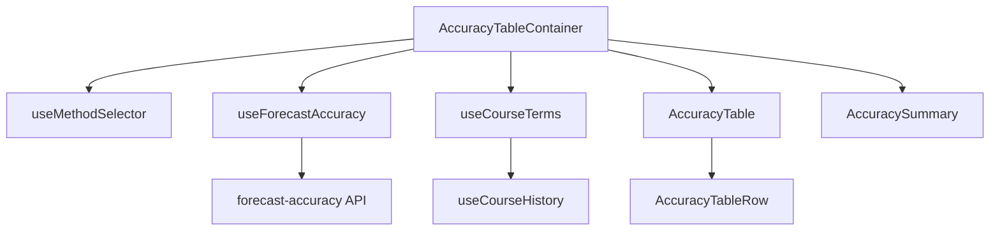
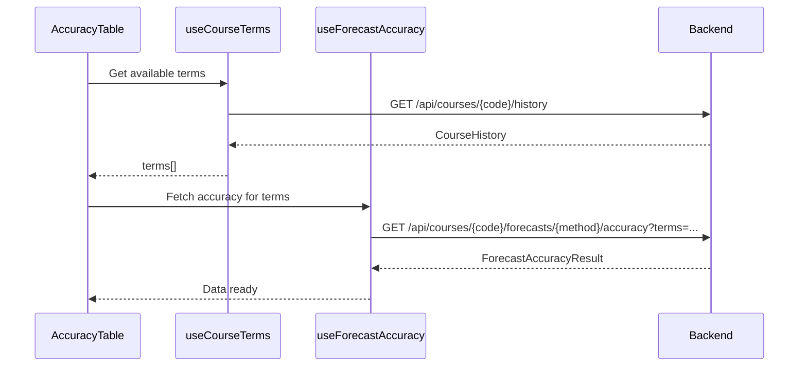

# Frontend Accuracy Table - System Impact

## Overview

This document describes the impact of the Frontend Accuracy Table feature on the existing system.

---

## 1. New Components

### 1.1 Types

| Component | Description |
|-----------|-------------|
| `types/forecast-accuracy.ts` | TypeScript interfaces for accuracy data |

### 1.2 API Layer

| Component | Description |
|-----------|-------------|
| `api/forecast-accuracy.ts` | API client for accuracy endpoint |

### 1.3 Hooks

| Component | Description |
|-----------|-------------|
| `hooks/useForecastAccuracy.ts` | Data fetching hook |
| `hooks/useCourseTerms.ts` | Terms extraction hook |

### 1.4 Components

| Component | Description |
|-----------|-------------|
| `AccuracyTableRow.tsx` | Individual row component |
| `AccuracyTable.tsx` | Main table component |
| `AccuracySummary.tsx` | Summary metrics display |
| `AccuracyTableContainer.tsx` | Container with data fetching |

### 1.5 Utilities

| Component | Description |
|-----------|-------------|
| `utils/formatters.ts` | Formatting utilities |

---

## 2. Modified Components

### 2.1 Pages

| File | Changes |
|------|---------|
| `CourseAccuracyPage.tsx` | Add AccuracyTableContainer |

---

## 3. Dependencies

### 3.1 Internal Dependencies



### 3.2 Context Dependencies

| Context | Used By |
|---------|---------|
| `MethodSelectorContext` | AccuracyTableContainer |

---

## 4. Backend Dependencies

### 4.1 Required Endpoints

| Endpoint | Use Case |
|----------|----------|
| `GET /api/courses/{code}/forecasts/{method}/accuracy` | Fetch accuracy data |
| `GET /api/courses/{code}/history` | Get available terms |

### 4.2 Data Flow



---

## 5. State Management Impact

### 5.1 Data Flow

1. **MethodSelectorContext**: Provides selected method
2. **useCourseTerms**: Extracts terms from course history
3. **useForecastAccuracy**: Fetches accuracy data
4. **Component State**: Sorting state managed locally

### 5.2 Cache Keys

```typescript
// React Query cache keys
['forecast-accuracy', courseCode, methodId, terms]
['course-history', courseCode]
```

---

## 6. Styling Impact

### 6.1 CSS Variables Used

| Variable | Default | Purpose |
|----------|---------|---------|
| `--color-success` | `#16a34a` | Excellent accuracy |
| `--color-warning` | `#d97706` | Good accuracy |
| `--color-orange` | `#ea580c` | Fair accuracy |
| `--color-error` | `#dc2626` | Poor accuracy |
| `--color-info` | `#2563eb` | Over-prediction |
| `--font-mono` | `monospace` | Numeric values |

### 6.2 Responsive Breakpoints

| Breakpoint | Layout Changes |
|------------|----------------|
| > 1024px | Full table |
| 768-1024px | Condensed table |
| < 768px | Stacked cards (optional) |

---

## 7. Performance Considerations

### 7.1 API Calls

| Trigger | Endpoint | Caching |
|---------|----------|---------|
| Method selection | Accuracy API | 5 min stale |
| Page load | Course history | Existing cache |

### 7.2 Rendering

- Memoized sorting with `useMemo`
- Table virtualization for > 50 rows (optional)

### 7.3 Bundle Size

| Component | Estimated Size |
|-----------|----------------|
| AccuracyTable | ~4KB |
| AccuracySummary | ~2KB |
| Container + styles | ~5KB |
| **Total** | **~11KB** (gzipped) |

---

## 8. Accessibility Impact

### 8.1 ARIA Support

- `role="grid"` on table
- `aria-sort` on sortable headers
- `aria-label` on cells with visual indicators

### 8.2 Keyboard Navigation

- Tab through sortable headers
- Enter/Space to toggle sort

---

## 9. Testing Impact

### 9.1 New Test Files

| File | Type |
|------|------|
| `AccuracyTableRow.test.tsx` | Unit |
| `AccuracyTable.test.tsx` | Unit |
| `AccuracySummary.test.tsx` | Unit |
| `AccuracyTableContainer.test.tsx` | Integration |
| `useForecastAccuracy.test.ts` | Hook |

---

## 10. Rollback Plan

### 10.1 Feature Flag

```typescript
const ENABLE_ACCURACY_TABLE = import.meta.env.VITE_ENABLE_ACCURACY_TABLE !== 'false';

// In CourseAccuracyPage
{ENABLE_ACCURACY_TABLE ? (
  <AccuracyTableContainer courseCode={courseCode} />
) : (
  <p>Accuracy data coming soon</p>
)}
```

---

## 11. Monitoring

### 11.1 Metrics

- Time to first meaningful paint
- API response times
- Error rates

### 11.2 Logging

```typescript
// Log accuracy data loading
console.debug('[AccuracyTable]', {
  courseCode,
  methodId: selectedMethod?.id,
  termsCount: terms.length,
  loadTime: performance.now() - startTime,
});
```

---

## Related Documents

- [Architecture Document](./architecture.md)
- [Implementation Guide](./implementation-guide.md)
- [Testing Guide](./testing-guide.md)
