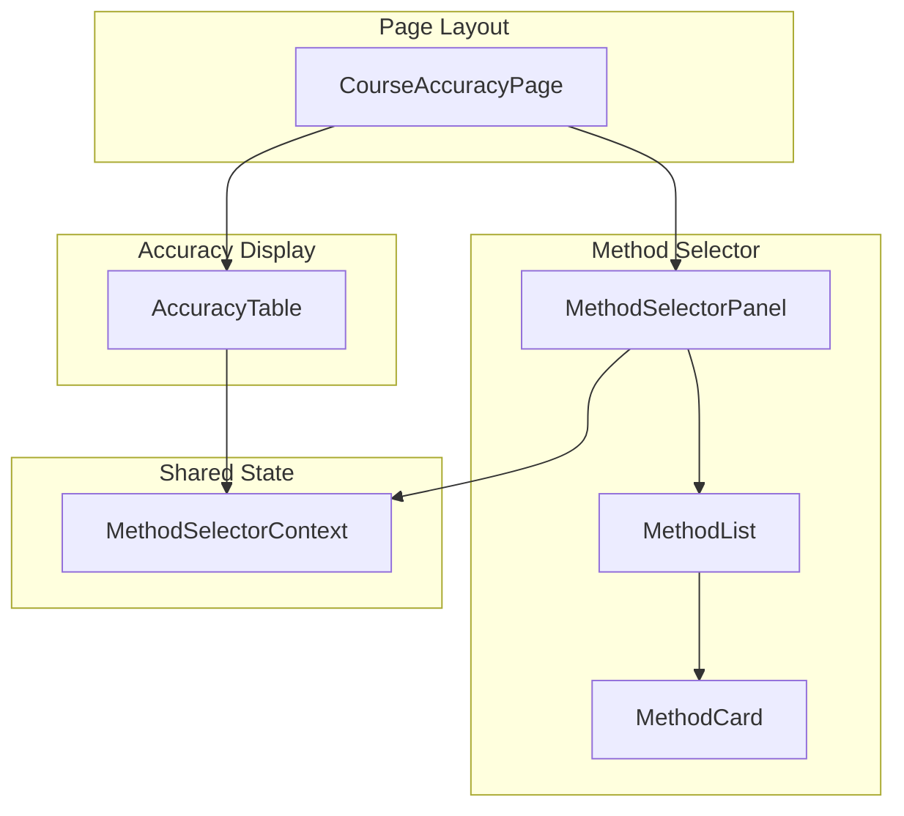
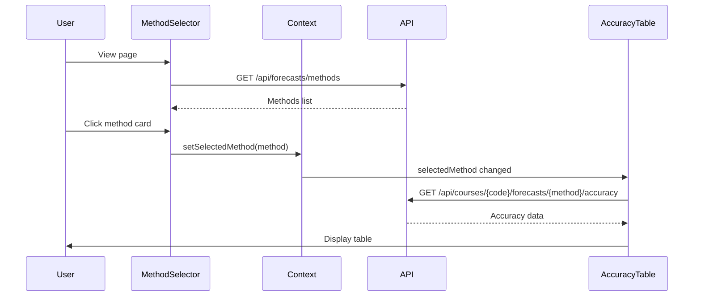

# Frontend Method Selector Architecture

## 1. Overview

### 1.1 Problem Statement

The frontend needs a way to:

- Display available forecast methods in a user-friendly manner
- Allow users to select a method to view backtesting accuracy data
- Show method metadata (name, description, capabilities)
- Provide visual feedback for the selected method

### 1.2 Goal

Create a **method selector component** that:

- Fetches available methods from the backend API
- Displays methods as clickable cards in a right sidebar
- Shows method name, short description, and status
- Triggers accuracy data fetch when a method is selected
- Maintains selection state across navigation

### 1.3 Design Principles

1. **Separation of Concerns**: UI logic separate from data fetching
2. **Accessibility**: Keyboard navigation and screen reader support
3. **Responsive Design**: Adapts to different screen sizes
4. **Loading States**: Clear feedback during data loading
5. **Error Handling**: Graceful degradation on API errors

---

## 2. Architecture Overview

### 2.1 Component Hierarchy



### 2.2 Data Flow



---

## 3. Component Design

### 3.1 MethodSelectorPanel

The main container for the method selection UI.

```typescript
// Location: apps/frontend/src/components/forecasts/MethodSelectorPanel.tsx

interface MethodSelectorPanelProps {
  /** Current course code for context */
  courseCode: string;

  /** Callback when method is selected */
  onMethodSelect?: (method: ForecastMethodDto) => void;

  /** Optional CSS class */
  className?: string;
}
```

**Responsibilities:**
- Fetch methods from API on mount
- Manage loading and error states
- Render method list
- Handle method selection

### 3.2 MethodCard

Individual card displaying a single forecast method.

```typescript
// Location: apps/frontend/src/components/forecasts/MethodCard.tsx

interface MethodCardProps {
  /** Method data */
  method: ForecastMethodDto;

  /** Whether this card is selected */
  isSelected: boolean;

  /** Click handler */
  onClick: () => void;

  /** Disabled state (e.g., method doesn't support backtesting) */
  disabled?: boolean;
}
```

**Responsibilities:**
- Display method name and short description
- Show status badge (active, beta, deprecated)
- Visual indication of selected state
- Hover and focus states

### 3.3 MethodSelectorContext

React context for sharing selected method state.

```typescript
// Location: apps/frontend/src/contexts/MethodSelectorContext.tsx

interface MethodSelectorContextValue {
  /** Currently selected method */
  selectedMethod: ForecastMethodDto | null;

  /** Set the selected method */
  setSelectedMethod: (method: ForecastMethodDto | null) => void;

  /** Available methods (cached) */
  methods: ForecastMethodDto[];

  /** Loading state */
  isLoading: boolean;

  /** Error state */
  error: Error | null;
}
```

---

## 4. Visual Design

### 4.1 Layout

```
┌─────────────────────────────────────────────────────────────────────┐
│                              Header                                  │
├───────────────────────────────────────────────┬─────────────────────┤
│                                               │                     │
│                                               │  Method Selector    │
│              Main Content                     │  ┌───────────────┐  │
│              (Course Info)                    │  │ Method 1      │  │
│                                               │  │ Description   │  │
│                                               │  └───────────────┘  │
│  ┌─────────────────────────────────────────┐  │  ┌───────────────┐  │
│  │                                         │  │  │ Method 2 ✓    │  │
│  │          Accuracy Table                 │  │  │ Description   │  │
│  │          (when method selected)         │  │  └───────────────┘  │
│  │                                         │  │  ┌───────────────┐  │
│  │                                         │  │  │ Method 3      │  │
│  │                                         │  │  │ Description   │  │
│  └─────────────────────────────────────────┘  │  └───────────────┘  │
│                                               │                     │
└───────────────────────────────────────────────┴─────────────────────┘
```

### 4.2 Method Card States

```
┌─────────────────────────────────────┐
│  Default State                      │
│  ┌─────────────────────────────┐   │
│  │ ○ Potential Students        │   │
│  │   Based on prerequisite...  │   │
│  │                    [Active] │   │
│  └─────────────────────────────┘   │
├─────────────────────────────────────┤
│  Hover State                        │
│  ┌─────────────────────────────┐   │
│  │ ○ Potential Students   ←─  │   │  (highlight border)
│  │   Based on prerequisite...  │   │
│  │                    [Active] │   │
│  └─────────────────────────────┘   │
├─────────────────────────────────────┤
│  Selected State                     │
│  ┌═════════════════════════════┐   │
│  │ ● Potential Students   ✓   │   │  (filled, checkmark)
│  │   Based on prerequisite...  │   │
│  │                    [Active] │   │
│  └═════════════════════════════┘   │
├─────────────────────────────────────┤
│  Disabled State                     │
│  ┌ ─ ─ ─ ─ ─ ─ ─ ─ ─ ─ ─ ─ ─ ─ ┐   │
│    ○ Historical Average     ╳      │  (grayed out)
│      Coming soon...                 │
│                         [Beta]      │
│  └ ─ ─ ─ ─ ─ ─ ─ ─ ─ ─ ─ ─ ─ ─ ┘   │
└─────────────────────────────────────┘
```

### 4.3 Status Badges

| Status | Color | Style |
|--------|-------|-------|
| Active | Green | Solid badge |
| Beta | Yellow | Outlined badge |
| Deprecated | Red | Striped badge |

---

## 5. API Integration

### 5.1 Custom Hook

```typescript
// Location: apps/frontend/src/hooks/useForecastMethods.ts

interface UseForecastMethodsOptions {
  /** Only fetch methods that support backtesting */
  backtestingOnly?: boolean;

  /** Filter by category */
  category?: MethodCategory;
}

interface UseForecastMethodsResult {
  methods: ForecastMethodDto[];
  isLoading: boolean;
  error: Error | null;
  refetch: () => Promise<void>;
}

function useForecastMethods(
  options?: UseForecastMethodsOptions
): UseForecastMethodsResult {
  // Implementation using React Query or SWR
}
```

### 5.2 API Client

```typescript
// Location: apps/frontend/src/api/forecast-methods.ts

import type { ForecastMethodDto, ForecastMethodListDto } from '@app/contracts';

const API_BASE = '/api/forecasts/methods';

export async function fetchForecastMethods(
  options?: { backtesting?: boolean; category?: string }
): Promise<ForecastMethodListDto> {
  const params = new URLSearchParams();

  if (options?.backtesting !== undefined) {
    params.set('backtesting', String(options.backtesting));
  }
  if (options?.category) {
    params.set('category', options.category);
  }

  const url = params.toString()
    ? `${API_BASE}?${params.toString()}`
    : API_BASE;

  const response = await fetch(url);

  if (!response.ok) {
    throw new Error(`Failed to fetch methods: ${response.statusText}`);
  }

  return response.json();
}

export async function fetchForecastMethod(
  methodId: string
): Promise<ForecastMethodDto> {
  const response = await fetch(`${API_BASE}/${methodId}`);

  if (!response.ok) {
    if (response.status === 404) {
      throw new Error(`Method '${methodId}' not found`);
    }
    throw new Error(`Failed to fetch method: ${response.statusText}`);
  }

  return response.json();
}
```

---

## 6. State Management

### 6.1 Context Provider

```typescript
// Location: apps/frontend/src/contexts/MethodSelectorContext.tsx

import React, { createContext, useContext, useState, useCallback } from 'react';
import type { ForecastMethodDto } from '@app/contracts';
import { useForecastMethods } from '../hooks/useForecastMethods';

const MethodSelectorContext = createContext<MethodSelectorContextValue | null>(null);

export function MethodSelectorProvider({
  children,
}: {
  children: React.ReactNode;
}) {
  const [selectedMethod, setSelectedMethod] = useState<ForecastMethodDto | null>(null);
  const { methods, isLoading, error } = useForecastMethods({
    backtestingOnly: true,
  });

  // Auto-select first method when loaded
  React.useEffect(() => {
    if (!selectedMethod && methods.length > 0) {
      setSelectedMethod(methods[0]);
    }
  }, [methods, selectedMethod]);

  const value: MethodSelectorContextValue = {
    selectedMethod,
    setSelectedMethod,
    methods,
    isLoading,
    error,
  };

  return (
    <MethodSelectorContext.Provider value={value}>
      {children}
    </MethodSelectorContext.Provider>
  );
}

export function useMethodSelector(): MethodSelectorContextValue {
  const context = useContext(MethodSelectorContext);

  if (!context) {
    throw new Error('useMethodSelector must be used within MethodSelectorProvider');
  }

  return context;
}
```

### 6.2 URL State Sync (Optional)

Persist selected method in URL for shareability:

```typescript
// Using React Router
import { useSearchParams } from 'react-router-dom';

function useMethodFromUrl() {
  const [searchParams, setSearchParams] = useSearchParams();
  const methodId = searchParams.get('method');

  const setMethodId = (id: string | null) => {
    if (id) {
      setSearchParams({ method: id });
    } else {
      searchParams.delete('method');
      setSearchParams(searchParams);
    }
  };

  return { methodId, setMethodId };
}
```

---

## 7. Accessibility

### 7.1 ARIA Attributes

```tsx
<div
  role="listbox"
  aria-label="Forecast methods"
  aria-activedescendant={selectedMethod?.id}
>
  {methods.map(method => (
    <div
      key={method.id}
      role="option"
      aria-selected={selectedMethod?.id === method.id}
      aria-disabled={!method.capabilities.supportsBacktesting}
      tabIndex={0}
    >
      {/* Card content */}
    </div>
  ))}
</div>
```

### 7.2 Keyboard Navigation

| Key | Action |
|-----|--------|
| `Tab` | Move focus to/from selector |
| `↑` / `↓` | Navigate between methods |
| `Enter` / `Space` | Select focused method |
| `Escape` | Clear selection (optional) |

---

## 8. Loading & Error States

### 8.1 Loading Skeleton

```tsx
function MethodCardSkeleton() {
  return (
    <div className="method-card skeleton">
      <div className="skeleton-line short" />
      <div className="skeleton-line" />
      <div className="skeleton-badge" />
    </div>
  );
}

function MethodListSkeleton() {
  return (
    <div className="method-list">
      {[1, 2, 3].map(i => (
        <MethodCardSkeleton key={i} />
      ))}
    </div>
  );
}
```

### 8.2 Error State

```tsx
function MethodListError({ error, onRetry }: { error: Error; onRetry: () => void }) {
  return (
    <div className="method-list-error">
      <AlertIcon />
      <p>Failed to load forecast methods</p>
      <p className="error-message">{error.message}</p>
      <button onClick={onRetry}>Try Again</button>
    </div>
  );
}
```

### 8.3 Empty State

```tsx
function MethodListEmpty() {
  return (
    <div className="method-list-empty">
      <InfoIcon />
      <p>No forecast methods available</p>
      <p>Contact support if this seems incorrect.</p>
    </div>
  );
}
```

---

## 9. Responsive Design

### 9.1 Breakpoints

| Breakpoint | Behavior |
|------------|----------|
| Desktop (> 1024px) | Right sidebar, 280px width |
| Tablet (768-1024px) | Collapsible sidebar with toggle |
| Mobile (< 768px) | Bottom sheet or modal |

### 9.2 Mobile Layout

```
┌───────────────────────────────────┐
│             Header                │
├───────────────────────────────────┤
│                                   │
│          Main Content             │
│                                   │
├───────────────────────────────────┤
│  Selected: Potential Students ▼  │  ← Tap to expand
└───────────────────────────────────┘

[Expanded - Bottom Sheet]
┌───────────────────────────────────┐
│  Select Forecast Method      ✕   │
├───────────────────────────────────┤
│  ┌─────────────────────────────┐ │
│  │ ● Potential Students    ✓  │ │
│  └─────────────────────────────┘ │
│  ┌─────────────────────────────┐ │
│  │ ○ Historical Average       │ │
│  └─────────────────────────────┘ │
└───────────────────────────────────┘
```

---

## 10. Performance Considerations

### 10.1 Caching

```typescript
// React Query configuration
const queryClient = new QueryClient({
  defaultOptions: {
    queries: {
      staleTime: 1000 * 60 * 60, // 1 hour
      cacheTime: 1000 * 60 * 60 * 24, // 24 hours
    },
  },
});
```

### 10.2 Lazy Loading

Methods list is small and should load immediately. No need for pagination or virtualization.

### 10.3 Optimistic UI

When selecting a method, update UI immediately before API confirmation.

---

## 11. Integration Points

### 11.1 With AccuracyTable

```tsx
function CourseAccuracyPage({ courseCode }: { courseCode: string }) {
  return (
    <MethodSelectorProvider>
      <div className="page-layout">
        <main className="main-content">
          <CourseHeader courseCode={courseCode} />
          <AccuracyTableContainer courseCode={courseCode} />
        </main>
        <aside className="sidebar">
          <MethodSelectorPanel courseCode={courseCode} />
        </aside>
      </div>
    </MethodSelectorProvider>
  );
}
```

### 11.2 With Course History

```tsx
// Can use same context to show forecasts in history view
function CourseHistoryWithForecast({ courseCode }: { courseCode: string }) {
  const { selectedMethod } = useMethodSelector();

  return (
    <div>
      <CourseHistoryChart courseCode={courseCode} />
      {selectedMethod && (
        <ForecastOverlay
          courseCode={courseCode}
          methodId={selectedMethod.id}
        />
      )}
    </div>
  );
}
```

---

## 12. Future Enhancements

### 12.1 Method Comparison Mode

Allow selecting multiple methods to compare accuracy:

```tsx
<MethodCard
  method={method}
  isSelected={selectedMethods.includes(method.id)}
  selectionMode="multi" // 'single' | 'multi'
/>
```

### 12.2 Favorites

Let users favorite frequently used methods:

```tsx
<MethodCard
  method={method}
  isFavorite={favorites.includes(method.id)}
  onToggleFavorite={handleToggleFavorite}
/>
```

### 12.3 Method Details Drawer

Show full method description in expandable drawer:

```tsx
<MethodCard
  method={method}
  onInfoClick={() => openMethodDetails(method)}
/>
```

---

## 13. Related Documents

- [Get Forecast Methods](../get-forecast-methods/architecture.md)
- [Frontend Accuracy Table](../frontend-accuracy-table/architecture.md)
- [Forecast Accuracy & Backtesting](../forecast-accuracy-backtesting/architecture.md)
- [Implementation Guide](./implementation-guide.md)
