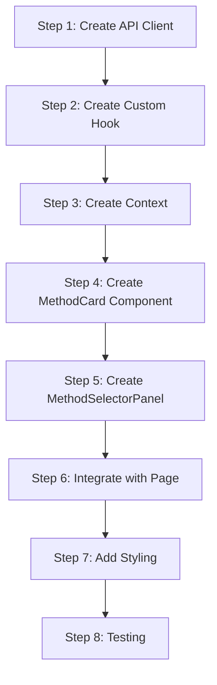

# Frontend Method Selector - Implementation Guide

## Overview

This guide provides step-by-step instructions for implementing the method selector component in the frontend.

---

## Prerequisites

Before starting, ensure:

- Backend [Get Forecast Methods](../get-forecast-methods/implementation-guide.md) API is implemented
- [Architecture Document](./architecture.md) is reviewed
- Frontend project structure is understood

---

## Implementation Steps



---

## Step 1: Create API Client

### 1.1 Create Types (if not using contracts)

**Location**: `apps/frontend/src/types/forecast-methods.ts`

```typescript
export interface MethodCapabilities {
  supportsMultiTerm: boolean;
  supportsBacktesting: boolean;
  requiresPrerequisites: boolean;
  requiresHistoricalData: boolean;
}

export type MethodCategory =
  | 'prerequisite-based'
  | 'historical-trend'
  | 'machine-learning';

export type MethodStatus = 'active' | 'beta' | 'deprecated';

export interface ForecastMethod {
  id: string;
  label: string;
  description: string;
  shortDescription: string;
  category: MethodCategory;
  status: MethodStatus;
  capabilities: MethodCapabilities;
  icon?: string;
}

export interface ForecastMethodList {
  methods: ForecastMethod[];
  metadata: {
    totalCount: number;
    activeCount: number;
  };
}
```

### 1.2 Create API Client

**Location**: `apps/frontend/src/api/forecast-methods.ts`

```typescript
import type { ForecastMethod, ForecastMethodList } from '../types/forecast-methods';

const API_BASE = import.meta.env.VITE_API_URL || '';

export interface FetchMethodsOptions {
  backtesting?: boolean;
  category?: string;
  status?: string;
}

export async function fetchForecastMethods(
  options: FetchMethodsOptions = {}
): Promise<ForecastMethodList> {
  const params = new URLSearchParams();

  if (options.backtesting !== undefined) {
    params.set('backtesting', String(options.backtesting));
  }
  if (options.category) {
    params.set('category', options.category);
  }
  if (options.status) {
    params.set('status', options.status);
  }

  const queryString = params.toString();
  const url = `${API_BASE}/api/forecasts/methods${queryString ? `?${queryString}` : ''}`;

  const response = await fetch(url);

  if (!response.ok) {
    throw new Error(`Failed to fetch methods: ${response.status} ${response.statusText}`);
  }

  return response.json();
}

export async function fetchForecastMethod(
  methodId: string
): Promise<ForecastMethod> {
  const response = await fetch(`${API_BASE}/api/forecasts/methods/${methodId}`);

  if (!response.ok) {
    if (response.status === 404) {
      throw new Error(`Method '${methodId}' not found`);
    }
    throw new Error(`Failed to fetch method: ${response.status}`);
  }

  return response.json();
}
```

---

## Step 2: Create Custom Hook

### 2.1 Using React Query (Recommended)

**Location**: `apps/frontend/src/hooks/useForecastMethods.ts`

```typescript
import { useQuery } from '@tanstack/react-query';
import { fetchForecastMethods, type FetchMethodsOptions } from '../api/forecast-methods';
import type { ForecastMethod } from '../types/forecast-methods';

export interface UseForecastMethodsOptions extends FetchMethodsOptions {
  enabled?: boolean;
}

export interface UseForecastMethodsResult {
  methods: ForecastMethod[];
  isLoading: boolean;
  isError: boolean;
  error: Error | null;
  refetch: () => void;
}

export function useForecastMethods(
  options: UseForecastMethodsOptions = {}
): UseForecastMethodsResult {
  const { enabled = true, ...fetchOptions } = options;

  const query = useQuery({
    queryKey: ['forecast-methods', fetchOptions],
    queryFn: () => fetchForecastMethods(fetchOptions),
    enabled,
    staleTime: 1000 * 60 * 60, // 1 hour
    refetchOnWindowFocus: false,
  });

  return {
    methods: query.data?.methods ?? [],
    isLoading: query.isLoading,
    isError: query.isError,
    error: query.error,
    refetch: query.refetch,
  };
}
```

### 2.2 Using Plain React (Alternative)

**Location**: `apps/frontend/src/hooks/useForecastMethods.ts`

```typescript
import { useState, useEffect, useCallback } from 'react';
import { fetchForecastMethods, type FetchMethodsOptions } from '../api/forecast-methods';
import type { ForecastMethod } from '../types/forecast-methods';

export interface UseForecastMethodsResult {
  methods: ForecastMethod[];
  isLoading: boolean;
  isError: boolean;
  error: Error | null;
  refetch: () => Promise<void>;
}

export function useForecastMethods(
  options: FetchMethodsOptions = {}
): UseForecastMethodsResult {
  const [methods, setMethods] = useState<ForecastMethod[]>([]);
  const [isLoading, setIsLoading] = useState(true);
  const [error, setError] = useState<Error | null>(null);

  const fetchData = useCallback(async () => {
    setIsLoading(true);
    setError(null);

    try {
      const data = await fetchForecastMethods(options);
      setMethods(data.methods);
    } catch (err) {
      setError(err instanceof Error ? err : new Error('Unknown error'));
    } finally {
      setIsLoading(false);
    }
  }, [JSON.stringify(options)]);

  useEffect(() => {
    fetchData();
  }, [fetchData]);

  return {
    methods,
    isLoading,
    isError: error !== null,
    error,
    refetch: fetchData,
  };
}
```

---

## Step 3: Create Context

**Location**: `apps/frontend/src/contexts/MethodSelectorContext.tsx`

```typescript
import React, {
  createContext,
  useContext,
  useState,
  useCallback,
  useEffect,
} from 'react';
import type { ForecastMethod } from '../types/forecast-methods';
import { useForecastMethods } from '../hooks/useForecastMethods';

interface MethodSelectorContextValue {
  selectedMethod: ForecastMethod | null;
  setSelectedMethod: (method: ForecastMethod | null) => void;
  methods: ForecastMethod[];
  isLoading: boolean;
  error: Error | null;
  refetch: () => void;
}

const MethodSelectorContext = createContext<MethodSelectorContextValue | null>(
  null
);

interface MethodSelectorProviderProps {
  children: React.ReactNode;
  /** Only show methods that support backtesting */
  backtestingOnly?: boolean;
  /** Initially selected method ID */
  initialMethodId?: string;
}

export function MethodSelectorProvider({
  children,
  backtestingOnly = true,
  initialMethodId,
}: MethodSelectorProviderProps) {
  const [selectedMethod, setSelectedMethodState] =
    useState<ForecastMethod | null>(null);

  const { methods, isLoading, error, refetch } = useForecastMethods({
    backtesting: backtestingOnly ? true : undefined,
  });

  // Handle method selection
  const setSelectedMethod = useCallback((method: ForecastMethod | null) => {
    setSelectedMethodState(method);
  }, []);

  // Auto-select first method or initial method when loaded
  useEffect(() => {
    if (!selectedMethod && methods.length > 0 && !isLoading) {
      if (initialMethodId) {
        const initial = methods.find(m => m.id === initialMethodId);
        if (initial) {
          setSelectedMethodState(initial);
          return;
        }
      }
      setSelectedMethodState(methods[0]);
    }
  }, [methods, selectedMethod, isLoading, initialMethodId]);

  const value: MethodSelectorContextValue = {
    selectedMethod,
    setSelectedMethod,
    methods,
    isLoading,
    error,
    refetch,
  };

  return (
    <MethodSelectorContext.Provider value={value}>
      {children}
    </MethodSelectorContext.Provider>
  );
}

export function useMethodSelector(): MethodSelectorContextValue {
  const context = useContext(MethodSelectorContext);

  if (!context) {
    throw new Error(
      'useMethodSelector must be used within a MethodSelectorProvider'
    );
  }

  return context;
}
```

---

## Step 4: Create MethodCard Component

**Location**: `apps/frontend/src/components/forecasts/MethodCard.tsx`

```tsx
import React from 'react';
import type { ForecastMethod, MethodStatus } from '../../types/forecast-methods';
import './MethodCard.css';

interface MethodCardProps {
  method: ForecastMethod;
  isSelected: boolean;
  onClick: () => void;
  disabled?: boolean;
}

function StatusBadge({ status }: { status: MethodStatus }) {
  return (
    <span className={`status-badge status-badge--${status}`}>
      {status}
    </span>
  );
}

export function MethodCard({
  method,
  isSelected,
  onClick,
  disabled = false,
}: MethodCardProps) {
  const handleClick = () => {
    if (!disabled) {
      onClick();
    }
  };

  const handleKeyDown = (event: React.KeyboardEvent) => {
    if ((event.key === 'Enter' || event.key === ' ') && !disabled) {
      event.preventDefault();
      onClick();
    }
  };

  return (
    <div
      role="option"
      aria-selected={isSelected}
      aria-disabled={disabled}
      tabIndex={disabled ? -1 : 0}
      className={`method-card ${isSelected ? 'method-card--selected' : ''} ${
        disabled ? 'method-card--disabled' : ''
      }`}
      onClick={handleClick}
      onKeyDown={handleKeyDown}
    >
      <div className="method-card__header">
        <div className="method-card__radio">
          {isSelected ? (
            <span className="method-card__radio--filled" />
          ) : (
            <span className="method-card__radio--empty" />
          )}
        </div>
        <h3 className="method-card__title">{method.label}</h3>
        {isSelected && (
          <span className="method-card__check" aria-hidden="true">
            ✓
          </span>
        )}
      </div>
      <p className="method-card__description">{method.shortDescription}</p>
      <div className="method-card__footer">
        <StatusBadge status={method.status} />
        {!method.capabilities.supportsBacktesting && (
          <span className="method-card__no-backtest">
            No backtesting
          </span>
        )}
      </div>
    </div>
  );
}
```

### 4.1 MethodCard Styles

**Location**: `apps/frontend/src/components/forecasts/MethodCard.css`

```css
.method-card {
  display: flex;
  flex-direction: column;
  gap: 0.5rem;
  padding: 1rem;
  border: 2px solid var(--color-border, #e2e8f0);
  border-radius: 0.5rem;
  background: var(--color-surface, #ffffff);
  cursor: pointer;
  transition: border-color 0.2s, box-shadow 0.2s;
}

.method-card:hover:not(.method-card--disabled) {
  border-color: var(--color-primary, #3b82f6);
  box-shadow: 0 2px 4px rgba(0, 0, 0, 0.05);
}

.method-card:focus {
  outline: none;
  border-color: var(--color-primary, #3b82f6);
  box-shadow: 0 0 0 3px var(--color-primary-light, rgba(59, 130, 246, 0.2));
}

.method-card--selected {
  border-color: var(--color-primary, #3b82f6);
  background: var(--color-primary-bg, #eff6ff);
}

.method-card--disabled {
  opacity: 0.6;
  cursor: not-allowed;
}

.method-card__header {
  display: flex;
  align-items: center;
  gap: 0.5rem;
}

.method-card__radio {
  width: 1rem;
  height: 1rem;
  flex-shrink: 0;
}

.method-card__radio--empty {
  display: block;
  width: 100%;
  height: 100%;
  border: 2px solid var(--color-border, #e2e8f0);
  border-radius: 50%;
}

.method-card__radio--filled {
  display: block;
  width: 100%;
  height: 100%;
  border: 2px solid var(--color-primary, #3b82f6);
  border-radius: 50%;
  background: var(--color-primary, #3b82f6);
}

.method-card__title {
  flex: 1;
  font-size: 0.875rem;
  font-weight: 600;
  margin: 0;
  color: var(--color-text, #1e293b);
}

.method-card__check {
  color: var(--color-primary, #3b82f6);
  font-weight: bold;
}

.method-card__description {
  font-size: 0.75rem;
  color: var(--color-text-secondary, #64748b);
  margin: 0;
  padding-left: 1.5rem;
}

.method-card__footer {
  display: flex;
  align-items: center;
  gap: 0.5rem;
  padding-left: 1.5rem;
}

/* Status badges */
.status-badge {
  font-size: 0.625rem;
  font-weight: 600;
  text-transform: uppercase;
  padding: 0.125rem 0.375rem;
  border-radius: 0.25rem;
}

.status-badge--active {
  background: var(--color-success-bg, #dcfce7);
  color: var(--color-success, #16a34a);
}

.status-badge--beta {
  background: var(--color-warning-bg, #fef3c7);
  color: var(--color-warning, #d97706);
}

.status-badge--deprecated {
  background: var(--color-error-bg, #fee2e2);
  color: var(--color-error, #dc2626);
}

.method-card__no-backtest {
  font-size: 0.625rem;
  color: var(--color-text-tertiary, #94a3b8);
}
```

---

## Step 5: Create MethodSelectorPanel

**Location**: `apps/frontend/src/components/forecasts/MethodSelectorPanel.tsx`

```tsx
import React from 'react';
import { useMethodSelector } from '../../contexts/MethodSelectorContext';
import { MethodCard } from './MethodCard';
import './MethodSelectorPanel.css';

interface MethodSelectorPanelProps {
  className?: string;
}

function LoadingSkeleton() {
  return (
    <div className="method-selector__skeleton">
      {[1, 2, 3].map(i => (
        <div key={i} className="method-card-skeleton">
          <div className="skeleton-line skeleton-line--short" />
          <div className="skeleton-line" />
          <div className="skeleton-badge" />
        </div>
      ))}
    </div>
  );
}

function ErrorState({
  error,
  onRetry,
}: {
  error: Error;
  onRetry: () => void;
}) {
  return (
    <div className="method-selector__error">
      <span className="method-selector__error-icon">⚠️</span>
      <p>Failed to load forecast methods</p>
      <p className="method-selector__error-message">{error.message}</p>
      <button
        className="method-selector__retry-button"
        onClick={onRetry}
      >
        Try Again
      </button>
    </div>
  );
}

function EmptyState() {
  return (
    <div className="method-selector__empty">
      <span className="method-selector__empty-icon">ℹ️</span>
      <p>No forecast methods available</p>
    </div>
  );
}

export function MethodSelectorPanel({ className = '' }: MethodSelectorPanelProps) {
  const {
    methods,
    selectedMethod,
    setSelectedMethod,
    isLoading,
    error,
    refetch,
  } = useMethodSelector();

  if (isLoading) {
    return (
      <aside className={`method-selector ${className}`}>
        <h2 className="method-selector__title">Forecast Methods</h2>
        <LoadingSkeleton />
      </aside>
    );
  }

  if (error) {
    return (
      <aside className={`method-selector ${className}`}>
        <h2 className="method-selector__title">Forecast Methods</h2>
        <ErrorState error={error} onRetry={refetch} />
      </aside>
    );
  }

  if (methods.length === 0) {
    return (
      <aside className={`method-selector ${className}`}>
        <h2 className="method-selector__title">Forecast Methods</h2>
        <EmptyState />
      </aside>
    );
  }

  return (
    <aside className={`method-selector ${className}`}>
      <h2 className="method-selector__title">Forecast Methods</h2>
      <p className="method-selector__subtitle">
        Select a method to view accuracy data
      </p>
      <div
        role="listbox"
        aria-label="Available forecast methods"
        aria-activedescendant={selectedMethod?.id}
        className="method-selector__list"
      >
        {methods.map(method => (
          <MethodCard
            key={method.id}
            method={method}
            isSelected={selectedMethod?.id === method.id}
            onClick={() => setSelectedMethod(method)}
            disabled={!method.capabilities.supportsBacktesting}
          />
        ))}
      </div>
    </aside>
  );
}
```

### 5.1 MethodSelectorPanel Styles

**Location**: `apps/frontend/src/components/forecasts/MethodSelectorPanel.css`

```css
.method-selector {
  display: flex;
  flex-direction: column;
  gap: 1rem;
  padding: 1.5rem;
  background: var(--color-surface, #ffffff);
  border-left: 1px solid var(--color-border, #e2e8f0);
  min-width: 280px;
  max-width: 320px;
}

.method-selector__title {
  font-size: 1rem;
  font-weight: 600;
  margin: 0;
  color: var(--color-text, #1e293b);
}

.method-selector__subtitle {
  font-size: 0.75rem;
  color: var(--color-text-secondary, #64748b);
  margin: 0;
}

.method-selector__list {
  display: flex;
  flex-direction: column;
  gap: 0.75rem;
}

/* Loading skeleton */
.method-selector__skeleton {
  display: flex;
  flex-direction: column;
  gap: 0.75rem;
}

.method-card-skeleton {
  padding: 1rem;
  border: 2px solid var(--color-border, #e2e8f0);
  border-radius: 0.5rem;
  display: flex;
  flex-direction: column;
  gap: 0.5rem;
}

.skeleton-line {
  height: 0.75rem;
  background: var(--color-skeleton, #e2e8f0);
  border-radius: 0.25rem;
  animation: skeleton-pulse 1.5s ease-in-out infinite;
}

.skeleton-line--short {
  width: 60%;
}

.skeleton-badge {
  width: 3rem;
  height: 1rem;
  background: var(--color-skeleton, #e2e8f0);
  border-radius: 0.25rem;
  animation: skeleton-pulse 1.5s ease-in-out infinite;
}

@keyframes skeleton-pulse {
  0%, 100% {
    opacity: 1;
  }
  50% {
    opacity: 0.5;
  }
}

/* Error state */
.method-selector__error {
  display: flex;
  flex-direction: column;
  align-items: center;
  gap: 0.5rem;
  padding: 2rem 1rem;
  text-align: center;
}

.method-selector__error-icon {
  font-size: 2rem;
}

.method-selector__error-message {
  font-size: 0.75rem;
  color: var(--color-error, #dc2626);
}

.method-selector__retry-button {
  padding: 0.5rem 1rem;
  background: var(--color-primary, #3b82f6);
  color: white;
  border: none;
  border-radius: 0.375rem;
  cursor: pointer;
  font-size: 0.875rem;
}

.method-selector__retry-button:hover {
  background: var(--color-primary-dark, #2563eb);
}

/* Empty state */
.method-selector__empty {
  display: flex;
  flex-direction: column;
  align-items: center;
  gap: 0.5rem;
  padding: 2rem 1rem;
  text-align: center;
  color: var(--color-text-secondary, #64748b);
}

.method-selector__empty-icon {
  font-size: 2rem;
}
```

---

## Step 6: Integrate with Page

**Location**: `apps/frontend/src/pages/CourseAccuracyPage.tsx`

```tsx
import React from 'react';
import { useParams } from 'react-router-dom';
import { MethodSelectorProvider } from '../contexts/MethodSelectorContext';
import { MethodSelectorPanel } from '../components/forecasts/MethodSelectorPanel';
import { AccuracyTableContainer } from '../components/forecasts/AccuracyTableContainer';
import './CourseAccuracyPage.css';

export function CourseAccuracyPage() {
  const { courseCode } = useParams<{ courseCode: string }>();

  if (!courseCode) {
    return <div>Course code is required</div>;
  }

  return (
    <MethodSelectorProvider backtestingOnly>
      <div className="course-accuracy-page">
        <main className="course-accuracy-page__main">
          <header className="course-accuracy-page__header">
            <h1>Forecast Accuracy: {courseCode}</h1>
          </header>
          <AccuracyTableContainer courseCode={courseCode} />
        </main>
        <MethodSelectorPanel className="course-accuracy-page__sidebar" />
      </div>
    </MethodSelectorProvider>
  );
}
```

### 6.1 Page Styles

**Location**: `apps/frontend/src/pages/CourseAccuracyPage.css`

```css
.course-accuracy-page {
  display: flex;
  min-height: 100vh;
}

.course-accuracy-page__main {
  flex: 1;
  padding: 1.5rem;
  overflow-x: auto;
}

.course-accuracy-page__header {
  margin-bottom: 1.5rem;
}

.course-accuracy-page__header h1 {
  font-size: 1.5rem;
  margin: 0;
}

.course-accuracy-page__sidebar {
  flex-shrink: 0;
}

/* Responsive */
@media (max-width: 768px) {
  .course-accuracy-page {
    flex-direction: column;
  }

  .course-accuracy-page__sidebar {
    order: -1;
    min-width: 100%;
    max-width: 100%;
    border-left: none;
    border-bottom: 1px solid var(--color-border, #e2e8f0);
  }
}
```

---

## Step 7: Add to Router

**Location**: `apps/frontend/src/router.tsx`

```tsx
import { createBrowserRouter } from 'react-router-dom';
import { CourseAccuracyPage } from './pages/CourseAccuracyPage';

export const router = createBrowserRouter([
  // ... existing routes
  {
    path: '/courses/:courseCode/accuracy',
    element: <CourseAccuracyPage />,
  },
]);
```

---

## Step 8: Testing

### 8.1 Component Tests

**Location**: `apps/frontend/src/components/forecasts/__tests__/MethodCard.test.tsx`

```tsx
import { render, screen, fireEvent } from '@testing-library/react';
import { describe, it, expect, vi } from 'vitest';
import { MethodCard } from '../MethodCard';
import type { ForecastMethod } from '../../../types/forecast-methods';

const mockMethod: ForecastMethod = {
  id: 'test-method',
  label: 'Test Method',
  description: 'Full description',
  shortDescription: 'Short description',
  category: 'prerequisite-based',
  status: 'active',
  capabilities: {
    supportsMultiTerm: true,
    supportsBacktesting: true,
    requiresPrerequisites: false,
    requiresHistoricalData: true,
  },
};

describe('MethodCard', () => {
  it('renders method information', () => {
    render(
      <MethodCard
        method={mockMethod}
        isSelected={false}
        onClick={() => {}}
      />
    );

    expect(screen.getByText('Test Method')).toBeInTheDocument();
    expect(screen.getByText('Short description')).toBeInTheDocument();
    expect(screen.getByText('active')).toBeInTheDocument();
  });

  it('calls onClick when clicked', () => {
    const handleClick = vi.fn();
    render(
      <MethodCard
        method={mockMethod}
        isSelected={false}
        onClick={handleClick}
      />
    );

    fireEvent.click(screen.getByRole('option'));
    expect(handleClick).toHaveBeenCalledTimes(1);
  });

  it('shows selected state', () => {
    render(
      <MethodCard
        method={mockMethod}
        isSelected={true}
        onClick={() => {}}
      />
    );

    expect(screen.getByRole('option')).toHaveAttribute('aria-selected', 'true');
    expect(screen.getByText('✓')).toBeInTheDocument();
  });

  it('is disabled when disabled prop is true', () => {
    const handleClick = vi.fn();
    render(
      <MethodCard
        method={mockMethod}
        isSelected={false}
        onClick={handleClick}
        disabled
      />
    );

    fireEvent.click(screen.getByRole('option'));
    expect(handleClick).not.toHaveBeenCalled();
    expect(screen.getByRole('option')).toHaveAttribute('aria-disabled', 'true');
  });

  it('handles keyboard navigation', () => {
    const handleClick = vi.fn();
    render(
      <MethodCard
        method={mockMethod}
        isSelected={false}
        onClick={handleClick}
      />
    );

    const card = screen.getByRole('option');
    fireEvent.keyDown(card, { key: 'Enter' });
    expect(handleClick).toHaveBeenCalledTimes(1);

    fireEvent.keyDown(card, { key: ' ' });
    expect(handleClick).toHaveBeenCalledTimes(2);
  });
});
```

---

## File Summary

### New Files to Create

| File | Purpose |
|------|---------|
| `src/types/forecast-methods.ts` | TypeScript types |
| `src/api/forecast-methods.ts` | API client functions |
| `src/hooks/useForecastMethods.ts` | Data fetching hook |
| `src/contexts/MethodSelectorContext.tsx` | State management |
| `src/components/forecasts/MethodCard.tsx` | Card component |
| `src/components/forecasts/MethodCard.css` | Card styles |
| `src/components/forecasts/MethodSelectorPanel.tsx` | Panel component |
| `src/components/forecasts/MethodSelectorPanel.css` | Panel styles |
| `src/pages/CourseAccuracyPage.tsx` | Page component |
| `src/pages/CourseAccuracyPage.css` | Page styles |

### Files to Modify

| File | Changes |
|------|---------|
| `src/router.tsx` | Add accuracy page route |

---

## Checklist

- [ ] Step 1: Create API Client
  - [ ] Create types file
  - [ ] Create API functions

- [ ] Step 2: Create Custom Hook
  - [ ] Implement useForecastMethods

- [ ] Step 3: Create Context
  - [ ] Create MethodSelectorContext
  - [ ] Add provider and hook

- [ ] Step 4: Create MethodCard
  - [ ] Create component
  - [ ] Add styles

- [ ] Step 5: Create MethodSelectorPanel
  - [ ] Create component
  - [ ] Add loading/error/empty states
  - [ ] Add styles

- [ ] Step 6: Integrate with Page
  - [ ] Create CourseAccuracyPage
  - [ ] Add page styles

- [ ] Step 7: Add Routing
  - [ ] Add route to router

- [ ] Step 8: Testing
  - [ ] Write component tests
  - [ ] Test keyboard navigation
  - [ ] Test loading/error states

---

## Related Documents

- [Architecture Document](./architecture.md)
- [Frontend Accuracy Table](../frontend-accuracy-table/architecture.md)
- [Get Forecast Methods](../get-forecast-methods/architecture.md)
