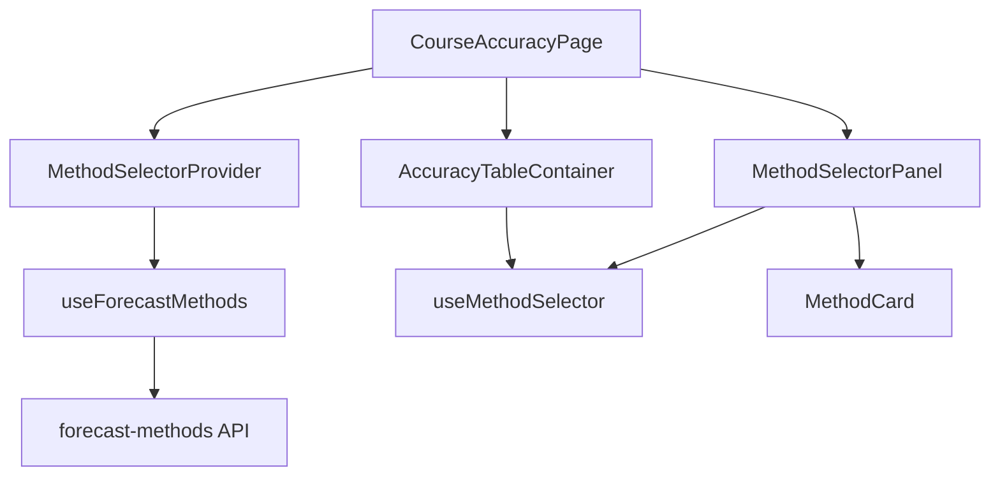

# Frontend Method Selector - System Impact

## Overview

This document describes the impact of the Frontend Method Selector feature on the existing system.

---

## 1. New Components

### 1.1 Types

| Component | Description |
|-----------|-------------|
| `types/forecast-methods.ts` | TypeScript interfaces for forecast methods |

### 1.2 API Layer

| Component | Description |
|-----------|-------------|
| `api/forecast-methods.ts` | API client for methods endpoint |

### 1.3 Hooks

| Component | Description |
|-----------|-------------|
| `hooks/useForecastMethods.ts` | Data fetching hook |

### 1.4 State Management

| Component | Description |
|-----------|-------------|
| `contexts/MethodSelectorContext.tsx` | Context for selected method state |

### 1.5 Components

| Component | Description |
|-----------|-------------|
| `components/forecasts/MethodCard.tsx` | Individual method card |
| `components/forecasts/MethodCard.css` | Card styles |
| `components/forecasts/MethodSelectorPanel.tsx` | Sidebar panel |
| `components/forecasts/MethodSelectorPanel.css` | Panel styles |

### 1.6 Pages

| Component | Description |
|-----------|-------------|
| `pages/CourseAccuracyPage.tsx` | Main page component |
| `pages/CourseAccuracyPage.css` | Page layout styles |

---

## 2. Modified Components

### 2.1 Router

| File | Changes |
|------|---------|
| `src/router.tsx` | Add `/courses/:courseCode/accuracy` route |

### 2.2 Navigation (Optional)

| File | Changes |
|------|---------|
| `src/components/Navigation.tsx` | Add link to accuracy page |

---

## 3. Dependencies

### 3.1 External Dependencies

| Package | Purpose | Status |
|---------|---------|--------|
| `@tanstack/react-query` | Data fetching (optional) | Existing or new |

### 3.2 Internal Dependencies



---

## 4. Backend Dependencies

### 4.1 Required Endpoints

| Endpoint | Use Case |
|----------|----------|
| `GET /api/forecasts/methods` | Fetch available methods |

### 4.2 Deployment Order

1. Deploy backend with methods endpoint
2. Deploy frontend with method selector

---

## 5. State Management Impact

### 5.1 New Context

The `MethodSelectorContext` provides:

- Selected method state
- Methods list cache
- Loading and error states

### 5.2 Context Scope

Provider should wrap:
- Method selector panel
- Accuracy table
- Any component needing selected method

---

## 6. Styling Impact

### 6.1 CSS Variables Used

The components use these CSS custom properties:

| Variable | Default | Purpose |
|----------|---------|---------|
| `--color-primary` | `#3b82f6` | Primary accent |
| `--color-primary-light` | `rgba(59, 130, 246, 0.2)` | Focus ring |
| `--color-primary-bg` | `#eff6ff` | Selected background |
| `--color-border` | `#e2e8f0` | Border color |
| `--color-surface` | `#ffffff` | Card background |
| `--color-text` | `#1e293b` | Primary text |
| `--color-text-secondary` | `#64748b` | Secondary text |
| `--color-success` | `#16a34a` | Active status |
| `--color-warning` | `#d97706` | Beta status |
| `--color-error` | `#dc2626` | Error/deprecated |

### 6.2 Layout Changes

- Right sidebar added to course pages
- Responsive breakpoints for mobile

---

## 7. Performance Considerations

### 7.1 API Calls

| When | Call | Caching |
|------|------|---------|
| Page mount | `GET /api/forecasts/methods` | 1 hour stale time |
| Manual refresh | Same endpoint | Force refetch |

### 7.2 Bundle Size

| Component | Estimated Size |
|-----------|----------------|
| MethodCard | ~2KB |
| MethodSelectorPanel | ~3KB |
| Context + Hook | ~2KB |
| Styles | ~3KB |
| **Total** | **~10KB** (gzipped) |

---

## 8. Accessibility Impact

### 8.1 ARIA Roles

- `listbox` for method list
- `option` for method cards
- Proper `aria-selected` and `aria-disabled`

### 8.2 Keyboard Support

- Full keyboard navigation
- Focus management

---

## 9. Testing Impact

### 9.1 New Test Files

| File | Type |
|------|------|
| `MethodCard.test.tsx` | Unit |
| `MethodSelectorPanel.test.tsx` | Integration |
| `useForecastMethods.test.ts` | Hook |

### 9.2 E2E Test Updates

Add scenarios for:
- Method selection
- Error handling
- Loading states

---

## 10. Documentation Updates

### 10.1 Required Updates

| Document | Changes |
|----------|---------|
| README.md | Add feature description |
| API docs | Document usage of methods endpoint |

---

## 11. Rollback Plan

### 11.1 Feature Flag

```typescript
const ENABLE_METHOD_SELECTOR = import.meta.env.VITE_ENABLE_METHOD_SELECTOR !== 'false';

// In CourseAccuracyPage
{ENABLE_METHOD_SELECTOR && <MethodSelectorPanel />}
```

### 11.2 Fallback

If disabled, can default to first method or hardcoded method ID.

---

## 12. Monitoring

### 12.1 Metrics

- Method selector render count
- Time to interactive
- Error rate for methods API

### 12.2 Logging

```typescript
// Log method selection for analytics
useEffect(() => {
  if (selectedMethod) {
    analytics.track('method_selected', {
      methodId: selectedMethod.id,
      courseCode,
    });
  }
}, [selectedMethod, courseCode]);
```

---

## Related Documents

- [Architecture Document](./architecture.md)
- [Implementation Guide](./implementation-guide.md)
- [Testing Guide](./testing-guide.md)
