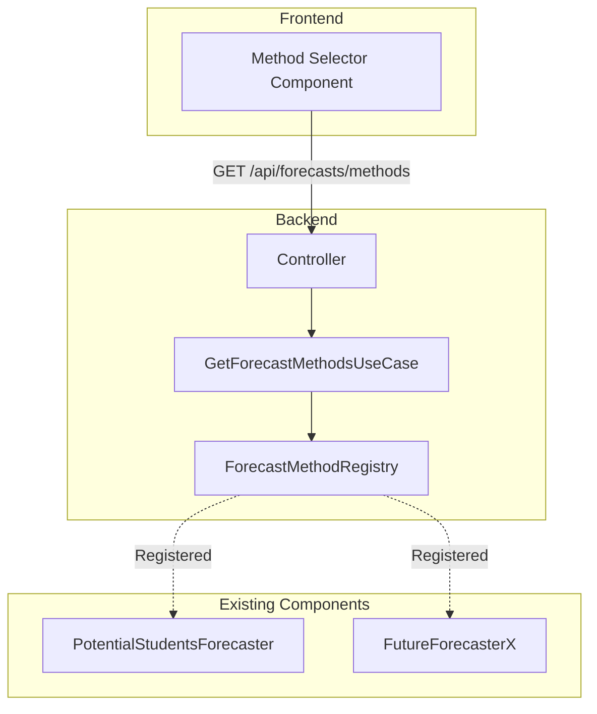
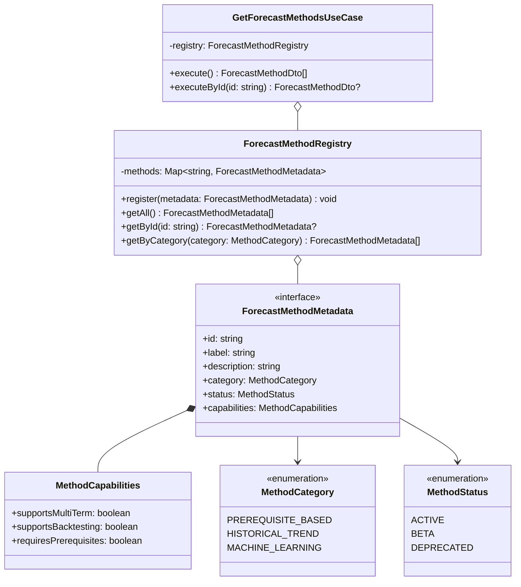
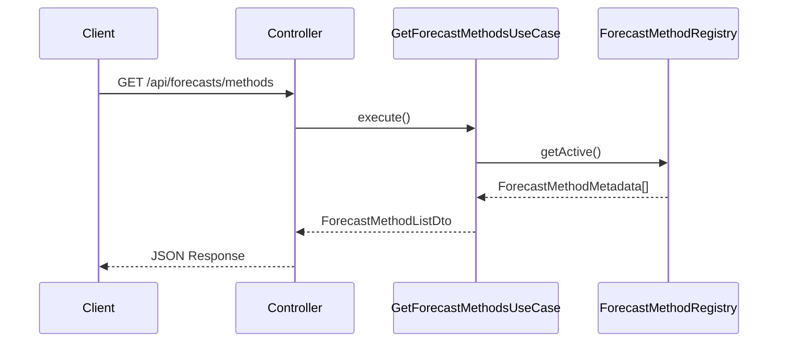
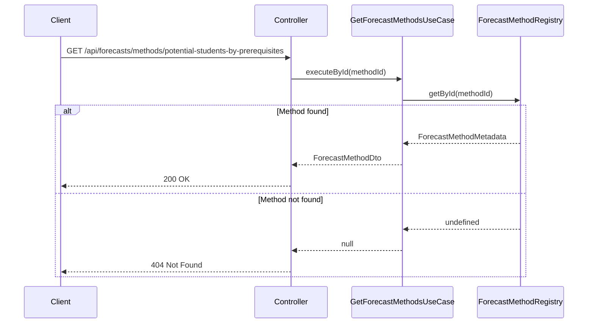

# Get Forecast Methods Architecture

## 1. Overview

### 1.1 Problem Statement

The frontend needs to display a list of available forecast methods so users can select which method to use for viewing backtesting accuracy data. Currently, there is no API endpoint that provides:

- A list of all available forecasting methods
- Metadata for each method (name, description, capabilities)
- Method status (active/deprecated)

### 1.2 Goal

Create a **forecast methods registry** that:

- Returns all available forecast methods with their metadata
- Provides consistent method identification across the system
- Enables frontend to dynamically build method selector UI
- Supports future method additions without frontend changes

### 1.3 Design Principles

1. **Single Source of Truth**: Method registry is the authoritative source for method metadata
2. **Extensibility**: New methods can be added without modifying existing code
3. **Consistency**: Method IDs match those used in forecast and accuracy endpoints
4. **Discoverability**: Self-describing API for frontend integration

---

## 2. Architecture Overview

### 2.1 System Context



### 2.2 Component Diagram



---

## 3. Domain Models

### 3.1 Forecast Method Metadata

```typescript
// Location: apps/backend/src/domain/forecasts/forecast-method-metadata.ts

export type MethodCategory =
  | 'prerequisite-based'
  | 'historical-trend'
  | 'machine-learning';

export type MethodStatus = 'active' | 'beta' | 'deprecated';

export interface MethodCapabilities {
  /** Whether the method supports multi-term requests */
  readonly supportsMultiTerm: boolean;

  /** Whether the method supports backtesting accuracy calculation */
  readonly supportsBacktesting: boolean;

  /** Whether the method requires prerequisite configuration */
  readonly requiresPrerequisites: boolean;

  /** Whether the method requires historical enrollment data */
  readonly requiresHistoricalData: boolean;
}

export interface ForecastMethodMetadata {
  /** Unique identifier (matches methodId in forecast responses) */
  readonly id: string;

  /** Human-readable method name */
  readonly label: string;

  /** Detailed description of the method */
  readonly description: string;

  /** Short description for UI cards */
  readonly shortDescription: string;

  /** Category for grouping methods */
  readonly category: MethodCategory;

  /** Current status of the method */
  readonly status: MethodStatus;

  /** Method capabilities */
  readonly capabilities: MethodCapabilities;

  /** Icon identifier for UI (optional) */
  readonly icon?: string;
}
```

### 3.2 Method Registry

```typescript
// Location: apps/backend/src/domain/forecasts/forecast-method-registry.ts

import type { ForecastMethodMetadata, MethodCategory } from './forecast-method-metadata';

export interface ForecastMethodRegistry {
  /**
   * Register a new forecast method
   */
  register(metadata: ForecastMethodMetadata): void;

  /**
   * Get all registered methods
   */
  getAll(): ForecastMethodMetadata[];

  /**
   * Get active methods only
   */
  getActive(): ForecastMethodMetadata[];

  /**
   * Get method by ID
   */
  getById(id: string): ForecastMethodMetadata | undefined;

  /**
   * Get methods by category
   */
  getByCategory(category: MethodCategory): ForecastMethodMetadata[];

  /**
   * Check if a method exists
   */
  has(id: string): boolean;
}
```

---

## 4. API Contract

### 4.1 Endpoints

#### Get All Methods

```
GET /api/forecasts/methods
```

#### Get Single Method

```
GET /api/forecasts/methods/{methodId}
```

### 4.2 Request Parameters

#### Path Parameters (for single method)

| Parameter | Type | Required | Description | Example |
|-----------|------|----------|-------------|---------|
| `methodId` | string | Yes | Method identifier | `potential-students-by-prerequisites` |

#### Query Parameters (for list)

| Parameter | Type | Required | Description | Example |
|-----------|------|----------|-------------|---------|
| `category` | string | No | Filter by category | `prerequisite-based` |
| `status` | string | No | Filter by status (default: active) | `active` |
| `backtesting` | boolean | No | Filter by backtesting support | `true` |

### 4.3 Response Schema

```typescript
// Location: packages/contracts/src/forecasts/forecast-method.dto.ts

import { z } from 'zod';

export const methodCapabilitiesSchema = z.object({
  supportsMultiTerm: z.boolean(),
  supportsBacktesting: z.boolean(),
  requiresPrerequisites: z.boolean(),
  requiresHistoricalData: z.boolean(),
});

export type MethodCapabilitiesDto = z.infer<typeof methodCapabilitiesSchema>;

export const forecastMethodSchema = z.object({
  id: z.string(),
  label: z.string(),
  description: z.string(),
  shortDescription: z.string(),
  category: z.enum(['prerequisite-based', 'historical-trend', 'machine-learning']),
  status: z.enum(['active', 'beta', 'deprecated']),
  capabilities: methodCapabilitiesSchema,
  icon: z.string().optional(),
});

export type ForecastMethodDto = z.infer<typeof forecastMethodSchema>;

export const forecastMethodListSchema = z.object({
  methods: z.array(forecastMethodSchema),
  metadata: z.object({
    totalCount: z.number().int().nonnegative(),
    activeCount: z.number().int().nonnegative(),
  }),
});

export type ForecastMethodListDto = z.infer<typeof forecastMethodListSchema>;
```

---

## 5. Request Flow

### 5.1 Get All Methods



### 5.2 Get Single Method



---

## 6. Request & Response Examples

### 6.1 Get All Methods

**Request:**
```bash
curl "http://localhost:3000/api/forecasts/methods"
```

**Response:**
```json
{
  "methods": [
    {
      "id": "potential-students-by-prerequisites",
      "label": "Potential Students by Prerequisites",
      "description": "Forecasts potential enrollment by analyzing students who have completed all prerequisite courses but haven't yet taken the target course. Uses set-based intersection to identify eligible students.",
      "shortDescription": "Based on prerequisite completion",
      "category": "prerequisite-based",
      "status": "active",
      "capabilities": {
        "supportsMultiTerm": true,
        "supportsBacktesting": true,
        "requiresPrerequisites": true,
        "requiresHistoricalData": true
      },
      "icon": "prerequisites"
    }
  ],
  "metadata": {
    "totalCount": 1,
    "activeCount": 1
  }
}
```

### 6.2 Get Single Method

**Request:**
```bash
curl "http://localhost:3000/api/forecasts/methods/potential-students-by-prerequisites"
```

**Response:**
```json
{
  "id": "potential-students-by-prerequisites",
  "label": "Potential Students by Prerequisites",
  "description": "Forecasts potential enrollment by analyzing students who have completed all prerequisite courses but haven't yet taken the target course. Uses set-based intersection to identify eligible students.",
  "shortDescription": "Based on prerequisite completion",
  "category": "prerequisite-based",
  "status": "active",
  "capabilities": {
    "supportsMultiTerm": true,
    "supportsBacktesting": true,
    "requiresPrerequisites": true,
    "requiresHistoricalData": true
  },
  "icon": "prerequisites"
}
```

### 6.3 Filter by Backtesting Support

**Request:**
```bash
curl "http://localhost:3000/api/forecasts/methods?backtesting=true"
```

---

## 7. Method Registry Configuration

### 7.1 Initial Methods

The registry is initialized with the following methods:

```typescript
// Location: apps/backend/src/domain/forecasts/method-definitions.ts

import type { ForecastMethodMetadata } from './forecast-method-metadata';

export const FORECAST_METHODS: ForecastMethodMetadata[] = [
  {
    id: 'potential-students-by-prerequisites',
    label: 'Potential Students by Prerequisites',
    description: 'Forecasts potential enrollment by analyzing students who have completed all prerequisite courses but haven\'t yet taken the target course. Uses set-based intersection to identify eligible students.',
    shortDescription: 'Based on prerequisite completion',
    category: 'prerequisite-based',
    status: 'active',
    capabilities: {
      supportsMultiTerm: true,
      supportsBacktesting: true,
      requiresPrerequisites: true,
      requiresHistoricalData: true,
    },
    icon: 'prerequisites',
  },
  // Future methods will be added here
];
```

### 7.2 Adding New Methods

When adding a new forecaster, register it in the method definitions:

```typescript
// Example: Adding a historical average method
{
  id: 'historical-average',
  label: 'Historical Average',
  description: 'Forecasts enrollment based on the average of previous terms.',
  shortDescription: 'Average of past enrollments',
  category: 'historical-trend',
  status: 'beta',
  capabilities: {
    supportsMultiTerm: true,
    supportsBacktesting: true,
    requiresPrerequisites: false,
    requiresHistoricalData: true,
  },
  icon: 'chart-line',
}
```

---

## 8. Error Handling

### 8.1 Error Scenarios

| Scenario | HTTP Status | Error Code | Description |
|----------|-------------|------------|-------------|
| Invalid category filter | 400 | `INVALID_CATEGORY` | Category value not recognized |
| Invalid status filter | 400 | `INVALID_STATUS` | Status value not recognized |
| Method not found | 404 | `METHOD_NOT_FOUND` | No method with specified ID |
| No methods match filter | 200 | - | Returns empty array with count 0 |

### 8.2 Error Response

```json
{
  "error": {
    "code": "METHOD_NOT_FOUND",
    "message": "Forecast method 'unknown-method' not found"
  }
}
```

---

## 9. Performance Considerations

### 9.1 Caching

- Method registry is loaded once at application startup
- Methods list can be cached with long TTL (methods rarely change)
- Consider HTTP caching headers for frontend

### 9.2 Response Size

- Response is small (< 1KB per method)
- No pagination needed for reasonable number of methods

---

## 10. Future Enhancements

### 10.1 Dynamic Method Discovery

Auto-register methods from forecaster implementations:

```typescript
export class PotentialStudentsByPrerequisitesForecaster
  implements CourseDemandForecaster, ForecastMethodProvider {

  static readonly metadata: ForecastMethodMetadata = {
    id: 'potential-students-by-prerequisites',
    // ...
  };
}
```

### 10.2 Method Versioning

Support multiple versions of the same method:

```typescript
{
  id: 'potential-students-by-prerequisites',
  version: '2.0',
  previousVersions: ['1.0'],
  // ...
}
```

### 10.3 Method Comparison Endpoint

Compare accuracy across methods:

```
GET /api/courses/{courseCode}/forecasts/compare?methods=method1,method2&terms=202410,202420
```

---

## 11. Related Documents

- [General Architecture](../../general-architecture.md)
- [Multi-Term Forecast Abstraction](../multi-term-forecast-abstraction/architecture.md)
- [Forecast Accuracy & Backtesting](../forecast-accuracy-backtesting/architecture.md)
- [Frontend Method Selector](../frontend-method-selector/architecture.md)
- [Implementation Guide](./implementation-guide.md)
