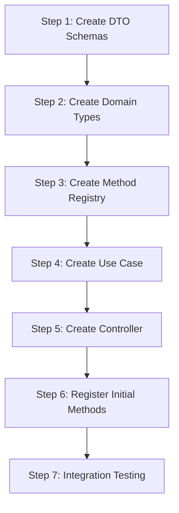

# Get Forecast Methods - Implementation Guide

## Overview

This guide provides step-by-step instructions for implementing the forecast methods registry and API endpoint.

---

## Prerequisites

Before starting, ensure you understand:

- The [Architecture Document](./architecture.md) for this feature
- The existing [General Architecture](../../general-architecture.md)
- The existing forecaster implementations

---

## Implementation Steps



---

## Step 1: Create DTO Schemas

### 1.1 Create the DTO File

**Location**: `packages/contracts/src/forecasts/forecast-method.dto.ts`

```typescript
import { z } from 'zod';

/**
 * Method capabilities schema
 */
export const methodCapabilitiesSchema = z.object({
  supportsMultiTerm: z.boolean(),
  supportsBacktesting: z.boolean(),
  requiresPrerequisites: z.boolean(),
  requiresHistoricalData: z.boolean(),
});

export type MethodCapabilitiesDto = z.infer<typeof methodCapabilitiesSchema>;

/**
 * Method category enumeration
 */
export const methodCategorySchema = z.enum([
  'prerequisite-based',
  'historical-trend',
  'machine-learning',
]);

export type MethodCategoryDto = z.infer<typeof methodCategorySchema>;

/**
 * Method status enumeration
 */
export const methodStatusSchema = z.enum(['active', 'beta', 'deprecated']);

export type MethodStatusDto = z.infer<typeof methodStatusSchema>;

/**
 * Single forecast method schema
 */
export const forecastMethodSchema = z.object({
  id: z.string().min(1),
  label: z.string().min(1),
  description: z.string(),
  shortDescription: z.string(),
  category: methodCategorySchema,
  status: methodStatusSchema,
  capabilities: methodCapabilitiesSchema,
  icon: z.string().optional(),
});

export type ForecastMethodDto = z.infer<typeof forecastMethodSchema>;

/**
 * Forecast methods list response schema
 */
export const forecastMethodListSchema = z.object({
  methods: z.array(forecastMethodSchema),
  metadata: z.object({
    totalCount: z.number().int().nonnegative(),
    activeCount: z.number().int().nonnegative(),
  }),
});

export type ForecastMethodListDto = z.infer<typeof forecastMethodListSchema>;

/**
 * Query parameters for filtering methods
 */
export const forecastMethodQuerySchema = z.object({
  category: methodCategorySchema.optional(),
  status: methodStatusSchema.optional(),
  backtesting: z
    .string()
    .transform(val => val === 'true')
    .optional(),
});

export type ForecastMethodQueryDto = z.infer<typeof forecastMethodQuerySchema>;
```

### 1.2 Update Package Exports

**Location**: `packages/contracts/src/index.ts`

Add the following exports:

```typescript
// Add to existing exports
export {
  methodCapabilitiesSchema,
  methodCategorySchema,
  methodStatusSchema,
  forecastMethodSchema,
  forecastMethodListSchema,
  forecastMethodQuerySchema,
} from './forecasts/forecast-method.dto.js';

export type {
  MethodCapabilitiesDto,
  MethodCategoryDto,
  MethodStatusDto,
  ForecastMethodDto,
  ForecastMethodListDto,
  ForecastMethodQueryDto,
} from './forecasts/forecast-method.dto.js';
```

---

## Step 2: Create Domain Types

### 2.1 Create Metadata Interface

**Location**: `apps/backend/src/domain/forecasts/forecast-method-metadata.ts`

```typescript
/**
 * Categories for grouping forecast methods
 */
export type MethodCategory =
  | 'prerequisite-based'
  | 'historical-trend'
  | 'machine-learning';

/**
 * Status of a forecast method
 */
export type MethodStatus = 'active' | 'beta' | 'deprecated';

/**
 * Capabilities of a forecast method
 */
export interface MethodCapabilities {
  readonly supportsMultiTerm: boolean;
  readonly supportsBacktesting: boolean;
  readonly requiresPrerequisites: boolean;
  readonly requiresHistoricalData: boolean;
}

/**
 * Complete metadata for a forecast method
 */
export interface ForecastMethodMetadata {
  readonly id: string;
  readonly label: string;
  readonly description: string;
  readonly shortDescription: string;
  readonly category: MethodCategory;
  readonly status: MethodStatus;
  readonly capabilities: MethodCapabilities;
  readonly icon?: string;
}
```

---

## Step 3: Create Method Registry

### 3.1 Create Registry Interface

**Location**: `apps/backend/src/domain/forecasts/forecast-method-registry.ts`

```typescript
import type {
  ForecastMethodMetadata,
  MethodCategory,
  MethodStatus,
} from './forecast-method-metadata';

/**
 * Filter options for querying methods
 */
export interface MethodFilterOptions {
  category?: MethodCategory;
  status?: MethodStatus;
  supportsBacktesting?: boolean;
}

/**
 * Registry for managing forecast method metadata
 */
export interface ForecastMethodRegistry {
  /**
   * Register a new forecast method
   */
  register(metadata: ForecastMethodMetadata): void;

  /**
   * Get all registered methods
   */
  getAll(): ForecastMethodMetadata[];

  /**
   * Get methods matching filter criteria
   */
  getFiltered(options: MethodFilterOptions): ForecastMethodMetadata[];

  /**
   * Get method by ID
   */
  getById(id: string): ForecastMethodMetadata | undefined;

  /**
   * Get methods by category
   */
  getByCategory(category: MethodCategory): ForecastMethodMetadata[];

  /**
   * Check if a method exists
   */
  has(id: string): boolean;

  /**
   * Get count of all methods
   */
  count(): number;

  /**
   * Get count of active methods
   */
  activeCount(): number;
}
```

### 3.2 Create Registry Implementation

**Location**: `apps/backend/src/domain/forecasts/in-memory-forecast-method-registry.ts`

```typescript
import type {
  ForecastMethodMetadata,
  MethodCategory,
} from './forecast-method-metadata';
import type {
  ForecastMethodRegistry,
  MethodFilterOptions,
} from './forecast-method-registry';

/**
 * In-memory implementation of the forecast method registry
 */
export class InMemoryForecastMethodRegistry implements ForecastMethodRegistry {
  private readonly methods = new Map<string, ForecastMethodMetadata>();

  register(metadata: ForecastMethodMetadata): void {
    if (this.methods.has(metadata.id)) {
      throw new Error(`Method with ID '${metadata.id}' is already registered`);
    }
    this.methods.set(metadata.id, metadata);
  }

  getAll(): ForecastMethodMetadata[] {
    return Array.from(this.methods.values());
  }

  getFiltered(options: MethodFilterOptions): ForecastMethodMetadata[] {
    let methods = this.getAll();

    if (options.category) {
      methods = methods.filter(m => m.category === options.category);
    }

    if (options.status) {
      methods = methods.filter(m => m.status === options.status);
    } else {
      // Default to active methods only
      methods = methods.filter(m => m.status === 'active');
    }

    if (options.supportsBacktesting !== undefined) {
      methods = methods.filter(
        m => m.capabilities.supportsBacktesting === options.supportsBacktesting,
      );
    }

    return methods;
  }

  getById(id: string): ForecastMethodMetadata | undefined {
    return this.methods.get(id);
  }

  getByCategory(category: MethodCategory): ForecastMethodMetadata[] {
    return this.getAll().filter(m => m.category === category);
  }

  has(id: string): boolean {
    return this.methods.has(id);
  }

  count(): number {
    return this.methods.size;
  }

  activeCount(): number {
    return this.getAll().filter(m => m.status === 'active').length;
  }
}
```

### 3.3 Create Method Definitions

**Location**: `apps/backend/src/domain/forecasts/method-definitions.ts`

```typescript
import type { ForecastMethodMetadata } from './forecast-method-metadata';

/**
 * All available forecast methods
 */
export const FORECAST_METHODS: ForecastMethodMetadata[] = [
  {
    id: 'potential-students-by-prerequisites',
    label: 'Potential Students by Prerequisites',
    description:
      'Forecasts potential enrollment by analyzing students who have completed all prerequisite courses but have not yet taken the target course. Uses set-based intersection to identify eligible students and provides detailed breakdown of prerequisite completion.',
    shortDescription: 'Based on prerequisite completion',
    category: 'prerequisite-based',
    status: 'active',
    capabilities: {
      supportsMultiTerm: true,
      supportsBacktesting: true,
      requiresPrerequisites: true,
      requiresHistoricalData: true,
    },
    icon: 'prerequisites',
  },
  // Additional methods can be added here
];
```

### 3.4 Create Registry Singleton

**Location**: `apps/backend/src/domain/forecasts/forecast-method-registry.singleton.ts`

```typescript
import { InMemoryForecastMethodRegistry } from './in-memory-forecast-method-registry';
import { FORECAST_METHODS } from './method-definitions';
import type { ForecastMethodRegistry } from './forecast-method-registry';

/**
 * Create and initialize the forecast method registry
 */
function createInitializedRegistry(): ForecastMethodRegistry {
  const registry = new InMemoryForecastMethodRegistry();

  for (const method of FORECAST_METHODS) {
    registry.register(method);
  }

  return registry;
}

/**
 * Singleton instance of the forecast method registry
 */
export const forecastMethodRegistry: ForecastMethodRegistry =
  createInitializedRegistry();
```

### 3.5 Update Domain Exports

**Location**: `apps/backend/src/domain/forecasts/index.ts`

```typescript
// Add to existing exports
export * from './forecast-method-metadata';
export * from './forecast-method-registry';
export * from './in-memory-forecast-method-registry';
export * from './method-definitions';
export { forecastMethodRegistry } from './forecast-method-registry.singleton';
```

---

## Step 4: Create Use Case

### 4.1 Create Use Case

**Location**: `apps/backend/src/application/use-cases/forecasts/get-forecast-methods.use-case.ts`

```typescript
import type { ForecastMethodDto, ForecastMethodListDto } from '@app/contracts';
import type { ForecastMethodRegistry } from '../../../domain/forecasts/forecast-method-registry';
import type { MethodCategory, MethodStatus } from '../../../domain/forecasts/forecast-method-metadata';

export interface GetForecastMethodsInput {
  category?: MethodCategory;
  status?: MethodStatus;
  supportsBacktesting?: boolean;
}

export interface GetForecastMethodsUseCaseDeps {
  registry: ForecastMethodRegistry;
}

export class GetForecastMethodsUseCase {
  private readonly registry: ForecastMethodRegistry;

  constructor(deps: GetForecastMethodsUseCaseDeps) {
    this.registry = deps.registry;
  }

  /**
   * Get all methods matching the filter criteria
   */
  execute(input: GetForecastMethodsInput = {}): ForecastMethodListDto {
    const methods = this.registry.getFiltered({
      category: input.category,
      status: input.status,
      supportsBacktesting: input.supportsBacktesting,
    });

    return {
      methods: methods.map(this.toDto),
      metadata: {
        totalCount: this.registry.count(),
        activeCount: this.registry.activeCount(),
      },
    };
  }

  /**
   * Get a single method by ID
   */
  executeById(methodId: string): ForecastMethodDto | null {
    const method = this.registry.getById(methodId);

    if (!method) {
      return null;
    }

    return this.toDto(method);
  }

  private toDto(method: {
    id: string;
    label: string;
    description: string;
    shortDescription: string;
    category: string;
    status: string;
    capabilities: {
      supportsMultiTerm: boolean;
      supportsBacktesting: boolean;
      requiresPrerequisites: boolean;
      requiresHistoricalData: boolean;
    };
    icon?: string;
  }): ForecastMethodDto {
    return {
      id: method.id,
      label: method.label,
      description: method.description,
      shortDescription: method.shortDescription,
      category: method.category as 'prerequisite-based' | 'historical-trend' | 'machine-learning',
      status: method.status as 'active' | 'beta' | 'deprecated',
      capabilities: method.capabilities,
      icon: method.icon,
    };
  }
}
```

---

## Step 5: Create Controller

### 5.1 Create Controller

**Location**: `apps/backend/src/presentation/controllers/forecasts/forecast-methods.controller.ts`

```typescript
import { z } from 'zod';
import { createRoute, OpenAPIHono } from '@hono/zod-openapi';
import {
  forecastMethodSchema,
  forecastMethodListSchema,
  methodCategorySchema,
  methodStatusSchema,
} from '@app/contracts';
import { GetForecastMethodsUseCase } from '../../../application/use-cases/forecasts/get-forecast-methods.use-case';
import { forecastMethodRegistry } from '../../../domain/forecasts/forecast-method-registry.singleton';

// List all methods route
const listMethodsRoute = createRoute({
  method: 'get',
  path: '/api/forecasts/methods',
  request: {
    query: z.object({
      category: methodCategorySchema.optional(),
      status: methodStatusSchema.optional(),
      backtesting: z
        .string()
        .transform(val => val === 'true')
        .optional(),
    }),
  },
  responses: {
    200: {
      description: 'List of available forecast methods',
      content: {
        'application/json': {
          schema: forecastMethodListSchema,
        },
      },
    },
  },
  tags: ['Forecasts', 'Methods'],
});

// Get single method route
const getMethodRoute = createRoute({
  method: 'get',
  path: '/api/forecasts/methods/{methodId}',
  request: {
    params: z.object({
      methodId: z.string().min(1),
    }),
  },
  responses: {
    200: {
      description: 'Forecast method details',
      content: {
        'application/json': {
          schema: forecastMethodSchema,
        },
      },
    },
    404: {
      description: 'Method not found',
    },
  },
  tags: ['Forecasts', 'Methods'],
});

export const registerForecastMethodsRoutes = (app: OpenAPIHono): void => {
  const useCase = new GetForecastMethodsUseCase({
    registry: forecastMethodRegistry,
  });

  // List methods
  app.openapi(listMethodsRoute, async c => {
    const { category, status, backtesting } = c.req.valid('query');

    const result = useCase.execute({
      category: category as 'prerequisite-based' | 'historical-trend' | 'machine-learning' | undefined,
      status: status as 'active' | 'beta' | 'deprecated' | undefined,
      supportsBacktesting: backtesting,
    });

    return c.json(result, 200);
  });

  // Get single method
  app.openapi(getMethodRoute, async c => {
    const { methodId } = c.req.valid('param');

    const result = useCase.executeById(methodId);

    if (!result) {
      return c.json(
        {
          error: {
            code: 'METHOD_NOT_FOUND',
            message: `Forecast method '${methodId}' not found`,
          },
        },
        404,
      );
    }

    return c.json(result, 200);
  });
};
```

### 5.2 Register Routes

**Location**: Update your main app file

```typescript
import { registerForecastMethodsRoutes } from './presentation/controllers/forecasts/forecast-methods.controller';

// In your app setup
registerForecastMethodsRoutes(app);
```

---

## Step 6: Integration Testing

### 6.1 Test the Implementation

```bash
# Start the development server
npm run dev

# Get all active methods
curl "http://localhost:3000/api/forecasts/methods"

# Get methods with backtesting support
curl "http://localhost:3000/api/forecasts/methods?backtesting=true"

# Get single method
curl "http://localhost:3000/api/forecasts/methods/potential-students-by-prerequisites"

# Test 404 for unknown method
curl "http://localhost:3000/api/forecasts/methods/unknown-method"
```

---

## File Summary

### New Files to Create

| File | Purpose | Layer |
|------|---------|-------|
| `packages/contracts/src/forecasts/forecast-method.dto.ts` | DTO schemas | Contracts |
| `apps/backend/src/domain/forecasts/forecast-method-metadata.ts` | Domain types | Domain |
| `apps/backend/src/domain/forecasts/forecast-method-registry.ts` | Registry interface | Domain |
| `apps/backend/src/domain/forecasts/in-memory-forecast-method-registry.ts` | Registry implementation | Domain |
| `apps/backend/src/domain/forecasts/method-definitions.ts` | Method definitions | Domain |
| `apps/backend/src/domain/forecasts/forecast-method-registry.singleton.ts` | Registry singleton | Domain |
| `apps/backend/src/application/use-cases/forecasts/get-forecast-methods.use-case.ts` | Use case | Application |
| `apps/backend/src/presentation/controllers/forecasts/forecast-methods.controller.ts` | Controller | Presentation |

### Files to Modify

| File | Changes |
|------|---------|
| `packages/contracts/src/index.ts` | Export method DTOs |
| `apps/backend/src/domain/forecasts/index.ts` | Export registry components |
| `apps/backend/src/presentation/server.ts` | Register methods routes |

---

## Checklist

### Pre-Implementation

- [ ] Review architecture document
- [ ] Understand existing forecaster structure
- [ ] Set up development environment

### Implementation

- [ ] Step 1: Create DTO Schemas
  - [ ] Create `forecast-method.dto.ts`
  - [ ] Update package exports

- [ ] Step 2: Create Domain Types
  - [ ] Create `forecast-method-metadata.ts`

- [ ] Step 3: Create Method Registry
  - [ ] Create registry interface
  - [ ] Create in-memory implementation
  - [ ] Create method definitions
  - [ ] Create singleton instance
  - [ ] Update domain exports

- [ ] Step 4: Create Use Case
  - [ ] Create `get-forecast-methods.use-case.ts`

- [ ] Step 5: Create Controller
  - [ ] Create `forecast-methods.controller.ts`
  - [ ] Register routes in app

- [ ] Step 6: Testing
  - [ ] Write unit tests for registry
  - [ ] Write unit tests for use case
  - [ ] Integration testing with curl

---

## Related Documents

- [Architecture Document](./architecture.md)
- [System Impact](./system-impact.md)
- [Testing Guide](./testing-guide.md)
- [Frontend Method Selector](../frontend-method-selector/architecture.md)
