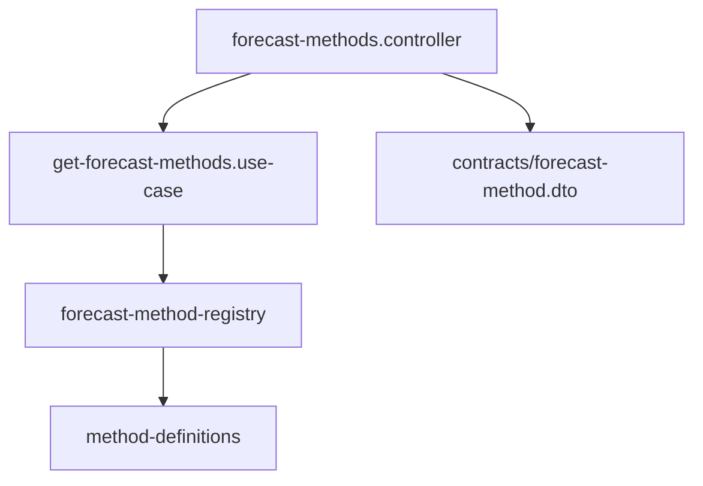

# Get Forecast Methods - System Impact

## Overview

This document describes the impact of the Get Forecast Methods feature on the existing system.

---

## 1. New Components

### 1.1 Contracts Package

| Component | Type | Description |
|-----------|------|-------------|
| `forecast-method.dto.ts` | Schema | Zod schemas for method DTOs |

### 1.2 Backend Domain Layer

| Component | Type | Description |
|-----------|------|-------------|
| `forecast-method-metadata.ts` | Types | TypeScript interfaces for method metadata |
| `forecast-method-registry.ts` | Interface | Registry abstraction |
| `in-memory-forecast-method-registry.ts` | Class | Registry implementation |
| `method-definitions.ts` | Config | Static method definitions |
| `forecast-method-registry.singleton.ts` | Singleton | Global registry instance |

### 1.3 Backend Application Layer

| Component | Type | Description |
|-----------|------|-------------|
| `get-forecast-methods.use-case.ts` | Use Case | Business logic for retrieving methods |

### 1.4 Backend Presentation Layer

| Component | Type | Description |
|-----------|------|-------------|
| `forecast-methods.controller.ts` | Controller | HTTP routes for methods API |

---

## 2. Modified Components

### 2.1 Contracts Package

| File | Changes |
|------|---------|
| `src/index.ts` | Add exports for method DTOs |

### 2.2 Backend

| File | Changes |
|------|---------|
| `src/domain/forecasts/index.ts` | Export registry components |
| `src/presentation/server.ts` | Register methods routes |

---

## 3. Database Impact

**No database changes required.**

The method registry is in-memory and populated from static configuration at startup.

---

## 4. API Changes

### 4.1 New Endpoints

| Method | Path | Description |
|--------|------|-------------|
| GET | `/api/forecasts/methods` | List all forecast methods |
| GET | `/api/forecasts/methods/{methodId}` | Get single method details |

### 4.2 Existing Endpoints

No changes to existing endpoints.

---

## 5. Frontend Impact

### 5.1 New Capabilities

The frontend can now:

- Fetch available forecast methods dynamically
- Display method metadata (name, description, capabilities)
- Filter methods by category, status, and features

### 5.2 API Client Updates

Frontend will need to add:

- Type definitions from contracts package
- API client methods for fetching methods

---

## 6. Performance Considerations

### 6.1 Memory

- Method registry is small (~1KB per method)
- Singleton pattern ensures single instance

### 6.2 Response Time

- In-memory lookup is O(1) by ID
- Filtering is O(n) where n is number of methods
- Expected n < 20 methods, so negligible impact

### 6.3 Caching Recommendations

```typescript
// Frontend: Cache method list
const CACHE_TTL = 3600000; // 1 hour

// Backend: HTTP caching headers
res.setHeader('Cache-Control', 'public, max-age=3600');
```

---

## 7. Dependencies

### 7.1 Required Dependencies

No new npm dependencies required.

### 7.2 Internal Dependencies



---

## 8. Migration Steps

### 8.1 Backend Deployment

1. Deploy updated contracts package
2. Deploy backend with new endpoints
3. Verify endpoints are accessible

### 8.2 Frontend Integration

1. Update contracts package dependency
2. Add API client methods
3. Integrate with method selector component

---

## 9. Rollback Plan

### 9.1 Backend

- Remove routes registration from server.ts
- Previous functionality unaffected

### 9.2 Frontend

- Feature flag can disable method selector
- Fallback to hardcoded method list

---

## 10. Monitoring

### 10.1 Metrics to Track

- `/api/forecasts/methods` request count
- `/api/forecasts/methods/{id}` request count
- Response times

### 10.2 Alerts

- 404 rate for unknown method IDs (potential frontend bugs)

---

## Related Documents

- [Architecture Document](./architecture.md)
- [Implementation Guide](./implementation-guide.md)
- [Testing Guide](./testing-guide.md)
