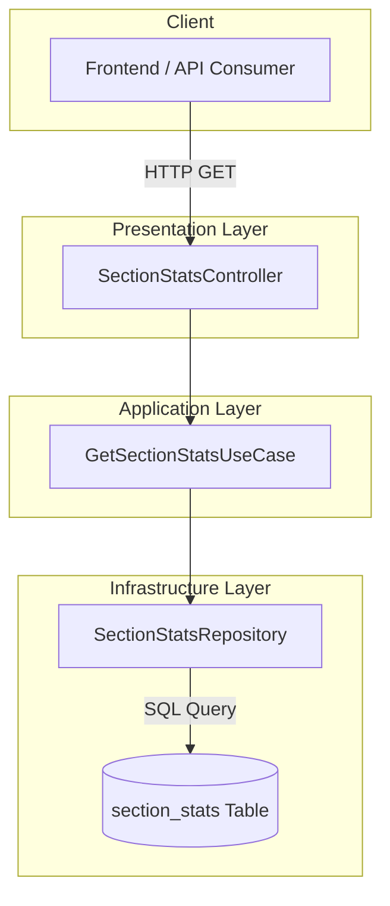
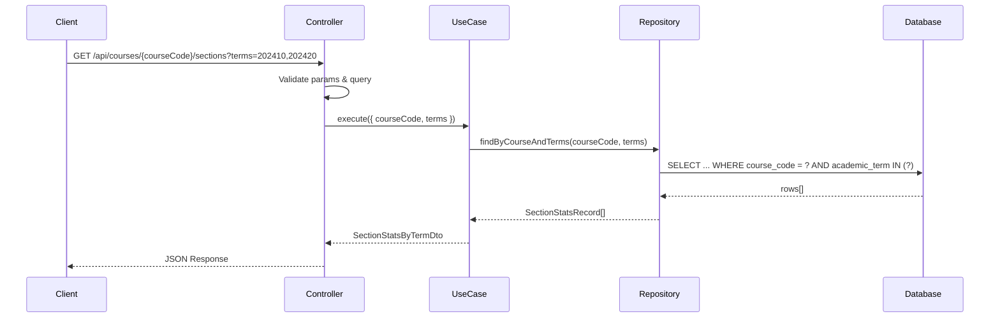
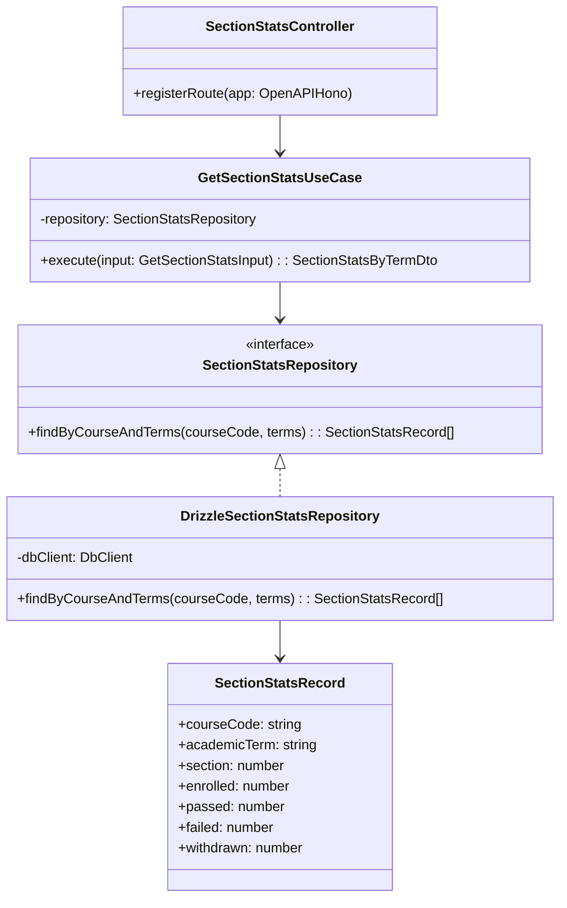

# Get Section Stats Architecture

## 1. Overview

### 1.1 Problem Statement

The existing course history functionality provides aggregate enrollment statistics per academic term, but there's no way to:

- View enrollment statistics broken down by section within each term
- Analyze pass/fail/withdrawn rates per section
- Compare section performance within the same course and term
- Support planning decisions based on section-level data

### 1.2 Goal

Create an endpoint to query the `section_stats` table that:

- Returns section-level enrollment statistics for a course
- Supports filtering by single or multiple academic terms
- Orders results by section number (descending)
- Follows existing API patterns for multi-term queries

### 1.3 Design Principles

1. **Consistency**: Follow existing patterns from course-history and forecast-accuracy endpoints
2. **Reuse**: Leverage existing repository and controller patterns
3. **Multi-Term Support**: Mirror the `term`/`terms` query parameter pattern
4. **Simplicity**: Direct query without complex domain logic (read-only)

---

## 2. Architecture Overview

### 2.1 System Context



### 2.2 Data Flow



---

## 3. Database Schema

### 3.1 Table Structure

```sql
CREATE TABLE IF NOT EXISTS "section_stats" (
    course_code   TEXT NOT NULL,
    academic_term TEXT NOT NULL,
    section       INTEGER NOT NULL,
    enrolled      INTEGER NOT NULL CHECK (enrolled >= 0),
    passed        INTEGER NOT NULL CHECK (passed >= 0),
    failed        INTEGER NOT NULL CHECK (failed >= 0),
    withdrawn     INTEGER NOT NULL CHECK (withdrawn >= 0),
    PRIMARY KEY (course_code, academic_term, section),
    CHECK (enrolled = passed + failed + withdrawn)
);
```

### 3.2 Schema Observations

| Column | Type | Notes |
|--------|------|-------|
| `course_code` | TEXT | Course identifier (e.g., "ISIS-3204") |
| `academic_term` | TEXT | Term identifier as string (e.g., "202410") |
| `section` | INTEGER | Section number within the term |
| `enrolled` | INTEGER | Total enrolled students |
| `passed` | INTEGER | Students who passed |
| `failed` | INTEGER | Students who failed |
| `withdrawn` | INTEGER | Students who withdrew |

**Note**: Unlike the `enrollments` table which uses `INTEGER` for `academic_term`, this table uses `TEXT`. The endpoint will accept integer query parameters and convert to string for querying.

---

## 4. Component Design

### 4.1 Class Diagram



### 4.2 Component Responsibilities

| Component | Responsibility | Layer |
|-----------|---------------|-------|
| `SectionStatsController` | HTTP routing, validation, response formatting | Presentation |
| `GetSectionStatsUseCase` | Orchestrate data retrieval and DTO mapping | Application |
| `SectionStatsRepository` | Data access abstraction | Infrastructure |
| `sectionStats` (Drizzle schema) | Database schema definition | Infrastructure |

---

## 5. API Contract

### 5.1 Endpoint

```
GET /api/courses/{courseCode}/sections
```

### 5.2 Request Parameters

#### Path Parameters

| Parameter | Type | Required | Description | Example |
|-----------|------|----------|-------------|---------|
| `courseCode` | string | Yes | Course code in XXXX-DDDD format | `ISIS-3204` |

#### Query Parameters

| Parameter | Type | Required | Description | Example |
|-----------|------|----------|-------------|---------|
| `term` | integer | No* | Single academic term | `202410` |
| `terms` | string | No* | Comma-separated terms | `202410,202420` |

*One of `term` or `terms` is required

### 5.3 Response Schema

```typescript
// Location: packages/contracts/src/section-stats/section-stats.dto.ts

import { z } from 'zod';

/**
 * Single section statistics
 */
export const sectionStatSchema = z.object({
  section: z.number().int().nonnegative(),
  enrolled: z.number().int().nonnegative(),
  passed: z.number().int().nonnegative(),
  failed: z.number().int().nonnegative(),
  withdrawn: z.number().int().nonnegative(),
});

export type SectionStatDto = z.infer<typeof sectionStatSchema>;

/**
 * Section stats grouped by term
 */
export const termSectionStatsSchema = z.object({
  academicTerm: z.number().int(),
  sections: z.array(sectionStatSchema),
  totals: z.object({
    totalSections: z.number().int().nonnegative(),
    totalEnrolled: z.number().int().nonnegative(),
    totalPassed: z.number().int().nonnegative(),
    totalFailed: z.number().int().nonnegative(),
    totalWithdrawn: z.number().int().nonnegative(),
  }),
});

export type TermSectionStatsDto = z.infer<typeof termSectionStatsSchema>;

/**
 * Full response for section stats query
 */
export const sectionStatsByTermSchema = z.object({
  courseCode: z.string().regex(/^[A-Z]{4}-\d{4}$/),
  terms: z.array(termSectionStatsSchema),
  metadata: z.object({
    requestedTerms: z.array(z.number().int()),
    termsWithData: z.number().int().nonnegative(),
    termsWithoutData: z.array(z.number().int()).optional(),
    processedAt: z.string().datetime(),
  }),
});

export type SectionStatsByTermDto = z.infer<typeof sectionStatsByTermSchema>;
```

---

## 6. Request & Response Examples

### 6.1 Single Term Request

**Request:**
```bash
curl "http://localhost:3000/api/courses/ISIS-3204/sections?term=202410"
```

**Response:**
```json
{
  "courseCode": "ISIS-3204",
  "terms": [
    {
      "academicTerm": 202410,
      "sections": [
        {
          "section": 3,
          "enrolled": 25,
          "passed": 20,
          "failed": 3,
          "withdrawn": 2
        },
        {
          "section": 2,
          "enrolled": 30,
          "passed": 25,
          "failed": 4,
          "withdrawn": 1
        },
        {
          "section": 1,
          "enrolled": 28,
          "passed": 22,
          "failed": 5,
          "withdrawn": 1
        }
      ],
      "totals": {
        "totalSections": 3,
        "totalEnrolled": 83,
        "totalPassed": 67,
        "totalFailed": 12,
        "totalWithdrawn": 4
      }
    }
  ],
  "metadata": {
    "requestedTerms": [202410],
    "termsWithData": 1,
    "processedAt": "2025-12-03T10:30:00.000Z"
  }
}
```

### 6.2 Multi-Term Request

**Request:**
```bash
curl "http://localhost:3000/api/courses/ISIS-3204/sections?terms=202410,202420,202510"
```

**Response:**
```json
{
  "courseCode": "ISIS-3204",
  "terms": [
    {
      "academicTerm": 202410,
      "sections": [
        {
          "section": 3,
          "enrolled": 25,
          "passed": 20,
          "failed": 3,
          "withdrawn": 2
        },
        {
          "section": 2,
          "enrolled": 30,
          "passed": 25,
          "failed": 4,
          "withdrawn": 1
        },
        {
          "section": 1,
          "enrolled": 28,
          "passed": 22,
          "failed": 5,
          "withdrawn": 1
        }
      ],
      "totals": {
        "totalSections": 3,
        "totalEnrolled": 83,
        "totalPassed": 67,
        "totalFailed": 12,
        "totalWithdrawn": 4
      }
    },
    {
      "academicTerm": 202420,
      "sections": [
        {
          "section": 2,
          "enrolled": 32,
          "passed": 28,
          "failed": 3,
          "withdrawn": 1
        },
        {
          "section": 1,
          "enrolled": 35,
          "passed": 30,
          "failed": 4,
          "withdrawn": 1
        }
      ],
      "totals": {
        "totalSections": 2,
        "totalEnrolled": 67,
        "totalPassed": 58,
        "totalFailed": 7,
        "totalWithdrawn": 2
      }
    }
  ],
  "metadata": {
    "requestedTerms": [202410, 202420, 202510],
    "termsWithData": 2,
    "termsWithoutData": [202510],
    "processedAt": "2025-12-03T10:30:00.000Z"
  }
}
```

### 6.3 JavaScript/TypeScript Usage

```typescript
// Fetch section stats for multiple terms
async function getSectionStats(
  courseCode: string,
  terms: number[]
): Promise<SectionStatsByTermDto> {
  const termsParam = terms.join(',');
  const response = await fetch(
    `/api/courses/${courseCode}/sections?terms=${termsParam}`
  );
  return response.json();
}

// Usage
const stats = await getSectionStats('ISIS-3204', [202410, 202420]);

// Display totals per term
stats.terms.forEach(term => {
  console.log(`Term ${term.academicTerm}:`);
  console.log(`  Sections: ${term.totals.totalSections}`);
  console.log(`  Enrolled: ${term.totals.totalEnrolled}`);
  console.log(`  Pass Rate: ${(term.totals.totalPassed / term.totals.totalEnrolled * 100).toFixed(1)}%`);
});
```

---

## 7. Error Handling

### 7.1 Error Scenarios

| Scenario | HTTP Status | Error Code | Description |
|----------|-------------|------------|-------------|
| Invalid course code | 400 | `INVALID_COURSE_CODE` | Format doesn't match XXXX-DDDD |
| No term provided | 400 | `MISSING_TERM` | Neither term nor terms provided |
| Invalid term format | 400 | `INVALID_TERM_FORMAT` | Term not a valid integer |
| Course not found | 200 | - | Empty terms array with metadata |

### 7.2 No Data Response

When no section stats exist for the requested terms:

```json
{
  "courseCode": "ISIS-3204",
  "terms": [],
  "metadata": {
    "requestedTerms": [202410, 202420],
    "termsWithData": 0,
    "termsWithoutData": [202410, 202420],
    "processedAt": "2025-12-03T10:30:00.000Z"
  }
}
```

---

## 8. Performance Considerations

### 8.1 Database Optimization

- **Existing Index**: Primary key on `(course_code, academic_term, section)` covers the query pattern
- **Query Pattern**: Single query with `IN` clause for multiple terms
- **Ordering**: ORDER BY `section DESC` aligns with use-case requirement

### 8.2 Query Example

```sql
SELECT course_code, academic_term, section, enrolled, passed, failed, withdrawn
FROM section_stats
WHERE course_code = ?
  AND academic_term IN (?, ?, ?)
ORDER BY academic_term ASC, section DESC;
```

### 8.3 Estimated Performance

| Scenario | Expected Rows | Expected Time |
|----------|--------------|---------------|
| Single term, 3 sections | 3 | < 1ms |
| 10 terms, 5 sections each | 50 | < 5ms |
| Max request (10 terms) | ~100 | < 10ms |

---

## 9. Related Documents

- [General Architecture](../../general-architecture.md)
- [Forecast Accuracy Backtesting](../forecast-accuracy-backtesting/architecture.md) - Multi-term query pattern reference
- [Implementation Guide](./implementation-guide.md)
- [System Impact](./system-impact.md)
- [Testing Guide](./testing-guide.md)
