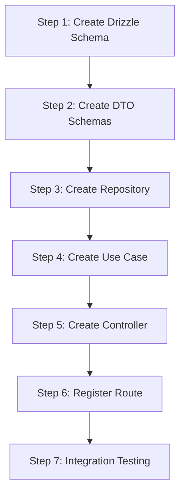

# Get Section Stats - Implementation Guide

## Overview

This guide provides step-by-step instructions for implementing the section stats query endpoint.

---

## Prerequisites

Before starting, ensure you understand:

- The [Architecture Document](./architecture.md) for this feature
- The existing [General Architecture](../../general-architecture.md)
- The [TypeScript Guidelines](../../../guidelines/typescript_guidelines.md)

---

## Implementation Steps



---

## Step 1: Create Drizzle Schema

### 1.1 Create Schema File

**Location**: `apps/backend/src/infrastructure/db/schema/section-stats.ts`

```typescript
import { integer, sqliteTable, text, primaryKey } from 'drizzle-orm/sqlite-core';

export const sectionStats = sqliteTable(
  'section_stats',
  {
    courseCode: text('course_code').notNull(),
    academicTerm: text('academic_term').notNull(),
    section: integer('section').notNull(),
    enrolled: integer('enrolled').notNull(),
    passed: integer('passed').notNull(),
    failed: integer('failed').notNull(),
    withdrawn: integer('withdrawn').notNull(),
  },
  table => ({
    pk: primaryKey({
      columns: [table.courseCode, table.academicTerm, table.section],
    }),
  }),
);
```

### 1.2 Export Schema

Update the schema index if one exists, or ensure it's exported from the schema directory.

---

## Step 2: Create DTO Schemas

### 2.1 Create DTO File

**Location**: `packages/contracts/src/section-stats/section-stats.dto.ts`

```typescript
import { z } from 'zod';

/**
 * Single section statistics within a term
 */
export const sectionStatSchema = z.object({
  section: z.number().int().nonnegative(),
  enrolled: z.number().int().nonnegative(),
  passed: z.number().int().nonnegative(),
  failed: z.number().int().nonnegative(),
  withdrawn: z.number().int().nonnegative(),
});

export type SectionStatDto = z.infer<typeof sectionStatSchema>;

/**
 * Section stats for a single term with aggregated totals
 */
export const termSectionStatsSchema = z.object({
  academicTerm: z.number().int(),
  sections: z.array(sectionStatSchema),
  totals: z.object({
    totalSections: z.number().int().nonnegative(),
    totalEnrolled: z.number().int().nonnegative(),
    totalPassed: z.number().int().nonnegative(),
    totalFailed: z.number().int().nonnegative(),
    totalWithdrawn: z.number().int().nonnegative(),
  }),
});

export type TermSectionStatsDto = z.infer<typeof termSectionStatsSchema>;

/**
 * Complete response for section stats query
 */
export const sectionStatsByTermSchema = z.object({
  courseCode: z.string().regex(/^[A-Z]{4}-\d{4}$/),
  terms: z.array(termSectionStatsSchema),
  metadata: z.object({
    requestedTerms: z.array(z.number().int()),
    termsWithData: z.number().int().nonnegative(),
    termsWithoutData: z.array(z.number().int()).optional(),
    processedAt: z.string().datetime(),
  }),
});

export type SectionStatsByTermDto = z.infer<typeof sectionStatsByTermSchema>;
```

### 2.2 Update Package Exports

**Location**: `packages/contracts/src/index.ts`

Add the following exports:

```typescript
// Section Stats
export {
  sectionStatSchema,
  termSectionStatsSchema,
  sectionStatsByTermSchema,
} from './section-stats/section-stats.dto.js';

export type {
  SectionStatDto,
  TermSectionStatsDto,
  SectionStatsByTermDto,
} from './section-stats/section-stats.dto.js';
```

---

## Step 3: Create Repository

### 3.1 Create Repository File

**Location**: `apps/backend/src/infrastructure/repositories/section-stats-repository.ts`

```typescript
import type { InferSelectModel } from 'drizzle-orm';
import { eq, inArray, desc, asc } from 'drizzle-orm';
import { createDbContext, type DbClient } from '../db/client';
import { sectionStats } from '../db/schema/section-stats';

export type SectionStatsRecord = InferSelectModel<typeof sectionStats>;

export interface SectionStatsRepository {
  findByCourseAndTerms(
    courseCode: string,
    terms: string[],
  ): Promise<SectionStatsRecord[]>;
}

/**
 * Creates a SectionStatsRepository backed by Drizzle and SQLite.
 */
export const createSectionStatsRepository = (
  dbClient: DbClient,
): SectionStatsRepository => {
  const findByCourseAndTerms = async (
    courseCode: string,
    terms: string[],
  ): Promise<SectionStatsRecord[]> => {
    if (terms.length === 0) {
      return [];
    }

    const rows = await dbClient
      .select()
      .from(sectionStats)
      .where(
        eq(sectionStats.courseCode, courseCode),
      )
      .orderBy(
        asc(sectionStats.academicTerm),
        desc(sectionStats.section),
      );

    // Filter by terms in-memory for SQLite compatibility
    // (inArray with text can be problematic in some SQLite setups)
    const termsSet = new Set(terms);
    return rows.filter(row => termsSet.has(row.academicTerm));
  };

  return { findByCourseAndTerms };
};

/**
 * Singleton instance for use across the application.
 */
const { dbClient } = createDbContext();
export const sectionStatsRepository = createSectionStatsRepository(dbClient);
```

---

## Step 4: Create Use Case

### 4.1 Create Use Case File

**Location**: `apps/backend/src/application/use-cases/get-section-stats.use-case.ts`

```typescript
import type {
  SectionStatsByTermDto,
  TermSectionStatsDto,
  SectionStatDto,
} from '@app/contracts';
import type {
  SectionStatsRepository,
  SectionStatsRecord,
} from '../../infrastructure/repositories/section-stats-repository';

export interface GetSectionStatsInput {
  readonly courseCode: string;
  readonly terms: number[];
}

export interface GetSectionStatsUseCase {
  execute(input: GetSectionStatsInput): Promise<SectionStatsByTermDto>;
}

export const createGetSectionStatsUseCase = (
  repository: SectionStatsRepository,
): GetSectionStatsUseCase => {
  const execute = async (
    input: GetSectionStatsInput,
  ): Promise<SectionStatsByTermDto> => {
    // Convert integer terms to string for database query
    const termsAsStrings = input.terms.map(t => String(t));

    const records = await repository.findByCourseAndTerms(
      input.courseCode,
      termsAsStrings,
    );

    // Group records by term
    const recordsByTerm = groupByTerm(records);

    // Map to DTOs
    const termsWithData: TermSectionStatsDto[] = [];
    const termsWithoutData: number[] = [];

    for (const requestedTerm of input.terms) {
      const termRecords = recordsByTerm.get(String(requestedTerm));

      if (termRecords && termRecords.length > 0) {
        termsWithData.push(mapToTermSectionStats(requestedTerm, termRecords));
      } else {
        termsWithoutData.push(requestedTerm);
      }
    }

    return {
      courseCode: input.courseCode,
      terms: termsWithData,
      metadata: {
        requestedTerms: input.terms,
        termsWithData: termsWithData.length,
        termsWithoutData:
          termsWithoutData.length > 0 ? termsWithoutData : undefined,
        processedAt: new Date().toISOString(),
      },
    };
  };

  return { execute };
};

function groupByTerm(
  records: SectionStatsRecord[],
): Map<string, SectionStatsRecord[]> {
  const map = new Map<string, SectionStatsRecord[]>();

  for (const record of records) {
    const existing = map.get(record.academicTerm) ?? [];
    existing.push(record);
    map.set(record.academicTerm, existing);
  }

  return map;
}

function mapToTermSectionStats(
  term: number,
  records: SectionStatsRecord[],
): TermSectionStatsDto {
  const sections: SectionStatDto[] = records.map(r => ({
    section: r.section,
    enrolled: r.enrolled,
    passed: r.passed,
    failed: r.failed,
    withdrawn: r.withdrawn,
  }));

  const totals = {
    totalSections: sections.length,
    totalEnrolled: sections.reduce((sum, s) => sum + s.enrolled, 0),
    totalPassed: sections.reduce((sum, s) => sum + s.passed, 0),
    totalFailed: sections.reduce((sum, s) => sum + s.failed, 0),
    totalWithdrawn: sections.reduce((sum, s) => sum + s.withdrawn, 0),
  };

  return {
    academicTerm: term,
    sections,
    totals,
  };
}
```

---

## Step 5: Create Controller

### 5.1 Create Controller File

**Location**: `apps/backend/src/presentation/controllers/section-stats.controller.ts`

```typescript
import { z } from 'zod';
import { createRoute, type OpenAPIHono } from '@hono/zod-openapi';
import { sectionStatsByTermSchema } from '@app/contracts';
import {
  createGetSectionStatsUseCase,
} from '../../application/use-cases/get-section-stats.use-case';
import {
  sectionStatsRepository,
} from '../../infrastructure/repositories/section-stats-repository';

const COURSE_CODE_PATTERN = /^[A-Z]{4}-\d{4}$/;

const sectionStatsRoute = createRoute({
  method: 'get',
  path: '/api/courses/{courseCode}/sections',
  request: {
    params: z.object({
      courseCode: z.string().regex(COURSE_CODE_PATTERN, {
        message: 'courseCode must match pattern XXXX-DDDD.',
      }),
    }),
    query: z
      .object({
        term: z
          .string()
          .regex(/^\d+$/)
          .transform(val => parseInt(val, 10))
          .optional(),
        terms: z
          .string()
          .regex(/^\d+(,\d+)*$/)
          .transform(val => val.split(',').map(t => parseInt(t, 10)))
          .optional(),
      })
      .refine(data => data.term !== undefined || data.terms !== undefined, {
        message: 'Either term or terms query parameter is required',
      }),
  },
  responses: {
    200: {
      description: 'Section statistics for the requested course and terms',
      content: {
        'application/json': {
          schema: sectionStatsByTermSchema,
        },
      },
    },
    400: {
      description: 'Invalid request parameters',
    },
  },
  tags: ['Courses', 'Sections'],
});

export const registerSectionStatsRoute = (app: OpenAPIHono): void => {
  const useCase = createGetSectionStatsUseCase(sectionStatsRepository);

  app.openapi(sectionStatsRoute, async c => {
    const { courseCode } = c.req.valid('param');
    const { term, terms } = c.req.valid('query');

    // Build terms array (prefer terms over single term)
    const termsArray = terms ?? (term !== undefined ? [term] : []);

    try {
      const result = await useCase.execute({
        courseCode,
        terms: termsArray,
      });

      return c.json(result, 200);
    } catch (error) {
      const message =
        error instanceof Error ? error.message : 'Unknown error occurred';

      return c.json(
        { error: { code: 'INTERNAL_ERROR', message } },
        500,
      );
    }
  });
};
```

---

## Step 6: Register Route

### 6.1 Update Server Configuration

**Location**: `apps/backend/src/presentation/server.ts`

Add the import and route registration:

```typescript
// Add import
import {
  registerSectionStatsRoute,
} from './controllers/section-stats.controller';

// In createHttpApp function, add:
registerSectionStatsRoute(app);
```

**Full diff:**

```diff
 import {
   registerForecastMethodsRoute,
 } from './controllers/forecasts/forecast-methods.controller';
+import {
+  registerSectionStatsRoute,
+} from './controllers/section-stats.controller';

 // ... existing code ...

   // Forecast methods routes.
   registerForecastMethodsRoute(app);

+  // Section stats routes.
+  registerSectionStatsRoute(app);

   return app;
 };
```

---

## Step 7: Integration Testing

### 7.1 Verify Build

```bash
cd apps/backend
npm run build
```

### 7.2 Start Server

```bash
npm run dev
```

### 7.3 Test Endpoints

```bash
# Single term
curl -s "http://localhost:3000/api/courses/ISIS-3204/sections?term=202410" | jq

# Multiple terms
curl -s "http://localhost:3000/api/courses/ISIS-3204/sections?terms=202410,202420,202510" | jq

# Verify validation - should return 400
curl -s -w "\nHTTP Status: %{http_code}\n" \
  "http://localhost:3000/api/courses/INVALID/sections?term=202410"

# Verify validation - should return 400 (no term)
curl -s -w "\nHTTP Status: %{http_code}\n" \
  "http://localhost:3000/api/courses/ISIS-3204/sections"
```

---

## File Summary

### New Files to Create

| File | Purpose | Layer |
|------|---------|-------|
| `apps/backend/src/infrastructure/db/schema/section-stats.ts` | Drizzle schema | Infrastructure |
| `packages/contracts/src/section-stats/section-stats.dto.ts` | DTO schemas | Contracts |
| `apps/backend/src/infrastructure/repositories/section-stats-repository.ts` | Repository | Infrastructure |
| `apps/backend/src/application/use-cases/get-section-stats.use-case.ts` | Use case | Application |
| `apps/backend/src/presentation/controllers/section-stats.controller.ts` | Controller | Presentation |

### Files to Modify

| File | Changes |
|------|---------|
| `packages/contracts/src/index.ts` | Export section-stats DTOs |
| `apps/backend/src/presentation/server.ts` | Register section stats route |

---

## Checklist

### Pre-Implementation

- [ ] Review architecture document
- [ ] Verify `section_stats` table exists in database
- [ ] Set up development environment

### Implementation

- [ ] Step 1: Create Drizzle Schema
  - [ ] Create `section-stats.ts` schema file

- [ ] Step 2: Create DTO Schemas
  - [ ] Create `section-stats.dto.ts`
  - [ ] Update package exports

- [ ] Step 3: Create Repository
  - [ ] Create `section-stats-repository.ts`
  - [ ] Test repository with sample queries

- [ ] Step 4: Create Use Case
  - [ ] Create `get-section-stats.use-case.ts`
  - [ ] Write unit tests

- [ ] Step 5: Create Controller
  - [ ] Create `section-stats.controller.ts`
  - [ ] Add OpenAPI documentation

- [ ] Step 6: Register Route
  - [ ] Update `server.ts`
  - [ ] Verify route is accessible

- [ ] Step 7: Testing
  - [ ] Manual testing with curl
  - [ ] Write integration tests
  - [ ] Verify error handling

---

## Common Issues

### Issue 1: Table Not Found

**Symptom**: `SQLITE_ERROR: no such table: section_stats`

**Solution**: Ensure the `section_stats` table exists in the database before running the application.

### Issue 2: Term Type Mismatch

**Symptom**: Query returns empty results despite data existing.

**Solution**: Verify the `academic_term` is stored as TEXT in the database. The use case converts integer query parameters to strings for comparison.

### Issue 3: Import Errors

**Symptom**: `Cannot find module '@app/contracts'`

**Solution**: Rebuild the contracts package:
```bash
cd packages/contracts
npm run build
```

---

## Related Documents

- [Architecture Document](./architecture.md)
- [System Impact](./system-impact.md)
- [Testing Guide](./testing-guide.md)
