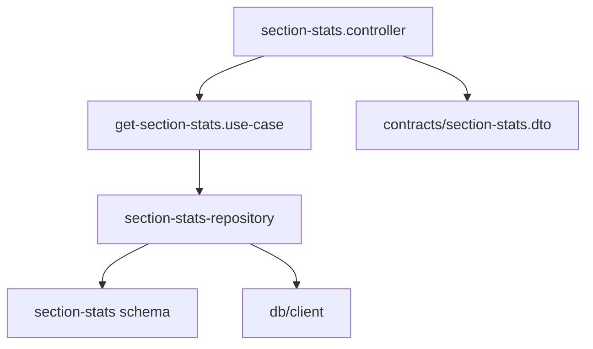

# Get Section Stats - System Impact

## Overview

This document describes the impact of the Get Section Stats feature on the existing system.

---

## 1. New Components

### 1.1 Contracts Package

| Component | Type | Description |
|-----------|------|-------------|
| `section-stats/section-stats.dto.ts` | Schema | Zod schemas for section stats DTOs |

### 1.2 Backend Infrastructure Layer

| Component | Type | Description |
|-----------|------|-------------|
| `db/schema/section-stats.ts` | Schema | Drizzle schema for `section_stats` table |
| `repositories/section-stats-repository.ts` | Repository | Data access for section stats |

### 1.3 Backend Application Layer

| Component | Type | Description |
|-----------|------|-------------|
| `use-cases/get-section-stats.use-case.ts` | Use Case | Business logic for retrieving section stats |

### 1.4 Backend Presentation Layer

| Component | Type | Description |
|-----------|------|-------------|
| `controllers/section-stats.controller.ts` | Controller | HTTP routes for section stats API |

---

## 2. Modified Components

### 2.1 Contracts Package

| File | Changes |
|------|---------|
| `src/index.ts` | Add exports for section-stats DTOs |

### 2.2 Backend

| File | Changes |
|------|---------|
| `src/presentation/server.ts` | Register section stats route |

---

## 3. Database Impact

### 3.1 New Table Required

The `section_stats` table must exist in the database before this feature can function.

**Schema:**
```sql
CREATE TABLE IF NOT EXISTS "section_stats" (
    course_code   TEXT NOT NULL,
    academic_term TEXT NOT NULL,
    section       INTEGER NOT NULL,
    enrolled      INTEGER NOT NULL CHECK (enrolled >= 0),
    passed        INTEGER NOT NULL CHECK (passed >= 0),
    failed        INTEGER NOT NULL CHECK (failed >= 0),
    withdrawn     INTEGER NOT NULL CHECK (withdrawn >= 0),
    PRIMARY KEY (course_code, academic_term, section),
    CHECK (enrolled = passed + failed + withdrawn)
);
```

### 3.2 Data Population

This feature assumes the `section_stats` table is populated by an external process (similar to how `enrollments` data is managed).

### 3.3 No Index Changes Required

The primary key `(course_code, academic_term, section)` already covers the query pattern.

---

## 4. API Changes

### 4.1 New Endpoints

| Method | Path | Description |
|--------|------|-------------|
| GET | `/api/courses/{courseCode}/sections` | Get section statistics by course and terms |

### 4.2 Existing Endpoints

No changes to existing endpoints.

---

## 5. Dependency Graph

### 5.1 Component Dependencies



### 5.2 Package Dependencies

| Component | Depends On |
|-----------|------------|
| Controller | Use Case, Contracts |
| Use Case | Repository, Contracts |
| Repository | DB Client, Schema |
| Schema | drizzle-orm |

---

## 6. Compatibility

### 6.1 Breaking Changes

None. This is a purely additive feature.

### 6.2 Backward Compatibility

- All existing endpoints remain unchanged
- No modifications to existing database tables
- No changes to existing DTOs or contracts

---

## 7. Performance Considerations

### 7.1 Query Performance

| Aspect | Impact |
|--------|--------|
| Query complexity | Simple SELECT with WHERE and ORDER BY |
| Index usage | Uses PRIMARY KEY index |
| Expected latency | < 10ms for typical requests |

### 7.2 Memory Usage

- Each section record: ~100 bytes
- Typical response (10 terms, 5 sections): ~5KB
- Maximum response (10 terms, 50 sections): ~50KB

### 7.3 No Caching Required

- Data is relatively small
- Queries are fast
- Data may change between requests

---

## 8. Security Considerations

### 8.1 Input Validation

| Parameter | Validation |
|-----------|------------|
| `courseCode` | Regex pattern `XXXX-DDDD` |
| `term` | Integer regex `^\d+$` |
| `terms` | CSV integer regex `^\d+(,\d+)*$` |

### 8.2 SQL Injection Prevention

- Uses Drizzle ORM with parameterized queries
- No raw SQL string concatenation

---

## 9. Error Scenarios

### 9.1 Expected Errors

| Scenario | Response | Action |
|----------|----------|--------|
| Invalid course code | 400 | Zod validation error |
| Missing term parameter | 400 | Zod refinement error |
| No data found | 200 | Empty terms array with metadata |

### 9.2 Unexpected Errors

| Scenario | Response | Logging |
|----------|----------|---------|
| Database connection error | 500 | Log error with stack trace |
| Query timeout | 500 | Log with query details |

---

## 10. Migration Steps

### 10.1 Database Migration

1. Ensure `section_stats` table exists
2. Populate table with section data (external process)
3. Verify data integrity

### 10.2 Backend Deployment

1. Deploy updated contracts package
2. Deploy backend with new endpoint
3. Verify endpoint is accessible

### 10.3 Frontend Integration (if applicable)

1. Update contracts package dependency
2. Add API client methods
3. Integrate with UI components

---

## 11. Rollback Plan

### 11.1 Backend Rollback

1. Remove route registration from `server.ts`
2. Redeploy backend
3. New files can remain (dead code, no impact)

### 11.2 Database Rollback

No database changes are made by this feature. The `section_stats` table is managed externally.

---

## 12. Monitoring

### 12.1 Metrics to Track

| Metric | Description |
|--------|-------------|
| Request count | `/api/courses/{}/sections` requests per minute |
| Response latency | P50, P95, P99 response times |
| Error rate | 4xx and 5xx responses |

### 12.2 Recommended Alerts

| Alert | Condition | Severity |
|-------|-----------|----------|
| High error rate | > 5% 5xx errors | Critical |
| High latency | P95 > 500ms | Warning |

---

## 13. Testing Requirements

### 13.1 Unit Tests

- Repository: Query correctness, empty results
- Use Case: Grouping logic, DTO mapping
- Controller: Route handling, validation

### 13.2 Integration Tests

- End-to-end request/response validation
- Database query verification
- Error response format

### 13.3 Manual Verification

- Verify with real database data
- Test all query parameter combinations

---

## 14. Documentation Updates

### 14.1 New Documentation

| Document | Location |
|----------|----------|
| Architecture | `docs/architecture/use-cases/get-section-stats/architecture.md` |
| Implementation Guide | `docs/architecture/use-cases/get-section-stats/implementation-guide.md` |
| System Impact | `docs/architecture/use-cases/get-section-stats/system-impact.md` |
| Testing Guide | `docs/architecture/use-cases/get-section-stats/testing-guide.md` |

### 14.2 Updated Documentation

- OpenAPI spec auto-generated from Zod schemas

---

## Related Documents

- [Architecture Document](./architecture.md)
- [Implementation Guide](./implementation-guide.md)
- [Testing Guide](./testing-guide.md)
