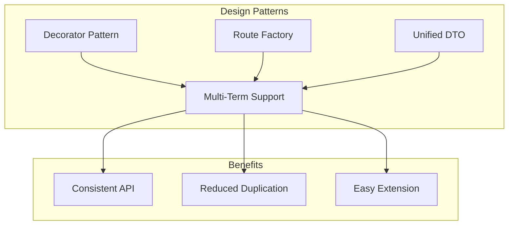
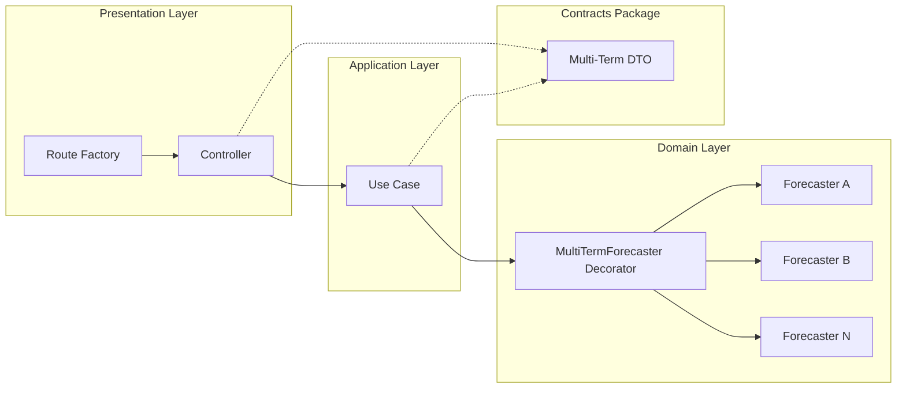
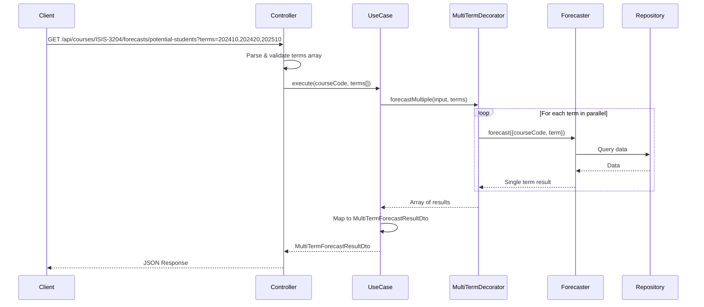
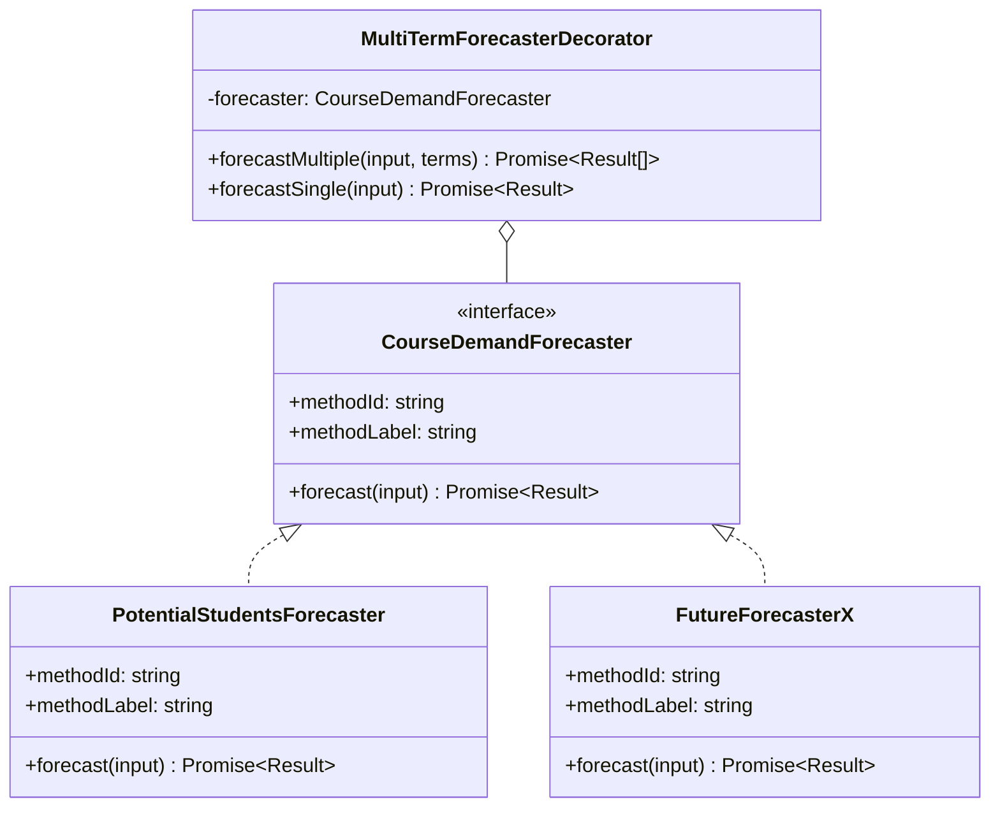
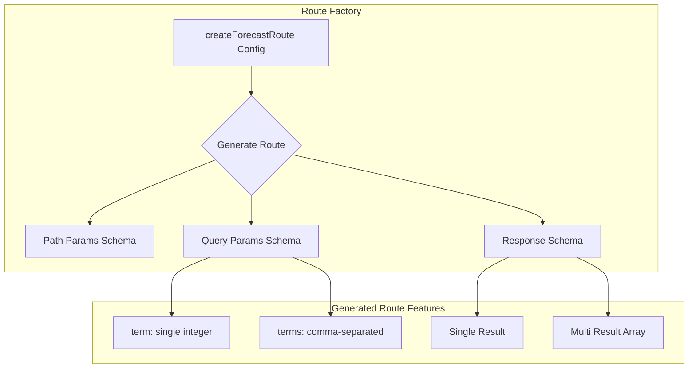
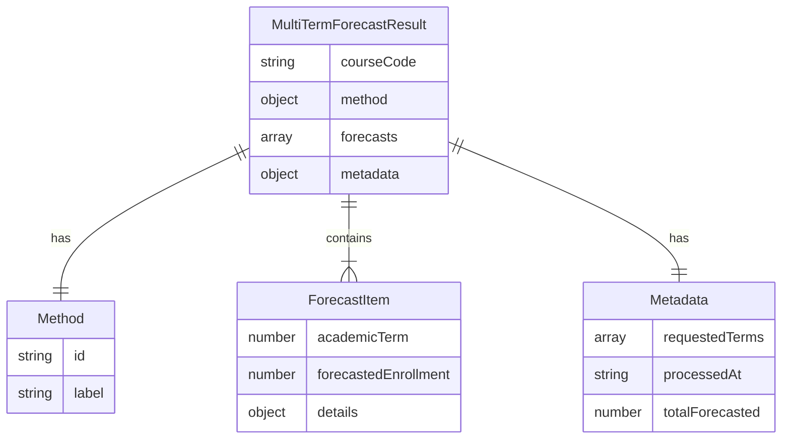

# Multi-Term Forecast Abstraction Architecture

## 1. Overview

### 1.1 Problem Statement

Currently, the forecasting system only supports single-term predictions per request. Users who need forecasts for multiple academic terms must make separate API calls for each term, leading to:

- Increased network overhead
- Poor user experience for batch operations
- Inefficient data retrieval patterns
- Duplicated client-side aggregation logic

### 1.2 Goal

Create a **generic abstraction** that enables any forecaster to handle multiple academic terms in a single request while:

- Maintaining backward compatibility with existing single-term endpoints
- Keeping individual forecaster implementations simple and focused
- Providing consistent response structures across all forecasters
- Minimizing code duplication in controllers

### 1.3 Design Principles

1. **Single Responsibility**: Forecasters focus on business logic only
2. **Open/Closed**: New forecasters work with multi-term support without modification
3. **DRY**: Route registration and multi-term logic are centralized
4. **Backward Compatibility**: Existing single-term APIs continue to work

---

## 2. Architecture Overview

The solution combines three design patterns:



### 2.1 Pattern Summary

| Pattern | Purpose | Location |
|---------|---------|----------|
| **Decorator Pattern** | Wraps any forecaster to add multi-term execution | Domain Layer |
| **Route Factory** | Generates routes with multi-term support | Presentation Layer |
| **Unified DTO** | Standardizes multi-term response format | Contracts Package |

---

## 3. Component Architecture

### 3.1 System Components Diagram



### 3.2 Request Flow



---

## 4. Detailed Design

### 4.1 Decorator Pattern - MultiTermForecasterDecorator

The decorator wraps any `CourseDemandForecaster` and adds the capability to execute forecasts for multiple terms concurrently.



#### Key Features

- **Parallel Execution**: Uses `Promise.all` for concurrent term processing
- **Error Handling**: Individual term failures don't block other terms
- **Transparent**: Works with any forecaster implementing `CourseDemandForecaster`

#### Interface Definition

```typescript
// Location: apps/backend/src/domain/forecasts/multi-term-forecaster.decorator.ts

interface MultiTermForecasterDecorator<TDetails = unknown> {
  /**
   * Execute forecast for multiple academic terms concurrently
   */
  forecastMultiple(
    input: Omit<CourseDemandForecasterInput, 'academicTerm'>,
    terms: number[]
  ): Promise<CourseDemandForecasterResult[]>;

  /**
   * Execute forecast for a single term (delegates to wrapped forecaster)
   */
  forecastSingle(
    input: CourseDemandForecasterInput
  ): Promise<CourseDemandForecasterResult>;
}
```

---

### 4.2 Route Factory - createForecastRoute

The route factory generates Hono routes with built-in support for both single-term and multi-term requests.



#### Configuration Interface

```typescript
// Location: apps/backend/src/presentation/factories/forecast-route.factory.ts

interface ForecastRouteConfig<TParams, TResult> {
  /** Route path with courseCode param */
  path: string;

  /** Zod schema for path parameters */
  paramsSchema: z.ZodSchema<TParams>;

  /** Use case with execute method */
  useCase: {
    execute(params: TParams & { academicTerm: number }): Promise<TResult>;
    executeMultiple?(params: TParams, terms: number[]): Promise<TResult[]>;
  };

  /** Zod schema for single result */
  resultSchema: z.ZodSchema<TResult>;

  /** OpenAPI metadata */
  metadata: {
    summary: string;
    description: string;
    tags: string[];
  };
}
```

#### Query Parameter Handling

The factory generates routes that accept either:

- `?term=202410` - Single term (returns single object)
- `?terms=202410,202420,202510` - Multiple terms (returns array)

---

### 4.3 Unified DTO - MultiTermForecastResultDto

A standardized response structure for multi-term forecasts.



#### Schema Definition

```typescript
// Location: packages/contracts/src/forecasts/multi-term-forecast.dto.ts

export const multiTermForecastResultSchema = z.object({
  courseCode: z.string().regex(/^[A-Z]{4}-\d{4}$/),

  method: z.object({
    id: z.string(),
    label: z.string(),
  }),

  forecasts: z.array(z.object({
    academicTerm: z.number().int().nonnegative(),
    forecastedEnrollment: z.number().int().nonnegative(),
    details: z.unknown().optional(),
  })),

  metadata: z.object({
    requestedTerms: z.array(z.number()),
    processedAt: z.string().datetime(),
    totalForecasted: z.number().int().nonnegative(),
  }),
});

export type MultiTermForecastResultDto = z.infer<
  typeof multiTermForecastResultSchema
>;
```

---

## 5. API Contract

### 5.1 Endpoint Specification

```
GET /api/courses/{courseCode}/forecasts/potential-students
```

### 5.2 Request Parameters

#### Path Parameters

| Parameter | Type | Required | Description | Example |
|-----------|------|----------|-------------|---------|
| `courseCode` | string | Yes | Course code in XXXX-DDDD format | `ISIS-3204` |

#### Query Parameters

| Parameter | Type | Required | Description | Example |
|-----------|------|----------|-------------|---------|
| `term` | integer | No* | Single academic term | `202410` |
| `terms` | string | No* | Comma-separated terms | `202410,202420,202510` |

*One of `term` or `terms` is required

### 5.3 Response Formats

#### Single Term Response (using `?term=202410`)

```json
{
  "courseCode": "ISIS-3204",
  "academicTerm": 202410,
  "forecastedEnrollment": 42,
  "methodId": "potential-students-by-prerequisites",
  "methodLabel": "Potential students by prerequisites (set-based)",
  "details": {
    "prerequisiteExpression": {
      "targetCourseCode": "ISIS-3204",
      "clauses": [
        { "kind": "required-course", "courseCode": "ISIS-1304" },
        { "kind": "required-course", "courseCode": "ISIS-1225" },
        { "kind": "any-of-group", "courseCodes": ["FISI-1028", "FISI-1528"] }
      ]
    },
    "eligibleStudentCountBeforeTargetFilter": 50,
    "alreadyPassedTargetCount": 8,
    "potentialStudentCount": 42,
    "perCoursePassedCounts": {
      "ISIS-1304": 120,
      "ISIS-1225": 115,
      "FISI-1028": 80,
      "FISI-1528": 45
    }
  }
}
```

#### Multi-Term Response (using `?terms=202410,202420,202510`)

```json
{
  "courseCode": "ISIS-3204",
  "method": {
    "id": "potential-students-by-prerequisites",
    "label": "Potential students by prerequisites (set-based)"
  },
  "forecasts": [
    {
      "academicTerm": 202410,
      "forecastedEnrollment": 42,
      "details": {
        "eligibleStudentCountBeforeTargetFilter": 50,
        "alreadyPassedTargetCount": 8,
        "potentialStudentCount": 42
      }
    },
    {
      "academicTerm": 202420,
      "forecastedEnrollment": 38,
      "details": {
        "eligibleStudentCountBeforeTargetFilter": 48,
        "alreadyPassedTargetCount": 10,
        "potentialStudentCount": 38
      }
    },
    {
      "academicTerm": 202510,
      "forecastedEnrollment": 45,
      "details": {
        "eligibleStudentCountBeforeTargetFilter": 55,
        "alreadyPassedTargetCount": 10,
        "potentialStudentCount": 45
      }
    }
  ],
  "metadata": {
    "requestedTerms": [202410, 202420, 202510],
    "processedAt": "2025-11-21T10:30:00.000Z",
    "totalForecasted": 125
  }
}
```

---

## 6. Request Examples

### 6.1 cURL Examples

#### Single Term Request

```bash
curl -X GET \
  "http://localhost:3000/api/courses/ISIS-3204/forecasts/potential-students?term=202410" \
  -H "Accept: application/json"
```

#### Multi-Term Request

```bash
curl -X GET \
  "http://localhost:3000/api/courses/ISIS-3204/forecasts/potential-students?terms=202410,202420,202510" \
  -H "Accept: application/json"
```

### 6.2 JavaScript/TypeScript Examples

#### Fetching Single Term

```typescript
async function getForecast(courseCode: string, term: number) {
  const response = await fetch(
    `/api/courses/${courseCode}/forecasts/potential-students?term=${term}`
  );
  return response.json() as Promise<CourseDemandForecastResultDto>;
}

// Usage
const forecast = await getForecast('ISIS-3204', 202410);
console.log(`Forecasted enrollment: ${forecast.forecastedEnrollment}`);
```

#### Fetching Multiple Terms

```typescript
async function getMultiTermForecast(courseCode: string, terms: number[]) {
  const termsParam = terms.join(',');
  const response = await fetch(
    `/api/courses/${courseCode}/forecasts/potential-students?terms=${termsParam}`
  );
  return response.json() as Promise<MultiTermForecastResultDto>;
}

// Usage
const forecasts = await getMultiTermForecast('ISIS-3204', [202410, 202420, 202510]);

// Access individual forecasts
forecasts.forecasts.forEach(f => {
  console.log(`Term ${f.academicTerm}: ${f.forecastedEnrollment} students`);
});

// Access aggregated data
console.log(`Total across all terms: ${forecasts.metadata.totalForecasted}`);
```

### 6.3 Frontend Integration Example

```typescript
// React hook example
function useCourseForecasts(courseCode: string, terms: number[]) {
  const [data, setData] = useState<MultiTermForecastResultDto | null>(null);
  const [loading, setLoading] = useState(true);
  const [error, setError] = useState<Error | null>(null);

  useEffect(() => {
    const fetchData = async () => {
      try {
        setLoading(true);
        const result = await getMultiTermForecast(courseCode, terms);
        setData(result);
      } catch (err) {
        setError(err as Error);
      } finally {
        setLoading(false);
      }
    };

    fetchData();
  }, [courseCode, terms.join(',')]);

  return { data, loading, error };
}

// Usage in component
function ForecastChart({ courseCode }: { courseCode: string }) {
  const terms = [202410, 202420, 202510, 202520];
  const { data, loading, error } = useCourseForecasts(courseCode, terms);

  if (loading) return <Spinner />;
  if (error) return <ErrorMessage error={error} />;
  if (!data) return null;

  return (
    <Chart
      data={data.forecasts.map(f => ({
        x: f.academicTerm,
        y: f.forecastedEnrollment,
      }))}
      title={`${data.courseCode} - ${data.method.label}`}
    />
  );
}
```

---

## 7. Error Handling

### 7.1 Error Response Structure

```typescript
interface ForecastErrorResponse {
  error: {
    code: string;
    message: string;
    details?: {
      invalidTerms?: number[];
      failedTerms?: Array<{
        term: number;
        reason: string;
      }>;
    };
  };
}
```

### 7.2 Error Scenarios

| Scenario | HTTP Status | Error Code | Description |
|----------|-------------|------------|-------------|
| Invalid course code format | 400 | `INVALID_COURSE_CODE` | Course code doesn't match XXXX-DDDD |
| No term parameter | 400 | `MISSING_TERM_PARAMETER` | Neither `term` nor `terms` provided |
| Invalid term format | 400 | `INVALID_TERM_FORMAT` | Term is not a valid integer |
| Course not found | 404 | `COURSE_NOT_FOUND` | Course doesn't exist in system |
| No prerequisites defined | 404 | `NO_PREREQUISITES` | Course has no prerequisite data |
| Partial failure | 207 | `PARTIAL_SUCCESS` | Some terms succeeded, others failed |

### 7.3 Partial Failure Handling

When some terms succeed and others fail:

```json
{
  "courseCode": "ISIS-3204",
  "method": {
    "id": "potential-students-by-prerequisites",
    "label": "Potential students by prerequisites (set-based)"
  },
  "forecasts": [
    {
      "academicTerm": 202410,
      "forecastedEnrollment": 42,
      "details": { }
    },
    {
      "academicTerm": 202420,
      "forecastedEnrollment": 38,
      "details": { }
    }
  ],
  "metadata": {
    "requestedTerms": [202410, 202420, 202510],
    "processedAt": "2025-11-21T10:30:00.000Z",
    "totalForecasted": 80,
    "errors": [
      {
        "term": 202510,
        "code": "INSUFFICIENT_DATA",
        "message": "Not enough historical data for term 202510"
      }
    ]
  }
}
```

---

## 8. Performance Considerations

### 8.1 Concurrent Execution

The decorator executes all term forecasts in parallel using `Promise.all`:

```typescript
async forecastMultiple(input, terms) {
  return Promise.all(
    terms.map(term =>
      this.forecaster.forecast({ ...input, academicTerm: term })
    )
  );
}
```

### 8.2 Database Query Optimization

For forecasters that make database queries, consider:

1. **Batch Queries**: Modify repository methods to accept term ranges
2. **Caching**: Cache prerequisite expressions (they don't change often)
3. **Query Optimization**: Use indexed columns for term filtering

### 8.3 Rate Limiting

Consider limiting:
- Maximum terms per request (e.g., 10 terms)
- Request rate per client

```typescript
const MAX_TERMS_PER_REQUEST = 10;

if (terms.length > MAX_TERMS_PER_REQUEST) {
  throw new BadRequestError(
    `Maximum ${MAX_TERMS_PER_REQUEST} terms allowed per request`
  );
}
```

---

## 9. Extensibility

### 9.1 Adding a New Forecaster

To add a new forecaster with multi-term support:

1. **Implement the forecaster interface**:

```typescript
// apps/backend/src/domain/forecasts/my-new-forecaster.ts
export class MyNewForecaster implements CourseDemandForecaster {
  readonly methodId = 'my-new-method';
  readonly methodLabel = 'My New Forecasting Method';

  async forecast(input: CourseDemandForecasterInput) {
    // Implementation
  }
}
```

2. **Create the use case**:

```typescript
// apps/backend/src/application/use-cases/forecasts/my-new-forecaster.use-case.ts
export class MyNewForecasterUseCase {
  private readonly decorator: MultiTermForecasterDecorator;

  constructor(forecaster: MyNewForecaster) {
    this.decorator = new MultiTermForecasterDecorator(forecaster);
  }

  async execute(input) { }
  async executeMultiple(input, terms) { }
}
```

3. **Register the route using the factory**:

```typescript
// apps/backend/src/presentation/controllers/forecasts/my-new-forecaster.controller.ts
registerForecastRoute(app, {
  path: '/api/courses/{courseCode}/forecasts/my-new-method',
  useCase: myNewForecasterUseCase,
  // ...config
});
```

### 9.2 Future Enhancements

- **Aggregation Options**: Sum, average, min, max across terms
- **Comparison Mode**: Compare forecasts between different methods
- **Time Series Analysis**: Trend detection across terms
- **Export Formats**: CSV, Excel export for multi-term data

---

## 10. Related Documents

- [General Architecture](../../general-architecture.md)
- [Potential Students by Prerequisites](../potential-students-by-prerequsites/doc.md)
- [Implementation Guide](./implementation-guide.md)
- [Testing Guide](./testing-guide.md)
