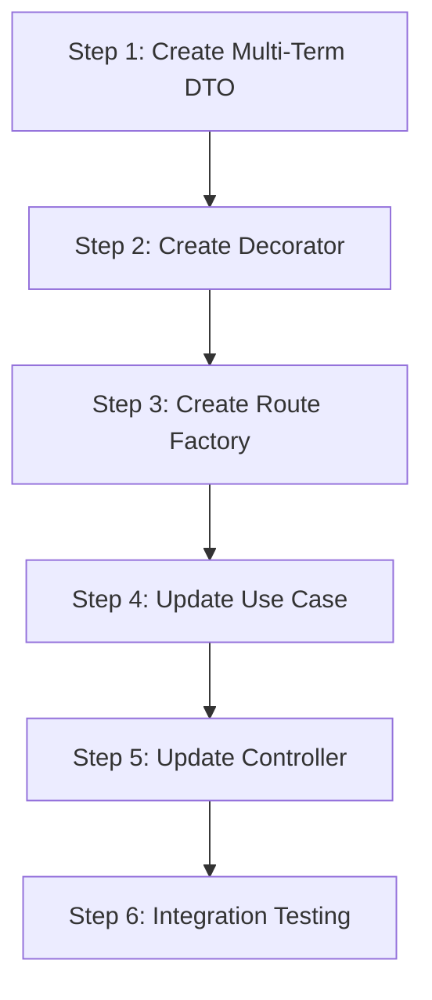

# Multi-Term Forecast Abstraction - Implementation Guide

## Overview

This guide provides step-by-step instructions for implementing the multi-term forecast abstraction. Follow each step in order to ensure proper integration with the existing codebase.

---

## Prerequisites

Before starting, ensure you understand:

- The existing [General Architecture](../../general-architecture.md)
- The [Potential Students by Prerequisites](../potential-students-by-prerequsites/doc.md) forecaster
- The [Architecture Document](./architecture.md) for this feature

---

## Implementation Steps



---

## Step 1: Create Multi-Term DTO Schema

### 1.1 Create the Schema File

**Location**: `packages/contracts/src/forecasts/multi-term-forecast.dto.ts`

```typescript
import { z } from 'zod';

/**
 * Schema for individual forecast within a multi-term response
 */
export const termForecastItemSchema = z.object({
  academicTerm: z
    .number()
    .int()
    .nonnegative(),
  forecastedEnrollment: z
    .number()
    .int()
    .nonnegative(),
  details: z.unknown().optional(),
});

export type TermForecastItem = z.infer<typeof termForecastItemSchema>;

/**
 * Schema for multi-term forecast response metadata
 */
export const forecastMetadataSchema = z.object({
  requestedTerms: z.array(z.number().int().nonnegative()),
  processedAt: z.string().datetime(),
  totalForecasted: z.number().int().nonnegative(),
  errors: z.array(z.object({
    term: z.number(),
    code: z.string(),
    message: z.string(),
  })).optional(),
});

export type ForecastMetadata = z.infer<typeof forecastMetadataSchema>;

/**
 * Schema for multi-term forecast result
 */
export const multiTermForecastResultSchema = z.object({
  courseCode: z
    .string()
    .regex(/^[A-Z]{4}-\d{4}$/, {
      message: 'courseCode must match pattern XXXX-DDDD.',
    }),

  method: z.object({
    id: z.string(),
    label: z.string(),
  }),

  forecasts: z.array(termForecastItemSchema),

  metadata: forecastMetadataSchema,
});

export type MultiTermForecastResultDto = z.infer<
  typeof multiTermForecastResultSchema
>;

/**
 * Input schema for multi-term forecast request
 */
export const multiTermForecastInputSchema = z.object({
  courseCode: z
    .string()
    .regex(/^[A-Z]{4}-\d{4}$/, {
      message: 'courseCode must match pattern XXXX-DDDD.',
    }),
  terms: z
    .array(z.number().int().nonnegative())
    .min(1, { message: 'At least one term is required' })
    .max(10, { message: 'Maximum 10 terms allowed per request' }),
});

export type MultiTermForecastInputDto = z.infer<
  typeof multiTermForecastInputSchema
>;
```

### 1.2 Export from Index

**Location**: `packages/contracts/src/forecasts/index.ts`

```typescript
export * from './course-demand-forecast.dto';
export * from './multi-term-forecast.dto';
```

### 1.3 Verify Export from Main Package

**Location**: `packages/contracts/src/index.ts`

Ensure the forecasts module is exported:

```typescript
export * from './forecasts';
```

---

## Step 2: Create MultiTermForecasterDecorator

### 2.1 Create the Decorator

**Location**: `apps/backend/src/domain/forecasts/multi-term-forecaster.decorator.ts`

```typescript
import {
  CourseDemandForecaster,
  CourseDemandForecasterInput,
  CourseDemandForecasterResult,
} from './course-demand-forecaster';

/**
 * Configuration options for the multi-term decorator
 */
export interface MultiTermForecasterOptions {
  /**
   * Maximum number of terms allowed per request
   * @default 10
   */
  maxTerms?: number;

  /**
   * Whether to continue processing if some terms fail
   * @default true
   */
  allowPartialFailure?: boolean;
}

/**
 * Result of a multi-term forecast operation
 */
export interface MultiTermForecasterResult {
  results: CourseDemandForecasterResult[];
  errors: Array<{
    term: number;
    error: Error;
  }>;
}

/**
 * Decorator that wraps any CourseDemandForecaster to add multi-term support.
 *
 * This allows any forecaster to handle multiple academic terms in a single
 * request without modifying the original forecaster implementation.
 *
 * @example
 * ```typescript
 * const forecaster = new PotentialStudentsByPrerequisitesForecaster({...});
 * const multiTermForecaster = new MultiTermForecasterDecorator(forecaster);
 *
 * const results = await multiTermForecaster.forecastMultiple(
 *   { courseCode: 'ISIS-3204' },
 *   [202410, 202420, 202510]
 * );
 * ```
 */
export class MultiTermForecasterDecorator {
  private readonly maxTerms: number;
  private readonly allowPartialFailure: boolean;

  constructor(
    private readonly forecaster: CourseDemandForecaster,
    options: MultiTermForecasterOptions = {},
  ) {
    this.maxTerms = options.maxTerms ?? 10;
    this.allowPartialFailure = options.allowPartialFailure ?? true;
  }

  /**
   * Get the method ID from the wrapped forecaster
   */
  get methodId(): string {
    return this.forecaster.methodId;
  }

  /**
   * Get the method label from the wrapped forecaster
   */
  get methodLabel(): string {
    return this.forecaster.methodLabel;
  }

  /**
   * Execute forecast for a single term (delegates to wrapped forecaster)
   */
  async forecastSingle(
    input: CourseDemandForecasterInput,
  ): Promise<CourseDemandForecasterResult> {
    return this.forecaster.forecast(input);
  }

  /**
   * Execute forecasts for multiple academic terms concurrently
   *
   * @param input - Base forecast input (without academicTerm)
   * @param terms - Array of academic terms to forecast
   * @returns Array of forecast results for each term
   * @throws Error if terms array exceeds maxTerms limit
   */
  async forecastMultiple(
    input: Omit<CourseDemandForecasterInput, 'academicTerm'>,
    terms: number[],
  ): Promise<MultiTermForecasterResult> {
    // Validate terms count
    if (terms.length > this.maxTerms) {
      throw new Error(
        `Maximum ${this.maxTerms} terms allowed per request. Received: ${terms.length}`,
      );
    }

    // Validate no duplicate terms
    const uniqueTerms = [...new Set(terms)];
    if (uniqueTerms.length !== terms.length) {
      throw new Error('Duplicate terms are not allowed');
    }

    // Execute forecasts concurrently
    const settledResults = await Promise.allSettled(
      terms.map(term =>
        this.forecaster.forecast({
          ...input,
          academicTerm: term,
        }),
      ),
    );

    // Separate successful results from errors
    const results: CourseDemandForecasterResult[] = [];
    const errors: Array<{ term: number; error: Error }> = [];

    settledResults.forEach((result, index) => {
      const term = terms[index];
      if (result.status === 'fulfilled') {
        results.push(result.value);
      } else {
        errors.push({
          term,
          error: result.reason instanceof Error
            ? result.reason
            : new Error(String(result.reason)),
        });
      }
    });

    // If partial failure is not allowed and there are errors, throw
    if (!this.allowPartialFailure && errors.length > 0) {
      const failedTerms = errors.map(e => e.term).join(', ');
      throw new Error(`Forecasts failed for terms: ${failedTerms}`);
    }

    return { results, errors };
  }
}
```

### 2.2 Export from Domain Index

**Location**: `apps/backend/src/domain/forecasts/index.ts`

```typescript
export * from './course-demand-forecaster';
export * from './multi-term-forecaster.decorator';
export * from './potential-students-by-prerequisites-forecaster';
```

---

## Step 3: Create Route Factory

### 3.1 Create the Factory

**Location**: `apps/backend/src/presentation/factories/forecast-route.factory.ts`

```typescript
import { z } from 'zod';
import { createRoute, OpenAPIHono } from '@hono/zod-openapi';

const COURSE_CODE_PATTERN = /^[A-Z]{4}-\d{4}$/;

/**
 * Configuration for creating a forecast route with multi-term support
 */
export interface ForecastRouteConfig<TResult> {
  /** Base path for the endpoint (e.g., '/api/courses/{courseCode}/forecasts/my-method') */
  path: string;

  /** OpenAPI operation summary */
  summary: string;

  /** OpenAPI operation description */
  description: string;

  /** OpenAPI tags */
  tags?: string[];

  /** Zod schema for single result */
  resultSchema: z.ZodSchema<TResult>;

  /** Handler for single-term requests */
  singleTermHandler: (
    courseCode: string,
    term: number,
  ) => Promise<TResult>;

  /** Handler for multi-term requests */
  multiTermHandler: (
    courseCode: string,
    terms: number[],
  ) => Promise<{
    results: TResult[];
    errors: Array<{ term: number; message: string }>;
  }>;
}

/**
 * Query schema supporting both single and multi-term requests
 */
const forecastQuerySchema = z.object({
  term: z
    .string()
    .regex(/^\d+$/, { message: 'term must be a positive integer' })
    .transform(val => parseInt(val, 10))
    .optional(),
  terms: z
    .string()
    .regex(/^\d+(,\d+)*$/, { message: 'terms must be comma-separated integers' })
    .transform(val => val.split(',').map(t => parseInt(t, 10)))
    .optional(),
}).refine(
  data => data.term !== undefined || data.terms !== undefined,
  { message: 'Either term or terms query parameter is required' },
);

/**
 * Creates a forecast route with automatic multi-term support
 *
 * @example
 * ```typescript
 * createForecastRoute(app, {
 *   path: '/api/courses/{courseCode}/forecasts/potential-students',
 *   summary: 'Forecast potential students',
 *   description: 'Forecasts based on prerequisite completion',
 *   resultSchema: courseDemandForecastResultSchema,
 *   singleTermHandler: async (courseCode, term) => {
 *     return useCase.execute({ courseCode, academicTerm: term });
 *   },
 *   multiTermHandler: async (courseCode, terms) => {
 *     return useCase.executeMultiple({ courseCode }, terms);
 *   },
 * });
 * ```
 */
export function createForecastRoute<TResult>(
  app: OpenAPIHono,
  config: ForecastRouteConfig<TResult>,
): void {
  const route = createRoute({
    method: 'get',
    path: config.path,
    request: {
      params: z.object({
        courseCode: z
          .string()
          .regex(COURSE_CODE_PATTERN, {
            message: 'courseCode must match pattern XXXX-DDDD.',
          }),
      }),
      query: forecastQuerySchema,
    },
    responses: {
      200: {
        description: config.description,
        content: {
          'application/json': {
            schema: z.union([
              config.resultSchema,
              z.object({
                courseCode: z.string(),
                method: z.object({
                  id: z.string(),
                  label: z.string(),
                }),
                forecasts: z.array(z.object({
                  academicTerm: z.number(),
                  forecastedEnrollment: z.number(),
                  details: z.unknown().optional(),
                })),
                metadata: z.object({
                  requestedTerms: z.array(z.number()),
                  processedAt: z.string(),
                  totalForecasted: z.number(),
                  errors: z.array(z.object({
                    term: z.number(),
                    code: z.string(),
                    message: z.string(),
                  })).optional(),
                }),
              }),
            ]),
          },
        },
      },
      400: {
        description: 'Invalid request parameters',
      },
      404: {
        description: 'Course or prerequisites not found',
      },
    },
    tags: config.tags ?? ['Forecasts'],
  });

  app.openapi(route, async (c) => {
    const { courseCode } = c.req.valid('param');
    const { term, terms } = c.req.valid('query');

    // Single term request
    if (term !== undefined && terms === undefined) {
      const result = await config.singleTermHandler(courseCode, term);
      return c.json(result, 200);
    }

    // Multi-term request
    const termsArray = terms ?? [term!];
    const { results, errors } = await config.multiTermHandler(courseCode, termsArray);

    // Build multi-term response
    const methodId = results[0]?.methodId ?? 'unknown';
    const methodLabel = results[0]?.methodLabel ?? 'Unknown method';

    const response = {
      courseCode,
      method: {
        id: methodId,
        label: methodLabel,
      },
      forecasts: results.map(r => ({
        academicTerm: r.academicTerm,
        forecastedEnrollment: r.forecastedEnrollment,
        details: r.details,
      })),
      metadata: {
        requestedTerms: termsArray,
        processedAt: new Date().toISOString(),
        totalForecasted: results.reduce(
          (sum, r) => sum + r.forecastedEnrollment,
          0,
        ),
        ...(errors.length > 0 && {
          errors: errors.map(e => ({
            term: e.term,
            code: 'FORECAST_FAILED',
            message: e.message,
          })),
        }),
      },
    };

    return c.json(response, 200);
  });
}
```

### 3.2 Create Index File

**Location**: `apps/backend/src/presentation/factories/index.ts`

```typescript
export * from './forecast-route.factory';
```

---

## Step 4: Update Use Case

### 4.1 Modify Existing Use Case

**Location**: `apps/backend/src/application/use-cases/forecasts/potential-students-by-prerequisites.use-case.forecaster.ts`

Add a new method for multi-term execution:

```typescript
import {
  CourseDemandForecastResultDto,
  MultiTermForecastResultDto,
} from '@app/contracts';
import {
  CourseDemandForecaster,
  MultiTermForecasterDecorator,
  MultiTermForecasterResult,
} from '../../../domain/forecasts';

export interface PotentialStudentsByPrerequisitesUseCaseInput {
  courseCode: string;
  academicTerm: number;
}

export interface PotentialStudentsByPrerequisitesUseCaseDeps {
  forecaster: CourseDemandForecaster;
}

export class PotentialStudentsByPrerequisitesUseCase {
  private readonly forecaster: CourseDemandForecaster;
  private readonly multiTermDecorator: MultiTermForecasterDecorator;

  constructor(deps: PotentialStudentsByPrerequisitesUseCaseDeps) {
    this.forecaster = deps.forecaster;
    this.multiTermDecorator = new MultiTermForecasterDecorator(
      this.forecaster,
      { maxTerms: 10, allowPartialFailure: true },
    );
  }

  /**
   * Execute forecast for a single academic term
   */
  async execute(
    input: PotentialStudentsByPrerequisitesUseCaseInput,
  ): Promise<CourseDemandForecastResultDto> {
    const result = await this.forecaster.forecast({
      courseCode: input.courseCode,
      academicTerm: input.academicTerm,
    });

    return {
      courseCode: result.courseCode,
      academicTerm: result.academicTerm,
      forecastedEnrollment: result.forecastedEnrollment,
      methodId: result.methodId,
      methodLabel: result.methodLabel,
      details: result.details,
    };
  }

  /**
   * Execute forecasts for multiple academic terms
   */
  async executeMultiple(
    input: Omit<PotentialStudentsByPrerequisitesUseCaseInput, 'academicTerm'>,
    terms: number[],
  ): Promise<{
    results: CourseDemandForecastResultDto[];
    errors: Array<{ term: number; message: string }>;
  }> {
    const { results, errors } = await this.multiTermDecorator.forecastMultiple(
      { courseCode: input.courseCode },
      terms,
    );

    return {
      results: results.map(r => ({
        courseCode: r.courseCode,
        academicTerm: r.academicTerm,
        forecastedEnrollment: r.forecastedEnrollment,
        methodId: r.methodId,
        methodLabel: r.methodLabel,
        details: r.details,
      })),
      errors: errors.map(e => ({
        term: e.term,
        message: e.error.message,
      })),
    };
  }
}
```

---

## Step 5: Update Controller

### 5.1 Refactor Controller to Use Factory

**Location**: `apps/backend/src/presentation/controllers/forecasts/potential-students-by-prerequisites.controller.ts`

```typescript
import { OpenAPIHono } from '@hono/zod-openapi';
import { courseDemandForecastResultSchema } from '@app/contracts';
import {
  PotentialStudentsByPrerequisitesForecaster,
} from '../../../domain/forecasts/potential-students-by-prerequisites-forecaster';
import {
  enrollmentForecastRepository,
} from '../../../infrastructure/repositories/enrollment-forecast-repository';
import {
  prerequisitesRepository,
} from '../../../infrastructure/repositories/prerequisites-repository';
import {
  PotentialStudentsByPrerequisitesUseCase,
} from '../../../application/use-cases/forecasts/potential-students-by-prerequisites.use-case.forecaster';
import { createForecastRoute } from '../../factories/forecast-route.factory';

export const registerPotentialStudentsForecastRoute = (
  app: OpenAPIHono,
): void => {
  // Initialize dependencies
  const forecaster = new PotentialStudentsByPrerequisitesForecaster({
    prerequisitesProvider: prerequisitesRepository,
    enrollmentHistoryProvider: enrollmentForecastRepository,
  });

  const useCase = new PotentialStudentsByPrerequisitesUseCase({
    forecaster,
  });

  // Register route with multi-term support
  createForecastRoute(app, {
    path: '/api/courses/{courseCode}/forecasts/potential-students',
    summary: 'Forecast potential student enrollment',
    description: 'Forecasts potential enrollment based on prerequisite completion for a given course and academic term(s).',
    tags: ['Forecasts'],
    resultSchema: courseDemandForecastResultSchema,

    singleTermHandler: async (courseCode, term) => {
      return useCase.execute({
        courseCode,
        academicTerm: term,
      });
    },

    multiTermHandler: async (courseCode, terms) => {
      return useCase.executeMultiple({ courseCode }, terms);
    },
  });
};
```

---

## Step 6: Integration Testing

### 6.1 Test the Implementation

After completing all steps, verify the implementation:

```bash
# Start the development server
npm run dev

# Test single-term request (existing functionality)
curl "http://localhost:3000/api/courses/ISIS-3204/forecasts/potential-students?term=202410"

# Test multi-term request (new functionality)
curl "http://localhost:3000/api/courses/ISIS-3204/forecasts/potential-students?terms=202410,202420,202510"
```

---

## File Summary

### New Files to Create

| File | Purpose |
|------|---------|
| `packages/contracts/src/forecasts/multi-term-forecast.dto.ts` | Multi-term DTO schemas |
| `apps/backend/src/domain/forecasts/multi-term-forecaster.decorator.ts` | Decorator for multi-term support |
| `apps/backend/src/presentation/factories/forecast-route.factory.ts` | Route factory function |
| `apps/backend/src/presentation/factories/index.ts` | Factory exports |

### Files to Modify

| File | Changes |
|------|---------|
| `packages/contracts/src/forecasts/index.ts` | Add multi-term exports |
| `apps/backend/src/domain/forecasts/index.ts` | Add decorator export |
| `apps/backend/src/application/use-cases/forecasts/potential-students-by-prerequisites.use-case.forecaster.ts` | Add `executeMultiple` method |
| `apps/backend/src/presentation/controllers/forecasts/potential-students-by-prerequisites.controller.ts` | Use route factory |

---

## Checklist

Use this checklist to track your implementation progress:

- [ ] Step 1: Create Multi-Term DTO
  - [ ] Create `multi-term-forecast.dto.ts`
  - [ ] Export from forecasts index
  - [ ] Verify package exports

- [ ] Step 2: Create Decorator
  - [ ] Create `multi-term-forecaster.decorator.ts`
  - [ ] Export from domain index
  - [ ] Write unit tests

- [ ] Step 3: Create Route Factory
  - [ ] Create `forecast-route.factory.ts`
  - [ ] Create factory index
  - [ ] Write unit tests

- [ ] Step 4: Update Use Case
  - [ ] Add `executeMultiple` method
  - [ ] Update constructor for decorator
  - [ ] Write unit tests

- [ ] Step 5: Update Controller
  - [ ] Refactor to use factory
  - [ ] Verify backward compatibility

- [ ] Step 6: Integration Testing
  - [ ] Test single-term requests
  - [ ] Test multi-term requests
  - [ ] Test error scenarios

---

## Next Steps

After implementation, proceed to:

1. [Testing Guide](./testing-guide.md) - Comprehensive testing strategy
2. Update API documentation/OpenAPI specs
3. Update frontend to utilize multi-term endpoints

---

## Related Documents

- [Architecture Document](./architecture.md)
- [Testing Guide](./testing-guide.md)
- [General Architecture](../../general-architecture.md)
