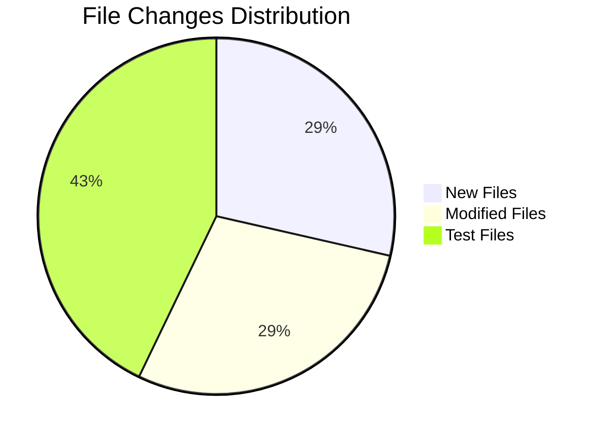

# Multi-Term Forecast Abstraction - System Impact Analysis

## Overview

This document analyzes the impact of implementing the multi-term forecast abstraction on the existing codebase. It identifies affected directories, files, and components.

---

## Impact Summary



| Category | Count | Risk Level |
|----------|-------|------------|
| New Files | 4 | Low |
| Modified Files | 4 | Medium |
| New Test Files | 6 | Low |
| Breaking Changes | 0 | None |

---

## Affected Directories

### Directory Tree

```
investigacion-app/
├── packages/
│   └── contracts/
│       └── src/
│           └── forecasts/
│               ├── index.ts                          [MODIFIED]
│               ├── multi-term-forecast.dto.ts        [NEW]
│               └── __tests__/
│                   └── multi-term-forecast.dto.test.ts [NEW]
│
├── apps/
│   └── backend/
│       └── src/
│           ├── domain/
│           │   └── forecasts/
│           │       ├── index.ts                      [MODIFIED]
│           │       ├── multi-term-forecaster.decorator.ts [NEW]
│           │       └── __tests__/
│           │           └── multi-term-forecaster.decorator.test.ts [NEW]
│           │
│           ├── application/
│           │   └── use-cases/
│           │       └── forecasts/
│           │           ├── potential-students-by-prerequisites.use-case.forecaster.ts [MODIFIED]
│           │           └── __tests__/
│           │               └── potential-students-by-prerequisites.use-case.integration.test.ts [NEW]
│           │
│           └── presentation/
│               ├── factories/
│               │   ├── index.ts                      [NEW]
│               │   ├── forecast-route.factory.ts     [NEW]
│               │   └── __tests__/
│               │       └── forecast-route.factory.test.ts [NEW]
│               │
│               └── controllers/
│                   └── forecasts/
│                       ├── potential-students-by-prerequisites.controller.ts [MODIFIED]
│                       └── __tests__/
│                           └── potential-students-by-prerequisites.controller.integration.test.ts [NEW]
│
└── docs/
    └── architecture/
        └── use-cases/
            └── multi-term-forecast-abstraction/
                ├── architecture.md                   [NEW]
                ├── implementation-guide.md           [NEW]
                ├── testing-guide.md                  [NEW]
                └── system-impact.md                  [NEW]
```

---

## Detailed Impact Analysis

### 1. Contracts Package

#### New Files

| File | Purpose | Dependencies |
|------|---------|--------------|
| `packages/contracts/src/forecasts/multi-term-forecast.dto.ts` | Multi-term DTO schemas | `zod` |

#### Modified Files

| File | Changes | Risk |
|------|---------|------|
| `packages/contracts/src/forecasts/index.ts` | Add export for multi-term DTOs | Low |

#### Impact on Consumers

- **Frontend**: Will have access to new types for multi-term responses
- **Backend**: Will use new schemas for validation
- **Breaking**: None - additive changes only

---

### 2. Domain Layer

#### New Files

| File | Purpose | Dependencies |
|------|---------|--------------|
| `apps/backend/src/domain/forecasts/multi-term-forecaster.decorator.ts` | Decorator pattern implementation | `course-demand-forecaster.ts` |

#### Modified Files

| File | Changes | Risk |
|------|---------|------|
| `apps/backend/src/domain/forecasts/index.ts` | Add export for decorator | Low |

#### Impact Analysis

- **Existing Forecasters**: No changes required
- **New Forecasters**: Automatically get multi-term support via decorator
- **Breaking**: None - existing `CourseDemandForecaster` interface unchanged

---

### 3. Application Layer

#### Modified Files

| File | Changes | Risk |
|------|---------|------|
| `apps/backend/src/application/use-cases/forecasts/potential-students-by-prerequisites.use-case.forecaster.ts` | Add `executeMultiple` method | Medium |

#### Changes Detail

```typescript
// Before
export class PotentialStudentsByPrerequisitesUseCase {
  async execute(input): Promise<CourseDemandForecastResultDto> { }
}

// After
export class PotentialStudentsByPrerequisitesUseCase {
  async execute(input): Promise<CourseDemandForecastResultDto> { }
  async executeMultiple(input, terms): Promise<MultiTermResult> { } // NEW
}
```

#### Impact Analysis

- **Existing Functionality**: `execute` method unchanged
- **New Functionality**: `executeMultiple` method added
- **Breaking**: None - additive changes only

---

### 4. Presentation Layer

#### New Files

| File | Purpose | Dependencies |
|------|---------|--------------|
| `apps/backend/src/presentation/factories/forecast-route.factory.ts` | Route factory function | `@hono/zod-openapi`, `zod` |
| `apps/backend/src/presentation/factories/index.ts` | Factory exports | - |

#### Modified Files

| File | Changes | Risk |
|------|---------|------|
| `apps/backend/src/presentation/controllers/forecasts/potential-students-by-prerequisites.controller.ts` | Use route factory | Medium |

#### Changes Detail

```typescript
// Before: Manual route definition
const potentialStudentsRoute = createRoute({
  method: 'get',
  path: '/api/courses/{courseCode}/forecasts/potential-students',
  // ... manual configuration
});

// After: Using factory
createForecastRoute(app, {
  path: '/api/courses/{courseCode}/forecasts/potential-students',
  singleTermHandler: async (courseCode, term) => { },
  multiTermHandler: async (courseCode, terms) => { },
});
```

#### Impact Analysis

- **API Contract**: Backward compatible
- **Single-term requests**: Continue to work as before
- **Multi-term requests**: New functionality added
- **OpenAPI**: Automatically updated with factory

---

## API Changes

### Endpoint Behavior

| Request Type | Before | After | Breaking |
|-------------|--------|-------|----------|
| `?term=202410` | Supported | Supported (unchanged) | No |
| `?terms=202410,202420` | Not supported | Supported | No |
| Invalid course code | 400 | 400 (unchanged) | No |

### Response Format Changes

#### Single Term (Unchanged)

```json
{
  "courseCode": "ISIS-3204",
  "academicTerm": 202410,
  "forecastedEnrollment": 42,
  "methodId": "...",
  "methodLabel": "...",
  "details": {}
}
```

#### Multi-Term (New)

```json
{
  "courseCode": "ISIS-3204",
  "method": { "id": "...", "label": "..." },
  "forecasts": [...],
  "metadata": {...}
}
```

---

## Dependency Analysis

### New Dependencies

| Package | Version | Purpose | Layer |
|---------|---------|---------|-------|
| None | - | No new external dependencies | - |

### Internal Dependencies

```mermaid
graph TD
    A[multi-term-forecast.dto.ts] --> B[zod]
    C[multi-term-forecaster.decorator.ts] --> D[course-demand-forecaster.ts]
    E[forecast-route.factory.ts] --> F[@hono/zod-openapi]
    E --> A
    G[use-case.ts] --> C
    G --> A
    H[controller.ts] --> E
    H --> G
```

---

## Migration Considerations

### For Existing Code

1. **No action required**: Existing single-term requests continue to work
2. **Optional adoption**: Teams can gradually adopt multi-term features

### For Future Forecasters

1. **Recommended**: Use `createForecastRoute` factory
2. **Optional**: Manually implement routes (not recommended)

### Rollback Plan

If issues arise:

1. Revert controller to manual route definition
2. Remove multi-term DTO exports
3. Remove decorator

All changes are contained and easily reversible.

---

## Performance Impact

### Positive Impacts

- **Reduced Network Calls**: Single request for multiple terms
- **Parallel Execution**: Terms processed concurrently
- **Better UX**: Less loading states for users

### Potential Concerns

| Concern | Mitigation |
|---------|------------|
| Memory usage with many terms | Max 10 terms limit |
| Database load | Consider batch queries in future |
| Response size | Compress responses, pagination if needed |

### Monitoring Recommendations

- Track request latency for multi-term endpoints
- Monitor memory usage during parallel execution
- Alert on failed term forecasts

---

## Testing Impact

### New Test Files

| File | Type | Coverage Target |
|------|------|-----------------|
| `multi-term-forecast.dto.test.ts` | Unit | 100% |
| `multi-term-forecaster.decorator.test.ts` | Unit | 90% |
| `forecast-route.factory.test.ts` | Unit | 85% |
| `potential-students-by-prerequisites.use-case.integration.test.ts` | Integration | 85% |
| `potential-students-by-prerequisites.controller.integration.test.ts` | Integration | 80% |

### Existing Test Updates

- No existing tests need modification
- Existing tests continue to pass

---

## Documentation Impact

### New Documentation

| File | Audience |
|------|----------|
| `architecture.md` | Architects, Senior Developers |
| `implementation-guide.md` | Developers |
| `testing-guide.md` | Developers, QA |
| `system-impact.md` | Tech Leads, DevOps |

### Documentation Updates Needed

- Update API documentation/OpenAPI specs
- Update frontend integration guides
- Update README if applicable

---

## Risk Assessment

### Risk Matrix

| Risk | Probability | Impact | Mitigation |
|------|-------------|--------|------------|
| Breaking existing endpoints | Low | High | Extensive testing, backward compatibility |
| Performance degradation | Low | Medium | Max terms limit, monitoring |
| Complex error handling | Medium | Low | Comprehensive test coverage |
| Frontend integration issues | Low | Medium | Clear API documentation |

### Overall Risk Level: **LOW**

The implementation is additive with no breaking changes to existing functionality.

---

## Checklist for Implementation

### Pre-Implementation

- [ ] Review architecture document
- [ ] Set up development environment
- [ ] Ensure test database is ready

### Implementation

- [ ] Create contracts (DTOs)
- [ ] Create decorator
- [ ] Create route factory
- [ ] Update use case
- [ ] Update controller
- [ ] Write unit tests
- [ ] Write integration tests

### Post-Implementation

- [ ] Code review
- [ ] Run full test suite
- [ ] Performance testing
- [ ] Update API documentation
- [ ] Deploy to staging
- [ ] Monitor for issues
- [ ] Deploy to production

---

## Approval Checklist

| Item | Reviewer | Status |
|------|----------|--------|
| Architecture Review | Tech Lead | Pending |
| Security Review | Security Team | Pending |
| API Contract Review | API Team | Pending |
| Code Review | Senior Dev | Pending |
| QA Sign-off | QA Lead | Pending |

---

## Related Documents

- [Architecture Document](./architecture.md)
- [Implementation Guide](./implementation-guide.md)
- [Testing Guide](./testing-guide.md)
- [General Architecture](../../general-architecture.md)
