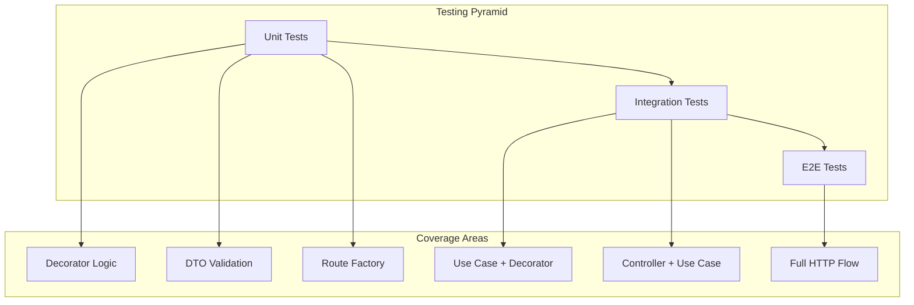

# Multi-Term Forecast Abstraction - Testing Guide

## Overview

This guide provides comprehensive testing strategies and examples for the multi-term forecast abstraction. It covers unit tests, integration tests, and end-to-end tests.

---

## Testing Strategy



### Test Distribution

| Test Type | Coverage | Execution Time | Dependencies |
|-----------|----------|----------------|--------------|
| Unit Tests | 70% | Fast (~ms) | None (mocked) |
| Integration Tests | 20% | Medium (~s) | SQLite test DB |
| E2E Tests | 10% | Slow (~s) | Full server |

---

## Unit Tests

### 1. MultiTermForecasterDecorator Tests

**Location**: `apps/backend/src/domain/forecasts/__tests__/multi-term-forecaster.decorator.test.ts`

```typescript
import { describe, it, expect, vi, beforeEach } from 'vitest';
import {
  MultiTermForecasterDecorator,
} from '../multi-term-forecaster.decorator';
import {
  CourseDemandForecaster,
  CourseDemandForecasterResult,
} from '../course-demand-forecaster';

// Mock forecaster factory
function createMockForecaster(
  results?: Map<number, CourseDemandForecasterResult>,
): CourseDemandForecaster {
  return {
    methodId: 'test-method',
    methodLabel: 'Test Method',
    forecast: vi.fn(async (input) => {
      if (results?.has(input.academicTerm)) {
        return results.get(input.academicTerm)!;
      }
      return {
        courseCode: input.courseCode,
        academicTerm: input.academicTerm,
        forecastedEnrollment: 42,
        methodId: 'test-method',
        methodLabel: 'Test Method',
        details: {},
      };
    }),
  };
}

describe('MultiTermForecasterDecorator', () => {
  describe('forecastSingle', () => {
    it('should delegate to wrapped forecaster', async () => {
      const mockForecaster = createMockForecaster();
      const decorator = new MultiTermForecasterDecorator(mockForecaster);

      const result = await decorator.forecastSingle({
        courseCode: 'ISIS-3204',
        academicTerm: 202410,
      });

      expect(mockForecaster.forecast).toHaveBeenCalledWith({
        courseCode: 'ISIS-3204',
        academicTerm: 202410,
      });
      expect(result.forecastedEnrollment).toBe(42);
    });
  });

  describe('forecastMultiple', () => {
    it('should execute forecasts for all terms', async () => {
      const mockForecaster = createMockForecaster();
      const decorator = new MultiTermForecasterDecorator(mockForecaster);
      const terms = [202410, 202420, 202510];

      const { results, errors } = await decorator.forecastMultiple(
        { courseCode: 'ISIS-3204' },
        terms,
      );

      expect(results).toHaveLength(3);
      expect(errors).toHaveLength(0);
      expect(mockForecaster.forecast).toHaveBeenCalledTimes(3);

      // Verify each term was processed
      terms.forEach((term, index) => {
        expect(results[index].academicTerm).toBe(term);
      });
    });

    it('should execute forecasts in parallel', async () => {
      const executionOrder: number[] = [];
      const mockForecaster: CourseDemandForecaster = {
        methodId: 'test',
        methodLabel: 'Test',
        forecast: vi.fn(async (input) => {
          // Simulate varying execution times
          await new Promise(resolve =>
            setTimeout(resolve, Math.random() * 10)
          );
          executionOrder.push(input.academicTerm);
          return {
            courseCode: input.courseCode,
            academicTerm: input.academicTerm,
            forecastedEnrollment: 10,
            methodId: 'test',
            methodLabel: 'Test',
            details: {},
          };
        }),
      };

      const decorator = new MultiTermForecasterDecorator(mockForecaster);
      await decorator.forecastMultiple(
        { courseCode: 'ISIS-3204' },
        [202410, 202420, 202510],
      );

      // Order may vary due to parallel execution
      expect(executionOrder).toHaveLength(3);
      expect(executionOrder.sort()).toEqual([202410, 202420, 202510]);
    });

    it('should enforce maxTerms limit', async () => {
      const mockForecaster = createMockForecaster();
      const decorator = new MultiTermForecasterDecorator(mockForecaster, {
        maxTerms: 3,
      });

      const terms = [202410, 202420, 202510, 202520];

      await expect(
        decorator.forecastMultiple({ courseCode: 'ISIS-3204' }, terms)
      ).rejects.toThrow('Maximum 3 terms allowed');
    });

    it('should reject duplicate terms', async () => {
      const mockForecaster = createMockForecaster();
      const decorator = new MultiTermForecasterDecorator(mockForecaster);

      const terms = [202410, 202420, 202410]; // Duplicate

      await expect(
        decorator.forecastMultiple({ courseCode: 'ISIS-3204' }, terms)
      ).rejects.toThrow('Duplicate terms');
    });

    it('should handle partial failures when allowed', async () => {
      const mockForecaster: CourseDemandForecaster = {
        methodId: 'test',
        methodLabel: 'Test',
        forecast: vi.fn(async (input) => {
          if (input.academicTerm === 202420) {
            throw new Error('Failed for term 202420');
          }
          return {
            courseCode: input.courseCode,
            academicTerm: input.academicTerm,
            forecastedEnrollment: 42,
            methodId: 'test',
            methodLabel: 'Test',
            details: {},
          };
        }),
      };

      const decorator = new MultiTermForecasterDecorator(mockForecaster, {
        allowPartialFailure: true,
      });

      const { results, errors } = await decorator.forecastMultiple(
        { courseCode: 'ISIS-3204' },
        [202410, 202420, 202510],
      );

      expect(results).toHaveLength(2);
      expect(errors).toHaveLength(1);
      expect(errors[0].term).toBe(202420);
      expect(errors[0].error.message).toBe('Failed for term 202420');
    });

    it('should throw on any failure when partial failure disabled', async () => {
      const mockForecaster: CourseDemandForecaster = {
        methodId: 'test',
        methodLabel: 'Test',
        forecast: vi.fn(async (input) => {
          if (input.academicTerm === 202420) {
            throw new Error('Failed');
          }
          return {
            courseCode: input.courseCode,
            academicTerm: input.academicTerm,
            forecastedEnrollment: 42,
            methodId: 'test',
            methodLabel: 'Test',
            details: {},
          };
        }),
      };

      const decorator = new MultiTermForecasterDecorator(mockForecaster, {
        allowPartialFailure: false,
      });

      await expect(
        decorator.forecastMultiple(
          { courseCode: 'ISIS-3204' },
          [202410, 202420, 202510],
        )
      ).rejects.toThrow('Forecasts failed for terms: 202420');
    });

    it('should preserve method metadata', async () => {
      const mockForecaster = createMockForecaster();
      const decorator = new MultiTermForecasterDecorator(mockForecaster);

      expect(decorator.methodId).toBe('test-method');
      expect(decorator.methodLabel).toBe('Test Method');
    });
  });
});
```

### 2. DTO Validation Tests

**Location**: `packages/contracts/src/forecasts/__tests__/multi-term-forecast.dto.test.ts`

```typescript
import { describe, it, expect } from 'vitest';
import {
  multiTermForecastResultSchema,
  multiTermForecastInputSchema,
} from '../multi-term-forecast.dto';

describe('multiTermForecastInputSchema', () => {
  it('should validate correct input', () => {
    const input = {
      courseCode: 'ISIS-3204',
      terms: [202410, 202420, 202510],
    };

    const result = multiTermForecastInputSchema.safeParse(input);
    expect(result.success).toBe(true);
  });

  it('should reject invalid course code format', () => {
    const input = {
      courseCode: 'invalid',
      terms: [202410],
    };

    const result = multiTermForecastInputSchema.safeParse(input);
    expect(result.success).toBe(false);
  });

  it('should reject empty terms array', () => {
    const input = {
      courseCode: 'ISIS-3204',
      terms: [],
    };

    const result = multiTermForecastInputSchema.safeParse(input);
    expect(result.success).toBe(false);
  });

  it('should reject more than 10 terms', () => {
    const input = {
      courseCode: 'ISIS-3204',
      terms: Array.from({ length: 11 }, (_, i) => 202410 + i * 10),
    };

    const result = multiTermForecastInputSchema.safeParse(input);
    expect(result.success).toBe(false);
  });

  it('should reject negative terms', () => {
    const input = {
      courseCode: 'ISIS-3204',
      terms: [-1, 202410],
    };

    const result = multiTermForecastInputSchema.safeParse(input);
    expect(result.success).toBe(false);
  });
});

describe('multiTermForecastResultSchema', () => {
  it('should validate correct result', () => {
    const result = {
      courseCode: 'ISIS-3204',
      method: {
        id: 'test-method',
        label: 'Test Method',
      },
      forecasts: [
        {
          academicTerm: 202410,
          forecastedEnrollment: 42,
          details: { someKey: 'value' },
        },
        {
          academicTerm: 202420,
          forecastedEnrollment: 38,
        },
      ],
      metadata: {
        requestedTerms: [202410, 202420],
        processedAt: '2025-11-21T10:30:00.000Z',
        totalForecasted: 80,
      },
    };

    const parsed = multiTermForecastResultSchema.safeParse(result);
    expect(parsed.success).toBe(true);
  });

  it('should validate result with errors', () => {
    const result = {
      courseCode: 'ISIS-3204',
      method: {
        id: 'test-method',
        label: 'Test Method',
      },
      forecasts: [
        {
          academicTerm: 202410,
          forecastedEnrollment: 42,
        },
      ],
      metadata: {
        requestedTerms: [202410, 202420],
        processedAt: '2025-11-21T10:30:00.000Z',
        totalForecasted: 42,
        errors: [
          {
            term: 202420,
            code: 'FORECAST_FAILED',
            message: 'Insufficient data',
          },
        ],
      },
    };

    const parsed = multiTermForecastResultSchema.safeParse(result);
    expect(parsed.success).toBe(true);
  });
});
```

### 3. Route Factory Tests

**Location**: `apps/backend/src/presentation/factories/__tests__/forecast-route.factory.test.ts`

```typescript
import { describe, it, expect, vi } from 'vitest';
import { Hono } from 'hono';
import { OpenAPIHono } from '@hono/zod-openapi';
import { z } from 'zod';
import { createForecastRoute } from '../forecast-route.factory';

describe('createForecastRoute', () => {
  const createTestApp = () => {
    const app = new OpenAPIHono();

    const singleTermHandler = vi.fn(async (courseCode, term) => ({
      courseCode,
      academicTerm: term,
      forecastedEnrollment: 42,
      methodId: 'test',
      methodLabel: 'Test',
      details: {},
    }));

    const multiTermHandler = vi.fn(async (courseCode, terms) => ({
      results: terms.map(term => ({
        courseCode,
        academicTerm: term,
        forecastedEnrollment: 42,
        methodId: 'test',
        methodLabel: 'Test',
        details: {},
      })),
      errors: [],
    }));

    createForecastRoute(app, {
      path: '/api/courses/{courseCode}/forecasts/test',
      summary: 'Test forecast',
      description: 'Test description',
      resultSchema: z.object({
        courseCode: z.string(),
        academicTerm: z.number(),
        forecastedEnrollment: z.number(),
        methodId: z.string(),
        methodLabel: z.string(),
        details: z.unknown(),
      }),
      singleTermHandler,
      multiTermHandler,
    });

    return { app, singleTermHandler, multiTermHandler };
  };

  describe('single term requests', () => {
    it('should handle single term query parameter', async () => {
      const { app, singleTermHandler } = createTestApp();

      const res = await app.request(
        '/api/courses/ISIS-3204/forecasts/test?term=202410'
      );

      expect(res.status).toBe(200);
      expect(singleTermHandler).toHaveBeenCalledWith('ISIS-3204', 202410);

      const data = await res.json();
      expect(data.academicTerm).toBe(202410);
    });
  });

  describe('multi term requests', () => {
    it('should handle terms query parameter', async () => {
      const { app, multiTermHandler } = createTestApp();

      const res = await app.request(
        '/api/courses/ISIS-3204/forecasts/test?terms=202410,202420,202510'
      );

      expect(res.status).toBe(200);
      expect(multiTermHandler).toHaveBeenCalledWith(
        'ISIS-3204',
        [202410, 202420, 202510]
      );

      const data = await res.json();
      expect(data.forecasts).toHaveLength(3);
      expect(data.metadata.requestedTerms).toEqual([202410, 202420, 202510]);
    });

    it('should calculate totalForecasted', async () => {
      const { app } = createTestApp();

      const res = await app.request(
        '/api/courses/ISIS-3204/forecasts/test?terms=202410,202420'
      );

      const data = await res.json();
      expect(data.metadata.totalForecasted).toBe(84); // 42 + 42
    });
  });

  describe('validation', () => {
    it('should reject invalid course code', async () => {
      const { app } = createTestApp();

      const res = await app.request(
        '/api/courses/invalid/forecasts/test?term=202410'
      );

      expect(res.status).toBe(400);
    });

    it('should reject missing term parameter', async () => {
      const { app } = createTestApp();

      const res = await app.request(
        '/api/courses/ISIS-3204/forecasts/test'
      );

      expect(res.status).toBe(400);
    });

    it('should reject invalid term format', async () => {
      const { app } = createTestApp();

      const res = await app.request(
        '/api/courses/ISIS-3204/forecasts/test?term=invalid'
      );

      expect(res.status).toBe(400);
    });
  });
});
```

---

## Integration Tests

### 1. Use Case Integration Tests

**Location**: `apps/backend/src/application/use-cases/forecasts/__tests__/potential-students-by-prerequisites.use-case.integration.test.ts`

```typescript
import { describe, it, expect, beforeAll, afterAll } from 'vitest';
import { PotentialStudentsByPrerequisitesUseCase } from '../potential-students-by-prerequisites.use-case.forecaster';
import { PotentialStudentsByPrerequisitesForecaster } from '../../../../domain/forecasts/potential-students-by-prerequisites-forecaster';
import { createTestDatabase, seedTestData } from '../../../../test/helpers/database';

describe('PotentialStudentsByPrerequisitesUseCase Integration', () => {
  let useCase: PotentialStudentsByPrerequisitesUseCase;
  let cleanup: () => Promise<void>;

  beforeAll(async () => {
    const { db, cleanup: dbCleanup, repositories } = await createTestDatabase();
    cleanup = dbCleanup;

    // Seed test data
    await seedTestData(db, {
      prerequisites: [
        {
          courseCode: 'ISIS-3204',
          prerequisitesJson: '["ISIS-1304", "ISIS-1225"]',
        },
      ],
      enrollments: [
        // Students who passed prerequisites before 202410
        { studentId: 1, academicTerm: 202310, courseCode: 'ISIS-1304', courseOutcome: 'P' },
        { studentId: 1, academicTerm: 202310, courseCode: 'ISIS-1225', courseOutcome: 'P' },
        { studentId: 2, academicTerm: 202310, courseCode: 'ISIS-1304', courseOutcome: 'P' },
        { studentId: 2, academicTerm: 202310, courseCode: 'ISIS-1225', courseOutcome: 'P' },
        { studentId: 3, academicTerm: 202310, courseCode: 'ISIS-1304', courseOutcome: 'P' },
        { studentId: 3, academicTerm: 202310, courseCode: 'ISIS-1225', courseOutcome: 'P' },
        // Student 3 already passed target course
        { studentId: 3, academicTerm: 202320, courseCode: 'ISIS-3204', courseOutcome: 'P' },
      ],
    });

    const forecaster = new PotentialStudentsByPrerequisitesForecaster({
      prerequisitesProvider: repositories.prerequisites,
      enrollmentHistoryProvider: repositories.enrollment,
    });

    useCase = new PotentialStudentsByPrerequisitesUseCase({ forecaster });
  });

  afterAll(async () => {
    await cleanup();
  });

  describe('execute (single term)', () => {
    it('should return correct forecast for single term', async () => {
      const result = await useCase.execute({
        courseCode: 'ISIS-3204',
        academicTerm: 202410,
      });

      expect(result.courseCode).toBe('ISIS-3204');
      expect(result.academicTerm).toBe(202410);
      // 3 passed prerequisites, 1 already passed target = 2 potential
      expect(result.forecastedEnrollment).toBe(2);
    });
  });

  describe('executeMultiple', () => {
    it('should return forecasts for multiple terms', async () => {
      const { results, errors } = await useCase.executeMultiple(
        { courseCode: 'ISIS-3204' },
        [202410, 202420],
      );

      expect(errors).toHaveLength(0);
      expect(results).toHaveLength(2);

      expect(results[0].academicTerm).toBe(202410);
      expect(results[1].academicTerm).toBe(202420);
    });

    it('should calculate different forecasts per term', async () => {
      const { results } = await useCase.executeMultiple(
        { courseCode: 'ISIS-3204' },
        [202320, 202410],
      );

      // Term 202320: student 3 hasn't passed yet
      // Term 202410: student 3 has passed
      expect(results[0].forecastedEnrollment).toBeGreaterThan(
        results[1].forecastedEnrollment
      );
    });
  });
});
```

### 2. Controller Integration Tests

**Location**: `apps/backend/src/presentation/controllers/forecasts/__tests__/potential-students-by-prerequisites.controller.integration.test.ts`

```typescript
import { describe, it, expect, beforeAll, afterAll } from 'vitest';
import { createApp } from '../../../../app';
import { createTestDatabase, seedTestData } from '../../../../test/helpers/database';

describe('Potential Students Forecast Controller Integration', () => {
  let app: ReturnType<typeof createApp>;
  let cleanup: () => Promise<void>;

  beforeAll(async () => {
    const { db, cleanup: dbCleanup } = await createTestDatabase();
    cleanup = dbCleanup;

    await seedTestData(db, {
      // Test data
    });

    app = createApp({ db });
  });

  afterAll(async () => {
    await cleanup();
  });

  describe('GET /api/courses/:courseCode/forecasts/potential-students', () => {
    describe('single term', () => {
      it('should return forecast for single term', async () => {
        const res = await app.request(
          '/api/courses/ISIS-3204/forecasts/potential-students?term=202410'
        );

        expect(res.status).toBe(200);

        const data = await res.json();
        expect(data).toHaveProperty('courseCode', 'ISIS-3204');
        expect(data).toHaveProperty('academicTerm', 202410);
        expect(data).toHaveProperty('forecastedEnrollment');
        expect(data).toHaveProperty('methodId');
        expect(data).toHaveProperty('methodLabel');
      });
    });

    describe('multiple terms', () => {
      it('should return forecasts for multiple terms', async () => {
        const res = await app.request(
          '/api/courses/ISIS-3204/forecasts/potential-students?terms=202410,202420,202510'
        );

        expect(res.status).toBe(200);

        const data = await res.json();
        expect(data).toHaveProperty('courseCode', 'ISIS-3204');
        expect(data).toHaveProperty('method');
        expect(data.method).toHaveProperty('id');
        expect(data.method).toHaveProperty('label');
        expect(data).toHaveProperty('forecasts');
        expect(data.forecasts).toHaveLength(3);
        expect(data).toHaveProperty('metadata');
        expect(data.metadata.requestedTerms).toEqual([202410, 202420, 202510]);
      });

      it('should include totalForecasted in metadata', async () => {
        const res = await app.request(
          '/api/courses/ISIS-3204/forecasts/potential-students?terms=202410,202420'
        );

        const data = await res.json();
        const sum = data.forecasts.reduce(
          (acc: number, f: any) => acc + f.forecastedEnrollment,
          0
        );
        expect(data.metadata.totalForecasted).toBe(sum);
      });
    });

    describe('error handling', () => {
      it('should return 400 for invalid course code', async () => {
        const res = await app.request(
          '/api/courses/invalid/forecasts/potential-students?term=202410'
        );

        expect(res.status).toBe(400);
      });

      it('should return 404 for course without prerequisites', async () => {
        const res = await app.request(
          '/api/courses/XXXX-0000/forecasts/potential-students?term=202410'
        );

        expect(res.status).toBe(404);
      });
    });
  });
});
```

---

## End-to-End Tests

### E2E Test Example

**Location**: `apps/backend/e2e/forecasts.e2e.test.ts`

```typescript
import { describe, it, expect, beforeAll, afterAll } from 'vitest';
import { spawn, ChildProcess } from 'child_process';

describe('Forecasts E2E', () => {
  let serverProcess: ChildProcess;
  const baseUrl = 'http://localhost:3001';

  beforeAll(async () => {
    // Start the server
    serverProcess = spawn('npm', ['run', 'dev'], {
      env: { ...process.env, PORT: '3001' },
      stdio: 'pipe',
    });

    // Wait for server to be ready
    await new Promise<void>((resolve) => {
      const checkServer = setInterval(async () => {
        try {
          const res = await fetch(`${baseUrl}/health`);
          if (res.ok) {
            clearInterval(checkServer);
            resolve();
          }
        } catch {
          // Server not ready yet
        }
      }, 100);
    });
  });

  afterAll(() => {
    serverProcess.kill();
  });

  describe('Multi-term forecast flow', () => {
    it('should complete full multi-term forecast request', async () => {
      const courseCode = 'ISIS-3204';
      const terms = [202410, 202420, 202510];

      const res = await fetch(
        `${baseUrl}/api/courses/${courseCode}/forecasts/potential-students?terms=${terms.join(',')}`
      );

      expect(res.status).toBe(200);

      const data = await res.json();

      // Verify response structure
      expect(data.courseCode).toBe(courseCode);
      expect(data.forecasts).toHaveLength(terms.length);
      expect(data.metadata.requestedTerms).toEqual(terms);

      // Verify each forecast
      data.forecasts.forEach((forecast: any, index: number) => {
        expect(forecast.academicTerm).toBe(terms[index]);
        expect(typeof forecast.forecastedEnrollment).toBe('number');
      });
    });
  });
});
```

---

## Test Data Fixtures

### Sample Test Fixtures

**Location**: `apps/backend/src/test/fixtures/forecasts.fixtures.ts`

```typescript
export const testPrerequisites = [
  {
    courseCode: 'ISIS-3204',
    prerequisitesJson: '["ISIS-1304", "ISIS-1225", ["FISI-1028", "FISI-1528"]]',
  },
  {
    courseCode: 'ISIS-4000',
    prerequisitesJson: '["ISIS-3204"]',
  },
];

export const testEnrollments = [
  // Student 1: Passed all prerequisites
  { studentId: 1, academicTerm: 202310, courseCode: 'ISIS-1304', courseOutcome: 'P' },
  { studentId: 1, academicTerm: 202310, courseCode: 'ISIS-1225', courseOutcome: 'P' },
  { studentId: 1, academicTerm: 202320, courseCode: 'FISI-1028', courseOutcome: 'P' },

  // Student 2: Passed all prerequisites
  { studentId: 2, academicTerm: 202310, courseCode: 'ISIS-1304', courseOutcome: 'P' },
  { studentId: 2, academicTerm: 202310, courseCode: 'ISIS-1225', courseOutcome: 'P' },
  { studentId: 2, academicTerm: 202320, courseCode: 'FISI-1528', courseOutcome: 'P' },

  // Student 3: Missing one prerequisite
  { studentId: 3, academicTerm: 202310, courseCode: 'ISIS-1304', courseOutcome: 'P' },
  { studentId: 3, academicTerm: 202320, courseCode: 'FISI-1028', courseOutcome: 'P' },

  // Student 4: Already passed target course
  { studentId: 4, academicTerm: 202310, courseCode: 'ISIS-1304', courseOutcome: 'P' },
  { studentId: 4, academicTerm: 202310, courseCode: 'ISIS-1225', courseOutcome: 'P' },
  { studentId: 4, academicTerm: 202320, courseCode: 'FISI-1028', courseOutcome: 'P' },
  { studentId: 4, academicTerm: 202320, courseCode: 'ISIS-3204', courseOutcome: 'P' },

  // Student 5: Failed prerequisites
  { studentId: 5, academicTerm: 202310, courseCode: 'ISIS-1304', courseOutcome: 'F' },
];

// Expected results for different terms
export const expectedResults = {
  'ISIS-3204': {
    202410: {
      // Students 1, 2 are potential (3 missing prereq, 4 already passed)
      potentialStudents: 2,
    },
    202320: {
      // Only student 4 passed at this point, none potential
      potentialStudents: 0,
    },
  },
};
```

---

## Test Utilities

### Database Test Helper

**Location**: `apps/backend/src/test/helpers/database.ts`

```typescript
import { drizzle } from 'drizzle-orm/better-sqlite3';
import Database from 'better-sqlite3';
import { migrate } from 'drizzle-orm/better-sqlite3/migrator';
import * as schema from '../../infrastructure/db/schema';

export async function createTestDatabase() {
  const sqlite = new Database(':memory:');
  const db = drizzle(sqlite, { schema });

  // Run migrations
  migrate(db, { migrationsFolder: './drizzle' });

  return {
    db,
    cleanup: async () => {
      sqlite.close();
    },
    repositories: {
      // Create test repository instances
    },
  };
}

export async function seedTestData(
  db: ReturnType<typeof drizzle>,
  data: {
    prerequisites?: Array<{
      courseCode: string;
      prerequisitesJson: string;
    }>;
    enrollments?: Array<{
      studentId: number;
      academicTerm: number;
      courseCode: string;
      courseOutcome: string;
    }>;
  }
) {
  if (data.prerequisites) {
    await db.insert(schema.coursePrerequisites).values(data.prerequisites);
  }

  if (data.enrollments) {
    await db.insert(schema.enrollments).values(
      data.enrollments.map(e => ({
        studentId: e.studentId,
        academicTerm: e.academicTerm,
        courseCode: e.courseCode,
        courseOutcome: e.courseOutcome,
        campusDescription: null,
        partialGrade: null,
        finalGrade: null,
        courseStatusDescription: null,
      }))
    );
  }
}
```

---

## Running Tests

### Commands

```bash
# Run all tests
npm test

# Run unit tests only
npm run test:unit

# Run integration tests only
npm run test:integration

# Run e2e tests only
npm run test:e2e

# Run tests with coverage
npm run test:coverage

# Run specific test file
npm test -- apps/backend/src/domain/forecasts/__tests__/multi-term-forecaster.decorator.test.ts

# Run tests in watch mode
npm run test:watch
```

### Coverage Requirements

| Component | Minimum Coverage |
|-----------|-----------------|
| Decorator | 90% |
| DTO Schemas | 100% |
| Route Factory | 85% |
| Use Case | 85% |
| Controller | 80% |

---

## Test Scenarios Checklist

### Core Functionality

- [ ] Single term forecast returns correct structure
- [ ] Multi-term forecast returns correct structure
- [ ] Forecasts execute in parallel
- [ ] Results are correctly aggregated
- [ ] Metadata is correctly calculated

### Validation

- [ ] Invalid course code format rejected
- [ ] Missing term parameter rejected
- [ ] Empty terms array rejected
- [ ] Exceeding max terms rejected
- [ ] Duplicate terms rejected
- [ ] Negative terms rejected

### Error Handling

- [ ] Partial failures handled correctly
- [ ] Complete failures throw correctly
- [ ] Error messages are descriptive
- [ ] HTTP status codes are correct

### Edge Cases

- [ ] Single term in terms array works
- [ ] Maximum allowed terms works
- [ ] Empty database returns zero forecast
- [ ] Course without prerequisites handled

### Performance

- [ ] Parallel execution verified
- [ ] No N+1 query issues
- [ ] Response time acceptable

---

## Related Documents

- [Architecture Document](./architecture.md)
- [Implementation Guide](./implementation-guide.md)
- [General Architecture](../../general-architecture.md)
