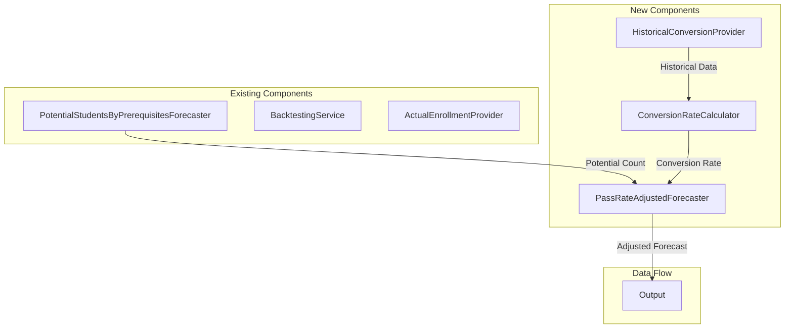
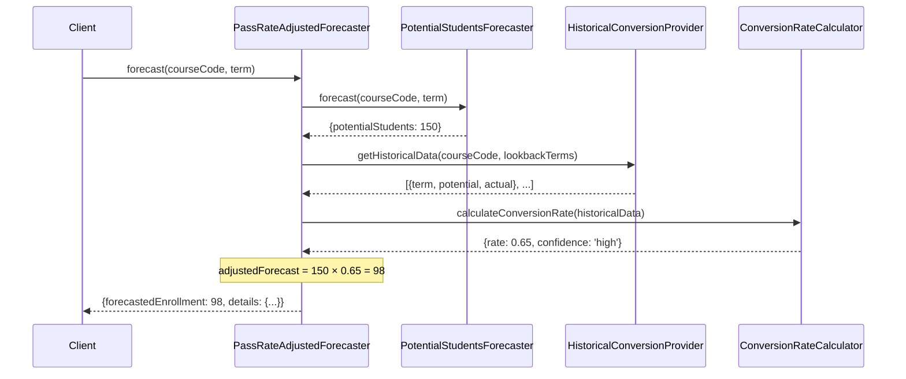
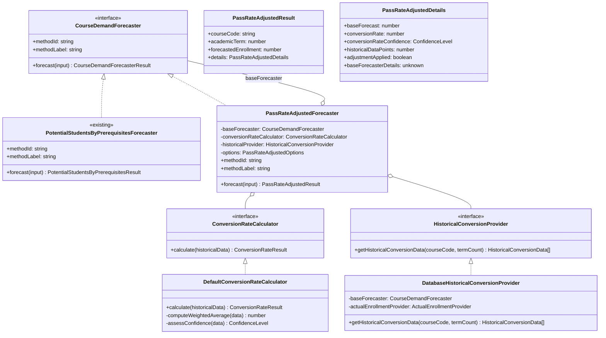
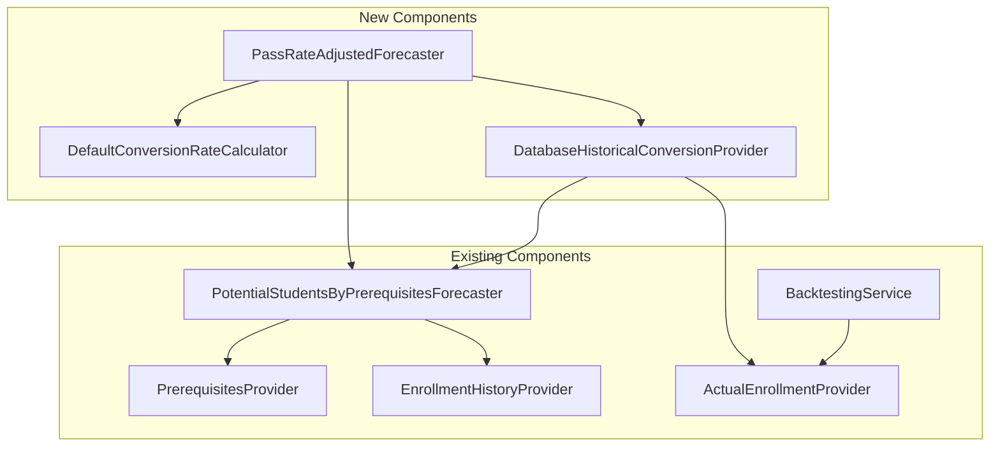

# Pass Rate Adjusted Forecaster - Architecture Document

## 1. Overview

### 1.1 Problem Statement

The current `PotentialStudentsByPrerequisitesForecaster` provides an **upper bound** estimate of enrollment by counting all students who have completed prerequisites. However, this approach:

- Overestimates actual enrollment because not all eligible students enroll
- Does not account for historical enrollment patterns
- Cannot adapt to course-specific demand variations
- Consistently produces "over-predictions" in backtesting

### 1.2 Goal

Create a **Pass Rate Adjusted Forecaster** that calibrates the prerequisite-based forecast using historical conversion rates:

```
Adjusted Forecast = Potential Students × Historical Conversion Rate
```

Where:
- **Potential Students**: Output from existing prerequisite-based forecaster
- **Historical Conversion Rate**: `actual_enrolled / potential_eligible` averaged over past terms

### 1.3 Design Principles

1. **Decorator Pattern**: Wrap existing forecaster rather than modifying it
2. **Separation of Concerns**: Keep conversion rate calculation independent
3. **Configurable Lookback**: Allow tuning of historical window size
4. **Graceful Degradation**: Fall back to base forecaster when insufficient history
5. **Transparency**: Expose calibration details in forecast output

---

## 2. Architecture Overview

### 2.1 System Context



### 2.2 High-Level Data Flow



---

## 3. Component Architecture

### 3.1 Class Diagram



### 3.2 Component Responsibilities

| Component | Responsibility | Layer |
|-----------|---------------|-------|
| `PassRateAdjustedForecaster` | Orchestrate base forecast and adjustment | Domain |
| `ConversionRateCalculator` | Compute conversion rate from historical data | Domain |
| `HistoricalConversionProvider` | Retrieve historical potential/actual pairs | Domain (Interface) |
| `DatabaseHistoricalConversionProvider` | Implementation using existing repositories | Infrastructure |

---

## 4. Domain Models

### 4.1 Conversion Rate Models

```typescript
// Location: apps/backend/src/domain/forecasts/models/conversion-rate.ts

/**
 * Confidence level for the conversion rate estimate
 */
export type ConversionRateConfidence = 'high' | 'medium' | 'low' | 'insufficient';

/**
 * Historical data point for conversion calculation
 */
export interface HistoricalConversionData {
  readonly academicTerm: number;
  readonly potentialStudents: number;
  readonly actualEnrollment: number;
  readonly conversionRate: number; // actual / potential
}

/**
 * Result of conversion rate calculation
 */
export interface ConversionRateResult {
  /** Calculated conversion rate (0.0 - 1.0+) */
  readonly rate: number;

  /** Confidence level based on data quality */
  readonly confidence: ConversionRateConfidence;

  /** Number of historical terms used */
  readonly dataPointsUsed: number;

  /** Standard deviation of historical rates */
  readonly standardDeviation: number;

  /** Minimum rate observed */
  readonly minRate: number;

  /** Maximum rate observed */
  readonly maxRate: number;
}
```

### 4.2 Forecaster Result Models

```typescript
// Location: apps/backend/src/domain/forecasts/models/pass-rate-adjusted.ts

import type { ConversionRateConfidence } from './conversion-rate';

/**
 * Detailed information about the pass-rate adjusted forecast
 */
export interface PassRateAdjustedDetails {
  /** Raw forecast from base forecaster (upper bound) */
  readonly baseForecast: number;

  /** Applied conversion rate */
  readonly conversionRate: number;

  /** Confidence in the conversion rate */
  readonly conversionRateConfidence: ConversionRateConfidence;

  /** Number of historical data points used */
  readonly historicalDataPoints: number;

  /** Whether adjustment was applied (false if insufficient data) */
  readonly adjustmentApplied: boolean;

  /** Reason if adjustment was not applied */
  readonly fallbackReason?: string;

  /** Historical conversion data used */
  readonly historicalRates?: Array<{
    term: number;
    rate: number;
  }>;

  /** Details from the base forecaster */
  readonly baseForecasterDetails: unknown;
}

/**
 * Extended result type for pass-rate adjusted forecasts
 */
export interface PassRateAdjustedResult {
  readonly courseCode: string;
  readonly academicTerm: number;
  readonly forecastedEnrollment: number;
  readonly methodId: string;
  readonly methodLabel: string;
  readonly details: PassRateAdjustedDetails;
}
```

---

## 5. Conversion Rate Calculation

### 5.1 Algorithm Overview

The conversion rate represents the proportion of eligible students who actually enroll:

```
Conversion Rate = Actual Enrollment / Potential Students
```

### 5.2 Weighted Average Approach

Recent terms are weighted more heavily than older terms. The system uses **term-type-aware lookback**:

#### Main Semester Terms (10, 20)
- Spring semesters: `YYYY10` (e.g., 202110, 202210, 202310)
- Fall semesters: `YYYY20` (e.g., 202120, 202220, 202320)
- Lookback: Previous 3 main semester terms

#### Intersession/Summer Terms (11-19)
- Summer/intersession terms: `YYYY11` through `YYYY19`
- Lookback: Previous 3 intersession/summer terms of the **same type**
- Example: For term `202315`, lookback uses `202215`, `202115`, `202015`

```typescript
// Exponential decay weighting
weight(i) = α^i  where i = 0 (most recent), 1, 2, ...

// Example with α = 0.7 and 3 terms:

// Main semester (forecasting for 202410):
// Term -1 (most recent, e.g., 202320): weight = 0.7^0 = 1.00
// Term -2 (e.g., 202310): weight = 0.7^1 = 0.70
// Term -3 (e.g., 202220): weight = 0.7^2 = 0.49

// Intersession (forecasting for 202415):
// Term -1 (most recent, e.g., 202315): weight = 0.7^0 = 1.00
// Term -2 (e.g., 202215): weight = 0.7^1 = 0.70
// Term -3 (e.g., 202115): weight = 0.7^2 = 0.49

weightedRate = Σ(weight_i × rate_i) / Σ(weight_i)
```

### 5.3 Confidence Assessment

| Confidence | Criteria |
|------------|----------|
| `high` | 3 data points, std dev < 0.15 |
| `medium` | 2 data points, std dev < 0.25 |
| `low` | 1 data point |
| `insufficient` | 0 data points |

> **Note**: The lookback strategy is term-type-aware:
> - Main semesters (10, 20) → lookback uses previous main semester terms
> - Intersession/summer (11-19) → lookback uses previous terms of the same type

### 5.4 Edge Cases

| Scenario | Handling |
|----------|----------|
| Potential = 0 | Skip term (division by zero) |
| Actual > Potential | Cap rate at 1.0 or allow > 1.0 (configurable) |
| No historical data | Fall back to base forecaster, set `adjustmentApplied: false` |
| Single data point | Use rate directly with `low` confidence |

### 5.5 Calculator Implementation

```typescript
// Location: apps/backend/src/domain/forecasts/default-conversion-rate-calculator.ts

import type {
  ConversionRateCalculator,
  ConversionRateResult,
  ConversionRateConfidence,
  HistoricalConversionData,
} from './models/conversion-rate';

export interface ConversionRateCalculatorOptions {
  /** Exponential decay factor (0-1). Higher = more weight on recent terms */
  decayFactor?: number;

  /** Minimum data points for high confidence */
  highConfidenceThreshold?: number;

  /** Whether to cap conversion rate at 1.0 */
  capRateAtOne?: boolean;
}

const DEFAULT_OPTIONS: Required<ConversionRateCalculatorOptions> = {
  decayFactor: 0.7,
  highConfidenceThreshold: 3,
  capRateAtOne: false,
};

export class DefaultConversionRateCalculator implements ConversionRateCalculator {
  private readonly options: Required<ConversionRateCalculatorOptions>;

  constructor(options: ConversionRateCalculatorOptions = {}) {
    this.options = { ...DEFAULT_OPTIONS, ...options };
  }

  calculate(historicalData: HistoricalConversionData[]): ConversionRateResult {
    // Filter out invalid data points
    const validData = historicalData.filter(
      d => d.potentialStudents > 0
    );

    if (validData.length === 0) {
      return this.insufficientDataResult();
    }

    // Sort by term descending (most recent first)
    const sorted = [...validData].sort(
      (a, b) => b.academicTerm - a.academicTerm
    );

    // Calculate rates
    const rates = sorted.map(d => {
      const rate = d.actualEnrollment / d.potentialStudents;
      return this.options.capRateAtOne ? Math.min(rate, 1.0) : rate;
    });

    // Compute weighted average
    const weights = rates.map((_, i) =>
      Math.pow(this.options.decayFactor, i)
    );
    const totalWeight = weights.reduce((sum, w) => sum + w, 0);
    const weightedRate = rates.reduce(
      (sum, rate, i) => sum + rate * weights[i], 0
    ) / totalWeight;

    // Calculate statistics
    const mean = rates.reduce((sum, r) => sum + r, 0) / rates.length;
    const variance = rates.reduce(
      (sum, r) => sum + Math.pow(r - mean, 2), 0
    ) / rates.length;
    const stdDev = Math.sqrt(variance);

    return {
      rate: Math.round(weightedRate * 1000) / 1000, // Round to 3 decimals
      confidence: this.assessConfidence(validData.length, stdDev),
      dataPointsUsed: validData.length,
      standardDeviation: Math.round(stdDev * 1000) / 1000,
      minRate: Math.min(...rates),
      maxRate: Math.max(...rates),
    };
  }

  private assessConfidence(
    dataPoints: number,
    stdDev: number
  ): ConversionRateConfidence {
    if (dataPoints >= this.options.highConfidenceThreshold && stdDev < 0.15) {
      return 'high';
    }
    if (dataPoints >= 2 && stdDev < 0.25) {
      return 'medium';
    }
    if (dataPoints >= 1) {
      return 'low';
    }
    return 'insufficient';
  }

  private insufficientDataResult(): ConversionRateResult {
    return {
      rate: 1.0, // Default to no adjustment
      confidence: 'insufficient',
      dataPointsUsed: 0,
      standardDeviation: 0,
      minRate: 0,
      maxRate: 0,
    };
  }
}
```

---

## 6. Forecaster Implementation

### 6.1 Main Forecaster Class

```typescript
// Location: apps/backend/src/domain/forecasts/pass-rate-adjusted-forecaster.ts

import type {
  CourseDemandForecaster,
  CourseDemandForecasterInput,
} from './course-demand-forecaster';
import type { ConversionRateCalculator } from './models/conversion-rate';
import type { HistoricalConversionProvider } from './historical-conversion-provider';
import type {
  PassRateAdjustedResult,
  PassRateAdjustedDetails,
} from './models/pass-rate-adjusted';

const METHOD_ID = 'pass-rate-adjusted';
const METHOD_LABEL = 'Pass Rate Adjusted (calibrated)';

export interface PassRateAdjustedForecasterOptions {
  /** Number of past terms to consider for conversion rate */
  lookbackTerms?: number;

  /** Minimum confidence level to apply adjustment */
  minimumConfidence?: 'high' | 'medium' | 'low';
}

const DEFAULT_OPTIONS: Required<PassRateAdjustedForecasterOptions> = {
  lookbackTerms: 3,
  minimumConfidence: 'low',
};

export interface PassRateAdjustedForecasterDeps {
  readonly baseForecaster: CourseDemandForecaster;
  readonly conversionRateCalculator: ConversionRateCalculator;
  readonly historicalConversionProvider: HistoricalConversionProvider;
}

export class PassRateAdjustedForecaster implements CourseDemandForecaster {
  public readonly methodId: string = METHOD_ID;
  public readonly methodLabel: string = METHOD_LABEL;

  private readonly baseForecaster: CourseDemandForecaster;
  private readonly conversionRateCalculator: ConversionRateCalculator;
  private readonly historicalProvider: HistoricalConversionProvider;
  private readonly options: Required<PassRateAdjustedForecasterOptions>;

  constructor(
    deps: PassRateAdjustedForecasterDeps,
    options: PassRateAdjustedForecasterOptions = {},
  ) {
    this.baseForecaster = deps.baseForecaster;
    this.conversionRateCalculator = deps.conversionRateCalculator;
    this.historicalProvider = deps.historicalConversionProvider;
    this.options = { ...DEFAULT_OPTIONS, ...options };
  }

  async forecast(
    input: CourseDemandForecasterInput,
  ): Promise<PassRateAdjustedResult> {
    const { courseCode, academicTerm } = input;

    // Step 1: Get base forecast (potential students)
    const baseResult = await this.baseForecaster.forecast(input);
    const baseForecast = baseResult.forecastedEnrollment;

    // Step 2: Get historical conversion data
    const historicalData = await this.historicalProvider
      .getHistoricalConversionData(
        courseCode,
        academicTerm,
        this.options.lookbackTerms,
      );

    // Step 3: Calculate conversion rate
    const conversionResult = this.conversionRateCalculator.calculate(
      historicalData,
    );

    // Step 4: Determine if adjustment should be applied
    const shouldApplyAdjustment = this.shouldApplyAdjustment(
      conversionResult.confidence,
    );

    // Step 5: Calculate adjusted forecast
    const adjustedForecast = shouldApplyAdjustment
      ? Math.round(baseForecast * conversionResult.rate)
      : baseForecast;

    // Build details
    const details: PassRateAdjustedDetails = {
      baseForecast,
      conversionRate: conversionResult.rate,
      conversionRateConfidence: conversionResult.confidence,
      historicalDataPoints: conversionResult.dataPointsUsed,
      adjustmentApplied: shouldApplyAdjustment,
      fallbackReason: shouldApplyAdjustment
        ? undefined
        : `Insufficient historical data (confidence: ${conversionResult.confidence})`,
      historicalRates: historicalData.map(d => ({
        term: d.academicTerm,
        rate: Math.round((d.actualEnrollment / d.potentialStudents) * 1000) / 1000,
      })),
      baseForecasterDetails: baseResult.details,
    };

    return {
      courseCode,
      academicTerm,
      forecastedEnrollment: adjustedForecast,
      methodId: this.methodId,
      methodLabel: this.methodLabel,
      details,
    };
  }

  private shouldApplyAdjustment(
    confidence: 'high' | 'medium' | 'low' | 'insufficient',
  ): boolean {
    const confidenceOrder = ['insufficient', 'low', 'medium', 'high'];
    const actualIndex = confidenceOrder.indexOf(confidence);
    const minimumIndex = confidenceOrder.indexOf(this.options.minimumConfidence);
    return actualIndex >= minimumIndex;
  }
}
```

---

## 7. Historical Data Provider

### 7.1 Interface Definition

```typescript
// Location: apps/backend/src/domain/forecasts/historical-conversion-provider.ts

import type { HistoricalConversionData } from './models/conversion-rate';

export interface HistoricalConversionProvider {
  /**
   * Retrieves historical conversion data for a course
   *
   * @param courseCode - The target course code
   * @param beforeTerm - Get data from terms before this one
   * @param termCount - Number of past terms to retrieve
   * @returns Array of historical conversion data points
   */
  getHistoricalConversionData(
    courseCode: string,
    beforeTerm: number,
    termCount: number,
  ): Promise<HistoricalConversionData[]>;
}
```

### 7.2 Infrastructure Implementation

```typescript
// Location: apps/backend/src/infrastructure/providers/database-historical-conversion-provider.ts

import type {
  HistoricalConversionProvider,
  HistoricalConversionData,
} from '../../domain/forecasts/historical-conversion-provider';
import type { CourseDemandForecaster } from '../../domain/forecasts/course-demand-forecaster';
import type { ActualEnrollmentProvider } from '../../domain/backtesting/actual-enrollment-provider';

export interface DatabaseHistoricalConversionProviderDeps {
  readonly baseForecaster: CourseDemandForecaster;
  readonly actualEnrollmentProvider: ActualEnrollmentProvider;
}

export class DatabaseHistoricalConversionProvider
  implements HistoricalConversionProvider
{
  private readonly baseForecaster: CourseDemandForecaster;
  private readonly actualEnrollmentProvider: ActualEnrollmentProvider;

  constructor(deps: DatabaseHistoricalConversionProviderDeps) {
    this.baseForecaster = deps.baseForecaster;
    this.actualEnrollmentProvider = deps.actualEnrollmentProvider;
  }

  async getHistoricalConversionData(
    courseCode: string,
    beforeTerm: number,
    termCount: number,
  ): Promise<HistoricalConversionData[]> {
    // Get list of past terms (term-type-aware)
    const pastTerms = this.getPastTerms(beforeTerm, termCount);

    if (pastTerms.length === 0) {
      return [];
    }

    // Get actual enrollments for all terms
    const actualEnrollments = await this.actualEnrollmentProvider
      .getActualEnrollments(courseCode, pastTerms);

    // Get potential students for each past term
    const results: HistoricalConversionData[] = [];

    for (const term of pastTerms) {
      const actual = actualEnrollments.get(term);

      // Skip terms without actual data
      if (actual === null || actual === undefined) {
        continue;
      }

      try {
        const forecast = await this.baseForecaster.forecast({
          courseCode,
          academicTerm: term,
        });

        const potential = forecast.forecastedEnrollment;

        // Skip if potential is 0 (can't calculate rate)
        if (potential === 0) {
          continue;
        }

        results.push({
          academicTerm: term,
          potentialStudents: potential,
          actualEnrollment: actual,
          conversionRate: actual / potential,
        });
      } catch {
        // Skip terms where forecast fails
        continue;
      }
    }

    return results.sort((a, b) => b.academicTerm - a.academicTerm);
  }

  /**
   * Generates a list of past academic terms based on term type.
   * Uses term-type-aware lookback strategy:
   *
   * **Main Semester Terms (10, 20):**
   * - Spring: YYYY10, Fall: YYYY20
   * - Lookback alternates between 10 and 20
   *
   * **Intersession/Summer Terms (11-19):**
   * - Lookback uses the same term type from previous years
   * - Example: 202315 → [202215, 202115, 202015]
   *
   * @example
   * // Main semester: beforeTerm = 202410, count = 3
   * // Returns: [202320, 202310, 202220]
   *
   * // Intersession: beforeTerm = 202415, count = 3
   * // Returns: [202315, 202215, 202115]
   */
  private getPastTerms(beforeTerm: number, count: number): number[] {
    const year = Math.floor(beforeTerm / 100);
    const semester = beforeTerm % 100;

    // Determine if this is an intersession/summer term (11-19)
    const isIntersession = semester > 10 && semester < 20;

    if (isIntersession) {
      return this.getPastIntersessionTerms(year, semester, count);
    } else {
      return this.getPastMainTerms(year, semester, count);
    }
  }

  /**
   * Gets past main semester terms (10 and 20)
   */
  private getPastMainTerms(
    year: number,
    semester: number,
    count: number,
  ): number[] {
    const terms: number[] = [];
    let currentYear = year;
    let currentSemester = semester;

    // Normalize to main semester (10 or 20)
    if (currentSemester < 10) {
      currentYear -= 1;
      currentSemester = 20;
    } else if (currentSemester < 20) {
      currentSemester = 10;
    } else {
      currentSemester = 20;
    }

    // Go back one main semester term
    if (currentSemester === 10) {
      currentYear -= 1;
      currentSemester = 20;
    } else {
      currentSemester = 10;
    }

    // Generate past main semester terms only (10 and 20)
    while (terms.length < count && currentYear >= 2018) {
      terms.push(currentYear * 100 + currentSemester);

      // Alternate between spring (10) and fall (20)
      if (currentSemester === 10) {
        currentYear -= 1;
        currentSemester = 20;
      } else {
        currentSemester = 10;
      }
    }

    return terms;
  }

  /**
   * Gets past intersession/summer terms of the same type.
   * For term 202315, returns [202215, 202115, 202015]
   */
  private getPastIntersessionTerms(
    year: number,
    semester: number,
    count: number,
  ): number[] {
    const terms: number[] = [];
    let currentYear = year - 1; // Start from previous year

    // Get the same intersession term from previous years
    while (terms.length < count && currentYear >= 2018) {
      terms.push(currentYear * 100 + semester);
      currentYear -= 1;
    }

    return terms;
  }
}
```

---

## 8. API Contract

### 8.1 Method Registration

The method should be registered in the forecast method registry:

```typescript
// Registration metadata
{
  id: 'pass-rate-adjusted',
  label: 'Pass Rate Adjusted (calibrated)',
  description: 'Adjusts prerequisite-based forecasts using historical enrollment conversion rates. Provides more accurate predictions by calibrating the upper-bound estimate with actual demand patterns.',
  shortDescription: 'Calibrated prerequisite forecast',
  category: 'prerequisite-based',
  status: 'active',
  capabilities: {
    supportsMultiTerm: true,
    supportsBacktesting: true,
    requiresPrerequisites: true,
    requiresHistoricalData: true,
  },
}
```

### 8.2 Response Schema Extension

```typescript
// Location: packages/contracts/src/forecasts/pass-rate-adjusted.dto.ts

import { z } from 'zod';

export const passRateAdjustedDetailsSchema = z.object({
  baseForecast: z.number().int().nonnegative(),
  conversionRate: z.number().nonnegative(),
  conversionRateConfidence: z.enum(['high', 'medium', 'low', 'insufficient']),
  historicalDataPoints: z.number().int().nonnegative(),
  adjustmentApplied: z.boolean(),
  fallbackReason: z.string().optional(),
  historicalRates: z.array(z.object({
    term: z.number().int(),
    rate: z.number().nonnegative(),
  })).optional(),
  baseForecasterDetails: z.unknown(),
});

export type PassRateAdjustedDetailsDto = z.infer<
  typeof passRateAdjustedDetailsSchema
>;
```

### 8.3 Example Response

```json
{
  "courseCode": "ISIS-3204",
  "academicTerm": 202410,
  "forecastedEnrollment": 98,
  "methodId": "pass-rate-adjusted",
  "methodLabel": "Pass Rate Adjusted (calibrated)",
  "details": {
    "baseForecast": 150,
    "conversionRate": 0.653,
    "conversionRateConfidence": "high",
    "historicalDataPoints": 3,
    "adjustmentApplied": true,
    "historicalRates": [
      { "term": 202320, "rate": 0.68 },
      { "term": 202310, "rate": 0.62 },
      { "term": 202220, "rate": 0.71 }
    ],
    "baseForecasterDetails": {
      "prerequisiteExpression": { ... },
      "eligibleStudentCountBeforeTargetFilter": 165,
      "alreadyPassedTargetCount": 15,
      "potentialStudentCount": 150,
      "perCoursePassedCounts": { ... }
    }
  }
}
```

---

## 9. Integration with Existing System

### 9.1 Dependency Graph



### 9.2 Reuse of Existing Components

| Existing Component | Reuse Type | Purpose |
|-------------------|------------|---------|
| `PotentialStudentsByPrerequisitesForecaster` | Composition | Base forecast |
| `ActualEnrollmentProvider` | Dependency | Historical actual enrollments |
| `MultiTermForecasterDecorator` | Wrapping | Multi-term support |
| `BacktestingService` | Integration | Accuracy evaluation |

---

## 10. Configuration Options

### 10.1 Forecaster Options

| Option | Type | Default | Description |
|--------|------|---------|-------------|
| `lookbackTerms` | number | 3 | Number of past main semester terms (10/20) for rate calculation |
| `minimumConfidence` | string | 'low' | Minimum confidence to apply adjustment |

### 10.2 Calculator Options

| Option | Type | Default | Description |
|--------|------|---------|-------------|
| `decayFactor` | number | 0.7 | Weight decay for older terms (0-1) |
| `highConfidenceThreshold` | number | 3 | Min data points for high confidence |
| `capRateAtOne` | boolean | false | Cap conversion rate at 1.0 |

---

## 11. Error Handling

### 11.1 Error Scenarios

| Scenario | Handling | Result |
|----------|----------|--------|
| Base forecaster fails | Propagate error | Error response |
| No historical data | Fallback to base | `adjustmentApplied: false` |
| Insufficient confidence | Fallback to base | `adjustmentApplied: false` |
| Historical provider fails | Fallback to base | `adjustmentApplied: false` |

### 11.2 Graceful Degradation

When adjustment cannot be applied, the forecaster returns the base forecast with explanation:

```json
{
  "forecastedEnrollment": 150,
  "details": {
    "baseForecast": 150,
    "conversionRate": 1.0,
    "conversionRateConfidence": "insufficient",
    "adjustmentApplied": false,
    "fallbackReason": "Insufficient historical data (confidence: insufficient)"
  }
}
```

---

## 12. Performance Considerations

### 12.1 Caching Opportunities

- **Conversion rates**: Can be cached per course, invalidated when new term data arrives
- **Historical data**: Read-only, safe to cache with TTL
- **Base forecasts**: Already computed, no additional optimization needed

### 12.2 Query Optimization

The historical provider should batch requests:

```typescript
// Instead of N sequential forecasts:
for (term of pastTerms) {
  await baseForecaster.forecast({ courseCode, academicTerm: term });
}

// Consider parallel execution:
await Promise.all(
  pastTerms.map(term =>
    baseForecaster.forecast({ courseCode, academicTerm: term })
  )
);
```

---

## 13. Future Enhancements

### 13.1 Potential Improvements

1. **Seasonal Adjustment**: Different conversion rates for spring vs fall
2. **Trend Detection**: Identify increasing/decreasing conversion trends
3. **Course Category Rates**: Use category-level rates for new courses
4. **Confidence Intervals**: Provide forecast ranges (low/mid/high)

### 13.2 ML Integration Path

This forecaster provides a foundation for ML approaches:

```
Current: Adjusted = Base × WeightedAverageRate

Future ML: Adjusted = Base × f(features)
  where features include:
  - historical rates
  - semester indicator
  - course difficulty
  - instructor ratings
  - prerequisite pass rates
```

---

## 14. Related Documents

- [Potential Students by Prerequisites](../potential-students-by-prerequsites/doc.md)
- [Forecast Accuracy & Backtesting](../forecast-accuracy-backtesting/architecture.md)
- [Multi-Term Forecast Abstraction](../multi-term-forecast-abstraction/architecture.md)
- [Implementation Guide](./implementation-guide.md)
- [System Impact](./system-impact.md)
- [Testing Guide](./testing-guide.md)
