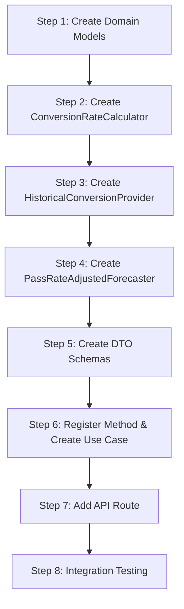

# Pass Rate Adjusted Forecaster - Implementation Guide

## Overview

This guide provides step-by-step instructions for implementing the Pass Rate Adjusted Forecaster. Follow each step in order to ensure proper integration with the existing codebase.

---

## Prerequisites

Before starting, ensure you understand:

- The existing [General Architecture](../../general-architecture.md)
- The [Potential Students by Prerequisites](../potential-students-by-prerequsites/doc.md) forecaster
- The [Forecast Accuracy & Backtesting](../forecast-accuracy-backtesting/architecture.md) system
- The [Architecture Document](./architecture.md) for this feature

---

## Implementation Steps



---

## Step 1: Create Domain Models

### 1.1 Create Conversion Rate Models

**Location**: `apps/backend/src/domain/forecasts/models/conversion-rate.ts`

```typescript
/**
 * Confidence level for the conversion rate estimate
 */
export type ConversionRateConfidence =
  | 'high'
  | 'medium'
  | 'low'
  | 'insufficient';

/**
 * Historical data point for conversion calculation
 */
export interface HistoricalConversionData {
  readonly academicTerm: number;
  readonly potentialStudents: number;
  readonly actualEnrollment: number;
  readonly conversionRate: number;
}

/**
 * Result of conversion rate calculation
 */
export interface ConversionRateResult {
  readonly rate: number;
  readonly confidence: ConversionRateConfidence;
  readonly dataPointsUsed: number;
  readonly standardDeviation: number;
  readonly minRate: number;
  readonly maxRate: number;
}
```

### 1.2 Create Pass Rate Adjusted Models

**Location**: `apps/backend/src/domain/forecasts/models/pass-rate-adjusted.ts`

```typescript
import type { ConversionRateConfidence } from './conversion-rate';

/**
 * Detailed information about the pass-rate adjusted forecast
 */
export interface PassRateAdjustedDetails {
  readonly baseForecast: number;
  readonly conversionRate: number;
  readonly conversionRateConfidence: ConversionRateConfidence;
  readonly historicalDataPoints: number;
  readonly adjustmentApplied: boolean;
  readonly fallbackReason?: string;
  readonly historicalRates?: Array<{
    term: number;
    rate: number;
  }>;
  readonly baseForecasterDetails: unknown;
}

/**
 * Extended result type for pass-rate adjusted forecasts
 */
export interface PassRateAdjustedResult {
  readonly courseCode: string;
  readonly academicTerm: number;
  readonly forecastedEnrollment: number;
  readonly methodId: string;
  readonly methodLabel: string;
  readonly details: PassRateAdjustedDetails;
}
```

### 1.3 Create Models Index

**Location**: `apps/backend/src/domain/forecasts/models/index.ts`

```typescript
export * from './conversion-rate';
export * from './pass-rate-adjusted';
```

---

## Step 2: Create Conversion Rate Calculator

### 2.1 Create Calculator Interface

**Location**: `apps/backend/src/domain/forecasts/conversion-rate-calculator.ts`

```typescript
import type {
  ConversionRateResult,
  HistoricalConversionData,
} from './models/conversion-rate';

/**
 * Interface for calculating conversion rates from historical data
 */
export interface ConversionRateCalculator {
  calculate(historicalData: HistoricalConversionData[]): ConversionRateResult;
}
```

### 2.2 Create Default Implementation

**Location**: `apps/backend/src/domain/forecasts/default-conversion-rate-calculator.ts`

```typescript
import type { ConversionRateCalculator } from './conversion-rate-calculator';
import type {
  ConversionRateResult,
  ConversionRateConfidence,
  HistoricalConversionData,
} from './models/conversion-rate';

export interface ConversionRateCalculatorOptions {
  /** Exponential decay factor (0-1). Higher = more weight on recent terms */
  decayFactor?: number;

  /** Minimum data points for high confidence */
  highConfidenceThreshold?: number;

  /** Standard deviation threshold for high confidence */
  highConfidenceStdDevMax?: number;

  /** Standard deviation threshold for medium confidence */
  mediumConfidenceStdDevMax?: number;

  /** Whether to cap conversion rate at 1.0 */
  capRateAtOne?: boolean;
}

const DEFAULT_OPTIONS: Required<ConversionRateCalculatorOptions> = {
  decayFactor: 0.7,
  highConfidenceThreshold: 3,
  highConfidenceStdDevMax: 0.15,
  mediumConfidenceStdDevMax: 0.25,
  capRateAtOne: false,
};

export class DefaultConversionRateCalculator
  implements ConversionRateCalculator
{
  private readonly options: Required<ConversionRateCalculatorOptions>;

  constructor(options: ConversionRateCalculatorOptions = {}) {
    this.options = { ...DEFAULT_OPTIONS, ...options };
  }

  calculate(historicalData: HistoricalConversionData[]): ConversionRateResult {
    // Filter out invalid data points (potential = 0)
    const validData = historicalData.filter(d => d.potentialStudents > 0);

    if (validData.length === 0) {
      return this.createInsufficientDataResult();
    }

    // Sort by term descending (most recent first)
    const sorted = [...validData].sort(
      (a, b) => b.academicTerm - a.academicTerm,
    );

    // Calculate individual rates
    const rates = sorted.map(d => {
      const rate = d.actualEnrollment / d.potentialStudents;
      return this.options.capRateAtOne ? Math.min(rate, 1.0) : rate;
    });

    // Compute weighted average using exponential decay
    const weights = rates.map((_, i) =>
      Math.pow(this.options.decayFactor, i),
    );
    const totalWeight = weights.reduce((sum, w) => sum + w, 0);
    const weightedRate =
      rates.reduce((sum, rate, i) => sum + rate * weights[i], 0) / totalWeight;

    // Calculate statistics
    const mean = rates.reduce((sum, r) => sum + r, 0) / rates.length;
    const variance =
      rates.reduce((sum, r) => sum + Math.pow(r - mean, 2), 0) / rates.length;
    const stdDev = Math.sqrt(variance);

    return {
      rate: this.round(weightedRate, 3),
      confidence: this.assessConfidence(validData.length, stdDev),
      dataPointsUsed: validData.length,
      standardDeviation: this.round(stdDev, 3),
      minRate: this.round(Math.min(...rates), 3),
      maxRate: this.round(Math.max(...rates), 3),
    };
  }

  private assessConfidence(
    dataPoints: number,
    stdDev: number,
  ): ConversionRateConfidence {
    if (
      dataPoints >= this.options.highConfidenceThreshold &&
      stdDev < this.options.highConfidenceStdDevMax
    ) {
      return 'high';
    }
    if (dataPoints >= 2 && stdDev < this.options.mediumConfidenceStdDevMax) {
      return 'medium';
    }
    if (dataPoints >= 1) {
      return 'low';
    }
    return 'insufficient';
  }

  private createInsufficientDataResult(): ConversionRateResult {
    return {
      rate: 1.0,
      confidence: 'insufficient',
      dataPointsUsed: 0,
      standardDeviation: 0,
      minRate: 0,
      maxRate: 0,
    };
  }

  private round(value: number, decimals: number): number {
    const factor = Math.pow(10, decimals);
    return Math.round(value * factor) / factor;
  }
}
```

---

## Step 3: Create Historical Conversion Provider

### 3.1 Create Provider Interface

**Location**: `apps/backend/src/domain/forecasts/historical-conversion-provider.ts`

```typescript
import type { HistoricalConversionData } from './models/conversion-rate';

/**
 * Provider interface for retrieving historical conversion data
 */
export interface HistoricalConversionProvider {
  /**
   * Retrieves historical conversion data for a course.
   * Uses term-type-aware lookback strategy:
   *
   * **Main Semester Terms (10, 20):**
   * - Lookback uses previous main semester terms
   *
   * **Intersession/Summer Terms (11-19):**
   * - Lookback uses previous terms of the same type from prior years
   *
   * @param courseCode - The target course code
   * @param beforeTerm - Get data from terms before this one
   * @param termCount - Number of past terms to retrieve
   * @returns Array of historical conversion data points
   *
   * @example
   * // Main semester: beforeTerm=202410, termCount=3
   * // Returns data for: 202320, 202310, 202220
   *
   * // Intersession: beforeTerm=202415, termCount=3
   * // Returns data for: 202315, 202215, 202115
   */
  getHistoricalConversionData(
    courseCode: string,
    beforeTerm: number,
    termCount: number,
  ): Promise<HistoricalConversionData[]>;
}
```

### 3.2 Create Database Implementation

**Location**: `apps/backend/src/infrastructure/providers/database-historical-conversion-provider.ts`

```typescript
import type {
  HistoricalConversionProvider,
  HistoricalConversionData,
} from '../../domain/forecasts/historical-conversion-provider';
import type { CourseDemandForecaster } from '../../domain/forecasts/course-demand-forecaster';
import type { ActualEnrollmentProvider } from '../../domain/backtesting/actual-enrollment-provider';

export interface DatabaseHistoricalConversionProviderDeps {
  readonly baseForecaster: CourseDemandForecaster;
  readonly actualEnrollmentProvider: ActualEnrollmentProvider;
}

export class DatabaseHistoricalConversionProvider
  implements HistoricalConversionProvider
{
  private readonly baseForecaster: CourseDemandForecaster;
  private readonly actualEnrollmentProvider: ActualEnrollmentProvider;

  constructor(deps: DatabaseHistoricalConversionProviderDeps) {
    this.baseForecaster = deps.baseForecaster;
    this.actualEnrollmentProvider = deps.actualEnrollmentProvider;
  }

  async getHistoricalConversionData(
    courseCode: string,
    beforeTerm: number,
    termCount: number,
  ): Promise<HistoricalConversionData[]> {
    // Get list of past terms (term-type-aware)
    const pastTerms = this.getPastTerms(beforeTerm, termCount);

    if (pastTerms.length === 0) {
      return [];
    }

    // Get actual enrollments for all terms in a single batch
    const actualEnrollments =
      await this.actualEnrollmentProvider.getActualEnrollments(
        courseCode,
        pastTerms,
      );

    // Get potential students for each past term (parallel execution)
    const forecastPromises = pastTerms.map(async term => {
      const actual = actualEnrollments.get(term);

      // Skip terms without actual data
      if (actual === null || actual === undefined) {
        return null;
      }

      try {
        const forecast = await this.baseForecaster.forecast({
          courseCode,
          academicTerm: term,
        });

        const potential = forecast.forecastedEnrollment;

        // Skip if potential is 0 (can't calculate rate)
        if (potential === 0) {
          return null;
        }

        return {
          academicTerm: term,
          potentialStudents: potential,
          actualEnrollment: actual,
          conversionRate: actual / potential,
        };
      } catch {
        // Skip terms where forecast fails
        return null;
      }
    });

    const results = await Promise.all(forecastPromises);

    // Filter out nulls and sort by term descending
    return results
      .filter((r): r is HistoricalConversionData => r !== null)
      .sort((a, b) => b.academicTerm - a.academicTerm);
  }

  /**
   * Generates a list of past academic terms based on term type.
   * Uses term-type-aware lookback strategy:
   *
   * **Main Semester Terms (10, 20):**
   * - Spring: YYYY10, Fall: YYYY20
   * - Lookback alternates between 10 and 20
   *
   * **Intersession/Summer Terms (11-19):**
   * - Lookback uses the same term type from previous years
   * - Example: 202315 → [202215, 202115, 202015]
   *
   * @example
   * // Main semester: beforeTerm = 202410, count = 3
   * // Returns: [202320, 202310, 202220]
   *
   * // Intersession: beforeTerm = 202415, count = 3
   * // Returns: [202315, 202215, 202115]
   */
  private getPastTerms(beforeTerm: number, count: number): number[] {
    const year = Math.floor(beforeTerm / 100);
    const semester = beforeTerm % 100;

    // Determine if this is an intersession/summer term (11-19)
    const isIntersession = semester > 10 && semester < 20;

    if (isIntersession) {
      return this.getPastIntersessionTerms(year, semester, count);
    } else {
      return this.getPastMainTerms(year, semester, count);
    }
  }

  /**
   * Gets past main semester terms (10 and 20)
   */
  private getPastMainTerms(
    year: number,
    semester: number,
    count: number,
  ): number[] {
    const terms: number[] = [];
    let currentYear = year;
    let currentSemester = semester;

    // Normalize to main semester (10 or 20)
    if (currentSemester < 10) {
      currentYear -= 1;
      currentSemester = 20;
    } else if (currentSemester < 20) {
      currentSemester = 10;
    } else {
      currentSemester = 20;
    }

    // Go back one main semester term
    if (currentSemester === 10) {
      currentYear -= 1;
      currentSemester = 20;
    } else {
      currentSemester = 10;
    }

    // Generate past main semester terms only (10 and 20)
    while (terms.length < count && currentYear >= 2018) {
      terms.push(currentYear * 100 + currentSemester);

      // Alternate between spring (10) and fall (20)
      if (currentSemester === 10) {
        currentYear -= 1;
        currentSemester = 20;
      } else {
        currentSemester = 10;
      }
    }

    return terms;
  }

  /**
   * Gets past intersession/summer terms of the same type.
   * For term 202315, returns [202215, 202115, 202015]
   */
  private getPastIntersessionTerms(
    year: number,
    semester: number,
    count: number,
  ): number[] {
    const terms: number[] = [];
    let currentYear = year - 1; // Start from previous year

    // Get the same intersession term from previous years
    while (terms.length < count && currentYear >= 2018) {
      terms.push(currentYear * 100 + semester);
      currentYear -= 1;
    }

    return terms;
  }
}
```

### 3.3 Create Provider Index

**Location**: `apps/backend/src/infrastructure/providers/index.ts`

```typescript
export * from './database-historical-conversion-provider';
```

---

## Step 4: Create Pass Rate Adjusted Forecaster

### 4.1 Create the Forecaster

**Location**: `apps/backend/src/domain/forecasts/pass-rate-adjusted-forecaster.ts`

```typescript
import type {
  CourseDemandForecaster,
  CourseDemandForecasterInput,
} from './course-demand-forecaster';
import type { ConversionRateCalculator } from './conversion-rate-calculator';
import type { HistoricalConversionProvider } from './historical-conversion-provider';
import type {
  PassRateAdjustedResult,
  PassRateAdjustedDetails,
} from './models/pass-rate-adjusted';
import type { ConversionRateConfidence } from './models/conversion-rate';

const METHOD_ID = 'pass-rate-adjusted';
const METHOD_LABEL = 'Pass Rate Adjusted (calibrated)';

export interface PassRateAdjustedForecasterOptions {
  /** Number of past main semester terms (10/20) to consider for conversion rate */
  lookbackTerms?: number;

  /** Minimum confidence level to apply adjustment */
  minimumConfidence?: ConversionRateConfidence;
}

const DEFAULT_OPTIONS: Required<PassRateAdjustedForecasterOptions> = {
  lookbackTerms: 3,
  minimumConfidence: 'low',
};

export interface PassRateAdjustedForecasterDeps {
  readonly baseForecaster: CourseDemandForecaster;
  readonly conversionRateCalculator: ConversionRateCalculator;
  readonly historicalConversionProvider: HistoricalConversionProvider;
}

/**
 * Forecaster that adjusts prerequisite-based predictions using
 * historical enrollment conversion rates.
 *
 * Formula: Adjusted Forecast = Base Forecast × Conversion Rate
 *
 * The conversion rate is calculated as a weighted average of
 * historical (actual_enrollment / potential_students) ratios.
 */
export class PassRateAdjustedForecaster implements CourseDemandForecaster {
  public readonly methodId: string = METHOD_ID;
  public readonly methodLabel: string = METHOD_LABEL;

  private readonly baseForecaster: CourseDemandForecaster;
  private readonly conversionRateCalculator: ConversionRateCalculator;
  private readonly historicalProvider: HistoricalConversionProvider;
  private readonly options: Required<PassRateAdjustedForecasterOptions>;

  constructor(
    deps: PassRateAdjustedForecasterDeps,
    options: PassRateAdjustedForecasterOptions = {},
  ) {
    this.baseForecaster = deps.baseForecaster;
    this.conversionRateCalculator = deps.conversionRateCalculator;
    this.historicalProvider = deps.historicalConversionProvider;
    this.options = { ...DEFAULT_OPTIONS, ...options };
  }

  async forecast(
    input: CourseDemandForecasterInput,
  ): Promise<PassRateAdjustedResult> {
    const { courseCode, academicTerm } = input;

    // Step 1: Get base forecast (potential students)
    const baseResult = await this.baseForecaster.forecast(input);
    const baseForecast = baseResult.forecastedEnrollment;

    // Step 2: Get historical conversion data
    const historicalData =
      await this.historicalProvider.getHistoricalConversionData(
        courseCode,
        academicTerm,
        this.options.lookbackTerms,
      );

    // Step 3: Calculate conversion rate
    const conversionResult =
      this.conversionRateCalculator.calculate(historicalData);

    // Step 4: Determine if adjustment should be applied
    const shouldApplyAdjustment = this.shouldApplyAdjustment(
      conversionResult.confidence,
    );

    // Step 5: Calculate adjusted forecast
    const adjustedForecast = shouldApplyAdjustment
      ? Math.round(baseForecast * conversionResult.rate)
      : baseForecast;

    // Build details
    const details: PassRateAdjustedDetails = {
      baseForecast,
      conversionRate: conversionResult.rate,
      conversionRateConfidence: conversionResult.confidence,
      historicalDataPoints: conversionResult.dataPointsUsed,
      adjustmentApplied: shouldApplyAdjustment,
      fallbackReason: shouldApplyAdjustment
        ? undefined
        : `Insufficient historical data (confidence: ${conversionResult.confidence})`,
      historicalRates: historicalData.map(d => ({
        term: d.academicTerm,
        rate: Math.round(d.conversionRate * 1000) / 1000,
      })),
      baseForecasterDetails: baseResult.details,
    };

    return {
      courseCode,
      academicTerm,
      forecastedEnrollment: adjustedForecast,
      methodId: this.methodId,
      methodLabel: this.methodLabel,
      details,
    };
  }

  private shouldApplyAdjustment(
    confidence: ConversionRateConfidence,
  ): boolean {
    const confidenceOrder: ConversionRateConfidence[] = [
      'insufficient',
      'low',
      'medium',
      'high',
    ];
    const actualIndex = confidenceOrder.indexOf(confidence);
    const minimumIndex = confidenceOrder.indexOf(
      this.options.minimumConfidence,
    );
    return actualIndex >= minimumIndex;
  }
}
```

### 4.2 Update Forecasts Index

**Location**: `apps/backend/src/domain/forecasts/index.ts`

Add exports for the new components:

```typescript
export * from './course-demand-forecaster';
export * from './multi-term-forecaster.decorator';
export * from './potential-students-by-prerequisites-forecaster';
export * from './forecast-method-registry';
export * from './forecast-method-metadata';
export * from './in-memory-forecast-method-registry';

// New exports
export * from './models';
export * from './conversion-rate-calculator';
export * from './default-conversion-rate-calculator';
export * from './historical-conversion-provider';
export * from './pass-rate-adjusted-forecaster';
```

---

## Step 5: Create DTO Schemas

### 5.1 Create Contract Schema

**Location**: `packages/contracts/src/forecasts/pass-rate-adjusted.dto.ts`

```typescript
import { z } from 'zod';

/**
 * Confidence level for conversion rate
 */
export const conversionRateConfidenceSchema = z.enum([
  'high',
  'medium',
  'low',
  'insufficient',
]);

export type ConversionRateConfidenceDto = z.infer<
  typeof conversionRateConfidenceSchema
>;

/**
 * Historical rate data point
 */
export const historicalRateSchema = z.object({
  term: z.number().int(),
  rate: z.number().nonnegative(),
});

export type HistoricalRateDto = z.infer<typeof historicalRateSchema>;

/**
 * Pass rate adjusted forecast details
 */
export const passRateAdjustedDetailsSchema = z.object({
  /** Raw forecast from base forecaster */
  baseForecast: z.number().int().nonnegative(),

  /** Applied conversion rate (0-1+) */
  conversionRate: z.number().nonnegative(),

  /** Confidence in the conversion rate */
  conversionRateConfidence: conversionRateConfidenceSchema,

  /** Number of historical terms used for calculation */
  historicalDataPoints: z.number().int().nonnegative(),

  /** Whether the adjustment was applied */
  adjustmentApplied: z.boolean(),

  /** Reason if adjustment was not applied */
  fallbackReason: z.string().optional(),

  /** Historical conversion rates per term */
  historicalRates: z.array(historicalRateSchema).optional(),

  /** Details from the underlying base forecaster */
  baseForecasterDetails: z.unknown(),
});

export type PassRateAdjustedDetailsDto = z.infer<
  typeof passRateAdjustedDetailsSchema
>;

/**
 * Full pass rate adjusted forecast result
 */
export const passRateAdjustedResultSchema = z.object({
  courseCode: z.string().regex(/^[A-Z]{4}-\d{4}$/, {
    message: 'courseCode must match pattern XXXX-DDDD.',
  }),

  academicTerm: z.number().int().nonnegative(),

  forecastedEnrollment: z.number().int().nonnegative(),

  methodId: z.literal('pass-rate-adjusted'),

  methodLabel: z.string(),

  details: passRateAdjustedDetailsSchema,
});

export type PassRateAdjustedResultDto = z.infer<
  typeof passRateAdjustedResultSchema
>;
```

### 5.2 Update Forecasts Index

**Location**: `packages/contracts/src/forecasts/index.ts`

```typescript
export * from './course-demand-forecast.dto';
export * from './multi-term-forecast.dto';
export * from './forecast-accuracy.dto';
export * from './forecast-method.dto';
export * from './pass-rate-adjusted.dto'; // Add this line
```

---

## Step 6: Register Method & Create Use Case

### 6.1 Register Method Metadata

**Location**: Update the method registration in your application setup

```typescript
import type { ForecastMethodMetadata } from '../domain/forecasts/forecast-method-metadata';

const passRateAdjustedMetadata: ForecastMethodMetadata = {
  id: 'pass-rate-adjusted',
  label: 'Pass Rate Adjusted (calibrated)',
  description:
    'Adjusts prerequisite-based forecasts using historical enrollment ' +
    'conversion rates. Provides more accurate predictions by calibrating ' +
    'the upper-bound estimate with actual demand patterns.',
  shortDescription: 'Calibrated prerequisite forecast',
  category: 'prerequisite-based',
  status: 'active',
  capabilities: {
    supportsMultiTerm: true,
    supportsBacktesting: true,
    requiresPrerequisites: true,
    requiresHistoricalData: true,
  },
};

// Register in your method registry
registry.register(passRateAdjustedMetadata);
```

### 6.2 Create Use Case

**Location**: `apps/backend/src/application/use-cases/forecasts/pass-rate-adjusted.use-case.ts`

```typescript
import type { PassRateAdjustedResultDto } from '@app/contracts';
import type { CourseDemandForecaster } from '../../../domain/forecasts/course-demand-forecaster';
import { MultiTermForecasterDecorator } from '../../../domain/forecasts/multi-term-forecaster.decorator';

export interface PassRateAdjustedUseCaseInput {
  courseCode: string;
  academicTerm: number;
}

export interface PassRateAdjustedUseCaseDeps {
  forecaster: CourseDemandForecaster;
}

export class PassRateAdjustedUseCase {
  private readonly forecaster: CourseDemandForecaster;
  private readonly multiTermDecorator: MultiTermForecasterDecorator;

  constructor(deps: PassRateAdjustedUseCaseDeps) {
    this.forecaster = deps.forecaster;
    this.multiTermDecorator = new MultiTermForecasterDecorator(
      this.forecaster,
      { maxTerms: 10, allowPartialFailure: true },
    );
  }

  /**
   * Execute forecast for a single academic term
   */
  async execute(
    input: PassRateAdjustedUseCaseInput,
  ): Promise<PassRateAdjustedResultDto> {
    const result = await this.forecaster.forecast({
      courseCode: input.courseCode,
      academicTerm: input.academicTerm,
    });

    return {
      courseCode: result.courseCode,
      academicTerm: result.academicTerm,
      forecastedEnrollment: result.forecastedEnrollment,
      methodId: result.methodId as 'pass-rate-adjusted',
      methodLabel: result.methodLabel,
      details: result.details as PassRateAdjustedResultDto['details'],
    };
  }

  /**
   * Execute forecasts for multiple academic terms
   */
  async executeMultiple(
    input: Omit<PassRateAdjustedUseCaseInput, 'academicTerm'>,
    terms: number[],
  ): Promise<{
    results: PassRateAdjustedResultDto[];
    errors: Array<{ term: number; message: string }>;
  }> {
    const { results, errors } = await this.multiTermDecorator.forecastMultiple(
      { courseCode: input.courseCode },
      terms,
    );

    return {
      results: results.map(r => ({
        courseCode: r.courseCode,
        academicTerm: r.academicTerm,
        forecastedEnrollment: r.forecastedEnrollment,
        methodId: r.methodId as 'pass-rate-adjusted',
        methodLabel: r.methodLabel,
        details: r.details as PassRateAdjustedResultDto['details'],
      })),
      errors: errors.map(e => ({
        term: e.term,
        message: e.error.message,
      })),
    };
  }
}
```

### 6.3 Create Factory Function

**Location**: `apps/backend/src/application/factories/pass-rate-adjusted-forecaster.factory.ts`

```typescript
import { PotentialStudentsByPrerequisitesForecaster } from '../../domain/forecasts/potential-students-by-prerequisites-forecaster';
import { PassRateAdjustedForecaster } from '../../domain/forecasts/pass-rate-adjusted-forecaster';
import { DefaultConversionRateCalculator } from '../../domain/forecasts/default-conversion-rate-calculator';
import { DatabaseHistoricalConversionProvider } from '../../infrastructure/providers/database-historical-conversion-provider';
import { PassRateAdjustedUseCase } from '../use-cases/forecasts/pass-rate-adjusted.use-case';

import type { PrerequisitesProvider } from '../../domain/forecasts/potential-students-by-prerequisites-forecaster';
import type { EnrollmentHistoryProvider } from '../../domain/forecasts/potential-students-by-prerequisites-forecaster';
import type { ActualEnrollmentProvider } from '../../domain/backtesting/actual-enrollment-provider';

export interface CreatePassRateAdjustedUseCaseDeps {
  prerequisitesProvider: PrerequisitesProvider;
  enrollmentHistoryProvider: EnrollmentHistoryProvider;
  actualEnrollmentProvider: ActualEnrollmentProvider;
}

export function createPassRateAdjustedUseCase(
  deps: CreatePassRateAdjustedUseCaseDeps,
): PassRateAdjustedUseCase {
  // Create base forecaster
  const baseForecaster = new PotentialStudentsByPrerequisitesForecaster({
    prerequisitesProvider: deps.prerequisitesProvider,
    enrollmentHistoryProvider: deps.enrollmentHistoryProvider,
  });

  // Create conversion rate calculator
  const conversionRateCalculator = new DefaultConversionRateCalculator({
    decayFactor: 0.7,
    highConfidenceThreshold: 4,
    capRateAtOne: false,
  });

  // Create historical conversion provider
  const historicalConversionProvider = new DatabaseHistoricalConversionProvider(
    {
      baseForecaster,
      actualEnrollmentProvider: deps.actualEnrollmentProvider,
    },
  );

  // Create pass rate adjusted forecaster
  const forecaster = new PassRateAdjustedForecaster(
    {
      baseForecaster,
      conversionRateCalculator,
      historicalConversionProvider,
    },
    {
      lookbackTerms: 3, // Uses only main semesters: 10 (spring), 20 (fall)
      minimumConfidence: 'low',
    },
  );

  return new PassRateAdjustedUseCase({ forecaster });
}
```

---

## Step 7: Add API Route

### 7.1 Create Controller

**Location**: `apps/backend/src/presentation/controllers/forecasts/pass-rate-adjusted.controller.ts`

```typescript
import { OpenAPIHono } from '@hono/zod-openapi';
import { passRateAdjustedResultSchema } from '@app/contracts';
import { createForecastRoute } from '../../factories/forecast-route.factory';
import { createPassRateAdjustedUseCase } from '../../../application/factories/pass-rate-adjusted-forecaster.factory';

// Import your repository instances
import { prerequisitesRepository } from '../../../infrastructure/repositories/prerequisites-repository';
import { enrollmentForecastRepository } from '../../../infrastructure/repositories/enrollment-forecast-repository';
import { actualEnrollmentProvider } from '../../../infrastructure/providers/actual-enrollment-provider';

export const registerPassRateAdjustedForecastRoute = (
  app: OpenAPIHono,
): void => {
  const useCase = createPassRateAdjustedUseCase({
    prerequisitesProvider: prerequisitesRepository,
    enrollmentHistoryProvider: enrollmentForecastRepository,
    actualEnrollmentProvider: actualEnrollmentProvider,
  });

  createForecastRoute(app, {
    path: '/api/courses/{courseCode}/forecasts/pass-rate-adjusted',
    summary: 'Forecast enrollment with pass rate adjustment',
    description:
      'Forecasts enrollment by adjusting prerequisite-based predictions ' +
      'using historical conversion rates for more accurate estimates.',
    tags: ['Forecasts'],
    resultSchema: passRateAdjustedResultSchema,

    singleTermHandler: async (courseCode, term) => {
      return useCase.execute({
        courseCode,
        academicTerm: term,
      });
    },

    multiTermHandler: async (courseCode, terms) => {
      return useCase.executeMultiple({ courseCode }, terms);
    },
  });
};
```

### 7.2 Register Route in Server

**Location**: Update `apps/backend/src/presentation/server.ts`

```typescript
import { registerPassRateAdjustedForecastRoute } from './controllers/forecasts/pass-rate-adjusted.controller';

// In your server setup:
registerPassRateAdjustedForecastRoute(app);
```

---

## Step 8: Integration Testing

### 8.1 Test the Implementation

After completing all steps, verify the implementation:

```bash
# Start the development server
npm run dev

# Test single-term request
curl "http://localhost:3000/api/courses/ISIS-3204/forecasts/pass-rate-adjusted?term=202410"

# Test multi-term request
curl "http://localhost:3000/api/courses/ISIS-3204/forecasts/pass-rate-adjusted?terms=202410,202420,202510"

# Compare with base forecaster
curl "http://localhost:3000/api/courses/ISIS-3204/forecasts/potential-students?term=202410"
```

### 8.2 Verify Response Structure

Expected response for single term:

```json
{
  "courseCode": "ISIS-3204",
  "academicTerm": 202410,
  "forecastedEnrollment": 98,
  "methodId": "pass-rate-adjusted",
  "methodLabel": "Pass Rate Adjusted (calibrated)",
  "details": {
    "baseForecast": 150,
    "conversionRate": 0.653,
    "conversionRateConfidence": "high",
    "historicalDataPoints": 3,
    "adjustmentApplied": true,
    "historicalRates": [
      { "term": 202320, "rate": 0.68 },
      { "term": 202310, "rate": 0.62 },
      { "term": 202220, "rate": 0.71 }
    ],
    "baseForecasterDetails": { ... }
  }
}
```

---

## File Summary

### New Files to Create

| File | Purpose |
|------|---------|
| `apps/backend/src/domain/forecasts/models/conversion-rate.ts` | Conversion rate domain models |
| `apps/backend/src/domain/forecasts/models/pass-rate-adjusted.ts` | Pass rate adjusted models |
| `apps/backend/src/domain/forecasts/models/index.ts` | Models exports |
| `apps/backend/src/domain/forecasts/conversion-rate-calculator.ts` | Calculator interface |
| `apps/backend/src/domain/forecasts/default-conversion-rate-calculator.ts` | Calculator implementation |
| `apps/backend/src/domain/forecasts/historical-conversion-provider.ts` | Provider interface |
| `apps/backend/src/domain/forecasts/pass-rate-adjusted-forecaster.ts` | Main forecaster |
| `apps/backend/src/infrastructure/providers/database-historical-conversion-provider.ts` | Provider implementation |
| `packages/contracts/src/forecasts/pass-rate-adjusted.dto.ts` | DTO schemas |
| `apps/backend/src/application/use-cases/forecasts/pass-rate-adjusted.use-case.ts` | Use case |
| `apps/backend/src/application/factories/pass-rate-adjusted-forecaster.factory.ts` | Factory function |
| `apps/backend/src/presentation/controllers/forecasts/pass-rate-adjusted.controller.ts` | API controller |

### Files to Modify

| File | Changes |
|------|---------|
| `apps/backend/src/domain/forecasts/index.ts` | Add new exports |
| `packages/contracts/src/forecasts/index.ts` | Add DTO export |
| `apps/backend/src/presentation/server.ts` | Register route |
| Method registry setup | Register method metadata |

---

## Checklist

Use this checklist to track your implementation progress:

- [ ] Step 1: Create Domain Models
  - [ ] Create `conversion-rate.ts`
  - [ ] Create `pass-rate-adjusted.ts`
  - [ ] Create models index

- [ ] Step 2: Create ConversionRateCalculator
  - [ ] Create interface
  - [ ] Create default implementation
  - [ ] Write unit tests

- [ ] Step 3: Create HistoricalConversionProvider
  - [ ] Create interface
  - [ ] Create database implementation
  - [ ] Write unit tests

- [ ] Step 4: Create PassRateAdjustedForecaster
  - [ ] Create forecaster class
  - [ ] Update exports
  - [ ] Write unit tests

- [ ] Step 5: Create DTO Schemas
  - [ ] Create contract schemas
  - [ ] Update exports

- [ ] Step 6: Register Method & Create Use Case
  - [ ] Register method metadata
  - [ ] Create use case
  - [ ] Create factory function

- [ ] Step 7: Add API Route
  - [ ] Create controller
  - [ ] Register route
  - [ ] Test endpoints

- [ ] Step 8: Integration Testing
  - [ ] Run unit tests
  - [ ] Test API endpoints
  - [ ] Compare with base forecaster

---

## Next Steps

After implementation, proceed to:

1. [Testing Guide](./testing-guide.md) - Comprehensive testing strategy
2. [System Impact](./system-impact.md) - Impact analysis
3. Run backtesting to compare accuracy with base forecaster
4. Update frontend to include new forecast method option

---

## Related Documents

- [Architecture Document](./architecture.md)
- [System Impact](./system-impact.md)
- [Testing Guide](./testing-guide.md)
- [General Architecture](../../general-architecture.md)
