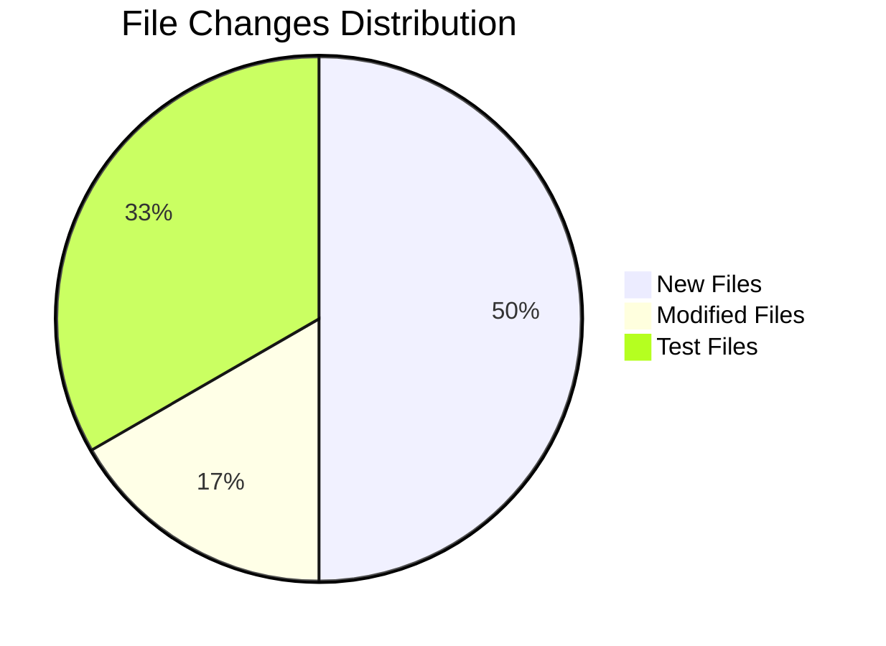
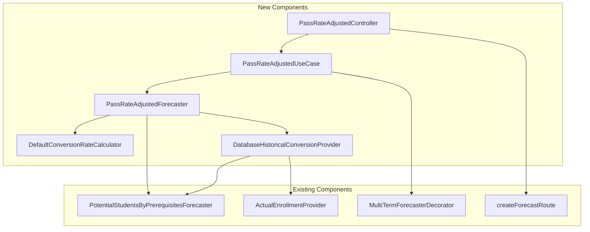

# Pass Rate Adjusted Forecaster - System Impact Analysis

## Overview

This document analyzes the impact of implementing the Pass Rate Adjusted Forecaster on the existing codebase. It identifies affected directories, files, components, and provides risk assessment.

---

## Impact Summary



| Category | Count | Risk Level |
|----------|-------|------------|
| New Files | 12 | Low |
| Modified Files | 4 | Low-Medium |
| New Test Files | 8 | Low |
| Breaking Changes | 0 | None |

---

## Affected Directories

### Directory Tree

```
investigacion-app/
├── packages/
│   └── contracts/
│       └── src/
│           └── forecasts/
│               ├── index.ts                              [MODIFIED]
│               ├── pass-rate-adjusted.dto.ts             [NEW]
│               └── __tests__/
│                   └── pass-rate-adjusted.dto.test.ts    [NEW]
│
├── apps/
│   └── backend/
│       └── src/
│           ├── domain/
│           │   └── forecasts/
│           │       ├── index.ts                          [MODIFIED]
│           │       ├── models/
│           │       │   ├── index.ts                      [NEW]
│           │       │   ├── conversion-rate.ts            [NEW]
│           │       │   └── pass-rate-adjusted.ts         [NEW]
│           │       ├── conversion-rate-calculator.ts     [NEW]
│           │       ├── default-conversion-rate-calculator.ts [NEW]
│           │       ├── historical-conversion-provider.ts [NEW]
│           │       ├── pass-rate-adjusted-forecaster.ts  [NEW]
│           │       └── __tests__/
│           │           ├── default-conversion-rate-calculator.test.ts [NEW]
│           │           └── pass-rate-adjusted-forecaster.test.ts [NEW]
│           │
│           ├── infrastructure/
│           │   └── providers/
│           │       ├── index.ts                          [NEW]
│           │       ├── database-historical-conversion-provider.ts [NEW]
│           │       └── __tests__/
│           │           └── database-historical-conversion-provider.test.ts [NEW]
│           │
│           ├── application/
│           │   ├── use-cases/
│           │   │   └── forecasts/
│           │   │       ├── pass-rate-adjusted.use-case.ts [NEW]
│           │   │       └── __tests__/
│           │   │           └── pass-rate-adjusted.use-case.test.ts [NEW]
│           │   │
│           │   └── factories/
│           │       └── pass-rate-adjusted-forecaster.factory.ts [NEW]
│           │
│           └── presentation/
│               ├── server.ts                             [MODIFIED]
│               └── controllers/
│                   └── forecasts/
│                       ├── pass-rate-adjusted.controller.ts [NEW]
│                       └── __tests__/
│                           └── pass-rate-adjusted.controller.test.ts [NEW]
│
└── docs/
    └── architecture/
        └── use-cases/
            └── pass-rate-adjusted-forecaster/
                ├── architecture.md                       [NEW]
                ├── implementation-guide.md               [NEW]
                ├── system-impact.md                      [NEW]
                └── testing-guide.md                      [NEW]
```

---

## Detailed Impact Analysis

### 1. Contracts Package

#### New Files

| File | Purpose | Dependencies |
|------|---------|--------------|
| `packages/contracts/src/forecasts/pass-rate-adjusted.dto.ts` | DTO schemas for pass rate adjusted forecaster | `zod` |

#### Modified Files

| File | Changes | Risk |
|------|---------|------|
| `packages/contracts/src/forecasts/index.ts` | Add export for pass-rate-adjusted DTOs | Low |

#### Impact on Consumers

- **Frontend**: Will have access to new types for pass-rate-adjusted responses
- **Backend**: Will use new schemas for validation
- **Breaking**: None - additive changes only

---

### 2. Domain Layer

#### New Files

| File | Purpose | Dependencies |
|------|---------|--------------|
| `models/conversion-rate.ts` | Conversion rate domain models | None |
| `models/pass-rate-adjusted.ts` | Pass rate adjusted result models | `conversion-rate.ts` |
| `models/index.ts` | Models barrel export | - |
| `conversion-rate-calculator.ts` | Calculator interface | `models/conversion-rate.ts` |
| `default-conversion-rate-calculator.ts` | Calculator implementation | `conversion-rate-calculator.ts` |
| `historical-conversion-provider.ts` | Provider interface | `models/conversion-rate.ts` |
| `pass-rate-adjusted-forecaster.ts` | Main forecaster class | Multiple domain files |

#### Modified Files

| File | Changes | Risk |
|------|---------|------|
| `apps/backend/src/domain/forecasts/index.ts` | Add exports for new components | Low |

#### Impact Analysis

- **Existing Forecasters**: No changes required
- **Existing Interfaces**: No modifications
- **Breaking**: None - all new components

---

### 3. Infrastructure Layer

#### New Files

| File | Purpose | Dependencies |
|------|---------|--------------|
| `providers/database-historical-conversion-provider.ts` | Provider implementation | `CourseDemandForecaster`, `ActualEnrollmentProvider` |
| `providers/index.ts` | Provider exports | - |

#### Dependency on Existing Components

| Component | Type | Notes |
|-----------|------|-------|
| `ActualEnrollmentProvider` | Interface | Reused from backtesting |
| `CourseDemandForecaster` | Interface | Used for base forecasts |

---

### 4. Application Layer

#### New Files

| File | Purpose | Dependencies |
|------|---------|--------------|
| `use-cases/forecasts/pass-rate-adjusted.use-case.ts` | Use case implementation | `PassRateAdjustedForecaster` |
| `factories/pass-rate-adjusted-forecaster.factory.ts` | Factory function | Multiple components |

#### Patterns Used

- **Factory Pattern**: For dependency assembly
- **Use Case Pattern**: For application logic encapsulation
- **Decorator Pattern**: Multi-term support via `MultiTermForecasterDecorator`

---

### 5. Presentation Layer

#### New Files

| File | Purpose | Dependencies |
|------|---------|--------------|
| `controllers/forecasts/pass-rate-adjusted.controller.ts` | API route handler | `createForecastRoute`, use case |

#### Modified Files

| File | Changes | Risk |
|------|---------|------|
| `apps/backend/src/presentation/server.ts` | Register new route | Low |

---

## API Changes

### New Endpoint

| Method | Path | Description |
|--------|------|-------------|
| GET | `/api/courses/{courseCode}/forecasts/pass-rate-adjusted` | Pass rate adjusted forecast |

### Query Parameters

| Parameter | Type | Description |
|-----------|------|-------------|
| `term` | integer | Single academic term |
| `terms` | string | Comma-separated terms for multi-term |

### Response Format

#### Single Term Response

```json
{
  "courseCode": "ISIS-3204",
  "academicTerm": 202410,
  "forecastedEnrollment": 98,
  "methodId": "pass-rate-adjusted",
  "methodLabel": "Pass Rate Adjusted (calibrated)",
  "details": {
    "baseForecast": 150,
    "conversionRate": 0.653,
    "conversionRateConfidence": "high",
    "historicalDataPoints": 5,
    "adjustmentApplied": true,
    "historicalRates": [...],
    "baseForecasterDetails": {...}
  }
}
```

#### Multi-Term Response

Uses standard multi-term response format with method-specific details.

---

## Dependency Analysis

### New External Dependencies

| Package | Version | Purpose |
|---------|---------|---------|
| None | - | No new external dependencies |

### Internal Dependency Graph



### Dependency Direction

All dependencies flow inward (toward domain):

- Presentation → Application → Domain ← Infrastructure

This maintains the clean architecture principle of dependency inversion.

---

## Database Impact

### Schema Changes

**None required.** The feature uses existing tables:

- `enrollments` - For historical enrollment data
- `course_prerequisites` - For prerequisite data

### Query Impact

| Operation | Frequency | Performance |
|-----------|-----------|-------------|
| Historical forecasts | Per lookback term (default: 3 terms) | Moderate (parallel) |
| Actual enrollments | Single batch query | Low |

> **Note**: Term-type-aware lookback strategy:
> - **Main semesters (10, 20)**: Uses previous 3 main semester terms (e.g., 202320, 202310, 202220)
> - **Intersession/summer (11-19)**: Uses previous 3 terms of the same type from prior years (e.g., 202315 → 202215, 202115, 202015)

### Optimization Notes

- Historical data provider executes forecasts in parallel
- Actual enrollments fetched in single batch query
- Consider caching conversion rates for frequently queried courses

---

## Performance Impact

### Computation Overhead

| Component | Impact | Notes |
|-----------|--------|-------|
| Base forecast | Same as existing | No additional overhead |
| Historical data | +N forecasts | N = lookbackTerms (default 3, term-type-aware) |
| Conversion calculation | O(N) | Negligible |

### Estimated Latency

| Scenario | Base Forecaster | Pass Rate Adjusted |
|----------|-----------------|-------------------|
| Single term | ~50ms | ~200ms |
| Multi-term (3) | ~150ms | ~300ms |

### Mitigation Strategies

1. **Parallel execution**: Historical forecasts run concurrently
2. **Caching**: Cache conversion rates with TTL
3. **Lazy evaluation**: Skip historical lookup if base forecast = 0

---

## Risk Assessment

### Risk Matrix

| Risk | Probability | Impact | Mitigation |
|------|-------------|--------|------------|
| Breaking existing endpoints | Very Low | High | All changes are additive |
| Performance degradation | Medium | Medium | Parallel execution, caching |
| Incorrect conversion rates | Low | Medium | Comprehensive testing, validation |
| Data quality issues | Low | Low | Graceful fallback to base forecaster |
| Integration complexity | Medium | Low | Clear interfaces, factory pattern |

### Overall Risk Level: **LOW**

The implementation is:
- Fully additive (no breaking changes)
- Uses proven patterns (decorator, factory)
- Has built-in fallback mechanisms
- Follows existing architecture conventions

---

## Migration Considerations

### Rollback Strategy

If issues arise, rollback is simple:

1. Remove route registration from `server.ts`
2. No database changes to revert
3. New files can remain (no harm if unused)

### Feature Flags (Optional)

Consider adding a feature flag for gradual rollout:

```typescript
if (config.features.passRateAdjustedForecaster) {
  registerPassRateAdjustedForecastRoute(app);
}
```

### Data Migration

**None required.** All historical data already exists in the system.

---

## Testing Impact

### New Test Files

| File | Type | Coverage Target |
|------|------|-----------------|
| `pass-rate-adjusted.dto.test.ts` | Unit | 100% |
| `default-conversion-rate-calculator.test.ts` | Unit | 95% |
| `pass-rate-adjusted-forecaster.test.ts` | Unit | 90% |
| `database-historical-conversion-provider.test.ts` | Integration | 85% |
| `pass-rate-adjusted.use-case.test.ts` | Integration | 85% |
| `pass-rate-adjusted.controller.test.ts` | Integration | 80% |

### Existing Test Updates

No existing tests need modification.

### Test Coverage Goals

| Layer | Target | Rationale |
|-------|--------|-----------|
| Domain | 90%+ | Core business logic |
| Infrastructure | 85%+ | Data access patterns |
| Application | 85%+ | Use case flows |
| Presentation | 80%+ | Route handling |

---

## Documentation Impact

### New Documentation

| File | Audience |
|------|----------|
| `architecture.md` | Architects, Senior Developers |
| `implementation-guide.md` | Developers |
| `system-impact.md` | Tech Leads, DevOps |
| `testing-guide.md` | Developers, QA |

### Documentation Updates Needed

| Document | Update Required |
|----------|-----------------|
| API documentation (OpenAPI) | Yes - new endpoint |
| Method registry documentation | Yes - new method |
| Frontend integration guide | Yes - new forecast option |
| README | Optional |

---

## Frontend Impact

### UI Changes Required

| Component | Change |
|-----------|--------|
| Method selector | Add "Pass Rate Adjusted" option |
| Forecast details view | Display conversion rate details |
| Accuracy dashboard | Support new method in comparisons |

### New Data to Display

- Conversion rate percentage
- Confidence level indicator
- Historical rates chart (optional)
- Base vs adjusted comparison

---

## Monitoring Recommendations

### Metrics to Track

| Metric | Purpose |
|--------|---------|
| Request latency | Performance monitoring |
| Conversion rate distribution | Data quality |
| Fallback frequency | Reliability |
| Error rate | System health |

### Alerts to Configure

| Alert | Threshold | Action |
|-------|-----------|--------|
| High latency | > 1000ms | Investigate performance |
| High fallback rate | > 30% | Check historical data quality |
| Error rate spike | > 1% | Check service health |

### Logging Recommendations

```typescript
// Log conversion rate calculation results
logger.info('Conversion rate calculated', {
  courseCode,
  term: academicTerm,
  rate: conversionResult.rate,
  confidence: conversionResult.confidence,
  dataPoints: conversionResult.dataPointsUsed,
});

// Log fallback occurrences
logger.warn('Falling back to base forecaster', {
  courseCode,
  term: academicTerm,
  reason: details.fallbackReason,
});
```

---

## Checklist for Implementation

### Pre-Implementation

- [ ] Review architecture document
- [ ] Set up development environment
- [ ] Ensure test database has sufficient historical data
- [ ] Verify existing backtesting infrastructure works

### Implementation

- [ ] Create domain models
- [ ] Create conversion rate calculator
- [ ] Create historical conversion provider
- [ ] Create pass rate adjusted forecaster
- [ ] Create DTO schemas
- [ ] Create use case and factory
- [ ] Add API route
- [ ] Write unit tests
- [ ] Write integration tests

### Post-Implementation

- [ ] Run full test suite
- [ ] Performance testing
- [ ] Compare accuracy with base forecaster (backtesting)
- [ ] Update API documentation
- [ ] Update frontend (if applicable)
- [ ] Deploy to staging
- [ ] Monitor metrics
- [ ] Deploy to production

---

## Approval Checklist

| Item | Reviewer | Status |
|------|----------|--------|
| Architecture Review | Tech Lead | Pending |
| Code Review | Senior Dev | Pending |
| Test Coverage Review | QA Lead | Pending |
| Performance Review | DevOps | Pending |
| API Contract Review | API Team | Pending |

---

## Related Documents

- [Architecture Document](./architecture.md)
- [Implementation Guide](./implementation-guide.md)
- [Testing Guide](./testing-guide.md)
- [Potential Students by Prerequisites](../potential-students-by-prerequsites/doc.md)
- [Forecast Accuracy & Backtesting](../forecast-accuracy-backtesting/architecture.md)
