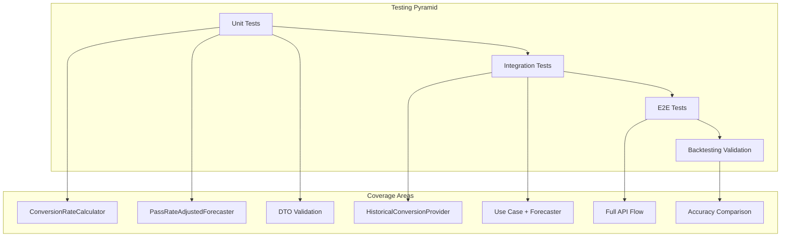

# Pass Rate Adjusted Forecaster - Testing Guide

## Overview

This guide provides comprehensive testing strategies and examples for the Pass Rate Adjusted Forecaster. It covers unit tests, integration tests, and end-to-end validation scenarios.

---

## Testing Strategy



### Test Distribution

| Test Type | Coverage | Execution Time | Dependencies |
|-----------|----------|----------------|--------------|
| Unit Tests | 70% | Fast (~ms) | None (mocked) |
| Integration Tests | 20% | Medium (~s) | SQLite test DB |
| E2E Tests | 5% | Slow (~s) | Full server |
| Backtesting | 5% | Slow (~min) | Real data |

---

## Unit Tests

### 1. DefaultConversionRateCalculator Tests

**Location**: `apps/backend/src/domain/forecasts/__tests__/default-conversion-rate-calculator.test.ts`

```typescript
import { describe, it, expect } from 'vitest';
import {
  DefaultConversionRateCalculator,
} from '../default-conversion-rate-calculator';
import type { HistoricalConversionData } from '../models/conversion-rate';

describe('DefaultConversionRateCalculator', () => {
  describe('calculate', () => {
    it('should return insufficient data result for empty input', () => {
      const calculator = new DefaultConversionRateCalculator();
      const result = calculator.calculate([]);

      expect(result.confidence).toBe('insufficient');
      expect(result.rate).toBe(1.0);
      expect(result.dataPointsUsed).toBe(0);
    });

    it('should calculate simple average for single data point', () => {
      const calculator = new DefaultConversionRateCalculator();
      const data: HistoricalConversionData[] = [
        {
          academicTerm: 202320,
          potentialStudents: 100,
          actualEnrollment: 65,
          conversionRate: 0.65,
        },
      ];

      const result = calculator.calculate(data);

      expect(result.rate).toBe(0.65);
      expect(result.confidence).toBe('insufficient');
      expect(result.dataPointsUsed).toBe(1);
    });

    it('should calculate weighted average with recent terms weighted more', () => {
      const calculator = new DefaultConversionRateCalculator({
        decayFactor: 0.5,
      });

      const data: HistoricalConversionData[] = [
        // Most recent (weight = 1.0)
        {
          academicTerm: 202320,
          potentialStudents: 100,
          actualEnrollment: 80,
          conversionRate: 0.80,
        },
        // Older (weight = 0.5)
        {
          academicTerm: 202310,
          potentialStudents: 100,
          actualEnrollment: 60,
          conversionRate: 0.60,
        },
      ];

      const result = calculator.calculate(data);

      // Weighted average: (0.80 * 1.0 + 0.60 * 0.5) / (1.0 + 0.5) = 1.10 / 1.5 = 0.733
      expect(result.rate).toBeCloseTo(0.733, 2);
      expect(result.dataPointsUsed).toBe(2);
    });

    it('should filter out data points with zero potential students', () => {
      const calculator = new DefaultConversionRateCalculator();
      const data: HistoricalConversionData[] = [
        {
          academicTerm: 202320,
          potentialStudents: 100,
          actualEnrollment: 70,
          conversionRate: 0.70,
        },
        {
          academicTerm: 202310,
          potentialStudents: 0, // Should be filtered
          actualEnrollment: 0,
          conversionRate: 0,
        },
      ];

      const result = calculator.calculate(data);

      expect(result.dataPointsUsed).toBe(1);
      expect(result.rate).toBe(0.70);
    });

    it('should cap rate at 1.0 when option is enabled', () => {
      const calculator = new DefaultConversionRateCalculator({
        capRateAtOne: true,
      });

      const data: HistoricalConversionData[] = [
        {
          academicTerm: 202320,
          potentialStudents: 50,
          actualEnrollment: 75, // 150% rate
          conversionRate: 1.5,
        },
      ];

      const result = calculator.calculate(data);

      expect(result.rate).toBe(1.0);
      expect(result.maxRate).toBe(1.0);
    });

    it('should allow rates above 1.0 when option is disabled', () => {
      const calculator = new DefaultConversionRateCalculator({
        capRateAtOne: false,
      });

      const data: HistoricalConversionData[] = [
        {
          academicTerm: 202320,
          potentialStudents: 50,
          actualEnrollment: 75,
          conversionRate: 1.5,
        },
      ];

      const result = calculator.calculate(data);

      expect(result.rate).toBe(1.5);
      expect(result.maxRate).toBe(1.5);
    });
  });

  describe('confidence assessment', () => {
    it('should return high confidence with 3 main semester points and low std dev', () => {
      const calculator = new DefaultConversionRateCalculator({
        highConfidenceThreshold: 3,
        highConfidenceStdDevMax: 0.15,
      });

      // 3 main semester data points with similar rates (low std dev)
      // Only uses 10 (spring) and 20 (fall) terms
      const data: HistoricalConversionData[] = [
        { academicTerm: 202320, potentialStudents: 100, actualEnrollment: 65, conversionRate: 0.65 },
        { academicTerm: 202310, potentialStudents: 100, actualEnrollment: 68, conversionRate: 0.68 },
        { academicTerm: 202220, potentialStudents: 100, actualEnrollment: 63, conversionRate: 0.63 },
      ];

      const result = calculator.calculate(data);

      expect(result.confidence).toBe('high');
      expect(result.dataPointsUsed).toBe(3);
      expect(result.standardDeviation).toBeLessThan(0.15);
    });

    it('should return medium confidence with 2 main semester points', () => {
      const calculator = new DefaultConversionRateCalculator();

      // 2 main semester terms (spring 10, fall 20)
      const data: HistoricalConversionData[] = [
        { academicTerm: 202320, potentialStudents: 100, actualEnrollment: 60, conversionRate: 0.60 },
        { academicTerm: 202310, potentialStudents: 100, actualEnrollment: 70, conversionRate: 0.70 },
      ];

      const result = calculator.calculate(data);

      expect(result.confidence).toBe('medium');
      expect(result.dataPointsUsed).toBe(2);
    });

    it('should return low confidence with 1 main semester point', () => {
      const calculator = new DefaultConversionRateCalculator();

      const data: HistoricalConversionData[] = [
        { academicTerm: 202320, potentialStudents: 100, actualEnrollment: 60, conversionRate: 0.60 },
      ];

      const result = calculator.calculate(data);

      expect(result.confidence).toBe('low');
      expect(result.dataPointsUsed).toBe(1);
    });

    it('should return insufficient confidence with 0 points', () => {
      const calculator = new DefaultConversionRateCalculator();

      const data: HistoricalConversionData[] = [];

      const result = calculator.calculate(data);

      expect(result.confidence).toBe('insufficient');
      expect(result.dataPointsUsed).toBe(0);
    });

    it('should downgrade confidence when std dev is high', () => {
      const calculator = new DefaultConversionRateCalculator({
        highConfidenceThreshold: 3,
        highConfidenceStdDevMax: 0.15,
      });

      // 3 main semester points but high variance
      const data: HistoricalConversionData[] = [
        { academicTerm: 202320, potentialStudents: 100, actualEnrollment: 40, conversionRate: 0.40 },
        { academicTerm: 202310, potentialStudents: 100, actualEnrollment: 90, conversionRate: 0.90 },
        { academicTerm: 202220, potentialStudents: 100, actualEnrollment: 50, conversionRate: 0.50 },
      ];

      const result = calculator.calculate(data);

      expect(result.confidence).not.toBe('high');
      expect(result.standardDeviation).toBeGreaterThan(0.15);
    });
  });

  describe('statistics', () => {
    it('should calculate min and max rates correctly', () => {
      const calculator = new DefaultConversionRateCalculator();

      const data: HistoricalConversionData[] = [
        { academicTerm: 202320, potentialStudents: 100, actualEnrollment: 50, conversionRate: 0.50 },
        { academicTerm: 202310, potentialStudents: 100, actualEnrollment: 80, conversionRate: 0.80 },
        { academicTerm: 202220, potentialStudents: 100, actualEnrollment: 65, conversionRate: 0.65 },
      ];

      const result = calculator.calculate(data);

      expect(result.minRate).toBe(0.50);
      expect(result.maxRate).toBe(0.80);
    });

    it('should calculate standard deviation correctly', () => {
      const calculator = new DefaultConversionRateCalculator();

      // All same rate = 0 std dev
      const data: HistoricalConversionData[] = [
        { academicTerm: 202320, potentialStudents: 100, actualEnrollment: 60, conversionRate: 0.60 },
        { academicTerm: 202310, potentialStudents: 100, actualEnrollment: 60, conversionRate: 0.60 },
        { academicTerm: 202220, potentialStudents: 100, actualEnrollment: 60, conversionRate: 0.60 },
      ];

      const result = calculator.calculate(data);

      expect(result.standardDeviation).toBe(0);
    });
  });
});
```

### 2. PassRateAdjustedForecaster Tests

**Location**: `apps/backend/src/domain/forecasts/__tests__/pass-rate-adjusted-forecaster.test.ts`

```typescript
import { describe, it, expect, vi, beforeEach } from 'vitest';
import { PassRateAdjustedForecaster } from '../pass-rate-adjusted-forecaster';
import type { CourseDemandForecaster } from '../course-demand-forecaster';
import type { ConversionRateCalculator } from '../conversion-rate-calculator';
import type { HistoricalConversionProvider } from '../historical-conversion-provider';
import type { HistoricalConversionData, ConversionRateResult } from '../models/conversion-rate';

describe('PassRateAdjustedForecaster', () => {
  // Mock factories
  const createMockBaseForecaster = (
    forecastedEnrollment: number = 100,
  ): CourseDemandForecaster => ({
    methodId: 'potential-students-by-prerequisites',
    methodLabel: 'Potential Students',
    forecast: vi.fn().mockResolvedValue({
      courseCode: 'ISIS-3204',
      academicTerm: 202410,
      forecastedEnrollment,
      methodId: 'potential-students-by-prerequisites',
      methodLabel: 'Potential Students',
      details: { some: 'details' },
    }),
  });

  const createMockCalculator = (
    result: ConversionRateResult,
  ): ConversionRateCalculator => ({
    calculate: vi.fn().mockReturnValue(result),
  });

  const createMockProvider = (
    data: HistoricalConversionData[] = [],
  ): HistoricalConversionProvider => ({
    getHistoricalConversionData: vi.fn().mockResolvedValue(data),
  });

  describe('forecast', () => {
    it('should apply conversion rate adjustment when confidence is sufficient', async () => {
      const baseForecaster = createMockBaseForecaster(150);
      const calculator = createMockCalculator({
        rate: 0.65,
        confidence: 'high',
        dataPointsUsed: 5,
        standardDeviation: 0.05,
        minRate: 0.60,
        maxRate: 0.70,
      });
      const provider = createMockProvider([
        { academicTerm: 202320, potentialStudents: 100, actualEnrollment: 65, conversionRate: 0.65 },
      ]);

      const forecaster = new PassRateAdjustedForecaster({
        baseForecaster,
        conversionRateCalculator: calculator,
        historicalConversionProvider: provider,
      });

      const result = await forecaster.forecast({
        courseCode: 'ISIS-3204',
        academicTerm: 202410,
      });

      // 150 * 0.65 = 97.5, rounded to 98
      expect(result.forecastedEnrollment).toBe(98);
      expect(result.details.baseForecast).toBe(150);
      expect(result.details.conversionRate).toBe(0.65);
      expect(result.details.adjustmentApplied).toBe(true);
    });

    it('should fall back to base forecast when confidence is insufficient', async () => {
      const baseForecaster = createMockBaseForecaster(150);
      const calculator = createMockCalculator({
        rate: 1.0,
        confidence: 'insufficient',
        dataPointsUsed: 0,
        standardDeviation: 0,
        minRate: 0,
        maxRate: 0,
      });
      const provider = createMockProvider([]);

      const forecaster = new PassRateAdjustedForecaster(
        {
          baseForecaster,
          conversionRateCalculator: calculator,
          historicalConversionProvider: provider,
        },
        { minimumConfidence: 'low' },
      );

      const result = await forecaster.forecast({
        courseCode: 'ISIS-3204',
        academicTerm: 202410,
      });

      expect(result.forecastedEnrollment).toBe(150);
      expect(result.details.adjustmentApplied).toBe(false);
      expect(result.details.fallbackReason).toContain('insufficient');
    });

    it('should respect minimumConfidence option', async () => {
      const baseForecaster = createMockBaseForecaster(100);
      const calculator = createMockCalculator({
        rate: 0.70,
        confidence: 'low',
        dataPointsUsed: 2,
        standardDeviation: 0.20,
        minRate: 0.60,
        maxRate: 0.80,
      });
      const provider = createMockProvider([
        { academicTerm: 202320, potentialStudents: 100, actualEnrollment: 70, conversionRate: 0.70 },
      ]);

      // Require medium confidence
      const forecaster = new PassRateAdjustedForecaster(
        {
          baseForecaster,
          conversionRateCalculator: calculator,
          historicalConversionProvider: provider,
        },
        { minimumConfidence: 'medium' },
      );

      const result = await forecaster.forecast({
        courseCode: 'ISIS-3204',
        academicTerm: 202410,
      });

      // Should not apply adjustment because low < medium
      expect(result.forecastedEnrollment).toBe(100);
      expect(result.details.adjustmentApplied).toBe(false);
    });

    it('should include historical rates from main semester terms in details', async () => {
      const baseForecaster = createMockBaseForecaster(100);
      const calculator = createMockCalculator({
        rate: 0.65,
        confidence: 'high',
        dataPointsUsed: 3,
        standardDeviation: 0.05,
        minRate: 0.60,
        maxRate: 0.70,
      });
      // Only main semester terms (10 = spring, 20 = fall)
      const historicalData: HistoricalConversionData[] = [
        { academicTerm: 202320, potentialStudents: 100, actualEnrollment: 65, conversionRate: 0.65 },
        { academicTerm: 202310, potentialStudents: 100, actualEnrollment: 60, conversionRate: 0.60 },
        { academicTerm: 202220, potentialStudents: 100, actualEnrollment: 70, conversionRate: 0.70 },
      ];
      const provider = createMockProvider(historicalData);

      const forecaster = new PassRateAdjustedForecaster({
        baseForecaster,
        conversionRateCalculator: calculator,
        historicalConversionProvider: provider,
      });

      const result = await forecaster.forecast({
        courseCode: 'ISIS-3204',
        academicTerm: 202410,
      });

      expect(result.details.historicalRates).toHaveLength(3);
      // Verify main semester terms are used (202320, 202310, 202220)
      expect(result.details.historicalRates![0]).toEqual({
        term: 202320,
        rate: 0.65,
      });
      expect(result.details.historicalRates![1]).toEqual({
        term: 202310,
        rate: 0.6,
      });
      expect(result.details.historicalRates![2]).toEqual({
        term: 202220,
        rate: 0.7,
      });
    });

    it('should include historical rates from intersession terms for intersession forecast', async () => {
      const baseForecaster = createMockBaseForecaster(100);
      const calculator = createMockCalculator({
        rate: 0.55,
        confidence: 'medium',
        dataPointsUsed: 3,
        standardDeviation: 0.08,
        minRate: 0.50,
        maxRate: 0.60,
      });
      // Intersession terms (same type from previous years)
      const historicalData: HistoricalConversionData[] = [
        { academicTerm: 202315, potentialStudents: 50, actualEnrollment: 28, conversionRate: 0.56 },
        { academicTerm: 202215, potentialStudents: 45, actualEnrollment: 23, conversionRate: 0.51 },
        { academicTerm: 202115, potentialStudents: 55, actualEnrollment: 33, conversionRate: 0.60 },
      ];
      const provider = createMockProvider(historicalData);

      const forecaster = new PassRateAdjustedForecaster({
        baseForecaster,
        conversionRateCalculator: calculator,
        historicalConversionProvider: provider,
      });

      // Forecasting for intersession term 202415
      const result = await forecaster.forecast({
        courseCode: 'ISIS-3204',
        academicTerm: 202415,
      });

      expect(result.details.historicalRates).toHaveLength(3);
      // Verify intersession terms of same type are used (202315, 202215, 202115)
      expect(result.details.historicalRates![0]).toEqual({
        term: 202315,
        rate: 0.56,
      });
      expect(result.details.historicalRates![1]).toEqual({
        term: 202215,
        rate: 0.51,
      });
      expect(result.details.historicalRates![2]).toEqual({
        term: 202115,
        rate: 0.60,
      });
    });

    it('should pass correct parameters to historical provider', async () => {
      const baseForecaster = createMockBaseForecaster(100);
      const calculator = createMockCalculator({
        rate: 0.65,
        confidence: 'high',
        dataPointsUsed: 3,
        standardDeviation: 0.05,
        minRate: 0.60,
        maxRate: 0.70,
      });
      const provider = createMockProvider([]);

      // Default lookbackTerms is 3 (main semester terms only)
      const forecaster = new PassRateAdjustedForecaster(
        {
          baseForecaster,
          conversionRateCalculator: calculator,
          historicalConversionProvider: provider,
        },
        { lookbackTerms: 3 },
      );

      await forecaster.forecast({
        courseCode: 'ISIS-3204',
        academicTerm: 202410,
      });

      // Should request 3 main semester terms: 202320, 202310, 202220
      expect(provider.getHistoricalConversionData).toHaveBeenCalledWith(
        'ISIS-3204',
        202410,
        3,
      );
    });

    it('should include base forecaster details', async () => {
      const baseDetails = {
        prerequisiteExpression: { clauses: [] },
        eligibleStudentCountBeforeTargetFilter: 120,
        alreadyPassedTargetCount: 20,
        potentialStudentCount: 100,
      };

      const baseForecaster: CourseDemandForecaster = {
        methodId: 'potential-students-by-prerequisites',
        methodLabel: 'Potential Students',
        forecast: vi.fn().mockResolvedValue({
          courseCode: 'ISIS-3204',
          academicTerm: 202410,
          forecastedEnrollment: 100,
          methodId: 'potential-students-by-prerequisites',
          methodLabel: 'Potential Students',
          details: baseDetails,
        }),
      };

      const calculator = createMockCalculator({
        rate: 0.65,
        confidence: 'high',
        dataPointsUsed: 4,
        standardDeviation: 0.05,
        minRate: 0.60,
        maxRate: 0.70,
      });
      const provider = createMockProvider([]);

      const forecaster = new PassRateAdjustedForecaster({
        baseForecaster,
        conversionRateCalculator: calculator,
        historicalConversionProvider: provider,
      });

      const result = await forecaster.forecast({
        courseCode: 'ISIS-3204',
        academicTerm: 202410,
      });

      expect(result.details.baseForecasterDetails).toEqual(baseDetails);
    });

    it('should return correct method metadata', async () => {
      const baseForecaster = createMockBaseForecaster(100);
      const calculator = createMockCalculator({
        rate: 0.65,
        confidence: 'high',
        dataPointsUsed: 4,
        standardDeviation: 0.05,
        minRate: 0.60,
        maxRate: 0.70,
      });
      const provider = createMockProvider([]);

      const forecaster = new PassRateAdjustedForecaster({
        baseForecaster,
        conversionRateCalculator: calculator,
        historicalConversionProvider: provider,
      });

      expect(forecaster.methodId).toBe('pass-rate-adjusted');
      expect(forecaster.methodLabel).toBe('Pass Rate Adjusted (calibrated)');

      const result = await forecaster.forecast({
        courseCode: 'ISIS-3204',
        academicTerm: 202410,
      });

      expect(result.methodId).toBe('pass-rate-adjusted');
      expect(result.methodLabel).toBe('Pass Rate Adjusted (calibrated)');
    });
  });

  describe('edge cases', () => {
    it('should handle zero base forecast', async () => {
      const baseForecaster = createMockBaseForecaster(0);
      const calculator = createMockCalculator({
        rate: 0.65,
        confidence: 'high',
        dataPointsUsed: 4,
        standardDeviation: 0.05,
        minRate: 0.60,
        maxRate: 0.70,
      });
      const provider = createMockProvider([]);

      const forecaster = new PassRateAdjustedForecaster({
        baseForecaster,
        conversionRateCalculator: calculator,
        historicalConversionProvider: provider,
      });

      const result = await forecaster.forecast({
        courseCode: 'ISIS-3204',
        academicTerm: 202410,
      });

      expect(result.forecastedEnrollment).toBe(0);
      expect(result.details.baseForecast).toBe(0);
    });

    it('should handle rate > 1.0', async () => {
      const baseForecaster = createMockBaseForecaster(100);
      const calculator = createMockCalculator({
        rate: 1.2, // More students enrolled than eligible
        confidence: 'high',
        dataPointsUsed: 4,
        standardDeviation: 0.05,
        minRate: 1.1,
        maxRate: 1.3,
      });
      const provider = createMockProvider([]);

      const forecaster = new PassRateAdjustedForecaster({
        baseForecaster,
        conversionRateCalculator: calculator,
        historicalConversionProvider: provider,
      });

      const result = await forecaster.forecast({
        courseCode: 'ISIS-3204',
        academicTerm: 202410,
      });

      expect(result.forecastedEnrollment).toBe(120);
    });

    it('should propagate base forecaster errors', async () => {
      const baseForecaster: CourseDemandForecaster = {
        methodId: 'test',
        methodLabel: 'Test',
        forecast: vi.fn().mockRejectedValue(new Error('Base forecaster failed')),
      };
      const calculator = createMockCalculator({
        rate: 0.65,
        confidence: 'high',
        dataPointsUsed: 4,
        standardDeviation: 0.05,
        minRate: 0.60,
        maxRate: 0.70,
      });
      const provider = createMockProvider([]);

      const forecaster = new PassRateAdjustedForecaster({
        baseForecaster,
        conversionRateCalculator: calculator,
        historicalConversionProvider: provider,
      });

      await expect(
        forecaster.forecast({
          courseCode: 'ISIS-3204',
          academicTerm: 202410,
        }),
      ).rejects.toThrow('Base forecaster failed');
    });
  });
});
```

### 3. DTO Validation Tests

**Location**: `packages/contracts/src/forecasts/__tests__/pass-rate-adjusted.dto.test.ts`

```typescript
import { describe, it, expect } from 'vitest';
import {
  passRateAdjustedResultSchema,
  passRateAdjustedDetailsSchema,
  conversionRateConfidenceSchema,
} from '../pass-rate-adjusted.dto';

describe('passRateAdjustedResultSchema', () => {
  it('should validate correct result', () => {
    const result = {
      courseCode: 'ISIS-3204',
      academicTerm: 202410,
      forecastedEnrollment: 98,
      methodId: 'pass-rate-adjusted',
      methodLabel: 'Pass Rate Adjusted (calibrated)',
      details: {
        baseForecast: 150,
        conversionRate: 0.653,
        conversionRateConfidence: 'high',
        historicalDataPoints: 5,
        adjustmentApplied: true,
        historicalRates: [
          { term: 202320, rate: 0.68 },
          { term: 202310, rate: 0.62 },
        ],
        baseForecasterDetails: { some: 'data' },
      },
    };

    const parsed = passRateAdjustedResultSchema.safeParse(result);
    expect(parsed.success).toBe(true);
  });

  it('should validate result with fallback reason', () => {
    const result = {
      courseCode: 'ISIS-3204',
      academicTerm: 202410,
      forecastedEnrollment: 150,
      methodId: 'pass-rate-adjusted',
      methodLabel: 'Pass Rate Adjusted (calibrated)',
      details: {
        baseForecast: 150,
        conversionRate: 1.0,
        conversionRateConfidence: 'insufficient',
        historicalDataPoints: 0,
        adjustmentApplied: false,
        fallbackReason: 'Insufficient historical data',
        baseForecasterDetails: {},
      },
    };

    const parsed = passRateAdjustedResultSchema.safeParse(result);
    expect(parsed.success).toBe(true);
  });

  it('should reject invalid method ID', () => {
    const result = {
      courseCode: 'ISIS-3204',
      academicTerm: 202410,
      forecastedEnrollment: 98,
      methodId: 'wrong-method',
      methodLabel: 'Wrong Method',
      details: {
        baseForecast: 150,
        conversionRate: 0.65,
        conversionRateConfidence: 'high',
        historicalDataPoints: 5,
        adjustmentApplied: true,
        baseForecasterDetails: {},
      },
    };

    const parsed = passRateAdjustedResultSchema.safeParse(result);
    expect(parsed.success).toBe(false);
  });

  it('should reject invalid course code format', () => {
    const result = {
      courseCode: 'invalid',
      academicTerm: 202410,
      forecastedEnrollment: 98,
      methodId: 'pass-rate-adjusted',
      methodLabel: 'Pass Rate Adjusted (calibrated)',
      details: {
        baseForecast: 150,
        conversionRate: 0.65,
        conversionRateConfidence: 'high',
        historicalDataPoints: 5,
        adjustmentApplied: true,
        baseForecasterDetails: {},
      },
    };

    const parsed = passRateAdjustedResultSchema.safeParse(result);
    expect(parsed.success).toBe(false);
  });
});

describe('conversionRateConfidenceSchema', () => {
  it('should accept valid confidence levels', () => {
    expect(conversionRateConfidenceSchema.safeParse('high').success).toBe(true);
    expect(conversionRateConfidenceSchema.safeParse('medium').success).toBe(true);
    expect(conversionRateConfidenceSchema.safeParse('low').success).toBe(true);
    expect(conversionRateConfidenceSchema.safeParse('insufficient').success).toBe(true);
  });

  it('should reject invalid confidence levels', () => {
    expect(conversionRateConfidenceSchema.safeParse('very-high').success).toBe(false);
    expect(conversionRateConfidenceSchema.safeParse('').success).toBe(false);
  });
});
```

---

## Integration Tests

### 1. Historical Conversion Provider Tests

**Location**: `apps/backend/src/infrastructure/providers/__tests__/database-historical-conversion-provider.test.ts`

```typescript
import { describe, it, expect, beforeAll, afterAll } from 'vitest';
import { DatabaseHistoricalConversionProvider } from '../database-historical-conversion-provider';
import { createTestDatabase, seedTestData } from '../../../test/helpers/database';

describe('DatabaseHistoricalConversionProvider Integration', () => {
  let provider: DatabaseHistoricalConversionProvider;
  let cleanup: () => Promise<void>;

  beforeAll(async () => {
    const { db, cleanup: dbCleanup, repositories } = await createTestDatabase();
    cleanup = dbCleanup;

    // Seed test data with historical enrollments
    await seedTestData(db, {
      prerequisites: [
        {
          courseCode: 'ISIS-3204',
          prerequisitesJson: '["ISIS-1304"]',
        },
      ],
      enrollments: [
        // Term 202310: 10 potential, 7 actual
        { studentId: 1, academicTerm: 202210, courseCode: 'ISIS-1304', courseOutcome: 'P' },
        { studentId: 2, academicTerm: 202210, courseCode: 'ISIS-1304', courseOutcome: 'P' },
        { studentId: 3, academicTerm: 202210, courseCode: 'ISIS-1304', courseOutcome: 'P' },
        { studentId: 4, academicTerm: 202210, courseCode: 'ISIS-1304', courseOutcome: 'P' },
        { studentId: 5, academicTerm: 202210, courseCode: 'ISIS-1304', courseOutcome: 'P' },
        { studentId: 6, academicTerm: 202210, courseCode: 'ISIS-1304', courseOutcome: 'P' },
        { studentId: 7, academicTerm: 202210, courseCode: 'ISIS-1304', courseOutcome: 'P' },
        { studentId: 8, academicTerm: 202210, courseCode: 'ISIS-1304', courseOutcome: 'P' },
        { studentId: 9, academicTerm: 202210, courseCode: 'ISIS-1304', courseOutcome: 'P' },
        { studentId: 10, academicTerm: 202210, courseCode: 'ISIS-1304', courseOutcome: 'P' },

        // 7 of them enrolled in ISIS-3204
        { studentId: 1, academicTerm: 202310, courseCode: 'ISIS-3204', courseOutcome: 'P' },
        { studentId: 2, academicTerm: 202310, courseCode: 'ISIS-3204', courseOutcome: 'P' },
        { studentId: 3, academicTerm: 202310, courseCode: 'ISIS-3204', courseOutcome: 'P' },
        { studentId: 4, academicTerm: 202310, courseCode: 'ISIS-3204', courseOutcome: 'F' },
        { studentId: 5, academicTerm: 202310, courseCode: 'ISIS-3204', courseOutcome: 'P' },
        { studentId: 6, academicTerm: 202310, courseCode: 'ISIS-3204', courseOutcome: 'P' },
        { studentId: 7, academicTerm: 202310, courseCode: 'ISIS-3204', courseOutcome: 'W' },
      ],
    });

    provider = new DatabaseHistoricalConversionProvider({
      baseForecaster: repositories.potentialStudentsForecaster,
      actualEnrollmentProvider: repositories.actualEnrollment,
    });
  });

  afterAll(async () => {
    await cleanup();
  });

  describe('getHistoricalConversionData', () => {
    it('should return historical conversion data for past terms', async () => {
      const data = await provider.getHistoricalConversionData(
        'ISIS-3204',
        202410, // Get data before this term
        4,
      );

      expect(data.length).toBeGreaterThan(0);

      // Verify structure
      const point = data[0];
      expect(point).toHaveProperty('academicTerm');
      expect(point).toHaveProperty('potentialStudents');
      expect(point).toHaveProperty('actualEnrollment');
      expect(point).toHaveProperty('conversionRate');
    });

    it('should calculate conversion rate correctly', async () => {
      const data = await provider.getHistoricalConversionData(
        'ISIS-3204',
        202410,
        4,
      );

      const term202310 = data.find(d => d.academicTerm === 202310);
      if (term202310) {
        expect(term202310.potentialStudents).toBe(10);
        expect(term202310.actualEnrollment).toBe(7);
        expect(term202310.conversionRate).toBeCloseTo(0.7, 2);
      }
    });

    it('should return empty array for course without history', async () => {
      const data = await provider.getHistoricalConversionData(
        'XXXX-0000',
        202410,
        4,
      );

      expect(data).toEqual([]);
    });

    it('should return data sorted by term descending', async () => {
      const data = await provider.getHistoricalConversionData(
        'ISIS-3204',
        202410,
        4,
      );

      for (let i = 1; i < data.length; i++) {
        expect(data[i - 1].academicTerm).toBeGreaterThan(data[i].academicTerm);
      }
    });

    it('should use term-type-aware lookback for main semesters', async () => {
      // For main semester 202410, should look back at 202320, 202310, 202220
      const data = await provider.getHistoricalConversionData(
        'ISIS-3204',
        202410, // Spring main semester
        3,
      );

      // Verify only main semester terms are returned (10 and 20)
      data.forEach(d => {
        const semester = d.academicTerm % 100;
        expect([10, 20]).toContain(semester);
      });
    });

    it('should use term-type-aware lookback for intersession terms', async () => {
      // For intersession 202415, should look back at 202315, 202215, 202115
      const data = await provider.getHistoricalConversionData(
        'ISIS-3204',
        202415, // Intersession term
        3,
      );

      // Verify only the same intersession type is returned (15)
      data.forEach(d => {
        const semester = d.academicTerm % 100;
        expect(semester).toBe(15);
      });
    });
  });
});
```

### 2. Use Case Integration Tests

**Location**: `apps/backend/src/application/use-cases/forecasts/__tests__/pass-rate-adjusted.use-case.test.ts`

```typescript
import { describe, it, expect, beforeAll, afterAll } from 'vitest';
import { PassRateAdjustedUseCase } from '../pass-rate-adjusted.use-case';
import { createPassRateAdjustedUseCase } from '../../../factories/pass-rate-adjusted-forecaster.factory';
import { createTestDatabase, seedTestData } from '../../../../test/helpers/database';

describe('PassRateAdjustedUseCase Integration', () => {
  let useCase: PassRateAdjustedUseCase;
  let cleanup: () => Promise<void>;

  beforeAll(async () => {
    const { db, cleanup: dbCleanup, repositories } = await createTestDatabase();
    cleanup = dbCleanup;

    await seedTestData(db, {
      // Add comprehensive test data
    });

    useCase = createPassRateAdjustedUseCase({
      prerequisitesProvider: repositories.prerequisites,
      enrollmentHistoryProvider: repositories.enrollment,
      actualEnrollmentProvider: repositories.actualEnrollment,
    });
  });

  afterAll(async () => {
    await cleanup();
  });

  describe('execute (single term)', () => {
    it('should return adjusted forecast', async () => {
      const result = await useCase.execute({
        courseCode: 'ISIS-3204',
        academicTerm: 202410,
      });

      expect(result.methodId).toBe('pass-rate-adjusted');
      expect(result.details.adjustmentApplied).toBeDefined();
      expect(result.forecastedEnrollment).toBeLessThanOrEqual(
        result.details.baseForecast,
      );
    });
  });

  describe('executeMultiple', () => {
    it('should return forecasts for multiple terms', async () => {
      const { results, errors } = await useCase.executeMultiple(
        { courseCode: 'ISIS-3204' },
        [202410, 202420],
      );

      expect(errors).toHaveLength(0);
      expect(results).toHaveLength(2);

      results.forEach(result => {
        expect(result.methodId).toBe('pass-rate-adjusted');
      });
    });
  });
});
```

---

## E2E Tests

### API Endpoint Tests

**Location**: `apps/backend/e2e/pass-rate-adjusted.e2e.test.ts`

```typescript
import { describe, it, expect, beforeAll, afterAll } from 'vitest';

describe('Pass Rate Adjusted Forecaster E2E', () => {
  const baseUrl = 'http://localhost:3000';

  describe('GET /api/courses/:courseCode/forecasts/pass-rate-adjusted', () => {
    it('should return adjusted forecast for single term', async () => {
      const res = await fetch(
        `${baseUrl}/api/courses/ISIS-3204/forecasts/pass-rate-adjusted?term=202410`,
      );

      expect(res.status).toBe(200);

      const data = await res.json();
      expect(data.methodId).toBe('pass-rate-adjusted');
      expect(data.details).toHaveProperty('baseForecast');
      expect(data.details).toHaveProperty('conversionRate');
      expect(data.details).toHaveProperty('adjustmentApplied');
    });

    it('should return multi-term forecast', async () => {
      const res = await fetch(
        `${baseUrl}/api/courses/ISIS-3204/forecasts/pass-rate-adjusted?terms=202410,202420`,
      );

      expect(res.status).toBe(200);

      const data = await res.json();
      expect(data.forecasts).toHaveLength(2);
      expect(data.metadata).toBeDefined();
    });

    it('should return 400 for invalid course code', async () => {
      const res = await fetch(
        `${baseUrl}/api/courses/invalid/forecasts/pass-rate-adjusted?term=202410`,
      );

      expect(res.status).toBe(400);
    });
  });
});
```

---

## Backtesting Validation

### Accuracy Comparison Tests

```typescript
import { describe, it, expect } from 'vitest';

describe('Pass Rate Adjusted vs Base Forecaster Accuracy', () => {
  it('should have lower MAPE than base forecaster', async () => {
    // Fetch accuracy for base forecaster
    const baseAccuracy = await fetch(
      `${baseUrl}/api/courses/ISIS-3204/forecasts/potential-students-by-prerequisites/accuracy?terms=202310,202320,202410`,
    ).then(r => r.json());

    // Fetch accuracy for pass rate adjusted
    const adjustedAccuracy = await fetch(
      `${baseUrl}/api/courses/ISIS-3204/forecasts/pass-rate-adjusted/accuracy?terms=202310,202320,202410`,
    ).then(r => r.json());

    // Pass rate adjusted should have lower error
    expect(adjustedAccuracy.summary.mape).toBeLessThan(
      baseAccuracy.summary.mape,
    );
  });

  it('should have fewer over-predictions than base forecaster', async () => {
    const baseAccuracy = await fetch(
      `${baseUrl}/api/courses/ISIS-3204/forecasts/potential-students-by-prerequisites/accuracy?terms=202310,202320,202410`,
    ).then(r => r.json());

    const adjustedAccuracy = await fetch(
      `${baseUrl}/api/courses/ISIS-3204/forecasts/pass-rate-adjusted/accuracy?terms=202310,202320,202410`,
    ).then(r => r.json());

    expect(adjustedAccuracy.summary.overPredictions).toBeLessThanOrEqual(
      baseAccuracy.summary.overPredictions,
    );
  });
});
```

---

## Test Fixtures

### Sample Test Data

**Location**: `apps/backend/src/test/fixtures/pass-rate-adjusted.fixtures.ts`

```typescript
export const testPrerequisites = [
  {
    courseCode: 'ISIS-3204',
    prerequisitesJson: '["ISIS-1304", "ISIS-1225"]',
  },
];

export const testEnrollments = [
  // Prerequisite completers (term 202210)
  ...Array.from({ length: 100 }, (_, i) => ({
    studentId: i + 1,
    academicTerm: 202210,
    courseCode: 'ISIS-1304',
    courseOutcome: 'P' as const,
  })),
  ...Array.from({ length: 100 }, (_, i) => ({
    studentId: i + 1,
    academicTerm: 202210,
    courseCode: 'ISIS-1225',
    courseOutcome: 'P' as const,
  })),

  // Term 202310: 65/100 enrolled (65% conversion)
  ...Array.from({ length: 65 }, (_, i) => ({
    studentId: i + 1,
    academicTerm: 202310,
    courseCode: 'ISIS-3204',
    courseOutcome: 'P' as const,
  })),

  // More prerequisite completers (term 202310)
  ...Array.from({ length: 50 }, (_, i) => ({
    studentId: i + 101,
    academicTerm: 202310,
    courseCode: 'ISIS-1304',
    courseOutcome: 'P' as const,
  })),
  ...Array.from({ length: 50 }, (_, i) => ({
    studentId: i + 101,
    academicTerm: 202310,
    courseCode: 'ISIS-1225',
    courseOutcome: 'P' as const,
  })),

  // Term 202320: 42/70 enrolled (60% conversion)
  ...Array.from({ length: 42 }, (_, i) => ({
    studentId: i + 101,
    academicTerm: 202320,
    courseCode: 'ISIS-3204',
    courseOutcome: 'P' as const,
  })),
];

export const expectedConversionRates = {
  202310: 0.65,
  202320: 0.60,
};
```

---

## Running Tests

### Commands

```bash
# Run all tests
npm test

# Run unit tests only
npm run test:unit

# Run integration tests
npm run test:integration

# Run specific test file
npm test -- apps/backend/src/domain/forecasts/__tests__/pass-rate-adjusted-forecaster.test.ts

# Run tests with coverage
npm run test:coverage

# Run tests in watch mode
npm run test:watch
```

### Coverage Requirements

| Component | Minimum Coverage |
|-----------|-----------------|
| ConversionRateCalculator | 95% |
| PassRateAdjustedForecaster | 90% |
| DTO Schemas | 100% |
| HistoricalConversionProvider | 85% |
| Use Case | 85% |
| Controller | 80% |

---

## Test Scenarios Checklist

### Core Functionality

- [ ] Conversion rate calculation with weighted average
- [ ] Confidence level assessment
- [ ] Adjustment application based on confidence
- [ ] Fallback to base forecast
- [ ] Historical data retrieval
- [ ] Multi-term execution

### Term-Type-Aware Lookback

- [ ] Main semester terms (10, 20) use alternating lookback
- [ ] Intersession/summer terms (11-19) use same-type lookback from prior years
- [ ] Correct term generation for spring semester (YYYY10)
- [ ] Correct term generation for fall semester (YYYY20)
- [ ] Correct term generation for intersession (YYYY15 → 202315, 202215, 202115)

### Edge Cases

- [ ] Empty historical data
- [ ] Single historical data point
- [ ] Zero potential students
- [ ] Conversion rate > 1.0
- [ ] Base forecaster failure
- [ ] Historical provider failure
- [ ] Intersession term with no historical data for that term type

### Validation

- [ ] Invalid course code rejected
- [ ] Missing term parameter rejected
- [ ] Invalid confidence levels rejected
- [ ] Negative values rejected

### Integration

- [ ] Correct database queries
- [ ] Parallel historical forecast execution
- [ ] Backtesting integration
- [ ] Multi-term decorator integration

### Performance

- [ ] Parallel execution verified
- [ ] Response time acceptable (< 300ms single, < 500ms multi)
- [ ] No N+1 query patterns

---

## Related Documents

- [Architecture Document](./architecture.md)
- [Implementation Guide](./implementation-guide.md)
- [System Impact](./system-impact.md)
- [General Architecture](../../general-architecture.md)
