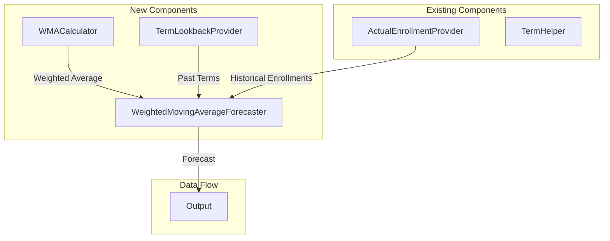
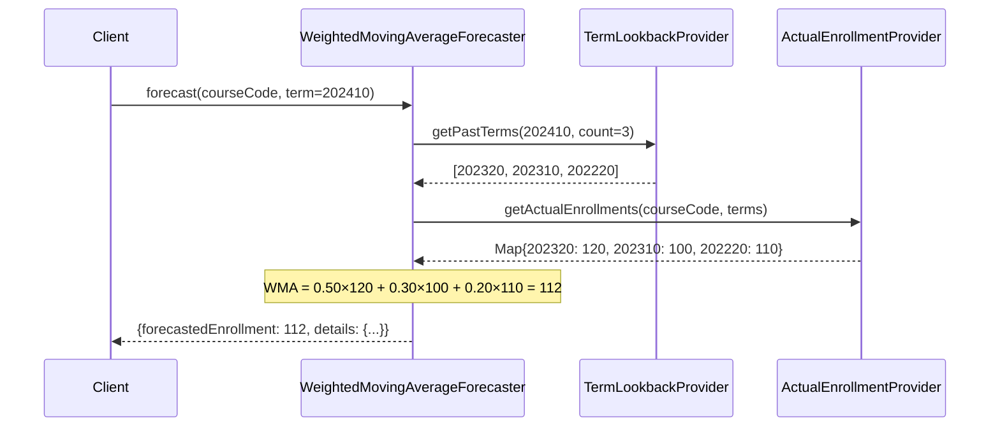
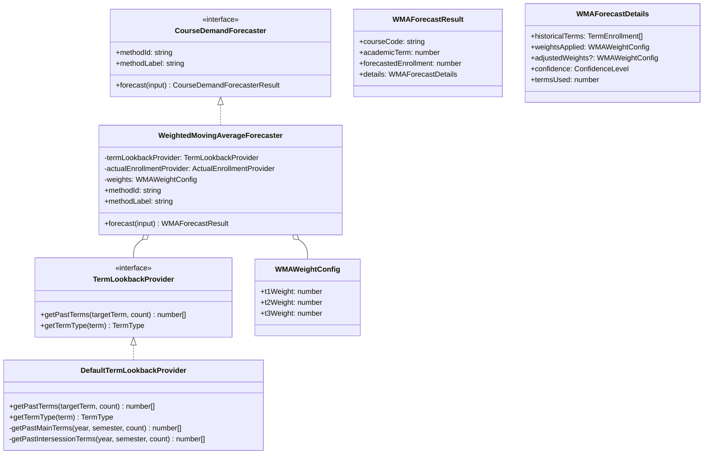
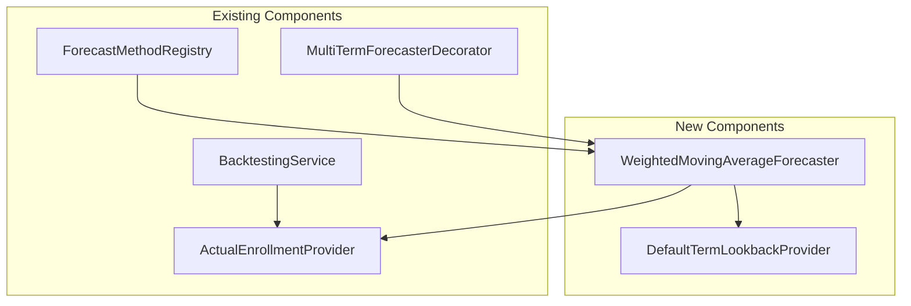

# Weighted Moving Average Forecaster - Architecture Document

## 1. Overview

### 1.1 Problem Statement

Existing forecasters rely on prerequisite-based analysis or pass-rate adjustments. While effective, they may not capture enrollment trends that evolve over time due to external factors such as:

- Course popularity changes
- Curriculum updates
- Student cohort size variations
- Market demand shifts for certain skills

A simpler, trend-based approach can complement these methods by directly extrapolating from recent enrollment history.

### 1.2 Goal

Create a **Weighted Moving Average (WMA) Forecaster** that predicts enrollment using a **3-term weighted moving average** of past enrollments:

```
Forecast = (0.50 × T₁) + (0.30 × T₂) + (0.20 × T₃)
```

Where:
- **T₁**: Most recent term's enrollment (weight: 0.50)
- **T₂**: Second most recent term's enrollment (weight: 0.30)
- **T₃**: Third most recent term's enrollment (weight: 0.20)

### 1.3 Why Weighted Moving Average?

The **Weighted Moving Average (WMA)** is a time-series forecasting technique that assigns different weights to each observation, with more recent observations typically receiving higher weights. This distinguishes it from:

- **Simple Moving Average (SMA)**: All observations have equal weight
- **Exponential Smoothing (ES)**: Weights decay exponentially (future forecaster)

WMA provides a balance between simplicity and responsiveness to recent trends.

### 1.4 Design Principles

1. **Term-Type Awareness**: Only use terms of the same type (semesters vs. intersessions)
2. **Fixed Weights**: Use predetermined weights that prioritize recent demand (0.50, 0.30, 0.20)
3. **Graceful Degradation**: Handle edge cases when fewer than 3 historical terms are available
4. **Simplicity**: Straightforward calculation without complex dependencies
5. **Transparency**: Expose calculation details in forecast output

---

## 2. Academic Term Classification

### 2.1 Term Types

Academic terms follow the format `YYYYSS` where:
- `YYYY`: Year (e.g., 2024)
- `SS`: Semester code (e.g., 10, 20, 15)

| Semester Code | Type | Description |
|---------------|------|-------------|
| `10` | Main Semester | Spring/First semester |
| `20` | Main Semester | Fall/Second semester |
| `11` - `19` | Intersession/Summer | Mid-year intensive terms |

### 2.2 Term-Type-Aware Lookback Strategy

The forecaster uses **only terms of the same type** for lookback:

#### Main Semester Terms (10, 20)

For a target term like `202410` (Spring 2024), use the last 3 **main semester** terms:
- `202320` (Fall 2023) - T₁
- `202310` (Spring 2023) - T₂
- `202220` (Fall 2022) - T₃

Example sequence: `[202110, 202120, 202210, 202220, 202310, 202320, 202410]`
→ For `202410`, lookback: `[202320, 202310, 202220]`

#### Intersession/Summer Terms (11-19)

For a target term like `202415` (Summer 2024), use the last 3 **same-type intersession** terms:
- `202315` (Summer 2023) - T₁
- `202215` (Summer 2022) - T₂
- `202115` (Summer 2021) - T₃

Example sequence: `[202015, 202115, 202215, 202315, 202415]`
→ For `202415`, lookback: `[202315, 202215, 202115]`

### 2.3 Rationale for Term-Type Separation

Different term types have fundamentally different enrollment patterns:

| Characteristic | Main Semester | Intersession/Summer |
|---------------|---------------|---------------------|
| Duration | 16-18 weeks | 4-8 weeks |
| Enrollment size | Higher | Lower |
| Course availability | Full catalog | Limited offerings |
| Student motivation | Regular progression | Catch-up/advance |

Mixing term types would introduce noise and reduce forecast accuracy.

---

## 3. Weighted Moving Average Formula

### 3.1 Fixed Weight Distribution

| Term Position | Weight | Rationale |
|---------------|--------|-----------|
| T₁ (Most Recent) | **0.50** (50%) | Recent demand is the strongest predictor |
| T₂ (Previous) | **0.30** (30%) | Provides trend context |
| T₃ (Third Recent) | **0.20** (20%) | Smooths out anomalies |

Total: `0.50 + 0.30 + 0.20 = 1.00` (100%)

### 3.2 Why These Weights?

1. **Prioritize Recency**: The most recent term accounts for half the forecast because it best reflects current demand
2. **Capture Trend**: The second term adds 30% to detect if demand is rising or falling
3. **Smooth Outliers**: The third term at 20% helps mitigate single-term anomalies (e.g., a pandemic semester)

### 3.3 Prediction Formula

The **Weighted Moving Average** formula:

```
WMA = Σ(wᵢ × Eᵢ) / Σ(wᵢ)
```

With our fixed weights (summing to 1.0):

```
Forecast = round(0.50 × E₁ + 0.30 × E₂ + 0.20 × E₃)
```

Where `Eₙ` is the actual enrollment for term `Tₙ`.

**Example Calculation:**

| Term | Enrollment (Eᵢ) | Weight (wᵢ) | Weighted Value (wᵢ × Eᵢ) |
|------|-----------------|-------------|---------------------------|
| 202320 (T₁) | 120 | 0.50 | 60.0 |
| 202310 (T₂) | 100 | 0.30 | 30.0 |
| 202220 (T₃) | 110 | 0.20 | 22.0 |
| **Total** | | **1.00** | **112.0** |

Forecast for `202410` = **112 students**

### 3.4 Comparison with Other Averaging Methods

| Method | Formula | Characteristics |
|--------|---------|-----------------|
| **Simple Moving Average (SMA)** | `(E₁ + E₂ + E₃) / 3` | Equal weights, slower to react |
| **Weighted Moving Average (WMA)** | `0.50×E₁ + 0.30×E₂ + 0.20×E₃` | Fixed weights, balanced responsiveness |
| **Exponential Smoothing (ES)** | `α×E₁ + α(1-α)×E₂ + ...` | Exponentially decaying weights |

This forecaster implements **WMA**. A future **Exponential Smoothing Forecaster** will provide an alternative approach.

---

## 4. Edge Cases and Fallback Strategies

### 4.1 Insufficient Historical Data

When fewer than 3 historical terms are available, the forecaster applies adjusted strategies:

#### Case 1: Only 2 Historical Terms Available

**Strategy**: Normalize weights for available terms

| Term Position | Original Weight | Adjusted Weight |
|---------------|-----------------|-----------------|
| T₁ (Most Recent) | 0.50 | 0.625 (0.50 / 0.80) |
| T₂ (Previous) | 0.30 | 0.375 (0.30 / 0.80) |

```
Forecast = round(0.625 × E₁ + 0.375 × E₂)
```

**Example**:
- T₁: 120 students → 120 × 0.625 = 75.0
- T₂: 100 students → 100 × 0.375 = 37.5
- **Forecast**: round(112.5) = **113 students**

#### Case 2: Only 1 Historical Term Available

**Strategy**: Use the single term directly

```
Forecast = E₁
```

Set confidence to `low` in the result.

#### Case 3: No Historical Data Available

**Strategy**: Return an error or fallback indicator

```typescript
{
  forecastedEnrollment: 0,
  details: {
    dataAvailable: false,
    fallbackReason: 'NO_HISTORICAL_DATA'
  }
}
```

### 4.2 Edge Case Summary

| Available Terms | Strategy | Confidence |
|-----------------|----------|------------|
| 3+ | Full weighted moving average | `high` |
| 2 | Normalized 2-term WMA | `medium` |
| 1 | Direct value | `low` |
| 0 | Error/fallback | `insufficient` |

### 4.3 Zero Enrollment Terms

If a historical term has zero enrollment:
- **Include it** in the calculation (it may represent valid data: course not offered that term)
- The weighted moving average will naturally account for it
- Document in details that a zero-enrollment term was included

---

## 5. Architecture Overview

### 5.1 System Context



### 5.2 High-Level Data Flow



---

## 6. Component Architecture

### 6.1 Class Diagram



### 6.2 Component Responsibilities

| Component | Responsibility | Layer |
|-----------|---------------|-------|
| `WeightedMovingAverageForecaster` | Orchestrate lookback, retrieval, and WMA calculation | Domain |
| `TermLookbackProvider` | Generate term-type-aware past term list | Domain (Interface) |
| `DefaultTermLookbackProvider` | Implementation with semester/intersession logic | Infrastructure |
| `WMAWeightConfig` | Store and manage weight configuration | Domain |

---

## 7. Domain Models

### 7.1 Term and Weight Models

```typescript
// Location: apps/backend/src/domain/forecasts/models/weighted-moving-average.ts

/**
 * Type of academic term
 */
export type TermType = 'main-semester' | 'intersession';

/**
 * Confidence level for the forecast
 */
export type ForecastConfidence = 'high' | 'medium' | 'low' | 'insufficient';

/**
 * Weight configuration for the 3-term Weighted Moving Average.
 *
 * WMA Formula: Forecast = Σ(wᵢ × Eᵢ) where Σwᵢ = 1.0
 */
export interface WMAWeightConfig {
  /** Weight for most recent term (default: 0.50) */
  readonly t1Weight: number;
  /** Weight for second most recent term (default: 0.30) */
  readonly t2Weight: number;
  /** Weight for third most recent term (default: 0.20) */
  readonly t3Weight: number;
}

/**
 * Default WMA weights: 50%, 30%, 20%
 */
export const DEFAULT_WMA_WEIGHTS: WMAWeightConfig = {
  t1Weight: 0.50,
  t2Weight: 0.30,
  t3Weight: 0.20,
};

/**
 * Historical enrollment data point with weight information
 */
export interface TermEnrollment {
  readonly academicTerm: number;
  readonly enrollment: number;
  readonly weightApplied: number;
  readonly weightedValue: number;
}
```

### 7.2 Forecaster Result Models

```typescript
// Location: apps/backend/src/domain/forecasts/models/weighted-moving-average.ts

/**
 * Detailed information about the Weighted Moving Average forecast
 */
export interface WMAForecastDetails {
  /** Historical enrollment data used in WMA calculation */
  readonly historicalTerms: TermEnrollment[];

  /** Original WMA weights configuration */
  readonly weightsApplied: WMAWeightConfig;

  /** Adjusted weights if fewer than 3 terms available */
  readonly adjustedWeights?: {
    t1Weight: number;
    t2Weight?: number;
  };

  /** Confidence level based on data availability */
  readonly confidence: ForecastConfidence;

  /** Number of historical terms used in WMA */
  readonly termsUsed: number;

  /** Type of terms used (main-semester or intersession) */
  readonly termType: TermType;

  /** Fallback reason if data unavailable */
  readonly fallbackReason?: string;
}

/**
 * Extended result type for Weighted Moving Average forecasts
 */
export interface WMAForecastResult {
  readonly courseCode: string;
  readonly academicTerm: number;
  readonly forecastedEnrollment: number;
  readonly methodId: string;
  readonly methodLabel: string;
  readonly details: WMAForecastDetails;
}
```

---

## 8. Forecasting Algorithm

### 8.1 Algorithm Overview

```typescript
// Pseudocode for the Weighted Moving Average forecaster

function forecast(courseCode: string, targetTerm: number): WMAForecastResult {
  // Step 1: Determine term type
  const termType = getTermType(targetTerm);

  // Step 2: Get past terms of the same type
  const pastTerms = getPastTerms(targetTerm, 3);

  // Step 3: Retrieve actual enrollments
  const enrollments = getActualEnrollments(courseCode, pastTerms);

  // Step 4: Filter to terms with data
  const validEnrollments = filterValidEnrollments(enrollments);

  // Step 5: Calculate Weighted Moving Average
  const forecast = calculateWMA(validEnrollments);

  // Step 6: Build result with details
  return buildResult(forecast, validEnrollments);
}
```

### 8.2 Detailed Algorithm

```typescript
// Location: apps/backend/src/domain/forecasts/weighted-moving-average-forecaster.ts

async forecast(input: CourseDemandForecasterInput): Promise<WMAForecastResult> {
  const { courseCode, academicTerm } = input;

  // Step 1: Determine term type and get past terms
  const termType = this.termLookbackProvider.getTermType(academicTerm);
  const pastTerms = this.termLookbackProvider.getPastTerms(academicTerm, 3);

  // Step 2: Get actual enrollments for past terms
  const enrollmentMap = await this.actualEnrollmentProvider
    .getActualEnrollments(courseCode, pastTerms);

  // Step 3: Build enrollment data array (preserving order)
  const enrollmentData: Array<{ term: number; enrollment: number | null }> =
    pastTerms.map(term => ({
      term,
      enrollment: enrollmentMap.get(term) ?? null,
    }));

  // Step 4: Filter to valid enrollments (non-null)
  const validData = enrollmentData.filter(
    (d): d is { term: number; enrollment: number } => d.enrollment !== null
  );

  // Step 5: Handle edge cases
  if (validData.length === 0) {
    return this.buildNoDataResult(courseCode, academicTerm, termType);
  }

  // Step 6: Calculate Weighted Moving Average based on available data
  const { forecast, termDetails, adjustedWeights, confidence } =
    this.calculateWMA(validData);

  // Step 7: Build result
  return {
    courseCode,
    academicTerm,
    forecastedEnrollment: forecast,
    methodId: this.methodId,
    methodLabel: this.methodLabel,
    details: {
      historicalTerms: termDetails,
      weightsApplied: this.weights,
      adjustedWeights,
      confidence,
      termsUsed: validData.length,
      termType,
    },
  };
}
```

### 8.3 WMA Calculation Logic

```typescript
private calculateWMA(validData: Array<{ term: number; enrollment: number }>) {
  const n = validData.length;

  // Define weights based on available data
  let weights: number[];
  let adjustedWeights: { t1Weight: number; t2Weight?: number } | undefined;
  let confidence: ForecastConfidence;

  if (n >= 3) {
    // Full 3-term Weighted Moving Average
    weights = [this.weights.t1Weight, this.weights.t2Weight, this.weights.t3Weight];
    confidence = 'high';
  } else if (n === 2) {
    // 2-term normalized WMA
    const totalOriginal = this.weights.t1Weight + this.weights.t2Weight;
    weights = [
      this.weights.t1Weight / totalOriginal,
      this.weights.t2Weight / totalOriginal,
    ];
    adjustedWeights = { t1Weight: weights[0], t2Weight: weights[1] };
    confidence = 'medium';
  } else {
    // Single term - direct value (degenerate WMA)
    weights = [1.0];
    adjustedWeights = { t1Weight: 1.0 };
    confidence = 'low';
  }

  // Calculate weighted sum: WMA = Σ(wᵢ × Eᵢ)
  const termDetails: TermEnrollment[] = validData.slice(0, weights.length).map((d, i) => ({
    academicTerm: d.term,
    enrollment: d.enrollment,
    weightApplied: weights[i],
    weightedValue: d.enrollment * weights[i],
  }));

  const forecast = Math.round(
    termDetails.reduce((sum, t) => sum + t.weightedValue, 0)
  );

  return { forecast, termDetails, adjustedWeights, confidence };
}
```

---

## 9. Term Lookback Provider

### 9.1 Interface Definition

```typescript
// Location: apps/backend/src/domain/forecasts/term-lookback-provider.ts

import type { TermType } from './models/weighted-moving-average';

/**
 * Provider interface for term-type-aware lookback
 */
export interface TermLookbackProvider {
  /**
   * Gets past academic terms of the same type.
   *
   * @param targetTerm - The term to forecast for
   * @param count - Number of past terms to retrieve
   * @returns Array of past term numbers, ordered most recent first
   *
   * @example
   * // Main semester: targetTerm=202410, count=3
   * // Returns: [202320, 202310, 202220]
   *
   * // Intersession: targetTerm=202415, count=3
   * // Returns: [202315, 202215, 202115]
   */
  getPastTerms(targetTerm: number, count: number): number[];

  /**
   * Determines the type of an academic term
   *
   * @param term - Academic term number (e.g., 202410)
   * @returns Term type: 'main-semester' or 'intersession'
   */
  getTermType(term: number): TermType;
}
```

### 9.2 Implementation

```typescript
// Location: apps/backend/src/infrastructure/providers/default-term-lookback-provider.ts

import type { TermLookbackProvider } from '../../domain/forecasts/term-lookback-provider';
import type { TermType } from '../../domain/forecasts/models/weighted-moving-average';

export class DefaultTermLookbackProvider implements TermLookbackProvider {
  private readonly minYear: number;

  constructor(options: { minYear?: number } = {}) {
    this.minYear = options.minYear ?? 2018;
  }

  getTermType(term: number): TermType {
    const semester = term % 100;

    // Intersession terms: 11-19
    if (semester > 10 && semester < 20) {
      return 'intersession';
    }

    // Main semester terms: 10, 20
    return 'main-semester';
  }

  getPastTerms(targetTerm: number, count: number): number[] {
    const year = Math.floor(targetTerm / 100);
    const semester = targetTerm % 100;
    const termType = this.getTermType(targetTerm);

    if (termType === 'intersession') {
      return this.getPastIntersessionTerms(year, semester, count);
    }

    return this.getPastMainTerms(year, semester, count);
  }

  /**
   * Gets past main semester terms (10 and 20).
   *
   * @example
   * // For 202410 (Spring 2024):
   * // Returns: [202320, 202310, 202220]
   */
  private getPastMainTerms(year: number, semester: number, count: number): number[] {
    const terms: number[] = [];
    let currentYear = year;
    let currentSemester = semester;

    // Normalize to main semester (10 or 20)
    if (currentSemester < 10) {
      currentYear -= 1;
      currentSemester = 20;
    } else if (currentSemester < 20) {
      currentSemester = 10;
    } else {
      currentSemester = 20;
    }

    // Go back one main semester term from target
    if (currentSemester === 10) {
      currentYear -= 1;
      currentSemester = 20;
    } else {
      currentSemester = 10;
    }

    // Generate past main semester terms
    while (terms.length < count && currentYear >= this.minYear) {
      terms.push(currentYear * 100 + currentSemester);

      // Alternate between spring (10) and fall (20)
      if (currentSemester === 10) {
        currentYear -= 1;
        currentSemester = 20;
      } else {
        currentSemester = 10;
      }
    }

    return terms;
  }

  /**
   * Gets past intersession terms of the same type.
   *
   * @example
   * // For 202415 (Summer 2024):
   * // Returns: [202315, 202215, 202115]
   */
  private getPastIntersessionTerms(year: number, semester: number, count: number): number[] {
    const terms: number[] = [];
    let currentYear = year - 1; // Start from previous year

    // Get the same intersession term from previous years
    while (terms.length < count && currentYear >= this.minYear) {
      terms.push(currentYear * 100 + semester);
      currentYear -= 1;
    }

    return terms;
  }
}
```

---

## 10. API Contract

### 10.1 Method Registration

```typescript
// Registration metadata
{
  id: 'weighted-moving-average',
  label: 'Weighted Moving Average (3-term WMA)',
  description:
    'Forecasts enrollment using a 3-term Weighted Moving Average. ' +
    'Fixed weights: 50% (most recent), 30% (previous), 20% (third recent). ' +
    'Uses term-type-aware lookback for main semesters (10, 20) and ' +
    'intersessions (11-19) separately.',
  shortDescription: '3-term weighted moving average',
  category: 'trend-based',
  status: 'active',
  capabilities: {
    supportsMultiTerm: true,
    supportsBacktesting: true,
    requiresPrerequisites: false,
    requiresHistoricalData: true,
  },
}
```

### 10.2 Response Schema

```typescript
// Location: packages/contracts/src/forecasts/weighted-moving-average.dto.ts

import { z } from 'zod';

/**
 * Term type classification
 */
export const termTypeSchema = z.enum(['main-semester', 'intersession']);

export type TermTypeDto = z.infer<typeof termTypeSchema>;

/**
 * Forecast confidence level
 */
export const forecastConfidenceSchema = z.enum(['high', 'medium', 'low', 'insufficient']);

export type ForecastConfidenceDto = z.infer<typeof forecastConfidenceSchema>;

/**
 * WMA weight configuration
 */
export const wmaWeightConfigSchema = z.object({
  t1Weight: z.number().min(0).max(1),
  t2Weight: z.number().min(0).max(1),
  t3Weight: z.number().min(0).max(1),
});

export type WMAWeightConfigDto = z.infer<typeof wmaWeightConfigSchema>;

/**
 * Term enrollment data point
 */
export const termEnrollmentSchema = z.object({
  academicTerm: z.number().int(),
  enrollment: z.number().int().nonnegative(),
  weightApplied: z.number().min(0).max(1),
  weightedValue: z.number().nonnegative(),
});

export type TermEnrollmentDto = z.infer<typeof termEnrollmentSchema>;

/**
 * WMA forecast details
 */
export const wmaForecastDetailsSchema = z.object({
  /** Historical enrollment data used in WMA */
  historicalTerms: z.array(termEnrollmentSchema),

  /** Original WMA weights configuration */
  weightsApplied: wmaWeightConfigSchema,

  /** Adjusted weights if fewer than 3 terms available */
  adjustedWeights: z.object({
    t1Weight: z.number(),
    t2Weight: z.number().optional(),
  }).optional(),

  /** Confidence level based on data availability */
  confidence: forecastConfidenceSchema,

  /** Number of historical terms used in WMA */
  termsUsed: z.number().int().nonnegative(),

  /** Type of terms used */
  termType: termTypeSchema,

  /** Fallback reason if data unavailable */
  fallbackReason: z.string().optional(),
});

export type WMAForecastDetailsDto = z.infer<typeof wmaForecastDetailsSchema>;

/**
 * Full WMA forecast result
 */
export const wmaForecastResultSchema = z.object({
  courseCode: z.string().regex(/^[A-Z]{4}-\d{4}$/),
  academicTerm: z.number().int(),
  forecastedEnrollment: z.number().int().nonnegative(),
  methodId: z.literal('weighted-moving-average'),
  methodLabel: z.string(),
  details: wmaForecastDetailsSchema,
});

export type WMAForecastResultDto = z.infer<typeof wmaForecastResultSchema>;
```

### 10.3 Example Response

```json
{
  "courseCode": "ISIS-3204",
  "academicTerm": 202410,
  "forecastedEnrollment": 112,
  "methodId": "weighted-moving-average",
  "methodLabel": "Weighted Moving Average (3-term WMA)",
  "details": {
    "historicalTerms": [
      {
        "academicTerm": 202320,
        "enrollment": 120,
        "weightApplied": 0.50,
        "weightedValue": 60.0
      },
      {
        "academicTerm": 202310,
        "enrollment": 100,
        "weightApplied": 0.30,
        "weightedValue": 30.0
      },
      {
        "academicTerm": 202220,
        "enrollment": 110,
        "weightApplied": 0.20,
        "weightedValue": 22.0
      }
    ],
    "weightsApplied": {
      "t1Weight": 0.50,
      "t2Weight": 0.30,
      "t3Weight": 0.20
    },
    "confidence": "high",
    "termsUsed": 3,
    "termType": "main-semester"
  }
}
```

### 10.4 Example Response (Edge Case - 2 Terms)

```json
{
  "courseCode": "ISIS-3204",
  "academicTerm": 202015,
  "forecastedEnrollment": 45,
  "methodId": "weighted-moving-average",
  "methodLabel": "Weighted Moving Average (3-term WMA)",
  "details": {
    "historicalTerms": [
      {
        "academicTerm": 201915,
        "enrollment": 50,
        "weightApplied": 0.625,
        "weightedValue": 31.25
      },
      {
        "academicTerm": 201815,
        "enrollment": 35,
        "weightApplied": 0.375,
        "weightedValue": 13.125
      }
    ],
    "weightsApplied": {
      "t1Weight": 0.50,
      "t2Weight": 0.30,
      "t3Weight": 0.20
    },
    "adjustedWeights": {
      "t1Weight": 0.625,
      "t2Weight": 0.375
    },
    "confidence": "medium",
    "termsUsed": 2,
    "termType": "intersession"
  }
}
```

---

## 11. Integration with Existing System

### 11.1 Dependency Graph



### 11.2 Reuse of Existing Components

| Existing Component | Reuse Type | Purpose |
|-------------------|------------|---------|
| `ActualEnrollmentProvider` | Dependency | Retrieve historical enrollments |
| `MultiTermForecasterDecorator` | Wrapping | Multi-term forecast support |
| `BacktestingService` | Integration | Accuracy evaluation |
| `ForecastMethodRegistry` | Registration | Method discovery and routing |

---

## 12. Configuration Options

### 12.1 Forecaster Options

| Option | Type | Default | Description |
|--------|------|---------|-------------|
| `lookbackTerms` | number | 3 | Number of past terms to consider |
| `minYear` | number | 2018 | Earliest year to consider for lookback |

### 12.2 WMA Weight Options

| Option | Type | Default | Description |
|--------|------|---------|-------------|
| `t1Weight` | number | 0.50 | Weight for most recent term |
| `t2Weight` | number | 0.30 | Weight for second most recent term |
| `t3Weight` | number | 0.20 | Weight for third most recent term |

---

## 13. Error Handling

### 13.1 Error Scenarios

| Scenario | Handling | Result |
|----------|----------|--------|
| No historical data | Return zero forecast | `fallbackReason: 'NO_HISTORICAL_DATA'` |
| Single term only | Use direct value | `confidence: 'low'` |
| Two terms only | Normalized weights | `confidence: 'medium'` |
| Provider failure | Propagate error | Error response |

### 13.2 Graceful Degradation

When fewer than 3 terms are available:

```json
{
  "forecastedEnrollment": 50,
  "details": {
    "confidence": "low",
    "termsUsed": 1,
    "adjustedWeights": {
      "t1Weight": 1.0
    },
    "historicalTerms": [
      {
        "academicTerm": 202315,
        "enrollment": 50,
        "weightApplied": 1.0,
        "weightedValue": 50.0
      }
    ]
  }
}
```

---

## 14. Performance Considerations

### 14.1 Efficiency

- **Single Query**: Only one database call needed (enrollments for 3 terms)
- **No Complex Calculations**: Simple weighted sum computation
- **Minimal Dependencies**: Only requires `ActualEnrollmentProvider`

### 14.2 Caching Opportunities

- **Term Lookback**: Static calculation, can be memoized
- **Historical Enrollments**: Immutable data, safe to cache with long TTL

---

## 15. Comparison with Other Forecasters

| Aspect | WMA Forecaster | Potential Students | Pass Rate Adjusted |
|--------|----------------|-------------------|-------------------|
| Data Required | Enrollment history | Prerequisites | Both |
| Complexity | Simple | Medium | High |
| New Courses | Limited | Good | Limited |
| Trend Capture | Excellent | Poor | Good |
| Accuracy Target | General trend | Upper bound | Calibrated |

### 15.1 Future: Exponential Smoothing Forecaster

A future **Exponential Smoothing Forecaster** will complement this WMA forecaster:

| Aspect | WMA (This) | Exponential Smoothing (Future) |
|--------|------------|-------------------------------|
| Weight decay | Fixed (0.50, 0.30, 0.20) | Exponential (α, α(1-α), ...) |
| Parameters | None | Smoothing factor α |
| Responsiveness | Fixed | Tunable via α |
| Terms used | Fixed 3 | All historical terms |

---

## 16. Related Documents

- [General Architecture](../../general-architecture.md)
- [Potential Students by Prerequisites](../potential-students-by-prerequsites/doc.md)
- [Pass Rate Adjusted Forecaster](../pass-rate-adjusted-forecaster/architecture.md)
- [Implementation Guide](./implementation-guide.md)
- [Testing Guide](./testing-guide.md)
- [System Impact](./system-impact.md)
