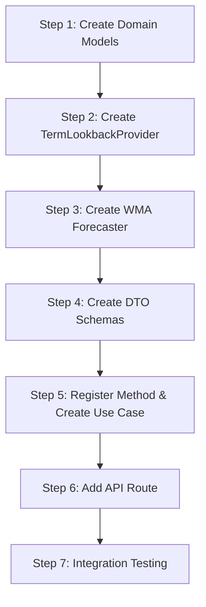

# Weighted Moving Average Forecaster - Implementation Guide

## Overview

This guide provides step-by-step instructions for implementing the **Weighted Moving Average (WMA) Forecaster** using a 3-term weighted moving average. Follow each step in order to ensure proper integration with the existing codebase.

> **Note**: This forecaster uses a **Weighted Moving Average** method with fixed weights (0.50, 0.30, 0.20). A future **Exponential Smoothing Forecaster** will provide an alternative time-series approach with tunable smoothing parameters.

---

## Prerequisites

Before starting, ensure you understand:

- The existing [General Architecture](../../general-architecture.md)
- The [Architecture Document](./architecture.md) for this feature
- The existing `ActualEnrollmentProvider` interface

---

## Implementation Steps



---

## Step 1: Create Domain Models

### 1.1 Create WMA Models

**Location**: `apps/backend/src/domain/forecasts/models/weighted-moving-average.ts`

```typescript
/**
 * Type of academic term
 */
export type TermType = 'main-semester' | 'intersession';

/**
 * Confidence level for the forecast
 */
export type ForecastConfidence = 'high' | 'medium' | 'low' | 'insufficient';

/**
 * Weight configuration for the 3-term Weighted Moving Average.
 *
 * WMA Formula: Forecast = Σ(wᵢ × Eᵢ) where Σwᵢ = 1.0
 *
 * Default weights prioritize recent demand:
 * - T1 (most recent): 50%
 * - T2 (previous): 30%
 * - T3 (third recent): 20%
 */
export interface WMAWeightConfig {
  /** Weight for most recent term (default: 0.50) */
  readonly t1Weight: number;
  /** Weight for second most recent term (default: 0.30) */
  readonly t2Weight: number;
  /** Weight for third most recent term (default: 0.20) */
  readonly t3Weight: number;
}

/**
 * Default WMA weights: 50%, 30%, 20%
 */
export const DEFAULT_WMA_WEIGHTS: Readonly<WMAWeightConfig> = {
  t1Weight: 0.50,
  t2Weight: 0.30,
  t3Weight: 0.20,
} as const;

/**
 * Historical enrollment data point with weight information
 */
export interface TermEnrollment {
  readonly academicTerm: number;
  readonly enrollment: number;
  readonly weightApplied: number;
  readonly weightedValue: number;
}

/**
 * Detailed information about the Weighted Moving Average forecast
 */
export interface WMAForecastDetails {
  /** Historical enrollment data used in WMA calculation */
  readonly historicalTerms: TermEnrollment[];

  /** Original WMA weights configuration */
  readonly weightsApplied: WMAWeightConfig;

  /** Adjusted weights if fewer than 3 terms available */
  readonly adjustedWeights?: {
    t1Weight: number;
    t2Weight?: number;
  };

  /** Confidence level based on data availability */
  readonly confidence: ForecastConfidence;

  /** Number of historical terms used in WMA */
  readonly termsUsed: number;

  /** Type of terms used (main-semester or intersession) */
  readonly termType: TermType;

  /** Fallback reason if data unavailable */
  readonly fallbackReason?: string;
}

/**
 * Extended result type for Weighted Moving Average forecasts
 */
export interface WMAForecastResult {
  readonly courseCode: string;
  readonly academicTerm: number;
  readonly forecastedEnrollment: number;
  readonly methodId: string;
  readonly methodLabel: string;
  readonly details: WMAForecastDetails;
}
```

### 1.2 Update Models Index

**Location**: `apps/backend/src/domain/forecasts/models/index.ts`

Add the export:

```typescript
export * from './conversion-rate';
export * from './pass-rate-adjusted';
export * from './weighted-moving-average'; // Add this line
```

---

## Step 2: Create Term Lookback Provider

### 2.1 Create Provider Interface

**Location**: `apps/backend/src/domain/forecasts/term-lookback-provider.ts`

```typescript
import type { TermType } from './models/weighted-moving-average';

/**
 * Provider interface for term-type-aware lookback.
 *
 * This provider generates a list of past academic terms based on term type:
 *
 * **Main Semester Terms (10, 20):**
 * - Lookback uses previous main semester terms alternating 10 ↔ 20
 *
 * **Intersession/Summer Terms (11-19):**
 * - Lookback uses the same term type from previous years
 */
export interface TermLookbackProvider {
  /**
   * Gets past academic terms of the same type.
   *
   * @param targetTerm - The term to forecast for (e.g., 202410)
   * @param count - Number of past terms to retrieve (default: 3)
   * @returns Array of past term numbers, ordered most recent first
   *
   * @example
   * // Main semester: targetTerm=202410, count=3
   * // Returns: [202320, 202310, 202220]
   *
   * // Intersession: targetTerm=202415, count=3
   * // Returns: [202315, 202215, 202115]
   */
  getPastTerms(targetTerm: number, count: number): number[];

  /**
   * Determines the type of an academic term.
   *
   * @param term - Academic term number (e.g., 202410)
   * @returns Term type: 'main-semester' or 'intersession'
   *
   * @example
   * getTermType(202410) // → 'main-semester'
   * getTermType(202420) // → 'main-semester'
   * getTermType(202415) // → 'intersession'
   */
  getTermType(term: number): TermType;
}
```

### 2.2 Create Default Implementation

**Location**: `apps/backend/src/infrastructure/providers/default-term-lookback-provider.ts`

```typescript
import type { TermLookbackProvider } from '../../domain/forecasts/term-lookback-provider';
import type { TermType } from '../../domain/forecasts/models/weighted-moving-average';

export interface TermLookbackProviderOptions {
  /** Earliest year to consider for lookback (default: 2018) */
  minYear?: number;
}

const DEFAULT_OPTIONS: Required<TermLookbackProviderOptions> = {
  minYear: 2018,
};

/**
 * Default implementation of TermLookbackProvider.
 *
 * Generates term-type-aware lookback lists:
 * - Main semesters (10, 20): Alternates between spring and fall
 * - Intersessions (11-19): Uses same term type from previous years
 */
export class DefaultTermLookbackProvider implements TermLookbackProvider {
  private readonly options: Required<TermLookbackProviderOptions>;

  constructor(options: TermLookbackProviderOptions = {}) {
    this.options = { ...DEFAULT_OPTIONS, ...options };
  }

  getTermType(term: number): TermType {
    const semester = term % 100;

    // Intersession terms: 11-19
    if (semester > 10 && semester < 20) {
      return 'intersession';
    }

    // Main semester terms: 10, 20
    return 'main-semester';
  }

  getPastTerms(targetTerm: number, count: number): number[] {
    const year = Math.floor(targetTerm / 100);
    const semester = targetTerm % 100;
    const termType = this.getTermType(targetTerm);

    if (termType === 'intersession') {
      return this.getPastIntersessionTerms(year, semester, count);
    }

    return this.getPastMainTerms(year, semester, count);
  }

  /**
   * Gets past main semester terms (10 and 20).
   *
   * Academic term sequence example:
   * [202110, 202120, 202210, 202220, 202310, 202320, 202410, ...]
   *
   * For target 202410 (Spring 2024):
   * → Previous is 202320 (Fall 2023)
   * → Before that is 202310 (Spring 2023)
   * → Before that is 202220 (Fall 2022)
   * Result: [202320, 202310, 202220]
   */
  private getPastMainTerms(
    year: number,
    semester: number,
    count: number,
  ): number[] {
    const terms: number[] = [];
    let currentYear = year;
    let currentSemester = semester;

    // Normalize to main semester (10 or 20)
    if (currentSemester < 10) {
      currentYear -= 1;
      currentSemester = 20;
    } else if (currentSemester < 20) {
      currentSemester = 10;
    } else {
      currentSemester = 20;
    }

    // Go back one main semester term from target
    if (currentSemester === 10) {
      currentYear -= 1;
      currentSemester = 20;
    } else {
      currentSemester = 10;
    }

    // Generate past main semester terms
    while (terms.length < count && currentYear >= this.options.minYear) {
      terms.push(currentYear * 100 + currentSemester);

      // Alternate between spring (10) and fall (20)
      if (currentSemester === 10) {
        currentYear -= 1;
        currentSemester = 20;
      } else {
        currentSemester = 10;
      }
    }

    return terms;
  }

  /**
   * Gets past intersession terms of the same type.
   *
   * For the same intersession code across years.
   * Example for term 202415 (Summer 2024):
   * → Previous is 202315 (Summer 2023)
   * → Before that is 202215 (Summer 2022)
   * → Before that is 202115 (Summer 2021)
   * Result: [202315, 202215, 202115]
   */
  private getPastIntersessionTerms(
    year: number,
    semester: number,
    count: number,
  ): number[] {
    const terms: number[] = [];
    let currentYear = year - 1; // Start from previous year

    // Get the same intersession term from previous years
    while (terms.length < count && currentYear >= this.options.minYear) {
      terms.push(currentYear * 100 + semester);
      currentYear -= 1;
    }

    return terms;
  }
}
```

### 2.3 Add Provider Export

**Location**: Update `apps/backend/src/infrastructure/providers/index.ts`

```typescript
export * from './database-historical-conversion-provider';
export * from './default-term-lookback-provider'; // Add this line
```

---

## Step 3: Create Weighted Moving Average Forecaster

### 3.1 Create the Forecaster

**Location**: `apps/backend/src/domain/forecasts/weighted-moving-average-forecaster.ts`

```typescript
import type {
  CourseDemandForecaster,
  CourseDemandForecasterInput,
} from './course-demand-forecaster';
import type { TermLookbackProvider } from './term-lookback-provider';
import type { ActualEnrollmentProvider } from '../backtesting/actual-enrollment-provider';
import type {
  WMAForecastResult,
  WMAForecastDetails,
  WMAWeightConfig,
  TermEnrollment,
  ForecastConfidence,
  TermType,
} from './models/weighted-moving-average';
import { DEFAULT_WMA_WEIGHTS } from './models/weighted-moving-average';

const METHOD_ID = 'weighted-moving-average';
const METHOD_LABEL = 'Weighted Moving Average (3-term WMA)';

export interface WMAForecasterOptions {
  /** Number of past terms to consider (default: 3) */
  lookbackTerms?: number;

  /** Custom WMA weight configuration */
  weights?: Partial<WMAWeightConfig>;
}

const DEFAULT_OPTIONS: Required<Omit<WMAForecasterOptions, 'weights'>> = {
  lookbackTerms: 3,
};

export interface WMAForecasterDeps {
  readonly termLookbackProvider: TermLookbackProvider;
  readonly actualEnrollmentProvider: ActualEnrollmentProvider;
}

/**
 * Forecaster that predicts enrollment using a 3-term Weighted Moving Average.
 *
 * WMA Formula: Forecast = Σ(wᵢ × Eᵢ) where Σwᵢ = 1.0
 *
 * Default weights:
 * - T₁ (most recent): 0.50 (50%)
 * - T₂ (previous): 0.30 (30%)
 * - T₃ (third recent): 0.20 (20%)
 *
 * Features:
 * - Term-type-aware lookback (main semesters vs intersessions)
 * - Graceful degradation when fewer than 3 terms available
 * - Transparent weight adjustments in edge cases
 *
 * @see ExponentialSmoothingForecaster for an alternative time-series approach (future)
 */
export class WeightedMovingAverageForecaster implements CourseDemandForecaster {
  public readonly methodId: string = METHOD_ID;
  public readonly methodLabel: string = METHOD_LABEL;

  private readonly termLookbackProvider: TermLookbackProvider;
  private readonly actualEnrollmentProvider: ActualEnrollmentProvider;
  private readonly lookbackTerms: number;
  private readonly weights: WMAWeightConfig;

  constructor(
    deps: WMAForecasterDeps,
    options: WMAForecasterOptions = {},
  ) {
    this.termLookbackProvider = deps.termLookbackProvider;
    this.actualEnrollmentProvider = deps.actualEnrollmentProvider;
    this.lookbackTerms = options.lookbackTerms ?? DEFAULT_OPTIONS.lookbackTerms;
    this.weights = {
      ...DEFAULT_WMA_WEIGHTS,
      ...options.weights,
    };
  }

  async forecast(
    input: CourseDemandForecasterInput,
  ): Promise<WMAForecastResult> {
    const { courseCode, academicTerm } = input;

    // Step 1: Determine term type and get past terms
    const termType = this.termLookbackProvider.getTermType(academicTerm);
    const pastTerms = this.termLookbackProvider.getPastTerms(
      academicTerm,
      this.lookbackTerms,
    );

    // Step 2: Get actual enrollments for past terms
    const enrollmentMap = await this.actualEnrollmentProvider.getActualEnrollments(
      courseCode,
      pastTerms,
    );

    // Step 3: Build enrollment data array (preserving order)
    const enrollmentData = pastTerms.map(term => ({
      term,
      enrollment: enrollmentMap.get(term) ?? null,
    }));

    // Step 4: Filter to valid enrollments (non-null)
    const validData = enrollmentData.filter(
      (d): d is { term: number; enrollment: number } => d.enrollment !== null,
    );

    // Step 5: Handle no data case
    if (validData.length === 0) {
      return this.buildNoDataResult(courseCode, academicTerm, termType);
    }

    // Step 6: Calculate Weighted Moving Average based on available data
    const { forecast, termDetails, adjustedWeights, confidence } =
      this.calculateWMA(validData);

    // Step 7: Build result
    return {
      courseCode,
      academicTerm,
      forecastedEnrollment: forecast,
      methodId: this.methodId,
      methodLabel: this.methodLabel,
      details: {
        historicalTerms: termDetails,
        weightsApplied: this.weights,
        adjustedWeights,
        confidence,
        termsUsed: validData.length,
        termType,
      },
    };
  }

  /**
   * Calculates the Weighted Moving Average forecast.
   *
   * Weight adjustment strategy:
   * - 3+ terms: Use full WMA weights (0.50, 0.30, 0.20)
   * - 2 terms: Normalize to (0.625, 0.375)
   * - 1 term: Use direct value (1.00)
   */
  private calculateWMA(
    validData: Array<{ term: number; enrollment: number }>,
  ): {
    forecast: number;
    termDetails: TermEnrollment[];
    adjustedWeights?: { t1Weight: number; t2Weight?: number };
    confidence: ForecastConfidence;
  } {
    const n = validData.length;

    let weights: number[];
    let adjustedWeights: { t1Weight: number; t2Weight?: number } | undefined;
    let confidence: ForecastConfidence;

    if (n >= 3) {
      // Full 3-term Weighted Moving Average
      weights = [this.weights.t1Weight, this.weights.t2Weight, this.weights.t3Weight];
      confidence = 'high';
    } else if (n === 2) {
      // 2-term normalized WMA
      // Original: 0.50 + 0.30 = 0.80
      // Normalized: 0.50/0.80 = 0.625, 0.30/0.80 = 0.375
      const totalOriginal = this.weights.t1Weight + this.weights.t2Weight;
      const w1 = this.weights.t1Weight / totalOriginal;
      const w2 = this.weights.t2Weight / totalOriginal;
      weights = [w1, w2];
      adjustedWeights = {
        t1Weight: this.round(w1, 3),
        t2Weight: this.round(w2, 3),
      };
      confidence = 'medium';
    } else {
      // Single term - direct value (degenerate WMA)
      weights = [1.0];
      adjustedWeights = { t1Weight: 1.0 };
      confidence = 'low';
    }

    // Calculate weighted sum: WMA = Σ(wᵢ × Eᵢ)
    const termDetails: TermEnrollment[] = validData
      .slice(0, weights.length)
      .map((d, i) => ({
        academicTerm: d.term,
        enrollment: d.enrollment,
        weightApplied: this.round(weights[i], 3),
        weightedValue: this.round(d.enrollment * weights[i], 2),
      }));

    const forecast = Math.round(
      termDetails.reduce((sum, t) => sum + t.weightedValue, 0),
    );

    return { forecast, termDetails, adjustedWeights, confidence };
  }

  /**
   * Builds a result for when no historical data is available.
   */
  private buildNoDataResult(
    courseCode: string,
    academicTerm: number,
    termType: TermType,
  ): WMAForecastResult {
    return {
      courseCode,
      academicTerm,
      forecastedEnrollment: 0,
      methodId: this.methodId,
      methodLabel: this.methodLabel,
      details: {
        historicalTerms: [],
        weightsApplied: this.weights,
        confidence: 'insufficient',
        termsUsed: 0,
        termType,
        fallbackReason: 'NO_HISTORICAL_DATA',
      },
    };
  }

  private round(value: number, decimals: number): number {
    const factor = Math.pow(10, decimals);
    return Math.round(value * factor) / factor;
  }
}
```

### 3.2 Update Forecasts Index

**Location**: `apps/backend/src/domain/forecasts/index.ts`

Add exports:

```typescript
export * from './course-demand-forecaster';
export * from './multi-term-forecaster.decorator';
export * from './potential-students-by-prerequisites-forecaster';
export * from './forecast-method-registry';
export * from './forecast-method-metadata';
export * from './in-memory-forecast-method-registry';

// Existing exports
export * from './models';
export * from './conversion-rate-calculator';
export * from './default-conversion-rate-calculator';
export * from './historical-conversion-provider';
export * from './pass-rate-adjusted-forecaster';

// New WMA exports
export * from './term-lookback-provider';
export * from './weighted-moving-average-forecaster';
```

---

## Step 4: Create DTO Schemas

### 4.1 Create Contract Schema

**Location**: `packages/contracts/src/forecasts/weighted-moving-average.dto.ts`

```typescript
import { z } from 'zod';

/**
 * Term type classification
 */
export const termTypeSchema = z.enum(['main-semester', 'intersession']);

export type TermTypeDto = z.infer<typeof termTypeSchema>;

/**
 * Forecast confidence level
 */
export const forecastConfidenceSchema = z.enum([
  'high',
  'medium',
  'low',
  'insufficient',
]);

export type ForecastConfidenceDto = z.infer<typeof forecastConfidenceSchema>;

/**
 * WMA weight configuration for 3-term Weighted Moving Average
 */
export const wmaWeightConfigSchema = z.object({
  t1Weight: z.number().min(0).max(1).describe('Weight for most recent term'),
  t2Weight: z.number().min(0).max(1).describe('Weight for second most recent term'),
  t3Weight: z.number().min(0).max(1).describe('Weight for third most recent term'),
});

export type WMAWeightConfigDto = z.infer<typeof wmaWeightConfigSchema>;

/**
 * Term enrollment data point with weight information
 */
export const termEnrollmentSchema = z.object({
  academicTerm: z.number().int().describe('Academic term (e.g., 202410)'),
  enrollment: z.number().int().nonnegative().describe('Actual enrollment count'),
  weightApplied: z.number().min(0).max(1).describe('WMA weight applied to this term'),
  weightedValue: z.number().nonnegative().describe('Enrollment × weight'),
});

export type TermEnrollmentDto = z.infer<typeof termEnrollmentSchema>;

/**
 * Adjusted weights when fewer than 3 terms available
 */
export const adjustedWeightsSchema = z.object({
  t1Weight: z.number().min(0).max(1),
  t2Weight: z.number().min(0).max(1).optional(),
});

export type AdjustedWeightsDto = z.infer<typeof adjustedWeightsSchema>;

/**
 * WMA forecast details
 */
export const wmaForecastDetailsSchema = z.object({
  /** Historical enrollment data used in WMA calculation */
  historicalTerms: z.array(termEnrollmentSchema),

  /** Original WMA weights configuration (0.50, 0.30, 0.20) */
  weightsApplied: wmaWeightConfigSchema,

  /** Adjusted weights if fewer than 3 terms available */
  adjustedWeights: adjustedWeightsSchema.optional(),

  /** Confidence level based on data availability */
  confidence: forecastConfidenceSchema,

  /** Number of historical terms used in WMA (0-3) */
  termsUsed: z.number().int().min(0).max(3),

  /** Type of terms used */
  termType: termTypeSchema,

  /** Fallback reason if data unavailable */
  fallbackReason: z.string().optional(),
});

export type WMAForecastDetailsDto = z.infer<typeof wmaForecastDetailsSchema>;

/**
 * Full WMA forecast result
 */
export const wmaForecastResultSchema = z.object({
  courseCode: z.string().regex(/^[A-Z]{4}-\d{4}$/, {
    message: 'courseCode must match pattern XXXX-DDDD',
  }),
  academicTerm: z.number().int().positive(),
  forecastedEnrollment: z.number().int().nonnegative(),
  methodId: z.literal('weighted-moving-average'),
  methodLabel: z.string(),
  details: wmaForecastDetailsSchema,
});

export type WMAForecastResultDto = z.infer<typeof wmaForecastResultSchema>;
```

### 4.2 Update Forecasts Index

**Location**: `packages/contracts/src/forecasts/index.ts`

```typescript
export * from './course-demand-forecast.dto';
export * from './multi-term-forecast.dto';
export * from './forecast-accuracy.dto';
export * from './forecast-method.dto';
export * from './pass-rate-adjusted.dto';
export * from './weighted-moving-average.dto'; // Add this line
```

---

## Step 5: Register Method & Create Use Case

### 5.1 Register Method Metadata

**Location**: Update the method registration in your application setup

```typescript
import type { ForecastMethodMetadata } from '../domain/forecasts/forecast-method-metadata';

const wmaMetadata: ForecastMethodMetadata = {
  id: 'weighted-moving-average',
  label: 'Weighted Moving Average (3-term WMA)',
  description:
    'Forecasts enrollment using a 3-term Weighted Moving Average. ' +
    'Fixed weights: 50% (most recent), 30% (previous), 20% (third recent). ' +
    'Uses term-type-aware lookback for main semesters (10, 20) and ' +
    'intersessions (11-19) separately.',
  shortDescription: '3-term weighted moving average',
  category: 'trend-based',
  status: 'active',
  capabilities: {
    supportsMultiTerm: true,
    supportsBacktesting: true,
    requiresPrerequisites: false,
    requiresHistoricalData: true,
  },
};

// Register in your method registry
registry.register(wmaMetadata);
```

### 5.2 Create Use Case

**Location**: `apps/backend/src/application/use-cases/forecasts/weighted-moving-average.use-case.ts`

```typescript
import type { WMAForecastResultDto } from '@app/contracts';
import type { CourseDemandForecaster } from '../../../domain/forecasts/course-demand-forecaster';
import { MultiTermForecasterDecorator } from '../../../domain/forecasts/multi-term-forecaster.decorator';

export interface WMAUseCaseInput {
  courseCode: string;
  academicTerm: number;
}

export interface WMAUseCaseDeps {
  forecaster: CourseDemandForecaster;
}

export class WeightedMovingAverageUseCase {
  private readonly forecaster: CourseDemandForecaster;
  private readonly multiTermDecorator: MultiTermForecasterDecorator;

  constructor(deps: WMAUseCaseDeps) {
    this.forecaster = deps.forecaster;
    this.multiTermDecorator = new MultiTermForecasterDecorator(
      this.forecaster,
      { maxTerms: 10, allowPartialFailure: true },
    );
  }

  /**
   * Execute WMA forecast for a single academic term
   */
  async execute(
    input: WMAUseCaseInput,
  ): Promise<WMAForecastResultDto> {
    const result = await this.forecaster.forecast({
      courseCode: input.courseCode,
      academicTerm: input.academicTerm,
    });

    return {
      courseCode: result.courseCode,
      academicTerm: result.academicTerm,
      forecastedEnrollment: result.forecastedEnrollment,
      methodId: result.methodId as 'weighted-moving-average',
      methodLabel: result.methodLabel,
      details: result.details as WMAForecastResultDto['details'],
    };
  }

  /**
   * Execute WMA forecasts for multiple academic terms
   */
  async executeMultiple(
    input: Omit<WMAUseCaseInput, 'academicTerm'>,
    terms: number[],
  ): Promise<{
    results: WMAForecastResultDto[];
    errors: Array<{ term: number; message: string }>;
  }> {
    const { results, errors } = await this.multiTermDecorator.forecastMultiple(
      { courseCode: input.courseCode },
      terms,
    );

    return {
      results: results.map(r => ({
        courseCode: r.courseCode,
        academicTerm: r.academicTerm,
        forecastedEnrollment: r.forecastedEnrollment,
        methodId: r.methodId as 'weighted-moving-average',
        methodLabel: r.methodLabel,
        details: r.details as WMAForecastResultDto['details'],
      })),
      errors: errors.map(e => ({
        term: e.term,
        message: e.error.message,
      })),
    };
  }
}
```

### 5.3 Create Factory Function

**Location**: `apps/backend/src/application/factories/weighted-moving-average-forecaster.factory.ts`

```typescript
import { WeightedMovingAverageForecaster } from '../../domain/forecasts/weighted-moving-average-forecaster';
import { DefaultTermLookbackProvider } from '../../infrastructure/providers/default-term-lookback-provider';
import { WeightedMovingAverageUseCase } from '../use-cases/forecasts/weighted-moving-average.use-case';

import type { ActualEnrollmentProvider } from '../../domain/backtesting/actual-enrollment-provider';

export interface CreateWMAUseCaseDeps {
  actualEnrollmentProvider: ActualEnrollmentProvider;
}

export interface CreateWMAUseCaseOptions {
  /** Earliest year to consider for lookback */
  minYear?: number;
  /** Number of terms to look back */
  lookbackTerms?: number;
}

export function createWeightedMovingAverageUseCase(
  deps: CreateWMAUseCaseDeps,
  options: CreateWMAUseCaseOptions = {},
): WeightedMovingAverageUseCase {
  // Create term lookback provider
  const termLookbackProvider = new DefaultTermLookbackProvider({
    minYear: options.minYear ?? 2018,
  });

  // Create WMA forecaster with fixed weights: 0.50, 0.30, 0.20
  const forecaster = new WeightedMovingAverageForecaster(
    {
      termLookbackProvider,
      actualEnrollmentProvider: deps.actualEnrollmentProvider,
    },
    {
      lookbackTerms: options.lookbackTerms ?? 3,
      // Using default WMA weights: 0.50, 0.30, 0.20
    },
  );

  return new WeightedMovingAverageUseCase({ forecaster });
}
```

---

## Step 6: Add API Route

### 6.1 Create Controller

**Location**: `apps/backend/src/presentation/controllers/forecasts/weighted-moving-average.controller.ts`

```typescript
import { OpenAPIHono } from '@hono/zod-openapi';
import { wmaForecastResultSchema } from '@app/contracts';
import { createForecastRoute } from '../../factories/forecast-route.factory';
import { createWeightedMovingAverageUseCase } from '../../../application/factories/weighted-moving-average-forecaster.factory';

// Import your actual enrollment provider instance
import { actualEnrollmentProvider } from '../../../infrastructure/providers/actual-enrollment-provider';

export const registerWMAForecastRoute = (
  app: OpenAPIHono,
): void => {
  const useCase = createWeightedMovingAverageUseCase({
    actualEnrollmentProvider,
  });

  createForecastRoute(app, {
    path: '/api/courses/{courseCode}/forecasts/weighted-moving-average',
    summary: 'Forecast enrollment using Weighted Moving Average',
    description:
      'Forecasts enrollment using a 3-term Weighted Moving Average. ' +
      'Uses term-type-aware lookback (main semesters vs intersessions). ' +
      'Fixed weights: 50% (most recent), 30% (previous), 20% (third recent).',
    tags: ['Forecasts'],
    resultSchema: wmaForecastResultSchema,

    singleTermHandler: async (courseCode, term) => {
      return useCase.execute({
        courseCode,
        academicTerm: term,
      });
    },

    multiTermHandler: async (courseCode, terms) => {
      return useCase.executeMultiple({ courseCode }, terms);
    },
  });
};
```

### 6.2 Register Route in Server

**Location**: Update `apps/backend/src/presentation/server.ts`

```typescript
import { registerWMAForecastRoute } from './controllers/forecasts/weighted-moving-average.controller';

// In your server setup:
registerWMAForecastRoute(app);
```

---

## Step 7: Integration Testing

### 7.1 Test the Implementation

After completing all steps, verify the implementation:

```bash
# Start the development server
npm run dev

# Test single-term request (main semester)
curl "http://localhost:3000/api/courses/ISIS-3204/forecasts/weighted-moving-average?term=202410"

# Test single-term request (intersession)
curl "http://localhost:3000/api/courses/ISIS-3204/forecasts/weighted-moving-average?term=202415"

# Test multi-term request
curl "http://localhost:3000/api/courses/ISIS-3204/forecasts/weighted-moving-average?terms=202410,202420,202510"
```

### 7.2 Verify Response Structure

**Expected response (full 3 terms):**

```json
{
  "courseCode": "ISIS-3204",
  "academicTerm": 202410,
  "forecastedEnrollment": 112,
  "methodId": "weighted-moving-average",
  "methodLabel": "Weighted Moving Average (3-term WMA)",
  "details": {
    "historicalTerms": [
      {
        "academicTerm": 202320,
        "enrollment": 120,
        "weightApplied": 0.50,
        "weightedValue": 60.0
      },
      {
        "academicTerm": 202310,
        "enrollment": 100,
        "weightApplied": 0.30,
        "weightedValue": 30.0
      },
      {
        "academicTerm": 202220,
        "enrollment": 110,
        "weightApplied": 0.20,
        "weightedValue": 22.0
      }
    ],
    "weightsApplied": {
      "t1Weight": 0.50,
      "t2Weight": 0.30,
      "t3Weight": 0.20
    },
    "confidence": "high",
    "termsUsed": 3,
    "termType": "main-semester"
  }
}
```

**Expected response (2 terms only):**

```json
{
  "courseCode": "ISIS-3204",
  "academicTerm": 202015,
  "forecastedEnrollment": 45,
  "methodId": "weighted-moving-average",
  "methodLabel": "Weighted Moving Average (3-term WMA)",
  "details": {
    "historicalTerms": [
      {
        "academicTerm": 201915,
        "enrollment": 50,
        "weightApplied": 0.625,
        "weightedValue": 31.25
      },
      {
        "academicTerm": 201815,
        "enrollment": 35,
        "weightApplied": 0.375,
        "weightedValue": 13.125
      }
    ],
    "weightsApplied": {
      "t1Weight": 0.50,
      "t2Weight": 0.30,
      "t3Weight": 0.20
    },
    "adjustedWeights": {
      "t1Weight": 0.625,
      "t2Weight": 0.375
    },
    "confidence": "medium",
    "termsUsed": 2,
    "termType": "intersession"
  }
}
```

---

## File Summary

### New Files to Create

| File | Purpose |
|------|---------|
| `apps/backend/src/domain/forecasts/models/weighted-moving-average.ts` | WMA domain models |
| `apps/backend/src/domain/forecasts/term-lookback-provider.ts` | Provider interface |
| `apps/backend/src/domain/forecasts/weighted-moving-average-forecaster.ts` | Main WMA forecaster |
| `apps/backend/src/infrastructure/providers/default-term-lookback-provider.ts` | Provider implementation |
| `packages/contracts/src/forecasts/weighted-moving-average.dto.ts` | DTO schemas |
| `apps/backend/src/application/use-cases/forecasts/weighted-moving-average.use-case.ts` | Use case |
| `apps/backend/src/application/factories/weighted-moving-average-forecaster.factory.ts` | Factory function |
| `apps/backend/src/presentation/controllers/forecasts/weighted-moving-average.controller.ts` | API controller |

### Files to Modify

| File | Changes |
|------|---------|
| `apps/backend/src/domain/forecasts/models/index.ts` | Add WMA model export |
| `apps/backend/src/domain/forecasts/index.ts` | Add new exports |
| `apps/backend/src/infrastructure/providers/index.ts` | Add provider export |
| `packages/contracts/src/forecasts/index.ts` | Add DTO export |
| `apps/backend/src/presentation/server.ts` | Register route |
| Method registry setup | Register method metadata |

---

## Checklist

Use this checklist to track your implementation progress:

- [ ] Step 1: Create Domain Models
  - [ ] Create `weighted-moving-average.ts`
  - [ ] Update models index

- [ ] Step 2: Create TermLookbackProvider
  - [ ] Create interface
  - [ ] Create default implementation
  - [ ] Write unit tests

- [ ] Step 3: Create WeightedMovingAverageForecaster
  - [ ] Create forecaster class
  - [ ] Update exports
  - [ ] Write unit tests

- [ ] Step 4: Create DTO Schemas
  - [ ] Create contract schemas
  - [ ] Update exports

- [ ] Step 5: Register Method & Create Use Case
  - [ ] Register method metadata
  - [ ] Create use case
  - [ ] Create factory function

- [ ] Step 6: Add API Route
  - [ ] Create controller
  - [ ] Register route
  - [ ] Test endpoints

- [ ] Step 7: Integration Testing
  - [ ] Run unit tests
  - [ ] Test API endpoints (main semester)
  - [ ] Test API endpoints (intersession)
  - [ ] Test edge cases (2 terms, 1 term, 0 terms)

---

## Future: Exponential Smoothing Forecaster

This Weighted Moving Average forecaster uses fixed weights. A future **Exponential Smoothing Forecaster** will provide:

- Tunable smoothing factor (α)
- Exponentially decaying weights
- Better handling of longer historical windows

---

## Related Documents

- [Architecture Document](./architecture.md)
- [Testing Guide](./testing-guide.md)
- [System Impact](./system-impact.md)
- [General Architecture](../../general-architecture.md)
