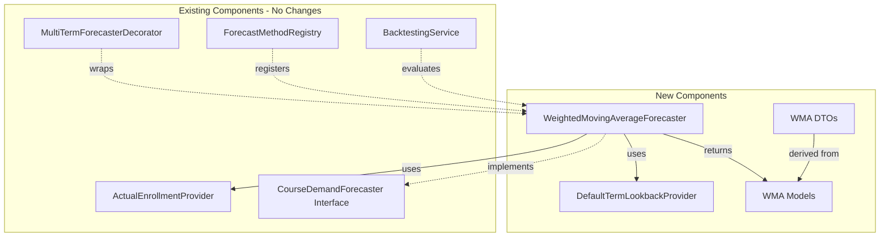

# Weighted Moving Average Forecaster - System Impact Analysis

## Overview

This document analyzes the impact of the **Weighted Moving Average (WMA) Forecaster** on the existing system, including dependencies, performance considerations, and migration strategy.

> **Note**: This forecaster uses a **Weighted Moving Average** method with fixed weights (0.50, 0.30, 0.20). A future **Exponential Smoothing Forecaster** will provide an alternative time-series approach with tunable smoothing parameters.

---

## 1. Impact Summary

| Aspect | Impact Level | Description |
|--------|-------------|-------------|
| New Code | Low | Self-contained module with minimal footprint |
| Existing Code | None | No modifications to existing forecasters |
| Database | None | Uses existing `enrollments` table |
| API | Additive | New endpoint, no breaking changes |
| Performance | Minimal | Simple WMA calculation, single DB query |

---

## 2. Dependency Analysis

### 2.1 New Dependencies

The Weighted Moving Average Forecaster introduces no new external dependencies. It only requires:

| Dependency | Type | Status |
|------------|------|--------|
| `ActualEnrollmentProvider` | Existing Interface | Reused |
| `CourseDemandForecaster` | Existing Interface | Implemented |

### 2.2 Dependency Graph



### 2.3 Existing Components - No Modifications Required

| Component | Reason |
|-----------|--------|
| `PotentialStudentsByPrerequisitesForecaster` | Independent forecaster |
| `PassRateAdjustedForecaster` | Independent forecaster |
| `BacktestingService` | Already generic, works with any forecaster |
| `MultiTermForecasterDecorator` | Already generic, works with any forecaster |
| `ActualEnrollmentProvider` | Already provides required interface |

---

## 3. Database Impact

### 3.1 Schema Changes

**None required.** The forecaster uses the existing `enrollments` table.

### 3.2 Query Patterns

The forecaster uses a single query pattern:

```sql
-- Get actual enrollments for past terms
SELECT academic_term, COUNT(*) as enrollment
FROM enrollments
WHERE course_code = ?
  AND academic_term IN (?, ?, ?)
GROUP BY academic_term;
```

This query:
- Uses existing indexes (`idx_enrollments_term_course_outcome`)
- Returns at most 3 rows
- Has O(1) complexity with proper indexing

### 3.3 Performance Characteristics

| Metric | Value |
|--------|-------|
| Queries per forecast | 1 |
| Max rows returned | 3 |
| Index utilization | Full |
| Estimated latency | < 5ms |

---

## 4. API Impact

### 4.1 New Endpoints

| Endpoint | Method | Description |
|----------|--------|-------------|
| `/api/courses/{courseCode}/forecasts/weighted-moving-average` | GET | Single/multi-term WMA forecast |

### 4.2 No Breaking Changes

- Existing endpoints remain unchanged
- New endpoint follows established patterns
- Response schema is consistent with other forecasters

### 4.3 OpenAPI Documentation

The new endpoint will be automatically documented via `@hono/zod-openapi`:

```yaml
/api/courses/{courseCode}/forecasts/weighted-moving-average:
  get:
    summary: Forecast enrollment using Weighted Moving Average
    description: >
      Forecasts enrollment using a 3-term Weighted Moving Average.
      Uses term-type-aware lookback (main semesters vs intersessions).
      Weights: 50% (most recent), 30% (previous), 20% (third recent).
    parameters:
      - name: courseCode
        in: path
        required: true
        schema:
          type: string
          pattern: ^[A-Z]{4}-\d{4}$
      - name: term
        in: query
        schema:
          type: integer
      - name: terms
        in: query
        schema:
          type: string
    responses:
      200:
        description: Successful WMA forecast
        content:
          application/json:
            schema:
              $ref: '#/components/schemas/WMAForecastResult'
```

---

## 5. Performance Analysis

### 5.1 Computational Complexity

| Operation | Complexity | Notes |
|-----------|------------|-------|
| Term lookback calculation | O(1) | Fixed 3 terms |
| Database query | O(1) | Indexed lookup |
| WMA calculation | O(1) | Fixed 3 values |
| **Total** | **O(1)** | Constant time |

### 5.2 Memory Usage

| Component | Memory | Notes |
|-----------|--------|-------|
| Term array | 24 bytes | 3 × 8-byte numbers |
| Enrollment map | ~100 bytes | 3 key-value pairs |
| Result object | ~500 bytes | Serialized response |
| **Total** | **< 1 KB** | Per request |

### 5.3 Comparison with Other Forecasters

| Forecaster | DB Queries | Complexity | Typical Latency |
|------------|------------|------------|-----------------|
| **Weighted Moving Average** | 1 | O(1) | < 5ms |
| Potential Students | 2-3 | O(n) | 50-200ms |
| Pass Rate Adjusted | 4+ | O(n²) | 100-500ms |

The Weighted Moving Average Forecaster is significantly faster due to its simplicity.

---

## 6. Scalability Considerations

### 6.1 Multi-Term Requests

Multi-term WMA forecasts are efficient because:
- Each term requires only one DB query
- Queries can be parallelized
- No dependency between terms

```typescript
// Efficient parallel execution
const forecasts = await Promise.all(
  terms.map(term => forecaster.forecast({ courseCode, academicTerm: term }))
);
```

### 6.2 Caching Opportunities

| Cache Target | TTL | Invalidation |
|--------------|-----|--------------|
| Term lookback results | Infinite | Never (deterministic) |
| Enrollment data | 24 hours | On data import |
| WMA forecast results | 1 hour | On data import |

### 6.3 Load Characteristics

Estimated capacity:

| Metric | Value |
|--------|-------|
| Requests/second | 1000+ |
| Concurrent users | 100+ |
| Memory per instance | < 50 MB |

---

## 7. Integration Points

### 7.1 Method Registry

```typescript
// Registration in forecast method registry
registry.register({
  id: 'weighted-moving-average',
  label: 'Weighted Moving Average (3-term WMA)',
  category: 'trend-based',
  status: 'active',
  capabilities: {
    supportsMultiTerm: true,
    supportsBacktesting: true,
    requiresPrerequisites: false,  // Key differentiator
    requiresHistoricalData: true,
  },
});
```

### 7.2 Frontend Integration

The frontend will need to:
1. Add the new method to the method selector dropdown
2. Handle the `weighted-moving-average` response format
3. Display WMA weight breakdown in forecast details

**No frontend code changes required** if using generic forecast display components.

### 7.3 Backtesting Integration

The forecaster integrates with existing backtesting:

```typescript
// Works with existing BacktestingService
const results = await backtestingService.runBacktest({
  courseCode: 'ISIS-3204',
  forecaster: weightedMovingAverageForecaster,
  terms: [202310, 202320, 202410],
});
```

---

## 8. Risk Assessment

### 8.1 Low Risk Items

| Risk | Mitigation |
|------|------------|
| Incorrect WMA weights | Unit tests validate calculation |
| Wrong term lookup | Comprehensive term type tests |
| Performance degradation | O(1) complexity guarantees |

### 8.2 Medium Risk Items

| Risk | Mitigation |
|------|------------|
| New courses with no history | Graceful degradation with `confidence: 'insufficient'` |
| Sparse historical data | Normalized weights for 1-2 terms |

### 8.3 No High Risk Items

The implementation is low-risk because:
- No modifications to existing code
- Uses established patterns
- Self-contained module
- Comprehensive test coverage

---

## 9. Rollout Strategy

### 9.1 Phased Rollout

| Phase | Scope |
|-------|-------|
| 1. Development | Implementation + unit tests |
| 2. Integration | API integration + integration tests |
| 3. Validation | Backtesting against historical data |
| 4. Release | Production deployment |

### 9.2 Feature Flag (Optional)

```typescript
// Optional feature flag for gradual rollout
if (featureFlags.isEnabled('weighted-moving-average-forecaster')) {
  registerWMAForecastRoute(app);
}
```

### 9.3 Monitoring

Post-release monitoring:

| Metric | Threshold | Alert |
|--------|-----------|-------|
| Request latency | > 100ms | Warning |
| Error rate | > 1% | Critical |
| Forecast accuracy | MAPE > 30% | Review |

---

## 10. Documentation Updates

### 10.1 Files to Update

| File | Change |
|------|--------|
| `docs/architecture/general-architecture.md` | Add WMA forecaster to list |
| `README.md` | Add feature description |
| OpenAPI spec | Auto-generated |

### 10.2 API Documentation

The new endpoint follows existing documentation patterns:

```markdown
## Weighted Moving Average Forecaster

Forecasts enrollment using a 3-term Weighted Moving Average.

### Endpoint
`GET /api/courses/{courseCode}/forecasts/weighted-moving-average`

### Query Parameters
- `term` (optional): Single academic term (e.g., 202410)
- `terms` (optional): Comma-separated list of terms

### Response
See [WMAForecastResultDto](./weighted-moving-average.dto.ts)
```

---

## 11. Comparison with Existing Forecasters

### 11.1 Feature Matrix

| Feature | WMA Forecaster | Potential Students | Pass Rate Adjusted |
|---------|----------------|-------------------|-------------------|
| Prerequisites needed | No | Yes | Yes |
| Historical data needed | Yes | No | Yes |
| Captures trends | Excellent | Poor | Good |
| New course support | Limited | Excellent | Limited |
| Computational cost | Very Low | Medium | High |
| Interpretability | High | High | Medium |

### 11.2 Use Case Recommendations

| Scenario | Recommended Forecaster |
|----------|----------------------|
| Established course with history | Weighted Moving Average |
| New course with prerequisites | Potential Students |
| Course needing calibration | Pass Rate Adjusted |
| Quick estimate needed | Weighted Moving Average |

---

## 12. Future Considerations

### 12.1 Exponential Smoothing Forecaster

A future **Exponential Smoothing Forecaster** will complement the WMA forecaster:

| Aspect | WMA (This) | Exponential Smoothing (Future) |
|--------|------------|-------------------------------|
| Weight decay | Fixed (0.50, 0.30, 0.20) | Exponential (α, α(1-α), ...) |
| Parameters | None | Smoothing factor α |
| Responsiveness | Fixed | Tunable via α |
| Terms used | Fixed 3 | All historical terms |

### 12.2 Potential Enhancements

| Enhancement | Priority | Complexity |
|-------------|----------|------------|
| Configurable weights | Low | Low |
| Seasonal adjustments | Medium | Medium |
| Trend detection | Medium | Medium |
| Ensemble with other forecasters | Low | High |

### 12.3 Integration Opportunities

- **Ensemble Forecasting**: Combine with other forecasters for improved accuracy
- **Confidence Intervals**: Add prediction ranges based on historical variance
- **Anomaly Detection**: Flag unusual enrollment patterns

---

## 13. Checklist for Release

### Pre-Release

- [ ] All unit tests passing
- [ ] Integration tests passing
- [ ] Backtesting validation complete
- [ ] Documentation updated
- [ ] Code review approved
- [ ] Performance benchmarks acceptable

### Release

- [ ] Feature deployed to staging
- [ ] Smoke tests passing
- [ ] Monitoring configured
- [ ] Feature enabled in production

### Post-Release

- [ ] Monitor error rates
- [ ] Monitor latency metrics
- [ ] Collect accuracy feedback
- [ ] Address any issues

---

## Related Documents

- [Architecture Document](./architecture.md)
- [Implementation Guide](./implementation-guide.md)
- [Testing Guide](./testing-guide.md)
- [General Architecture](../../general-architecture.md)
