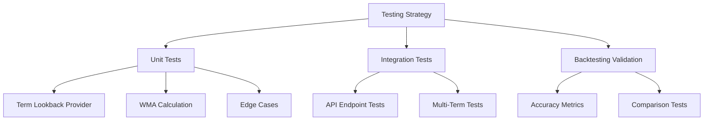

# Weighted Moving Average Forecaster - Testing Guide

## Overview

This guide provides a comprehensive testing strategy for the **Weighted Moving Average (WMA) Forecaster**. It covers unit tests, integration tests, and backtesting validation.

> **Note**: This forecaster uses a **Weighted Moving Average** method with fixed weights (0.50, 0.30, 0.20). A future **Exponential Smoothing Forecaster** will provide an alternative time-series approach with tunable smoothing parameters.

---

## Test Categories



---

## 1. Unit Tests

### 1.1 Term Lookback Provider Tests

**File**: `apps/backend/src/infrastructure/providers/__tests__/default-term-lookback-provider.test.ts`

```typescript
import { describe, it, expect } from 'vitest';
import { DefaultTermLookbackProvider } from '../default-term-lookback-provider';

describe('DefaultTermLookbackProvider', () => {
  const provider = new DefaultTermLookbackProvider({ minYear: 2018 });

  describe('getTermType', () => {
    it('should identify main semester term 10 (spring)', () => {
      expect(provider.getTermType(202410)).toBe('main-semester');
      expect(provider.getTermType(202110)).toBe('main-semester');
    });

    it('should identify main semester term 20 (fall)', () => {
      expect(provider.getTermType(202420)).toBe('main-semester');
      expect(provider.getTermType(202120)).toBe('main-semester');
    });

    it('should identify intersession terms (11-19)', () => {
      expect(provider.getTermType(202411)).toBe('intersession');
      expect(provider.getTermType(202415)).toBe('intersession');
      expect(provider.getTermType(202419)).toBe('intersession');
    });
  });

  describe('getPastTerms - Main Semester', () => {
    it('should return 3 past main semester terms for spring term', () => {
      // For 202410 (Spring 2024), expect: 202320, 202310, 202220
      const terms = provider.getPastTerms(202410, 3);

      expect(terms).toHaveLength(3);
      expect(terms[0]).toBe(202320); // T1: Fall 2023
      expect(terms[1]).toBe(202310); // T2: Spring 2023
      expect(terms[2]).toBe(202220); // T3: Fall 2022
    });

    it('should return 3 past main semester terms for fall term', () => {
      // For 202420 (Fall 2024), expect: 202410, 202320, 202310
      const terms = provider.getPastTerms(202420, 3);

      expect(terms).toHaveLength(3);
      expect(terms[0]).toBe(202410); // T1: Spring 2024
      expect(terms[1]).toBe(202320); // T2: Fall 2023
      expect(terms[2]).toBe(202310); // T3: Spring 2023
    });

    it('should alternate between 10 and 20 semesters', () => {
      const terms = provider.getPastTerms(202510, 6);

      // Should alternate: 202420, 202410, 202320, 202310, 202220, 202210
      expect(terms[0] % 100).toBe(20);
      expect(terms[1] % 100).toBe(10);
      expect(terms[2] % 100).toBe(20);
      expect(terms[3] % 100).toBe(10);
    });

    it('should stop at minYear boundary', () => {
      const providerWith2022Min = new DefaultTermLookbackProvider({ minYear: 2022 });
      const terms = providerWith2022Min.getPastTerms(202310, 5);

      // Should only return terms from 2022+
      expect(terms.every(t => Math.floor(t / 100) >= 2022)).toBe(true);
    });
  });

  describe('getPastTerms - Intersession', () => {
    it('should return 3 past intersession terms of the same type', () => {
      // For 202415 (Summer 2024), expect: 202315, 202215, 202115
      const terms = provider.getPastTerms(202415, 3);

      expect(terms).toHaveLength(3);
      expect(terms[0]).toBe(202315); // T1: Summer 2023
      expect(terms[1]).toBe(202215); // T2: Summer 2022
      expect(terms[2]).toBe(202115); // T3: Summer 2021
    });

    it('should preserve intersession code across years', () => {
      const terms = provider.getPastTerms(202417, 3);

      // All should have semester code 17
      expect(terms.every(t => t % 100 === 17)).toBe(true);
    });

    it('should handle different intersession codes separately', () => {
      const terms11 = provider.getPastTerms(202411, 3);
      const terms15 = provider.getPastTerms(202415, 3);
      const terms19 = provider.getPastTerms(202419, 3);

      // Each should have its own semester code preserved
      expect(terms11.every(t => t % 100 === 11)).toBe(true);
      expect(terms15.every(t => t % 100 === 15)).toBe(true);
      expect(terms19.every(t => t % 100 === 19)).toBe(true);
    });

    it('should stop at minYear boundary for intersessions', () => {
      const terms = provider.getPastTerms(202015, 5);

      // With minYear 2018, should return at most 2 terms: 201915, 201815
      expect(terms.length).toBeLessThanOrEqual(2);
      expect(terms.every(t => Math.floor(t / 100) >= 2018)).toBe(true);
    });
  });

  describe('getPastTerms - Edge Cases', () => {
    it('should return empty array if no terms available before minYear', () => {
      const providerWith2024Min = new DefaultTermLookbackProvider({ minYear: 2024 });
      const terms = providerWith2024Min.getPastTerms(202410, 3);

      expect(terms).toHaveLength(0);
    });

    it('should handle requesting more terms than available', () => {
      const providerWith2022Min = new DefaultTermLookbackProvider({ minYear: 2022 });
      const terms = providerWith2022Min.getPastTerms(202310, 10);

      // Should return available terms (not crash)
      expect(terms.length).toBeLessThan(10);
      expect(terms.length).toBeGreaterThan(0);
    });
  });
});
```

### 1.2 Weighted Moving Average Forecaster Tests

**File**: `apps/backend/src/domain/forecasts/__tests__/weighted-moving-average-forecaster.test.ts`

```typescript
import { describe, it, expect, vi, beforeEach } from 'vitest';
import { WeightedMovingAverageForecaster } from '../weighted-moving-average-forecaster';
import type { TermLookbackProvider } from '../term-lookback-provider';
import type { ActualEnrollmentProvider } from '../../backtesting/actual-enrollment-provider';

describe('WeightedMovingAverageForecaster', () => {
  // Mock dependencies
  const mockTermLookbackProvider: TermLookbackProvider = {
    getPastTerms: vi.fn(),
    getTermType: vi.fn(),
  };

  const mockActualEnrollmentProvider: ActualEnrollmentProvider = {
    getActualEnrollments: vi.fn(),
  };

  let forecaster: WeightedMovingAverageForecaster;

  beforeEach(() => {
    vi.clearAllMocks();

    forecaster = new WeightedMovingAverageForecaster(
      {
        termLookbackProvider: mockTermLookbackProvider,
        actualEnrollmentProvider: mockActualEnrollmentProvider,
      },
      { lookbackTerms: 3 },
    );
  });

  describe('Full 3-Term Weighted Moving Average', () => {
    it('should calculate WMA with default weights (0.50, 0.30, 0.20)', async () => {
      // Setup
      vi.mocked(mockTermLookbackProvider.getTermType).mockReturnValue('main-semester');
      vi.mocked(mockTermLookbackProvider.getPastTerms).mockReturnValue([
        202320, 202310, 202220,
      ]);
      vi.mocked(mockActualEnrollmentProvider.getActualEnrollments).mockResolvedValue(
        new Map([
          [202320, 120], // T1: 120 × 0.50 = 60
          [202310, 100], // T2: 100 × 0.30 = 30
          [202220, 110], // T3: 110 × 0.20 = 22
        ]),              // Total: 112
      );

      // Execute
      const result = await forecaster.forecast({
        courseCode: 'ISIS-3204',
        academicTerm: 202410,
      });

      // Verify
      expect(result.forecastedEnrollment).toBe(112);
      expect(result.details.confidence).toBe('high');
      expect(result.details.termsUsed).toBe(3);
      expect(result.details.historicalTerms).toHaveLength(3);

      // Verify WMA weights
      expect(result.details.historicalTerms[0].weightApplied).toBe(0.50);
      expect(result.details.historicalTerms[1].weightApplied).toBe(0.30);
      expect(result.details.historicalTerms[2].weightApplied).toBe(0.20);
    });

    it('should round the WMA forecast to nearest integer', async () => {
      vi.mocked(mockTermLookbackProvider.getTermType).mockReturnValue('main-semester');
      vi.mocked(mockTermLookbackProvider.getPastTerms).mockReturnValue([
        202320, 202310, 202220,
      ]);
      vi.mocked(mockActualEnrollmentProvider.getActualEnrollments).mockResolvedValue(
        new Map([
          [202320, 123], // 123 × 0.50 = 61.5
          [202310, 107], // 107 × 0.30 = 32.1
          [202220, 115], // 115 × 0.20 = 23.0
        ]),             // Total: 116.6 → 117
      );

      const result = await forecaster.forecast({
        courseCode: 'ISIS-3204',
        academicTerm: 202410,
      });

      expect(result.forecastedEnrollment).toBe(117);
    });

    it('should include correct weighted values in details', async () => {
      vi.mocked(mockTermLookbackProvider.getTermType).mockReturnValue('main-semester');
      vi.mocked(mockTermLookbackProvider.getPastTerms).mockReturnValue([
        202320, 202310, 202220,
      ]);
      vi.mocked(mockActualEnrollmentProvider.getActualEnrollments).mockResolvedValue(
        new Map([
          [202320, 100],
          [202310, 100],
          [202220, 100],
        ]),
      );

      const result = await forecaster.forecast({
        courseCode: 'ISIS-3204',
        academicTerm: 202410,
      });

      // All same enrollment → weighted values should match weights × 100
      expect(result.details.historicalTerms[0].weightedValue).toBe(50.0);
      expect(result.details.historicalTerms[1].weightedValue).toBe(30.0);
      expect(result.details.historicalTerms[2].weightedValue).toBe(20.0);
      expect(result.forecastedEnrollment).toBe(100);
    });
  });

  describe('2-Term Edge Case', () => {
    it('should normalize WMA weights when only 2 terms available', async () => {
      vi.mocked(mockTermLookbackProvider.getTermType).mockReturnValue('intersession');
      vi.mocked(mockTermLookbackProvider.getPastTerms).mockReturnValue([
        202315, 202215,
      ]);
      vi.mocked(mockActualEnrollmentProvider.getActualEnrollments).mockResolvedValue(
        new Map([
          [202315, 50], // T1: 50 × 0.625 = 31.25
          [202215, 35], // T2: 35 × 0.375 = 13.125
        ]),            // Total: 44.375 → 44
      );

      const result = await forecaster.forecast({
        courseCode: 'ISIS-3204',
        academicTerm: 202415,
      });

      expect(result.forecastedEnrollment).toBe(44);
      expect(result.details.confidence).toBe('medium');
      expect(result.details.termsUsed).toBe(2);

      // Verify adjusted weights (0.50/0.80 = 0.625, 0.30/0.80 = 0.375)
      expect(result.details.adjustedWeights).toBeDefined();
      expect(result.details.adjustedWeights?.t1Weight).toBeCloseTo(0.625, 3);
      expect(result.details.adjustedWeights?.t2Weight).toBeCloseTo(0.375, 3);
    });

    it('should only use 2 terms when third has no data', async () => {
      vi.mocked(mockTermLookbackProvider.getTermType).mockReturnValue('main-semester');
      vi.mocked(mockTermLookbackProvider.getPastTerms).mockReturnValue([
        202320, 202310, 202220,
      ]);
      // Third term has no data
      vi.mocked(mockActualEnrollmentProvider.getActualEnrollments).mockResolvedValue(
        new Map([
          [202320, 100],
          [202310, 80],
          // 202220 missing
        ]),
      );

      const result = await forecaster.forecast({
        courseCode: 'ISIS-3204',
        academicTerm: 202410,
      });

      expect(result.details.termsUsed).toBe(2);
      expect(result.details.confidence).toBe('medium');
      expect(result.details.adjustedWeights).toBeDefined();
    });
  });

  describe('1-Term Edge Case', () => {
    it('should use direct value when only 1 term available', async () => {
      vi.mocked(mockTermLookbackProvider.getTermType).mockReturnValue('intersession');
      vi.mocked(mockTermLookbackProvider.getPastTerms).mockReturnValue([202315]);
      vi.mocked(mockActualEnrollmentProvider.getActualEnrollments).mockResolvedValue(
        new Map([[202315, 75]]),
      );

      const result = await forecaster.forecast({
        courseCode: 'ISIS-3204',
        academicTerm: 202415,
      });

      expect(result.forecastedEnrollment).toBe(75);
      expect(result.details.confidence).toBe('low');
      expect(result.details.termsUsed).toBe(1);
      expect(result.details.adjustedWeights?.t1Weight).toBe(1.0);
    });
  });

  describe('No Data Edge Case', () => {
    it('should return zero forecast with insufficient confidence when no data', async () => {
      vi.mocked(mockTermLookbackProvider.getTermType).mockReturnValue('main-semester');
      vi.mocked(mockTermLookbackProvider.getPastTerms).mockReturnValue([
        202320, 202310, 202220,
      ]);
      vi.mocked(mockActualEnrollmentProvider.getActualEnrollments).mockResolvedValue(
        new Map(), // No data for any term
      );

      const result = await forecaster.forecast({
        courseCode: 'ISIS-3204',
        academicTerm: 202410,
      });

      expect(result.forecastedEnrollment).toBe(0);
      expect(result.details.confidence).toBe('insufficient');
      expect(result.details.termsUsed).toBe(0);
      expect(result.details.fallbackReason).toBe('NO_HISTORICAL_DATA');
    });
  });

  describe('Zero Enrollment Handling', () => {
    it('should include zero enrollment terms in WMA calculation', async () => {
      vi.mocked(mockTermLookbackProvider.getTermType).mockReturnValue('main-semester');
      vi.mocked(mockTermLookbackProvider.getPastTerms).mockReturnValue([
        202320, 202310, 202220,
      ]);
      vi.mocked(mockActualEnrollmentProvider.getActualEnrollments).mockResolvedValue(
        new Map([
          [202320, 100], // 100 × 0.50 = 50
          [202310, 0],   // 0 × 0.30 = 0
          [202220, 100], // 100 × 0.20 = 20
        ]),             // Total: 70
      );

      const result = await forecaster.forecast({
        courseCode: 'ISIS-3204',
        academicTerm: 202410,
      });

      expect(result.forecastedEnrollment).toBe(70);
      expect(result.details.termsUsed).toBe(3);
      expect(result.details.confidence).toBe('high');
    });
  });

  describe('Term Type Handling', () => {
    it('should correctly report main-semester term type', async () => {
      vi.mocked(mockTermLookbackProvider.getTermType).mockReturnValue('main-semester');
      vi.mocked(mockTermLookbackProvider.getPastTerms).mockReturnValue([202320]);
      vi.mocked(mockActualEnrollmentProvider.getActualEnrollments).mockResolvedValue(
        new Map([[202320, 100]]),
      );

      const result = await forecaster.forecast({
        courseCode: 'ISIS-3204',
        academicTerm: 202410,
      });

      expect(result.details.termType).toBe('main-semester');
    });

    it('should correctly report intersession term type', async () => {
      vi.mocked(mockTermLookbackProvider.getTermType).mockReturnValue('intersession');
      vi.mocked(mockTermLookbackProvider.getPastTerms).mockReturnValue([202315]);
      vi.mocked(mockActualEnrollmentProvider.getActualEnrollments).mockResolvedValue(
        new Map([[202315, 50]]),
      );

      const result = await forecaster.forecast({
        courseCode: 'ISIS-3204',
        academicTerm: 202415,
      });

      expect(result.details.termType).toBe('intersession');
    });
  });

  describe('Metadata', () => {
    it('should have correct methodId', () => {
      expect(forecaster.methodId).toBe('weighted-moving-average');
    });

    it('should have correct methodLabel', () => {
      expect(forecaster.methodLabel).toBe('Weighted Moving Average (3-term WMA)');
    });

    it('should include methodId and methodLabel in result', async () => {
      vi.mocked(mockTermLookbackProvider.getTermType).mockReturnValue('main-semester');
      vi.mocked(mockTermLookbackProvider.getPastTerms).mockReturnValue([202320]);
      vi.mocked(mockActualEnrollmentProvider.getActualEnrollments).mockResolvedValue(
        new Map([[202320, 100]]),
      );

      const result = await forecaster.forecast({
        courseCode: 'ISIS-3204',
        academicTerm: 202410,
      });

      expect(result.methodId).toBe('weighted-moving-average');
      expect(result.methodLabel).toBe('Weighted Moving Average (3-term WMA)');
    });
  });
});
```

### 1.3 WMA Weight Calculation Tests

**File**: `apps/backend/src/domain/forecasts/__tests__/wma-weight-calculation.test.ts`

```typescript
import { describe, it, expect } from 'vitest';
import { DEFAULT_WMA_WEIGHTS } from '../models/weighted-moving-average';

describe('WMA Weight Configuration', () => {
  describe('DEFAULT_WMA_WEIGHTS', () => {
    it('should have weights summing to 1.0', () => {
      const sum = DEFAULT_WMA_WEIGHTS.t1Weight + DEFAULT_WMA_WEIGHTS.t2Weight + DEFAULT_WMA_WEIGHTS.t3Weight;
      expect(sum).toBe(1.0);
    });

    it('should have t1Weight as 0.50', () => {
      expect(DEFAULT_WMA_WEIGHTS.t1Weight).toBe(0.50);
    });

    it('should have t2Weight as 0.30', () => {
      expect(DEFAULT_WMA_WEIGHTS.t2Weight).toBe(0.30);
    });

    it('should have t3Weight as 0.20', () => {
      expect(DEFAULT_WMA_WEIGHTS.t3Weight).toBe(0.20);
    });

    it('should have decreasing weights (most recent gets highest)', () => {
      expect(DEFAULT_WMA_WEIGHTS.t1Weight).toBeGreaterThan(DEFAULT_WMA_WEIGHTS.t2Weight);
      expect(DEFAULT_WMA_WEIGHTS.t2Weight).toBeGreaterThan(DEFAULT_WMA_WEIGHTS.t3Weight);
    });
  });

  describe('2-Term WMA Weight Normalization', () => {
    it('should normalize to 0.625 and 0.375 for 2 terms', () => {
      const t1 = DEFAULT_WMA_WEIGHTS.t1Weight;
      const t2 = DEFAULT_WMA_WEIGHTS.t2Weight;
      const total = t1 + t2; // 0.80

      const normalizedT1 = t1 / total;
      const normalizedT2 = t2 / total;

      expect(normalizedT1).toBeCloseTo(0.625, 3);
      expect(normalizedT2).toBeCloseTo(0.375, 3);
      expect(normalizedT1 + normalizedT2).toBe(1.0);
    });
  });
});
```

---

## 2. Integration Tests

### 2.1 API Endpoint Tests

**File**: `apps/backend/src/presentation/controllers/forecasts/__tests__/weighted-moving-average.controller.test.ts`

```typescript
import { describe, it, expect, beforeAll, afterAll } from 'vitest';
import { app } from '../../../server';

describe('Weighted Moving Average Forecast API', () => {
  describe('GET /api/courses/:courseCode/forecasts/weighted-moving-average', () => {
    it('should return a valid WMA forecast for main semester', async () => {
      const response = await app.request(
        '/api/courses/ISIS-3204/forecasts/weighted-moving-average?term=202410',
      );

      expect(response.status).toBe(200);

      const body = await response.json();
      expect(body.courseCode).toBe('ISIS-3204');
      expect(body.academicTerm).toBe(202410);
      expect(body.methodId).toBe('weighted-moving-average');
      expect(typeof body.forecastedEnrollment).toBe('number');
      expect(body.details.termType).toBe('main-semester');
    });

    it('should return a valid WMA forecast for intersession', async () => {
      const response = await app.request(
        '/api/courses/ISIS-3204/forecasts/weighted-moving-average?term=202415',
      );

      expect(response.status).toBe(200);

      const body = await response.json();
      expect(body.details.termType).toBe('intersession');
    });

    it('should include historical terms in response', async () => {
      const response = await app.request(
        '/api/courses/ISIS-3204/forecasts/weighted-moving-average?term=202410',
      );

      const body = await response.json();
      expect(body.details.historicalTerms).toBeInstanceOf(Array);

      if (body.details.termsUsed > 0) {
        const term = body.details.historicalTerms[0];
        expect(term).toHaveProperty('academicTerm');
        expect(term).toHaveProperty('enrollment');
        expect(term).toHaveProperty('weightApplied');
        expect(term).toHaveProperty('weightedValue');
      }
    });

    it('should return 400 for invalid course code format', async () => {
      const response = await app.request(
        '/api/courses/INVALID/forecasts/weighted-moving-average?term=202410',
      );

      expect(response.status).toBe(400);
    });

    it('should return 400 for invalid term format', async () => {
      const response = await app.request(
        '/api/courses/ISIS-3204/forecasts/weighted-moving-average?term=invalid',
      );

      expect(response.status).toBe(400);
    });
  });

  describe('Multi-Term Requests', () => {
    it('should handle multiple terms', async () => {
      const response = await app.request(
        '/api/courses/ISIS-3204/forecasts/weighted-moving-average?terms=202410,202420,202510',
      );

      expect(response.status).toBe(200);

      const body = await response.json();
      expect(body.results).toBeInstanceOf(Array);
      expect(body.results.length).toBeLessThanOrEqual(3);
    });
  });
});
```

### 2.2 Database Integration Tests

**File**: `apps/backend/src/__tests__/weighted-moving-average-integration.test.ts`

```typescript
import { describe, it, expect, beforeAll, afterAll } from 'vitest';
import { db } from '../infrastructure/database';
import { WeightedMovingAverageForecaster } from '../domain/forecasts/weighted-moving-average-forecaster';
import { DefaultTermLookbackProvider } from '../infrastructure/providers/default-term-lookback-provider';
import { DatabaseActualEnrollmentProvider } from '../infrastructure/providers/database-actual-enrollment-provider';

describe('Weighted Moving Average Forecaster - Database Integration', () => {
  let forecaster: WeightedMovingAverageForecaster;

  beforeAll(() => {
    const termLookbackProvider = new DefaultTermLookbackProvider({ minYear: 2018 });
    const actualEnrollmentProvider = new DatabaseActualEnrollmentProvider(db);

    forecaster = new WeightedMovingAverageForecaster(
      { termLookbackProvider, actualEnrollmentProvider },
      { lookbackTerms: 3 },
    );
  });

  it('should forecast using real database data', async () => {
    const result = await forecaster.forecast({
      courseCode: 'ISIS-3204',
      academicTerm: 202410,
    });

    expect(result.courseCode).toBe('ISIS-3204');
    expect(result.academicTerm).toBe(202410);
    expect(typeof result.forecastedEnrollment).toBe('number');
    expect(result.forecastedEnrollment).toBeGreaterThanOrEqual(0);
  });

  it('should handle course with sparse data', async () => {
    // Use a course that might have limited history
    const result = await forecaster.forecast({
      courseCode: 'ISIS-9999', // Hypothetical course with limited data
      academicTerm: 202410,
    });

    // Should not throw, should handle gracefully
    expect(result).toBeDefined();
    expect(['high', 'medium', 'low', 'insufficient']).toContain(result.details.confidence);
  });
});
```

---

## 3. Backtesting Validation

### 3.1 Accuracy Metrics Tests

**File**: `apps/backend/src/__tests__/weighted-moving-average-backtesting.test.ts`

```typescript
import { describe, it, expect } from 'vitest';
import { BacktestingService } from '../domain/backtesting/backtesting-service';
import { WeightedMovingAverageForecaster } from '../domain/forecasts/weighted-moving-average-forecaster';

describe('Weighted Moving Average Forecaster - Backtesting', () => {
  describe('Accuracy Metrics', () => {
    it('should calculate MAE (Mean Absolute Error)', async () => {
      // Setup forecaster and backtesting service
      // ...

      const results = await backtestingService.runBacktest({
        courseCode: 'ISIS-3204',
        forecaster,
        terms: [202310, 202320, 202410],
      });

      expect(results.metrics.mae).toBeDefined();
      expect(results.metrics.mae).toBeGreaterThanOrEqual(0);
    });

    it('should calculate MAPE (Mean Absolute Percentage Error)', async () => {
      // ...

      expect(results.metrics.mape).toBeDefined();
      expect(results.metrics.mape).toBeGreaterThanOrEqual(0);
      expect(results.metrics.mape).toBeLessThanOrEqual(100); // Percentage
    });
  });

  describe('Comparison with Other Forecasters', () => {
    it('should compare accuracy with potential-students forecaster', async () => {
      // Compare forecast accuracy between methods
      // ...
    });

    it('should compare accuracy with pass-rate-adjusted forecaster', async () => {
      // Compare forecast accuracy between methods
      // ...
    });
  });
});
```

### 3.2 Manual Backtesting Script

**File**: `apps/backend/scripts/backtest-weighted-moving-average.ts`

```typescript
#!/usr/bin/env ts-node

/**
 * Backtest script for Weighted Moving Average Forecaster
 *
 * Usage:
 *   npx ts-node scripts/backtest-weighted-moving-average.ts --course ISIS-3204 --terms 202310,202320,202410
 */

import { WeightedMovingAverageForecaster } from '../src/domain/forecasts/weighted-moving-average-forecaster';
import { DefaultTermLookbackProvider } from '../src/infrastructure/providers/default-term-lookback-provider';
import { DatabaseActualEnrollmentProvider } from '../src/infrastructure/providers/database-actual-enrollment-provider';
import { db } from '../src/infrastructure/database';

async function runBacktest(courseCode: string, terms: number[]) {
  const termLookbackProvider = new DefaultTermLookbackProvider({ minYear: 2018 });
  const actualEnrollmentProvider = new DatabaseActualEnrollmentProvider(db);

  const forecaster = new WeightedMovingAverageForecaster(
    { termLookbackProvider, actualEnrollmentProvider },
    { lookbackTerms: 3 },
  );

  console.log(`\nBacktesting Weighted Moving Average Forecaster for ${courseCode}`);
  console.log('='.repeat(60));

  const results: Array<{
    term: number;
    forecast: number;
    actual: number;
    error: number;
    confidence: string;
  }> = [];

  for (const term of terms) {
    const forecast = await forecaster.forecast({ courseCode, academicTerm: term });
    const actualMap = await actualEnrollmentProvider.getActualEnrollments(courseCode, [term]);
    const actual = actualMap.get(term) ?? 0;
    const error = Math.abs(forecast.forecastedEnrollment - actual);

    results.push({
      term,
      forecast: forecast.forecastedEnrollment,
      actual,
      error,
      confidence: forecast.details.confidence,
    });

    console.log(`\nTerm ${term}:`);
    console.log(`  Forecast: ${forecast.forecastedEnrollment}`);
    console.log(`  Actual:   ${actual}`);
    console.log(`  Error:    ${error} (${((error / actual) * 100).toFixed(1)}%)`);
    console.log(`  Confidence: ${forecast.details.confidence}`);
    console.log(`  Terms Used: ${forecast.details.termsUsed}`);
  }

  // Calculate summary metrics
  const validResults = results.filter(r => r.actual > 0);
  if (validResults.length > 0) {
    const mae = validResults.reduce((sum, r) => sum + r.error, 0) / validResults.length;
    const mape = validResults.reduce((sum, r) => sum + (r.error / r.actual) * 100, 0) / validResults.length;

    console.log('\n' + '='.repeat(60));
    console.log('Summary Metrics:');
    console.log(`  MAE:  ${mae.toFixed(2)} students`);
    console.log(`  MAPE: ${mape.toFixed(2)}%`);
  }
}

// Parse command line arguments
const args = process.argv.slice(2);
const courseIndex = args.indexOf('--course');
const termsIndex = args.indexOf('--terms');

const courseCode = courseIndex >= 0 ? args[courseIndex + 1] : 'ISIS-3204';
const terms = termsIndex >= 0
  ? args[termsIndex + 1].split(',').map(Number)
  : [202310, 202320, 202410];

runBacktest(courseCode, terms).catch(console.error);
```

---

## 4. Test Data Setup

### 4.1 Test Database Seeding

**File**: `apps/backend/src/__tests__/fixtures/weighted-moving-average-fixtures.ts`

```typescript
/**
 * Test fixtures for Weighted Moving Average Forecaster tests
 */

export const testEnrollments = [
  // Main semester data for ISIS-3204
  { courseCode: 'ISIS-3204', academicTerm: 202220, enrollment: 110 },
  { courseCode: 'ISIS-3204', academicTerm: 202310, enrollment: 100 },
  { courseCode: 'ISIS-3204', academicTerm: 202320, enrollment: 120 },
  { courseCode: 'ISIS-3204', academicTerm: 202410, enrollment: 115 }, // Actual for verification

  // Intersession data for ISIS-3204
  { courseCode: 'ISIS-3204', academicTerm: 202115, enrollment: 40 },
  { courseCode: 'ISIS-3204', academicTerm: 202215, enrollment: 35 },
  { courseCode: 'ISIS-3204', academicTerm: 202315, enrollment: 50 },
  { courseCode: 'ISIS-3204', academicTerm: 202415, enrollment: 45 }, // Actual for verification

  // Limited data course
  { courseCode: 'ISIS-4001', academicTerm: 202320, enrollment: 30 },
  // Only one term of data
];

export const expectedForecasts = {
  'ISIS-3204-202410': {
    // WMA: 120 × 0.50 + 100 × 0.30 + 110 × 0.20 = 60 + 30 + 22 = 112
    forecast: 112,
    confidence: 'high',
    termsUsed: 3,
  },
  'ISIS-3204-202415': {
    // WMA (intersession): 50 × 0.50 + 35 × 0.30 + 40 × 0.20 = 25 + 10.5 + 8 = 43.5 → 44
    forecast: 44,
    confidence: 'high',
    termsUsed: 3,
  },
  'ISIS-4001-202410': {
    // Only one term: 30 directly (degenerate WMA)
    forecast: 30,
    confidence: 'low',
    termsUsed: 1,
  },
};
```

---

## 5. Test Coverage Requirements

### 5.1 Minimum Coverage Targets

| Component | Line Coverage | Branch Coverage |
|-----------|---------------|-----------------|
| `WeightedMovingAverageForecaster` | 90% | 85% |
| `DefaultTermLookbackProvider` | 95% | 90% |
| `weighted-moving-average.dto.ts` | 100% | 100% |

### 5.2 Critical Paths to Test

1. **Full 3-term WMA calculation**: Verify correct weighted average
2. **2-term WMA normalization**: Verify weight adjustment
3. **1-term fallback**: Verify direct value usage
4. **No data handling**: Verify graceful degradation
5. **Term type separation**: Verify main vs intersession isolation
6. **Rounding behavior**: Verify correct integer rounding

---

## 6. Running Tests

### 6.1 Commands

```bash
# Run all tests
npm test

# Run only WMA forecaster tests
npm test -- --grep "Weighted"

# Run with coverage
npm test -- --coverage

# Run integration tests
npm test -- --config vitest.integration.config.ts

# Run backtest script
npx ts-node scripts/backtest-weighted-moving-average.ts --course ISIS-3204
```

### 6.2 CI Configuration

```yaml
# .github/workflows/test.yml (excerpt)
jobs:
  test:
    steps:
      - name: Run unit tests
        run: npm test -- --coverage

      - name: Run integration tests
        run: npm test -- --config vitest.integration.config.ts

      - name: Upload coverage
        uses: codecov/codecov-action@v3
```

---

## Future: Exponential Smoothing Forecaster

This Weighted Moving Average forecaster uses fixed weights. A future **Exponential Smoothing Forecaster** will require additional tests for:

- Tunable smoothing factor (α) validation
- Exponentially decaying weights calculation
- Longer historical window handling

---

## Related Documents

- [Architecture Document](./architecture.md)
- [Implementation Guide](./implementation-guide.md)
- [System Impact](./system-impact.md)
